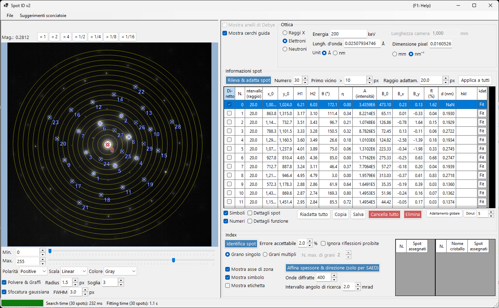
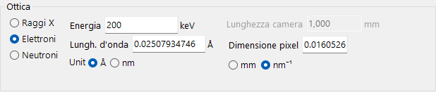
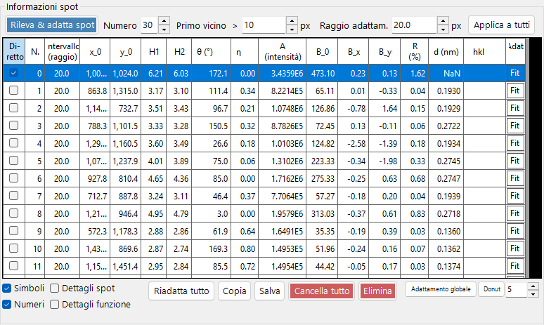
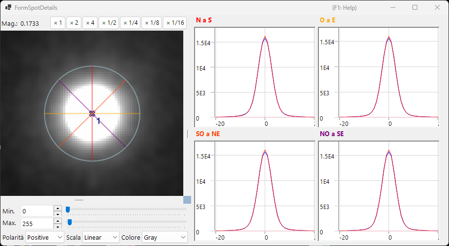
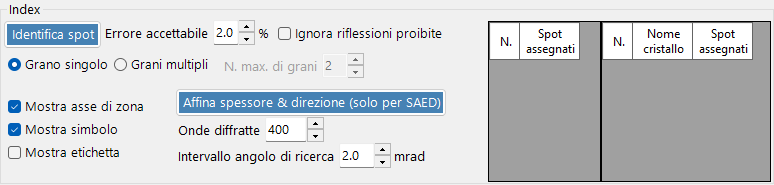

# Spot ID v2

**Spot ID v2** rileva, esegue il fitting e indicizza gli spot di diffrazione su un'immagine di diffrazione sperimentale. [Spot ID v1](10-spot-id.md) (il precedente TEM ID) acquisisce invece la geometria degli spot come input numerico.

---

## Scorciatoie da tastiera e mouse

L'elenco degli spot si costruisce direttamente sull'immagine caricata. Il riquadro dell'immagine usa la [navigazione standard della vista immagine](21-shortcuts.md) di ReciPro per spostare/zoomare; per la modifica degli spot si aggiungono le combinazioni seguenti.

| Scorciatoia | Azione |
|----------|--------|
| <kbd>F1</kbd> | Apre questa pagina del manuale online |
| Doppio clic sinistro sull'immagine | Aggiunge uno spot in quel punto (con fitting del picco) |
| <kbd>CTRL</kbd> + doppio clic sinistro | Aggiunge uno spot e lo contrassegna come fascio diretto (000) |
| Clic sinistro su uno spot | Seleziona lo spot più vicino |
| <kbd>CTRL</kbd> + clic destro su uno spot | Elimina lo spot più vicino |
| <kbd>CTRL</kbd> + tasti freccia | Sposta lo spot selezionato di un pixel |
| Trascinamento sinistro / centrale (area vuota) | Sposta l'immagine |
| Rotellina del mouse | Zoom avanti / indietro alla posizione del cursore |
| Trascinamento destro di un riquadro | Zoom avanti sulla regione selezionata |
| Doppio clic destro | Zoom indietro |
| Doppio clic sull'intestazione di riga di uno spot (tabella) | Zoom su quello spot (×2) |

→ Vedi **[21. Scorciatoie da tastiera e mouse](21-shortcuts.md)** per una panoramica di ogni finestra.

---

## Menu File

Apre un'immagine di diffrazione; **Salva** / **Copia** scrivono l'immagine visualizzata come metafile (EMF) o come immagine (PNG). Le immagini si possono caricare anche tramite trascinamento (drag and drop). Per un file Gatan DM3/DM4 calibrato in nm⁻¹, la radiazione viene impostata su elettroni e la tensione di accelerazione e la dimensione del pixel (nm⁻¹) vengono lette dal file (in tal caso la lunghezza di camera non è necessaria).

**Salva ▸ Candidate list (CSV)...** esporta i candidati di orientazione trovati dall'indicizzazione e **Copia ▸ Candidate list (TSV)** copia la stessa tabella negli appunti: una riga per candidato × grano, con il rango, l'indice del grano, il nome del cristallo, gli angoli di Eulero ZXZ (°), i nove elementi della matrice di rotazione, il residuo quadratico medio (nm⁻²), il numero di spot assegnati e le assegnazioni spot → (hkl). Il CSV usa sempre il punto come separatore decimale; il TSV si incolla direttamente in un foglio di calcolo.

---

## Ottica

### Sorgente incidente

Selezionare il tipo di radiazione (raggi X / elettroni / neutroni) e impostare l'energia o la lunghezza d'onda.

### Lunghezza camera / Dimensione pixel

La lunghezza di camera (mm) e la dimensione del pixel del rivelatore (mm o nm⁻¹). Quando viene caricato un file Gatan DM calibrato in nm⁻¹, la dimensione del pixel (nm⁻¹) viene letta dall'intestazione del file e la lunghezza di camera non viene usata (la casella della lunghezza di camera è disabilitata finché l'unità è nm⁻¹). Cambiando la lunghezza d'onda, la lunghezza di camera o l'unità della dimensione del pixel, le posizioni degli spot (pixel) restano invariate e le loro distanze *d* vengono ricalcolate con la nuova calibrazione.

La posizione della finestra e la calibrazione (sorgente, energia, lunghezza di camera, unità e valore della dimensione del pixel) vengono mantenute al prossimo avvio; l'apertura di un file immagine che contiene una calibrazione le sovrascrive. <!-- 261105Cl 監査: NumericBoxPixelSize_ValueChanged (8860d40)、FormMain.cs の保存・復元 (dc42de3) -->

**Mostra anelli di Debye** (disattivato per impostazione predefinita) disegna gli anelli di Debye di tutti i cristalli selezionati nella finestra principale — ciascun cristallo con il proprio colore quando ne sono selezionati più d'uno — centrati sullo spot diretto e con la calibrazione corrente (lunghezza d'onda, lunghezza di camera, dimensione del pixel); gli anelli delle riflessioni proibite dalle regole di estinzione non vengono disegnati. **Mostra cerchi guida** (attivato per impostazione predefinita) disegna dei cerchi guida sul pattern. <!-- 261106Cl 作者の決定 I10 -->

---

## Informazioni sullo spot

- **Rileva & adatta spot**: Rilevamento automatico degli spot mediante massimi locali e sottrazione del fondo.
- **Numero**: Il numero massimo di spot da rilevare.
- **Primo vicino**: La separazione minima (px) consentita tra gli spot rilevati. I picchi più vicini di questo valore vengono uniti, impedendo la doppia rilevazione dello stesso spot.
- **Raggio adattam.**: Il raggio (px) della regione circolare usata per fittare il picco di ogni spot. I pixel all'interno di questo cerchio vengono fittati con una funzione pseudo-Voigt.
- **Applica a tutti**: Imposta il raggio di fitting di ogni spot al valore corrente di **Raggio adattam.**.
- **Elimina / Cancella tutto**: Rimuove lo spot selezionato oppure tutti gli spot rilevati.
- **Salva** / **Copia**: Salva la tabella degli spot in un file CSV oppure la copia negli appunti come testo separato da tabulazioni. Entrambi funzionano anche con un solo spot. Il CSV usa sempre il punto come separatore decimale e può essere riletto con **File ▸ Carica** (prima deve essere caricata un'immagine; gli spot vengono aggiunti a quelli già elencati). <!-- 261105Cl 監査: GetSpotListText / readCSV (7f65908) -->
- **Riadatta tutto**: Esegue di nuovo il fitting delle posizioni e delle intensità di tutti gli spot rilevati.
- **Simboli** / **Numeri**: Mostra simboli di marcatura / numeri sugli spot osservati (entrambi attivi per impostazione predefinita).
- **Adattamento globale**: Esegue un fit globale di tutte le posizioni degli spot contemporaneamente (sperimentale).
- **Donut**: Applica una sottrazione del fondo a forma di ciambella (sperimentale); la casella adiacente imposta la larghezza (px) dell'anello attorno a ciascuno spot la cui media viene sottratta come fondo locale.
- **Dettagli spot**: Se selezionato, apre una finestra che mostra informazioni dettagliate sullo spot attualmente selezionato.
- **Dettagli funzione** (disattivato all'apertura della finestra): Mostra una figura della funzione pseudo-Voigt bidimensionale e dei suoi parametri (x_0, y_0, H1, H2, θ, η, A, B_0, B_x, B_y) usati nella tabella degli spot.

---

## Index

- **Identifica spot**: Esegue l'algoritmo di indicizzazione per trovare il cristallo e l'asse di zona che meglio corrispondono. Durante l'esecuzione al suo posto compare un pulsante **Arresta** che interrompe la ricerca. Richiede un'immagine caricata, almeno due spot e almeno un cristallo selezionato nell'elenco dei cristalli della finestra principale; altrimenti un messaggio indica cosa manca. Mentre Spot ID v2 è aperto, l'elenco dei cristalli della finestra principale consente la selezione multipla. <!-- 261105Cl 監査: buttonIdentifySpots_Click (494ef52)、FormMain.cs の複数選択 (4020433) -->
- **Errore accettabile**: Tolleranza relativa sulla distanza interplanare in % (0,1–10, predefinito 2). La tolleranza sull'angolo tra gli spot ne viene derivata come asin(tolleranza)/2.
- **Ignora riflessioni proibite** (disattivato per impostazione predefinita; solo diffrazione elettronica): Se selezionato, tutte le riflessioni sistematicamente estinte, comprese quelle proibite da assi elicoidali e piani di scorrimento, vengono escluse dalle riflessioni candidate. Se non selezionato, vengono escluse solo le estinzioni dovute alla centratura del reticolo (I, F, A, B, C, R), per cui le riflessioni proibite da assi elicoidali o piani di scorrimento, che possono comparire per diffrazione multipla, restano candidate. Per i raggi X e i neutroni tutte le riflessioni estinte vengono sempre escluse (trattazione cinematica); la casella appare allora spuntata e disattivata, e torna allo stato precedente quando la sorgente viene reimpostata su elettroni. <!-- 261106Cl 作者の決定 I4 -->
- **Grano singolo / Grani multipli**: Cerca un singolo orientamento (monocristallo) oppure più orientamenti (una regione policristallina / multigrano). Per più grani, **N. max. di grani** imposta il limite superiore al numero di grani da cercare.
- **Mostra asse di zona** / **Mostra simbolo** / **Mostra etichetta**: Sovrappone l'asse di zona e i simboli / le etichette degli indici degli spot calcolati.
- **Affina spessore & direzione (solo per SAED)**: Funziona solo con **Elettroni** come sorgente (altrimenti la barra di stato lo segnala e non viene calcolato nulla). <!-- 261105Cl 監査: ButtonRefineThicknessAndDirection_Click / Bethe_CbedCompleted (ed018ca) --> Affina lo spessore del campione (nm) e la direzione del fascio del grano selezionato confrontando le intensità osservate degli spot con calcoli dinamici (onde di Bloch). **Onde diffratte** (1–2048, predefinito 400) è il numero di fasci, e **Intervallo angolo di ricerca** (mrad, 1–10, predefinito 2) è il semi-intervallo angolare delle direzioni incidenti esplorate. L'affinamento non può essere interrotto (il pulsante **Arresta** appartiene solo a **Identifica spot**); la finestra resta disabilitata finché non termina. Vengono provati spessori di 50–549 nm (passo 1 nm) e direzioni incidenti su una griglia quadrata attorno all'orientazione corrente del grano (passo = 1/15 dell'intervallo di ricerca), e si sceglie la coppia che minimizza Σ (Iobs − a·Icalc)² sugli spot indicizzati (a: fattore di scala ottimale). Lo spessore migliore viene passato al Simulatore di diffrazione, e l'orientazione del grano (applicata anche alla finestra principale, a meno che lì il cristallo non sia stato cambiato durante il calcolo) viene inclinata in modo che la direzione migliore diventi la direzione del fascio; la rotazione nel piano viene mantenuta. Il risultato (spessore, inclinazione in mrad, asse di zona, residuo) è mostrato nella barra di stato. Se la direzione migliore cade al bordo dell'intervallo di ricerca, la barra di stato lo segnala, perché l'ottimo potrebbe trovarsi al di fuori: premi di nuovo il pulsante (la ricerca viene allora centrata sull'orientazione affinata) oppure allarga l'intervallo. <!-- 261105Cl 方位の精密化の実装に合わせて追記 (根拠: FormSpotIDV2.cs: ButtonRefineThicknessAndDirection_Click / Bethe_CbedCompleted) -->
- **Results**: Le migliori corrispondenze vengono visualizzate con il nome del cristallo, l'asse di zona [uvw] e gli indici dei singoli spot (hkl). Selezionando una sola riga di grano si seleziona anche il suo cristallo nella finestra principale e si imposta quell'orientazione. <!-- 261105Cl 監査: bindingSourceGrains_CurrentChanged (I11) -->

---

## Vedi anche

- [Spot ID v1](10-spot-id.md)
- [Simulatore di diffrazione](7-diffraction-simulator/index.md)
- [Finestra principale](0-main-window.md)
- [Scorciatoie da tastiera e mouse](21-shortcuts.md)
