# Simulazione EBSD

Il **Simulatore EBSD** simula i pattern di diffrazione da retrodiffusione elettronica (EBSD) — pattern di Kikuchi — ottenuti in un microscopio elettronico a scansione (SEM), mediante calcoli di teoria dinamica. Calcola la distribuzione angolare/energetica/in profondità degli elettroni retrodiffusi (BSE) tramite una simulazione Monte-Carlo, costruisce un **master pattern** dinamico (a onde di Bloch) del cristallo e lo proietta sul rivelatore per l'orientazione corrente del cristallo. È anche possibile caricare un'immagine EBSD sperimentale e **indicizzarla**: l'orientazione che la spiega meglio viene cercata automaticamente ([Immagine sperimentale](#immagine-sperimentale)).

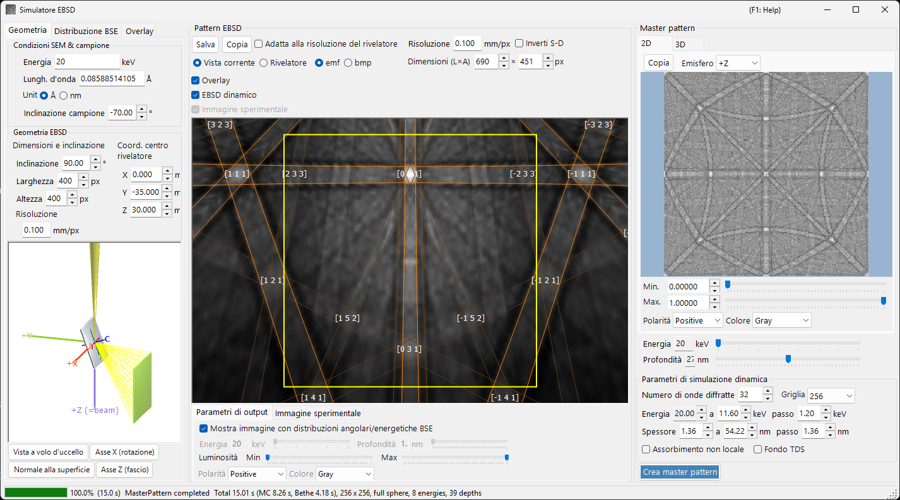

La finestra è composta da tre colonne.

- **Sinistra** : condizioni di simulazione. Le schede selezionano **Geometria** (geometria campione/rivelatore e una vista 3D), **Distribuzione BSE** (distribuzioni degli elettroni retrodiffusi) e **Overlay** (linee di Kikuchi e altre annotazioni).
- **Centro** : il pattern EBSD (di Kikuchi) per l'orientazione corrente del cristallo. Sotto di esso, le schede selezionano **Immagine simulata** e **Immagine sperimentale**.
- **Destra** : il master pattern indipendente dall'orientazione, nelle schede **2D** e **3D**.

La barra di stato in basso mostra l'avanzamento del calcolo in corso e un riepilogo del risultato. Se la finestra è stretta, un messaggio lungo viene troncato sul bordo destro; passandoci sopra il mouse si vede il messaggio completo.

---

## Scorciatoie da tastiera e mouse

La vista centrale del pattern EBSD (di Kikuchi) e le viste del master pattern sulla destra rispondono ad azioni del mouse differenti.

| Scorciatoia | Azione |
|----------|--------|
| <kbd>F1</kbd> | Apre questa pagina del manuale online |
| Trascinare con il tasto sinistro il pattern vicino al centro | Inclina il cristallo |
| Trascinare con il tasto sinistro l'area esterna del pattern | Ruota il cristallo |
| Doppio clic sul pattern | Seleziona la sotto-cella del rivelatore sotto il cursore e mostra le sue statistiche (quando la selezione **Zone axis** è attiva: aggiunge un asse di zona; vedi [Selezione degli assi di zona](#selezione-degli-assi-di-zona)) |
| Rilasciare un file immagine sulla finestra | Lo carica come immagine EBSD sperimentale |
| Trascinare con il tasto sinistro una vista 3D (geometria / sfera master) | Ruotala |
| Trascinare con il tasto destro, o rotellina del mouse, su una vista 3D | Zoom |
| <kbd>CTRL</kbd> + doppio clic destro su una vista 3D | Commuta tra ortografica / prospettica |
| Trascinare / rotellina sul master pattern 2D | Sposta / zooma l'immagine |

Le viste 3D utilizzano la [navigazione della vista](21-shortcuts.md) standard di ReciPro (spostamento disabilitato).

→ Vedi **[21. Scorciatoie da tastiera e mouse](21-shortcuts.md)** per una panoramica di tutte le finestre.

---

## Flusso di lavoro

La pressione di **Crea master pattern** esegue in ordine i passaggi seguenti.

1. **Simulazione Monte-Carlo dei BSE** : utilizzando la composizione del cristallo corrente, la densità, la tensione di accelerazione e l'inclinazione del campione, 10 milioni di elettroni incidenti vengono tracciati all'interno del campione (diffusione elastica: sezioni d'urto di Mott/NIST; diffusione anelastica: modello di risposta dielettrica). Ciò produce la distribuzione congiunta di *profondità di penetrazione × direzione di uscita × energia di uscita* degli elettroni retrodiffusi.
2. **Selezione automatica degli intervalli** : da tale distribuzione, l'intervallo di energia (dall'energia incidente fino a circa il 95° percentile della perdita di energia) e l'intervallo di profondità usati nel calcolo dinamico vengono impostati automaticamente. La profondità è qui lo spessore del master pattern, cioè la lunghezza del percorso misurata lungo la direzione di uscita (profondità della sorgente ÷ cos χ, dove χ è l'angolo tra la direzione di uscita e la normale alla superficie del campione). L'intervallo di profondità arriva fino al 99,9° percentile di tale lunghezza del percorso per gli elettroni che raggiungono il rivelatore (arrotondato per eccesso a due cifre significative) ed è diviso in 40 passi disuguali, più fitti vicino alla superficie.
3. **Costruzione del master pattern** : per ogni energia e profondità, il problema di diffrazione dinamica (a onde di Bloch) viene risolto e integrato sulla sfera delle direzioni, pesato con la distribuzione Monte-Carlo, per fornire l'intensità di diffrazione retrodiffusa in ogni direzione. Il risultato è memorizzato su una griglia equiareale (di Roşca–Lambert).
4. **Proiezione sul rivelatore, con pesatura** : per l'orientazione corrente del cristallo, l'intensità per la direzione sottesa da ciascun pixel del rivelatore viene cercata nel master pattern e disegnata come pattern di Kikuchi, opzionalmente pesata con la distribuzione angolare/energetica dei BSE.

Gli intervalli di energia e profondità vengono impostati automaticamente nei passaggi 1–2 finché **Intervalli di energia e profondità automatici (MC)** è selezionato (impostazione predefinita; le caselle degli intervalli sono allora di sola lettura). Deselezionalo per costruire con intervalli digitati a mano: il Monte Carlo non tocca più le caselle, e gli intervalli inseriti a mano vengono salvati e ripristinati al prossimo avvio. <!-- 261106Cl 作者の決定 C11 --> Gli intervalli non utilizzabili — un limite inferiore non minore del limite superiore, un'energia superiore alla tensione di accelerazione (controllata prima dell'avvio del Monte Carlo) o un intervallo interamente al di fuori della distribuzione Monte-Carlo — non vengono costruiti; un messaggio indica il motivo e i valori. <!-- 261106Cl 作者の決定 F5/F15 -->

---

## Geometria

### Condizioni SEM & campione

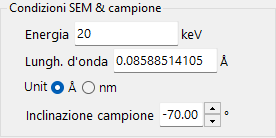

- **Energia** : tensione di accelerazione del fascio incidente (keV).
- **Lungh. d'onda** : lunghezza d'onda dell'elettrone, collegata a Energia. **Unit** seleziona Å o nm.
- **Inclinazione campione** : angolo di inclinazione del campione (tipicamente −70°). La forte inclinazione nell'EBSD aumenta la resa degli elettroni retrodiffusi. Modificarla scarta i risultati Monte-Carlo (le distribuzioni BSE e i relativi pesi; eseguire di nuovo **Simula**); il master pattern non dipende dall'inclinazione e viene mantenuto. <!-- 261106Cl 作者の決定 F17 -->

### Geometria EBSD

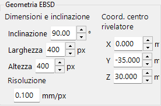

Il rivelatore (schermo a fosfori) è un rettangolo definito da un numero di pixel e da una dimensione di pixel.

- **Dimensioni e inclinazione** : **Inclinazione** è l'inclinazione dello schermo del rivelatore (°), misurata dal piano orizzontale (perpendicolare al fascio): 0° = schermo orizzontale, 90° = schermo verticale (impostazione predefinita). **Larghezza** e **Altezza** sono il numero di pixel del rivelatore. <!-- 261105Cl 監査: numericBoxDetTilt.ToolTip (EbsdDetectorGeometry の法線 (0, sin d, −cos d)) -->
- **Risoluzione** : la dimensione fisica di un pixel del rivelatore (mm/px). La dimensione fisica del rivelatore è quindi Larghezza × Risoluzione per Altezza × Risoluzione.
- **Coord. centro rivelatore** : posizione **X**, **Y**, **Z** del centro del rivelatore rispetto al punto di impatto del fascio (mm), nel sistema di riferimento del microscopio (di laboratorio). **Y** è lo scostamento orizzontale perpendicolare sia al fascio (Z) sia all'asse di inclinazione del campione (X), non una direzione sulla superficie inclinata del campione. <!-- 261105Cl 監査: numericBoxDetY.ToolTip --> Y e Z, insieme all'inclinazione, determinano la lunghezza di camera; X è lo scostamento sinistra-destra.

Caricando un'immagine sperimentale, **Larghezza** e **Altezza** vengono portati alle dimensioni dell'immagine, così che un pixel del rivelatore corrisponda a un pixel dell'immagine (la **Risoluzione** resta invariata).

La geometria può essere esaminata nella vista 3D della scheda **Geometria**.

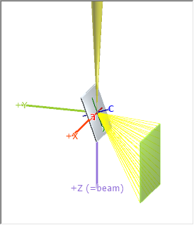

La piastra grigia è il campione, la lastra rettangolare verde è il rivelatore e il **+Z (=beam)** viola è il fascio incidente. Sono mostrati anche gli assi cristallini **a / b / c** (fissi al campione). I pulsanti **Vista a volo d'uccello**, **Normale alla superficie**, **Asse X (rotazione)** e **Asse Z (fascio)** allineano la vista alle direzioni standard. Vedi [Appendice A1. Sistemi di coordinate](appendix/a1-coordinate-system/2-diffraction.md) per le definizioni dei sistemi di coordinate.

---

## Distribuzione dei BSE

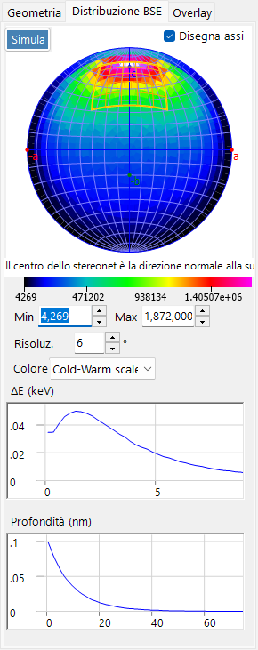

La scheda **Distribuzione BSE** mostra le distribuzioni Monte-Carlo degli elettroni retrodiffusi. Usa **Simula** per ricalcolarle. Si esegue un solo Monte Carlo alla volta: mentre uno è in corso (avviato da **Simula** o dal primo passaggio di **Crea master pattern**), **Simula** non ne avvia un altro e la barra di stato chiede di attendere o di premere **Arresta**. <!-- 261105Cl 監査: FormEBSD.cs buttonBSE_Click (monteCarloCts) -->

- **Stereonet** : distribuzione angolare (istogramma delle direzioni di uscita) degli elettroni retrodiffusi. Il centro è la direzione della normale alla superficie e il contorno giallo segna la regione rettangolare sottesa dal rivelatore. **Disegna assi** sovrappone gli assi cristallini e la scala dei colori (**Min** / **Max**, **Resolution**, **Color**) è regolabile.
- **ΔE (keV)** : distribuzione della perdita di energia degli elettroni retrodiffusi.
- **Profondità (nm)** : distribuzione della profondità della sorgente degli elettroni retrodiffusi rivelati, secondo la definizione di **Profondità della sorgente (MC)** (predefinita: l'ultimo evento di diffusione anelastica) — la stessa definizione di profondità che pesa il master pattern.

Queste distribuzioni sono calcolate dallo stesso motore Monte-Carlo di [Traiettorie elettroniche](8-electron-trajectory.md) e sono utilizzate per pesare il master pattern. Cambiando il cristallo o la tensione di accelerazione questi risultati vengono scartati insieme al master pattern (una modifica fatta a finestra chiusa ha effetto alla riapertura); la barra di stato indica che cosa è stato scartato. Un doppio clic sul grafico **ΔE** o **Profondità** ne copia i valori negli appunti come testo (x e y, separati da tabulazione). <!-- 261106Cl 作者の決定 F23 --> <!-- 261105Cl 監査: FormEBSD.cs SetCrystal / 電圧の変更 / 開き直し (4bc81f06) -->

---

## Overlay

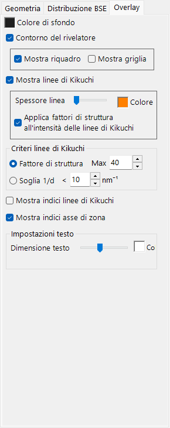

La scheda **Overlay** configura le annotazioni disegnate sul pattern EBSD.

- **Colore di sfondo** : colore di sfondo.
- **Contorno del rivelatore** : il contorno del rivelatore. **Mostra riquadro** (il rettangolo giallo al bordo del rivelatore) / **Mostra griglia** (griglia di suddivisione).
- **Mostra linee di Kikuchi** : disegna le linee di Kikuchi. **Spessore linea** / **Colore** e **Applica fattori di struttura all'intensità delle linee di Kikuchi** (ogni linea sfuma verso lo sfondo in proporzione al proprio fattore di struttura).
- **Criteri linee di Kikuchi** : quali linee di Kikuchi disegnare: **Fattore di struttura** (le prime *N* per fattore di struttura, con *N* impostato in **Max**) oppure **Soglia 1/d** (quelle con 1/d al di sotto di una soglia, nm⁻¹). Passando dall'uno all'altro le linee vengono ridisegnate subito. <!-- 261105Cl 監査: 1/d Cutoff 側にもハンドラを配線 (d88da429) -->
- **Mostra indici linee di Kikuchi** : mostra gli indici delle linee di Kikuchi (bande).
- **Mostra indici asse di zona** : mostra gli indici degli assi di zona.
- **Impostazioni testo** : **Dimensione testo** / **Colore** delle etichette degli indici.

---

## Master pattern

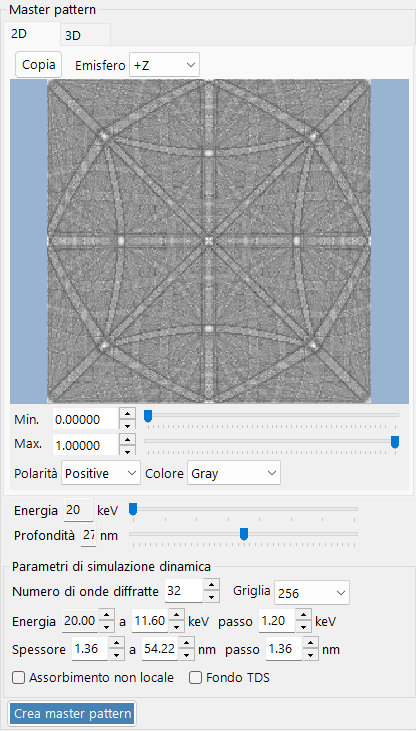

Il master pattern è l'intensità di diffrazione retrodiffusa su tutte le direzioni, calcolata in anticipo con la teoria dinamica tramite **Crea master pattern** (**Arresta** interrompe il calcolo in corso).

Se un sito atomico non ha il parametro di spostamento atomico (B = 0), premendo **Crea master pattern** compare una finestra di dialogo. I siti con B = 0 non producono assorbimento e, se tutti i siti hanno B = 0, il master pattern con **Sorgente non locale** è vuoto. **OK** assegna a quei siti un B isotropo di 0,5 Ų e avvia il calcolo (il valore si può cambiare in seguito nella finestra principale); **Annulla** si ferma senza calcolare. I siti con parametri anisotropi (Bij) restano invariati.

- Scheda **2D** : proiezione equiareale (di Lambert) di un emisfero. **Emisfero** seleziona l'emisfero proiettato (+Z / −Z).
- Scheda **3D** : una sfera con l'intensità mappata su di essa. Può essere ruotata con il mouse e un riquadro in alto a sinistra mostra gli assi cristallini sincronizzati (a/b/c). **Etichette assi** / **Frecce assi** commutano le etichette/frecce e **Vista lungo** guarda lungo l'asse di zona [u v w] inserito accanto.
- Cursori **Energia / Profondità** : selezionano la sezione di energia/profondità da visualizzare in anteprima.
- Ciascuna vista può essere inviata negli appunti con **Copia**.
- **Salva video** (scheda **3D**) : salva un video (MP4) del master pattern sferico in rotazione. Direzione di rotazione, velocità, durata, fps e qualità si impostano nella stessa finestra di dialogo «Movie setting» del [Visualizzatore struttura](5-structure-viewer.md). Ruota solo questa vista 3D; l'orientazione del cristallo (gli angoli di Eulero della finestra principale) non cambia.

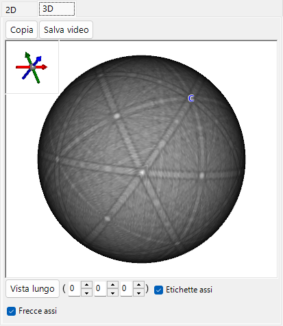

### Parametri di simulazione dinamica

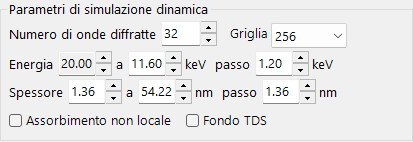

- **Numero di onde diffratte** : numero di fasci diffratti (onde) inclusi nel calcolo a onde di Bloch. Più onde sono più accurate ma più lente.
- **Griglia** : risoluzione della griglia del master pattern (pixel per lato, 64–8192; predefinito 256). 4096 e 8192 richiedono un'enorme quantità di memoria per i dati intermedi (con le 16 energie × 40 profondità predefinite, circa 344 GB a 4096 e 1374 GB a 8192; già circa 86 GB a 2048), quindi il numero di passi in energia e profondità va ridotto drasticamente perché diventino utilizzabili. Se la memoria non basta, il calcolo termina con «MasterPattern failed» (ReciPro continua a funzionare).
- **Intervalli di energia e profondità automatici (MC)** (attivo per impostazione predefinita) : se selezionato, il Monte Carlo imposta i due intervalli sottostanti e le loro caselle sono di sola lettura; se deselezionato, il master pattern viene costruito con gli intervalli digitati nelle caselle (vedi [Flusso di lavoro](#flusso-di-lavoro)), e tali intervalli vengono mantenuti al prossimo avvio. L'impostazione viene mantenuta al prossimo avvio. <!-- 261106Cl 作者の決定 F5/F15 -->
- **Energia … a … passo …** : intervallo di energia e passo su cui si integra (keV); impostato automaticamente dal risultato Monte-Carlo finché la casella precedente è selezionata.
- **Profondità … a … passo …** : intervallo di profondità e passo su cui si integra (nm), misurato come lunghezza del percorso lungo la direzione di uscita; impostato anch'esso automaticamente. Le profondità automatiche non sono equispaziate, quindi le caselle mostrano come riferimento il punto meno profondo, l'estremo superiore e il primo intervallo; modificare a mano una casella passa a profondità equispaziate con quei valori.
- **Assorbimento non locale** : usa la forma di assorbimento non locale.
- **Sorgente non locale** (attivo per impostazione predefinita) : sostituisce la sorgente di retrodiffusione localizzata sui siti atomici con la forma non locale del potenziale assorbente (U'_back integrato sull'emisfero posteriore). Entrambe usano la stessa sezione d'urto fisica: è un cambio di modello, non un fondo additivo.
- **Profondità della sorgente (MC)** : quale evento Monte Carlo definisce la profondità della sorgente coerente di retrodiffusione usata nella pesatura (energia × profondità): l'ultimo evento anelastico (predefinito), l'ultimo evento di trasporto di qualsiasi tipo, o l'ultima decoerenza. In quest'ultimo caso un evento azzera la sorgente solo se è abbastanza localizzato da lasciare nel campione l'informazione su quale atomo ha diffuso: gli elastici con la probabilità termico-diffusa 1 − exp(−2B s²) del fattore di Debye–Waller (la diffusione di Bragg coerente no), gli anelastici sempre per eccitazioni di core o ad alta perdita e, per eccitazioni di valenza, solo con la frazione il cui trasferimento di impulso supera il taglio plasmonico q_c = ω_p/v_F (plasmoni e coppie elettrone–lacuna delocalizzate conservano lo stato di Bloch). Sorgenti più superficiali portano una modulazione di Kikuchi più debole: l'ultima opzione fissa il fondo diffuso con il solo trasporto, senza parametri liberi. Il cambio ricampiona solo gli elettroni salvati, senza ripetere il Monte Carlo.
- **Il contrasto cala con la perdita di energia** (attivo per impostazione predefinita; mantenuto al prossimo avvio, E_c no; E_c = 0,8 keV con gaussiana asimmetrica e 0,9 keV con istogramma + A per elettrone) : moltiplica il contrasto di Kikuchi di ogni fetta di energia per A(E) = exp(−(E0 − E)/E_c), dove E0 è l'energia del fascio ed E l'energia di uscita, e sposta la parte persa in un piedistallo piatto mediato sulle direzioni, così che la luminosità senza contrasto di banda resti invariata. I pesi Monte Carlo contano ogni elettrone retrodiffuso, ma gli elettroni che hanno perso molta energia portano poco contrasto di Kikuchi netto; senza questa correzione ogni fetta porta il contrasto pieno e le bande risultano circa il 12 % più larghe che per elettroni monocromatici a E0 (Si, 20 kV). E_c è un parametro efficace, non una costante del materiale; valori più piccoli danno un'attenuazione più forte. Il valore predefinito di 0,8 keV della gaussiana asimmetrica si basa su una calibrazione, con le condizioni di calcolo originali, sulle larghezze di banda di un pattern misurato di Si a 20 kV (insieme di dati Si004; rapporto di lunghezza d'onda efficace α ≈ 1.017). I valori calibrati dipendono dal materiale e dalle riflessioni usate; per la botallackite si sono ottenuti circa 0.43–0.71 keV a seconda della scelta delle riflessioni. Per confronti quantitativi delle larghezze di banda, ricalibrare E_c quando cambiano la griglia energia/profondità, il metodo di sintesi o la misura di valutazione. Modificarlo ripesa soltanto le fette esistenti, senza ricalcolare il master pattern né il Monte Carlo.
- **Strato amorfo superficiale** : spessore (nm) di uno strato superficiale non cristallino (ossido nativo, contaminazione, danno da lucidatura o da assottigliamento ionico). Gli elettroni la cui sorgente coerente di retrodiffusione si trova nello strato non portano modulazione di Kikuchi e sono aggiunti come contributo uniforme mediato in direzione, con la stessa intensità per elettrone; le sorgenti sotto lo strato si misurano dalla superficie del cristallo. Il trasporto è calcolato con composizione e densità del cristallo, adeguato per pochi nm. 0 disattiva; il cambio ricampiona solo gli elettroni salvati, senza ripetere il Monte Carlo.
- **Pesare con la risposta del fosforo** (attivo per default, E_dead = 2 keV) : pesa ogni elettrone Monte Carlo con la resa luminosa di uno schermo al fosforo, φ(E) = max(0, E − E_dead), invece di contare ogni elettrone una volta. Gli elettroni di energia più alta lasciano il campione inclinato più in avanti, quindi la pesatura riduce il gradiente di intensità dall'alto in basso del pattern (per Si a 20 kV da circa 2,5 a 1,7 sul rivelatore) e attenua leggermente gli assi di zona. Si applica al binning sul piano del rivelatore e alla distribuzione di energia per bin; la modifica ri-raggruppa gli elettroni salvati senza rieseguire il Monte Carlo. Disattivare per un rivelatore diretto che conta gli elettroni. E_dead è l'energia dello strato morto (soglia) del fosforo; valori tipici 0–3 keV per uno schermo P43 con rivestimento di alluminio.
- **Energy filter E >** (keV; predefinito 0 = disattivato) : un filtro di energia passa-alto ideale davanti al rivelatore. Gli elettroni la cui energia di uscita è pari o inferiore a questo valore non contribuiscono al pattern. La modifica ri-raggruppa gli elettroni salvati senza rieseguire il Monte Carlo né ricostruire il master pattern.
- **Distribuzione di energia da istogramma MC** (disattivato per impostazione predefinita) : costruisce la distribuzione dell'energia di uscita di ogni bin di direzione dall'istogramma Monte Carlo grezzo (pesato con φ, ripartito linearmente tra le due fette di energia vicine del master pattern) invece che da una gaussiana asimmetrica adattata alla media e alle dispersioni dei due lati. La gaussiana sottostima il picco vicino all'energia del fascio di un fattore 2–3, facendo apparire le bande più larghe. Attivandolo, anche l'A(E) di **Il contrasto cala con la perdita di energia** viene applicato a ogni elettrone alla sua energia di uscita prima di ripartirlo tra le fette di energia, invece di essere valutato alle energie delle fette. In modalità istogramma + A per elettrone, finché E_c non viene modificato passa al valore provvisorio di 0,9 keV ricavato dalla mediana delle larghezze di 18 bande fisse Si004 a 20 kV; altre misure (ad esempio la correlazione dell’intera immagine) danno valori diversi. Dopo aver modificato E_c, il valore inserito viene mantenuto quando si cambia distribuzione. La modifica ri-raggruppa gli elettroni memorizzati senza ripetere il Monte Carlo.

---

## Pattern EBSD

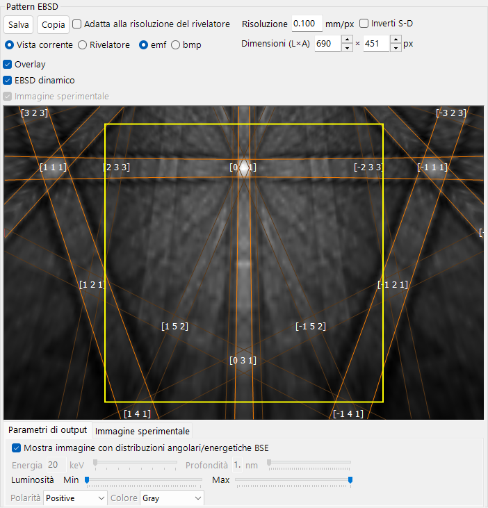

Il pannello centrale mostra il pattern EBSD (a bande di Kikuchi) per l'orientazione corrente del cristallo. La barra sopra il pattern controlla che cosa viene disegnato e come viene copiato.

- **EBSD dinamico** : proietta sul rivelatore il master pattern costruito; deselezionata resta solo lo sfondo.
- **Overlay** : disegna le linee di Kikuchi, gli indici e il contorno del rivelatore configurati nella scheda **Overlay**.
- **Immagine sperimentale** : sovrappone l'immagine sperimentale caricata (vedi sotto).
- **Inverti S-D** : specchia il pattern e tutti i suoi overlay da sinistra a destra. Deselezionata (impostazione predefinita) è la vista dal rivelatore verso il campione, cioè il pattern come lo registra una telecamera EBSD; selezionala solo se la tua immagine sperimentale ha la chiralità opposta.
- **Risoluzione** (mm/px) e **Dimensioni (L×A)** (px) : risoluzione e dimensioni della vista visualizzata.
- **Salva** : salva il pattern in un file, con l'intervallo e la risoluzione selezionati accanto. Il formato (PNG / TIFF / EMF) si sceglie nella finestra di salvataggio.
  - **Pattern values (\*.csv)** scrive, invece di un'immagine, le intensità grezze sulla griglia di pixel del rivelatore. Le sue righe di intestazione `#` registrano le condizioni (cristallo, griglia e dimensione dei pixel del rivelatore, tensione, inclinazioni del rivelatore e del campione in gradi, X/Y/Z del rivelatore, …) e il minimo e il massimo. <!-- 261105Cl 監査: 傾斜角は度で書く (FormEBSD.cs, 5f7484d1) -->
  - Un TIFF viene scritto in scala di grigi a 16 bit (non quantizzato a 256 livelli) quando l'intervallo è **Rivelatore**, **EBSD dinamico** è visualizzato e nessuna immagine sperimentale è sovrapposta (nessuna è caricata, oppure **Immagine sperimentale** è deselezionata). <!-- 261105Cl 監査: 16 bit の条件 (FormEBSD.cs, 5f7484d1) --> In tal caso gli **Overlay** vengono omessi qualunque sia la loro casella, e i valori dei pixel sono il pattern mappato linearmente dal proprio minimo–massimo su 0–65535 (il minimo e il massimo usati sono riportati nella barra di stato; usare l'esportazione csv se servono valori assoluti).
- **Copia** : copia il pattern negli appunti, con l'intervallo e il formato selezionati accanto.
  - **Vista corrente** copia l'area attualmente visualizzata (con spostamento e zoom correnti); **Rivelatore** copia solo l'area del rivelatore, nel qual caso il riquadro giallo viene omesso così che l'immagine termini esattamente al bordo del rivelatore.
  - **emf** copia un Enhanced Metafile mantenendo vettoriali le linee di Kikuchi e le etichette degli indici; **bmp** rasterizza tutto.
  - **Adatta alla risoluzione del rivelatore** copia con un pixel dell'immagine per pixel del rivelatore (il lato maggiore è limitato a 4096 px). Deselezionata, viene usata la risoluzione a schermo.

### Immagine simulata

Prima che venga costruito il primo master pattern, sono disattivate solo le righe di visualizzazione sottostanti (distribuzioni BSE e sezione, luminosità e contrasto, colore); le impostazioni del Monte Carlo (**Profondità della sorgente (MC)**, **Il contrasto cala con la perdita di energia**, **Strato amorfo superficiale**, **Pesare con la risposta del fosforo**, **Energy filter E >**, **Distribuzione di energia da istogramma MC**) si possono modificare fin dall'inizio. <!-- 261106Cl 作者の決定 F16 -->

- **Con distribuzioni angolari/energetiche BSE** (attivo per impostazione predefinita) : se selezionata, il pattern viene composto pesando con la distribuzione dei BSE (energia, profondità, direzione) anziché con una singola sezione.
- **Energia** / **Profondità** : quando l'opzione precedente è disattivata, seleziona la sezione di energia/profondità da visualizzare.
- **Luminosità** (**Min** / **Max**), **Contrasto**, **Polarità**, **Colore** : i punti di nero e di bianco del pattern simulato come percentuale dell'intervallo di visualizzazione (cursori lineari), l'ampiezza di tale intervallo, la sua polarità e la scala dei colori. Con Contrasto 0 l'intervallo di visualizzazione coincide con l'intervallo di intensità del pattern stesso; -1 lo allarga di dieci volte (contrasto dieci volte più debole) e +1 lo restringe a un decimo, mantenendo fisso il centro.
- **Appiattire il fondo** (**FWHM**, px; disattivo per default, 100 px) : sottrae al pattern simulato una copia sfocata con una gaussiana, rimuovendo la distribuzione di luminosità a variazione lenta così da confrontare bande e assi di zona con un pattern sperimentale corretto per il fondo. La larghezza a metà altezza è in pixel del rivelatore e non dipende dallo zoom. Agisce sull'immagine visualizzata e sull'export PNG/TIFF; l'export CSV mantiene i valori grezzi.

### Immagine sperimentale

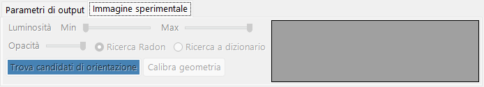

Rilascia un file immagine EBSD (TIFF, PNG, BMP o JPEG; i TIFF a 16 bit sono letti a piena profondità) in un punto qualsiasi della finestra per caricarlo come pattern sperimentale. Viene disegnato sull'area del rivelatore — sopra il pattern simulato e sotto gli overlay delle linee di Kikuchi — così da poter confrontare direttamente simulazione e misura. Il caricamento porta inoltre **Width** e **Height** del rivelatore alle dimensioni dell'immagine.

- **Luminosità** (**Min** / **Max**), **Contrasto** : i punti di nero e di bianco dell'immagine sovrapposta come percentuale del suo intervallo di visualizzazione, e l'ampiezza di tale intervallo (cursori lineari, stessa convenzione del pattern simulato). Agiscono solo sull'immagine sperimentale.
- **Appiattire il fondo** (**FWHM**, px; disattivo per default, 100 px) : sottrae all'immagine sperimentale una sua copia sfocata con una gaussiana, rimuovendone la distribuzione di luminosità a variazione lenta. I cursori di intensità agiscono quindi sui valori appiattiti.
- **Adatta all'immagine** : imposta **Min**, **Max** e **Contrasto** del pattern simulato in modo che i suoi livelli di intensità al 2 % e al 98 % siano mostrati con lo stesso grigio di quelli dell'immagine sperimentale. L'adattamento usa i percentili, quindi non dipende dalla soluzione di orientazione ed è insensibile a un piedistallo o a pochi pixel luminosi degli assi di zona. Polarità, Colore e le due impostazioni **Appiattire il fondo** non vengono modificati, quindi appiattire entrambi i lati o nessuno dei due prima di premerlo.
- **Opacità** : opacità dell'immagine sovrapposta, da 0 (invisibile) a 100 % (opaca). Riducila per vedere il pattern simulato sottostante.

L'orientazione che spiega l'immagine viene poi cercata con uno dei due motori.

- **Ricerca Radon** : confronta modelli cinematici di bande di Kikuchi con la mappa di Radon (rilevazione di rette) dell'immagine sperimentale. Funziona senza master pattern; se ne esiste uno, i candidati vengono riordinati con una ZNCC robusta (correlazione incrociata normalizzata a media nulla) rispetto al pattern simulato.
- **Ricerca a dizionario** : genera dal master pattern dinamico i pattern di dizionario per tutte le orientazioni e li confronta tutti con ZNCC robusta. Richiede il master pattern e impiega alcuni secondi, ma è più affidabile della ricerca Radon.

**Trova candidati di orientazione** esegue il motore selezionato ed elenca fino a 10 candidati, dal migliore in giù; se è disponibile un master pattern, il candidato migliore viene raffinato a ±0,25°. Le colonne sono:

| Colonna | Significato |
|---------|-------------|
| **#** | Posizione (0 = migliore) |
| **Score** | Valore *z* dell'evidenza di bande Radon |
| **Bands** | Bande accoppiate / bande previste nel campo visivo |
| **ZNCC** | Correlazione con il pattern simulato |
| **Strong bands (hkl)** | Indici delle bande accoppiate (solo ricerca Radon) |

**Facendo clic su una riga, quell'orientazione viene applicata all'intero programma**: il pattern simulato viene ridisegnato sopra quello sperimentale e l'orientazione del cristallo di tutte le altre finestre lo segue.

### Selezione degli assi di zona

Invece di confrontare l'intera immagine, l'orientazione si può trovare anche dalle intersezioni di bande (assi di zona) selezionate a mano sull'immagine sperimentale.

- **Zone axis** : attiva la selezione. Quando è attiva, un doppio clic sinistro sul pattern aggiunge un punto, <kbd>CTRL</kbd> + doppio clic sinistro rimuove il punto entro 5 pixel dello schermo e <kbd>SHIFT</kbd> + doppio clic sinistro seleziona un punto (disegnato in giallo; gli altri sono in ciano, numerati). Quando è disattivata, il doppio clic seleziona come di consueto una cella del rivelatore.
- **[u v w]** : l'indice dell'asse di zona del punto selezionato. Lasciare 0 0 0 perché sia la ricerca ad assegnarlo; digitare un indice vincola la ricerca (utile per cristalli a bassa simmetria e assi ad alti indici).
- **+ geometry** : ottimizza anche il centro del rivelatore (X, Y, Z, mm) insieme all'orientazione, minimizzando il residuo in pixel tra le posizioni previste e quelle selezionate degli assi di zona. Richiede almeno 4 punti assegnati; selezionando poi un candidato viene applicata anche la geometria raffinata.
- **Find** : cerca le orientazioni che spiegano gli assi di zona selezionati (almeno 2 punti; tre di solito bastano, due sono ambigui). La tolleranza angolare è di 2°, riprovata a 5° se non si trova nulla. Fino a 10 candidati vengono scritti nella stessa tabella dei candidati e, facendo clic su una riga, vengono applicati come sopra.
- **Clear** : rimuove tutti i punti selezionati, gli indici digitati e i candidati dell'ultima ricerca per assi di zona (senza annullamento). Caricare una nuova immagine sperimentale ha lo stesso effetto.

**Calibra geometria** raffina la geometria del rivelatore — centro del pattern (PC) e distanza del rivelatore (DD) — alternandola con l'orientazione, massimizzando la ZNCC tra pattern simulato e sperimentale. Richiede il master pattern, mantiene fissa l'inclinazione del rivelatore e riscrive il risultato nei campi **Coord. centro rivelatore** X/Y/Z, mantenendo il rivelatore sul lato (+Y o −Y) in cui era stato posto. <!-- 261105Cl 監査: +Y 側の検出器も側を保つ (e1d645d5) --> Poiché la scansione del fascio di un SEM sposta il centro del pattern solo di una frazione di millimetro, di norma una sola calibrazione all'inizio dell'esperimento basta per un'intera serie di immagini.

---

## Vedi anche

- [Traiettorie elettroniche](8-electron-trajectory.md) — Simulazione Monte-Carlo delle traiettorie elettroniche / dei BSE usata per la pesatura angolare/energetica/in profondità.
- [Simulatore di diffrazione](7-diffraction-simulator/index.md) — diffrazione elettronica dinamica (a onde di Bloch).
- [Appendice A1. Sistemi di coordinate](appendix/a1-coordinate-system/2-diffraction.md) — definizioni dei sistemi di coordinate del campione/rivelatore.
