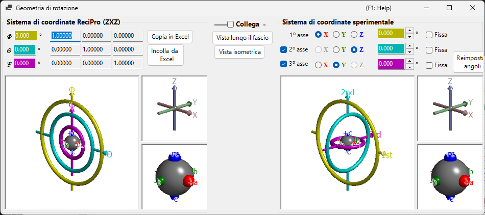

# Geometria di rotazione

Questa finestra rappresenta lo stato di rotazione di un cristallo come matrice 3×3 e converte tra diversi sistemi di coordinate euleriani.

ReciPro utilizza tre angoli di Eulero — **Ψ**, **Θ** e **Φ** — applicati nell'ordine **Z–X–Z**. Tuttavia, questa convenzione non corrisponde necessariamente agli assi del goniometro del vostro strumento reale. La finestra **Geometria di rotazione** consente di convertire gli angoli di Eulero di ReciPro in un sistema di coordinate definito arbitrariamente, supportando la regolazione del goniometro in laboratorio. <!-- 261105Cl 監査: 画面の欄の見出し・ツールチップ (Φ, Θ, Ψ) に合わせ θ → Θ に統一 -->

---

## Scorciatoie da tastiera e mouse

Tutte e sei le viste 3D (i pannelli di ReciPro e del goniometro sperimentale / degli assi / degli oggetti) sono **collegate** — ruotandone una qualsiasi, ruotano tutte e sei insieme. Condividono la [navigazione standard della vista OpenGL](21-shortcuts.md) di ReciPro.

| Scorciatoia | Azione |
|----------|--------|
| <kbd>F1</kbd> | Apre questa pagina del manuale online |
| Trascinamento sinistro in una vista | Ruota il modello (tutte e sei le viste ruotano insieme) |
| Rotellina del mouse, o trascinamento destro su/giù | Zoom (le viste grandi del goniometro) |
| <kbd>CTRL</kbd> + trascinamento destro su/giù | Modifica la distanza della telecamera (solo in modalità prospettica) |
| <kbd>CTRL</kbd> + doppio clic destro | Alterna tra proiezione ortografica e prospettica |

Nelle piccole viste *Axes* e *Objects* lo zoom e lo spostamento sono disabilitati. Non ci sono scorciatoie da tastiera oltre a <kbd>F1</kbd>.

---

## Sistema di coordinate ReciPro (ZXZ)

La metà superiore della finestra mostra lo stato di rotazione nel "sistema di coordinate ReciPro".

- **Φ, Θ, Ψ** sono caselle di sola lettura che mostrano l'orientazione corrente (gli angoli di Eulero della Finestra principale). Le rotazioni effettuate mentre questa finestra è chiusa vengono mostrate quando la si riapre. <!-- 261105Cl 監査: 読み取り専用の表示・開き直したときの反映 (FormRotation.cs) -->
- **Rotation matrix** mostra la matrice 3×3 corrispondente allo stato di rotazione corrente.

### Φ, Θ, Ψ (angoli di Eulero Z–X–Z)

L'orientazione del cristallo è parametrizzata da tre rotazioni. Descritte nel sistema di riferimento **solidale al corpo (intrinseco)**, sono applicate in questo ordine:

1. **Φ** — prima rotazione attorno all'asse **Z**.
2. **Θ** — rotazione attorno all'asse **X** del sistema di riferimento ruotato una volta.
3. **Ψ** — seconda rotazione attorno all'asse **Z** del sistema di riferimento ruotato due volte.

La stessa rotazione vista nel sistema di riferimento **fisso di laboratorio** corrisponde alla sequenza inversa — Ψ attorno a $Z$, poi Θ attorno a $X$, poi Φ attorno a $Z$ — ed è la descrizione adottata nell'[Appendice A1.1](appendix/a1-coordinate-system/1-orientation.md). Entrambe danno la stessa identica matrice $R$ riportata sotto; Φ è semplicemente l'asse più esterno (come in un goniometro) e Ψ quello più interno.

Le caselle Φ, Θ, Ψ e le nove caselle della matrice sono visualizzazioni **di sola lettura**. Per modificare l'orientazione, ruotate il cristallo nella Finestra principale, usate **Incolla da Excel** oppure (con **Collega** attivo) modificate più sotto gli angoli degli assi sperimentali; ogni modifica viene propagata alla Finestra principale e a tutti i simulatori collegati.

### Rotation matrix

La matrice 3 × 3 generata a partire dagli attuali (Φ, Θ, Ψ). Utilizzate **Copia in Excel** / **Incolla da Excel** per trasferire la matrice avanti e indietro attraverso un foglio di calcolo.

La matrice segue un'unica convenzione ovunque compaia in ReciPro:

$$
\mathbf{v}_{\mathrm{rot}} = R\,\mathbf{v}_{0}
$$

- \(R\) è la rotazione **attiva** del cristallo, espressa nel sistema di laboratorio fisso al monitor (\(X\) a destra, \(Y\) in alto, \(Z\) verso l'osservatore — si veda l'[Appendice A1.1](appendix/a1-coordinate-system/1-orientation.md)).
- \(\mathbf{v}_{0}\) : coordinate cartesiane (vettore colonna) di una direzione solidale al cristallo nell'**orientazione iniziale** (\(c \parallel Z\), \(b\) nel piano \(YZ\)).
- \(\mathbf{v}_{\mathrm{rot}}\) : coordinate della stessa direzione dopo la rotazione, sempre nel sistema di laboratorio.
- Per \(\Phi=\Theta=\Psi=0\), \(R\) è la matrice identità. \(R\) è ortonormale con determinante +1, quindi la trasformazione inversa è semplicemente la trasposta: \(R^{-1}=R^{\mathsf T}\).

In termini degli angoli di Eulero, \(R = R_Z(\Phi)\,R_X(\Theta)\,R_Z(\Psi)\) (rotazioni destrorse attorno agli assi fissi; \(\Psi\) agisce per prima sul vettore):

$$
R=\begin{pmatrix}
\cos\Phi\cos\Psi-\cos\Theta\,\sin\Phi\sin\Psi & -\cos\Phi\sin\Psi-\cos\Theta\,\sin\Phi\cos\Psi & \sin\Theta\,\sin\Phi\\
\sin\Phi\cos\Psi+\cos\Theta\,\cos\Phi\sin\Psi & -\sin\Phi\sin\Psi+\cos\Theta\,\cos\Phi\cos\Psi & -\sin\Theta\,\cos\Phi\\
\sin\Theta\,\sin\Psi & \sin\Theta\,\cos\Psi & \cos\Theta
\end{pmatrix}
$$

Per applicarla agli indici cristallografici, convertiteli prima in coordinate cartesiane dell'orientazione iniziale: una direzione \([uvw]\) diventa \(\mathbf{v}_0 = u\mathbf{a}+v\mathbf{b}+w\mathbf{c}\), e una normale al piano \((hkl)\) diventa \(\mathbf{v}_0 = h\mathbf{a}^{*}+k\mathbf{b}^{*}+l\mathbf{c}^{*}\) (assi reciproci).

La stessa matrice (\(R_{ij}\) = riga \(i\), colonna \(j\)) compare in:

- **Copia in Excel** / **Incolla da Excel** in questa finestra (3 × 3, separata da tabulazioni, righe dall'alto in basso);
- `Dir.GetRotationMatrix()` / `Dir.SetRotationMatrix()` e `Dir.GetEuler()` nell'[API delle macro](20-macro/1-built-in-functions.md) (nove elementi in ordine di riga \(R_{11}, R_{12}, R_{13}, R_{21}, \ldots, R_{33}\));
- le colonne **R11**–**R33** dell'elenco dei candidati salvato da [Spot ID v2](11-spot-id-v2.md).

### Finestre OpenGL

La vista 3D mostra la rotazione corrente mediante tre tori colorati (a forma di ciambella):

| Colore | Angolo di Eulero | Livello del goniometro |
|--------|------------|-----------------|
| **Giallo** | Φ | 1° asse (superiore) |
| **Azzurro** | Θ | 2° asse (centrale) |
| **Rosa** | Ψ | 3° asse (inferiore) |

Le frecce **rossa**, **verde** e **blu** rappresentano gli assi X, Y, Z in coordinate cartesiane dello spazio reale. Questi *non* coincidono con gli assi cristallini mostrati nella Finestra principale.

La sfera grigia al centro rappresenta il campione. Le piccole sfere rosse / verdi / blu (etichettate **+a/−a**, **+b/−b**, **+c/−c**) indicano le direzioni degli assi *a*, *b*, *c* normalizzati del cristallo dopo la rotazione (sfera più grande = estremo +). Per Φ = Θ = Ψ = 0 mostrano l'orientazione iniziale del cristallo (*c* ∥ +Z, *b* nel piano YZ); quindi *a* e *b* coincidono con +X e +Y solo per le celle ortogonali.

> **Nota**: Trascinare nella finestra OpenGL cambia solo la *direzione di proiezione* di questa vista, non l'orientazione del cristallo in sé. Per ruotare il cristallo, utilizzate la Finestra principale.

### Pulsanti

| Pulsante | Azione |
|--------|--------|
| Copia in Excel | Copia la matrice di rotazione 3×3 come testo separato da tabulazioni, una riga per linea; può essere reincollata con **Incolla da Excel** |
| Incolla da Excel | Imposta la matrice di rotazione dagli appunti (3×3, separata da tabulazioni). I valori che non formano una matrice di rotazione (righe e colonne ortonormali, determinante +1) vengono rifiutati con un messaggio; piccole deviazioni come gli arrotondamenti di un foglio di calcolo (fino a 10⁻³) vengono corrette alla matrice di rotazione più vicina <!-- 261105Cl 監査: FormRotation.cs の Paste の検査 (RᵀR − I ≤ 1e-3, det > 0) と Copy の改行 (\r\n) --> |
| Vista lungo il fascio | Adatta alla proiezione della Finestra principale (asse Z perpendicolare allo schermo) |
| Vista isometrica | Passa alla proiezione isometrica |

---

## Sistema di coordinate sperimentale

La metà inferiore definisce gli angoli di Eulero su un insieme arbitrario di assi di rotazione e legge/imposta lo stato del goniometro. Questo viene chiamato **Sistema di coordinate sperimentale**.

### 1°, 2°, 3° asse

Selezionate l'asse di rotazione di ciascun livello del goniometro (1º = superiore, 2º = centrale, 3º = inferiore) tra **X**, **Y** o **Z** (solo le direzioni positive del sistema di laboratorio). Il 2º asse non può coincidere con il 1º, né il 3º con il 2º (il pulsante di opzione in conflitto viene disabilitato). L'impostazione predefinita è **X – Z – Y**. La grafica si aggiorna di conseguenza.

L'angolo di ciascun asse è mostrato nella corrispondente casella colorata (gialla, azzurra, rosa) e può essere inserito direttamente (in gradi; i valori al di fuori di −180…180° vengono ricondotti all'intervallo). La rotazione sperimentale è composta nello stesso modo della matrice di ReciPro, con il 1º asse più esterno:

$$
R_{\mathrm{exp}} = R_{\mathbf{e}_1}(\omega_1)\,R_{\mathbf{e}_2}(\omega_2)\,R_{\mathbf{e}_3}(\omega_3)
$$

(rotazioni destrorse attorno agli assi fissi di laboratorio $\mathbf{e}_i$).

| Controllo | Azione |
|---------|--------|
| **2º asse** / **3º asse** | Abilita o disabilita quel livello (goniometro con uno o due soli assi). Disabilitandolo, il suo angolo viene posto a 0. Disabilitare il 2º asse disabilita anche il 3º. |
| **Fissa** | Mantiene quell'angolo al valore attuale mentre Collega scompone una nuova orientazione negli angoli del goniometro (vedi sotto). |
| **Azzera angoli** | Pone a 0 tutti e tre gli angoli sperimentali. |

---

## Collega {#link}

Quando **Collega** è attivato, il sistema di coordinate ReciPro e il sistema di coordinate sperimentale sono accoppiati: i loro angoli di Eulero vengono regolati in modo che l'orientazione dell'oggetto sia coerente tra i due sistemi.

Nel momento in cui si attiva **Collega**, viene memorizzato lo scarto $R_{\mathrm{base}} = R_{\mathrm{exp}}^{-1} R$ tra i due sistemi e da quel momento vale $R = R_{\mathrm{exp}}\,R_{\mathrm{base}}$. Finché il collegamento è attivo:

- la modifica di un angolo sperimentale ruota il cristallo in tutte le finestre;
- una rotazione incrementale (pulsanti freccia, CTRL+SHIFT+frecce, o trascinamento nella Finestra principale o in altre finestre) viene scomposta numericamente negli angoli del goniometro abilitati e non **Fissa**ti, e il cristallo viene portato all'**orientazione più vicina raggiungibile dal goniometro** — quindi, con assi fissati o disabilitati, il cristallo segue i vincoli del goniometro anziché esattamente il mouse;
- le caselle **Fissa** della Finestra principale restano valide: se una di esse è attiva, la rotazione incrementale viene eseguita attorno a quell'asse di zona o a quella normale al piano prima di essere scomposta; <!-- 261105Cl 監査: Link 中も主窓の Fix が効く (FormMain.cs, bc75fdc4) -->
- l'impostazione di un'orientazione assoluta — digitando nelle caselle **Angoli di Eulero** della Finestra principale (le caselle Φ, Θ, Ψ di questa finestra sono di sola lettura), **Reimposta rotazione**, **Vista lungo** ▸ **Asse** / **Piano**, **Incolla da Excel** in questa finestra, selezionando nell'elenco cristalli un cristallo con un'orientazione diversa, oppure impostando l'orientazione da un'altra finestra (ad esempio applicando un risultato di indicizzazione) o da una macro — viene applicata esattamente e **disattiva Collega**; la barra di stato della Finestra principale lo segnala. Gli angoli del goniometro, le impostazioni **Fissa** e gli assi abilitati vengono mantenuti. Spuntate di nuovo **Collega** per collegare alla nuova orientazione. Le operazioni che lasciano invariata l'orientazione (ad esempio la modifica del cristallo) mantengono Collega attivo. <!-- 261106Cl 作者の決定 G-13: FormRotation.cs SetRotation(bool) -->

Se il cristallo viene ruotato mentre questa finestra è chiusa con **Collega** attivo, alla riapertura della finestra il collegamento viene ribasato sull'orientazione corrente (come se **Collega** fosse stato spuntato di nuovo), così né l'orientazione del cristallo né gli angoli del goniometro saltano. <!-- 261105Cl 監査: 開き直したときの Link の扱い (FormRotation.cs, ecdcec9a) -->

### Esempio di flusso di lavoro

1. In laboratorio, impostate un goniometro in modo che l'asse *a* di un cristallo sia allineato con la direzione di incidenza dei raggi X e l'asse *b* sia orizzontale.
2. Inserite gli angoli di Eulero del goniometro di laboratorio nel sistema di coordinate sperimentale.
3. Nella Finestra principale, ruotate il cristallo in modo che l'asse *a* sia rivolto verso la normale dello schermo e l'asse *b* sia orizzontale.
4. Attivate **Collega** — ora, ogni volta che orientate il cristallo verso una diversa orientazione nella Finestra principale, gli angoli del goniometro richiesti vengono visualizzati automaticamente.

---

## Vedi anche

- [Finestra principale](0-main-window.md)
- [Stereogramma](6-stereonet.md)
- [Sistema di coordinate di base e orientazione del cristallo](appendix/a1-coordinate-system/1-orientation.md)
- [Scorciatoie da tastiera e mouse](21-shortcuts.md)
