# Visualizzatore struttura

Il **Visualizzatore struttura** disegna la struttura del cristallo selezionato come immagine tridimensionale utilizzando OpenGL.

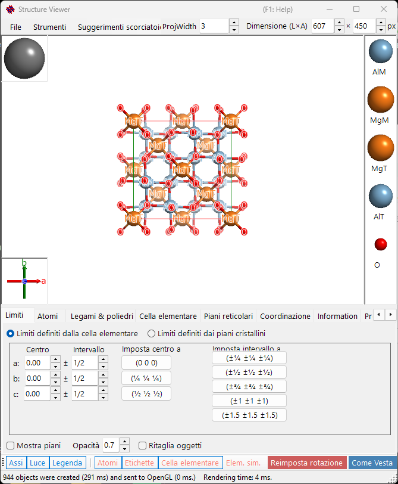

---

## Scorciatoie da tastiera e mouse

La finestra dispone di una vista 3D principale più due piccoli gizmo — il riquadro degli **assi cristallografici** (in basso a sinistra) e il riquadro della **direzione della luce** (in alto a sinistra) — e ciascuno risponde in modo diverso al trascinamento con il tasto sinistro. La vista principale utilizza la [navigazione della vista OpenGL](21-shortcuts.md) standard di ReciPro.

| Scorciatoia | Azione |
|----------|--------|
| <kbd>F1</kbd> | Apre questa pagina del manuale online |
| <kbd>CTRL</kbd>+<kbd>SHIFT</kbd>+<kbd>C</kbd> | Copia l'immagine renderizzata negli appunti |
| Trascinamento con il tasto sinistro nella vista principale | Ruota il modello |
| Doppio clic sinistro su un atomo | Mostra le coordinate dell'atomo cliccato e le distanze e gli angoli di legame dei vicini attorno a esso (si possono selezionare solo gli atomi visualizzati) <!-- 261105Cl 監査: 近接原子はクリックした位置の周り (ca87b772, 8cc95680) --> |
| Trascinamento con il tasto destro su/giù, o rotellina del mouse | Zoom |
| Trascinamento con il tasto centrale | Spostamento |
| <kbd>CTRL</kbd> + trascinamento con il tasto destro su/giù | Cambia la distanza della camera (solo in modalità prospettica) |
| <kbd>CTRL</kbd> + doppio clic destro | Alterna la proiezione ortografica / prospettica |
| Trascinamento con il tasto sinistro sul gizmo degli **assi cristallografici** | Ruota il modello (senza rotazione nel piano) |
| Trascinamento con il tasto sinistro sul gizmo della **luce** | Cambia la direzione dell'illuminazione |

Anche le scorciatoie <kbd>CTRL</kbd>+<kbd>SHIFT</kbd> valide per tutta l'applicazione provenienti dalla [finestra principale](0-main-window.md#keyboard-mouse-shortcuts) funzionano mentre questa finestra ha il fuoco.

→ Vedi **[21. Scorciatoie da tastiera e mouse](21-shortcuts.md)** per una panoramica di tutte le finestre.

---

## Area principale

La struttura cristallina 3-D, disegnata insieme al gizmo della direzione della luce, al gizmo degli assi cristallografici e alla legenda degli atomi. La posizione e la dimensione della finestra vengono mantenute al prossimo avvio. <!-- 261106Cl 作者の決定 H6 -->
> Il riquadro **Dimensione (L×A)** in alto a destra nella finestra imposta la dimensione in pixel della vista 3-D (la finestra viene ridimensionata di conseguenza); le immagini salvate e copiate hanno questa dimensione.
> Il riquadro **ProjWidth** accanto ad esso mostra la larghezza della vista proiettata in nm. Modifica il valore per zoomare numericamente — resta sincronizzato con lo zoom tramite trascinamento con il tasto destro / rotellina sulla vista.

---

## Barra dei menu

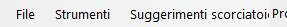

### Menu File

| Voce di menu | Descrizione |
|--------------|-------------|
| Salva immagine ▸ Immagine principale / Legenda / Assi cristallini / Direzione luce | Salvare in PNG la vista principale, la legenda degli atomi o uno dei gizmo |
| Copia immagine negli appunti ▸ Immagine principale / Legenda / Assi cristallini / Direzione luce <!-- 261105Cl 監査: copyToClipboardToolStripMenuItem.Text --> | Copiare l'immagine (Ctrl+Shift+C copia la vista principale) |
| Salva video ▸ Immagine principale / Assi cristallini | Salvare in MP4 un filmato di rotazione/traslazione della vista principale o del gizmo degli assi cristallini (velocità, durata, fps, qualità e così via) |
| Export 3D model (3MF/STL) | Esportare la struttura visualizzata come modello solido per la stampa 3D |

Menu **Strumenti**: **Mi piace VESTA** (equivale al pulsante *Come Vesta* della barra degli strumenti) ed **Enable DDP** (mostra/nasconde la voce *Dual Depth Peeling* in [Modalità di trasparenza](#modalità-di-trasparenza)).

**Suggerimenti scorciatoie** (un menu di primo livello a sé) elenca le scorciatoie da tastiera.

**Salva video** apre la finestra di dialogo delle impostazioni del filmato mostrata sotto. Un filmato può ruotare la vista, traslare il centro di proiezione o fare entrambe le cose contemporaneamente — seleziona **Rotazione** e/o **Traslazione**:

- **Rotazione**: ruota la vista alla **Velocità** (°/s; i valori negativi invertono il senso di rotazione) attorno all'asse scelto sotto — **Proiezione corrente** (direzione di inclinazione scelta con i pulsanti freccia), un **Indice di direzione** [uvw] o la normale di un **Piano reticolare** (hkl). L'asse viene ricavato dall'orientazione del cristallo nel momento in cui si preme **OK**. Con gli indici di Miller-Bravais attivi, i quattro indici compaiono solo per **Piano reticolare**; un **Indice di direzione** è sempre il [uvw] a tre indici. <!-- 261105Cl 監査: FormMovie.cs (OK の時点で回転軸を求め直す、4 指数は格子面だけ, 35fa72fc) -->
- **Traslazione**: sposta il centro di proiezione lungo l'indice di direzione [uvw] alla **Velocità** (periodi reticolari al secondo). Questa opzione compare solo quando la finestra di dialogo viene aperta dal Visualizzatore struttura e, finché è attiva, **Indice di direzione** è l'unica modalità di direzione disponibile.

Imposta la lunghezza del filmato (**Durata**), la frequenza dei fotogrammi (**FPS**, 1–120) e la qualità di codifica (**Qualità**, 1–100; valori più alti usano un bitrate maggiore e producono un file più grande), scegli il codec (**H264** / **H265**) e premi **OK** per generare un file MP4. **Includi ultimo fotogramma** aggiunge un fotogramma extra a t = Durata, così il filmato termina esattamente nell'orientamento/posizione finale. (L'elenco della velocità di codifica serve ormai solo come etichetta nella visualizzazione dell'avanzamento e non influisce più sulla codifica effettiva.)

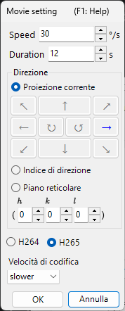

#### Export 3D model (3MF/STL)

**Export 3D model (3MF/STL)** esporta il modello di struttura attualmente disegnato sullo schermo come modello solido per la stampa 3D. Si possono esportare solo solidi chiusi: atomi (sfere ed ellissoidi), legami (cilindri) e poliedri di coordinazione. Le etichette degli atomi, i piani di delimitazione, i piani reticolari e i simboli degli elementi di simmetria non vengono esportati. <!-- 261105Cl 監査: 配位多面体を出力し、対称要素は出さない (6c31fc0d) --> Il telaio della cella elementare è fatto di segmenti, quindi viene sostituito da cilindri (con sfere ai vertici) solo se selezioni l'opzione corrispondente. **Ritaglia oggetti ai piani di delimitazione** non si applica all'output: gli oggetti che attraversano i piani di delimitazione vengono esportati per intero (la finestra di dialogo lo segnala). <!-- 261106Cl 作者の決定 H10 -->

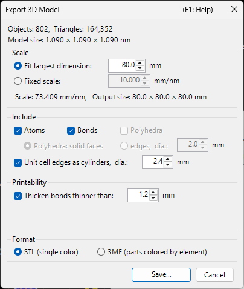

In alto nella finestra di dialogo sono riportati il numero di oggetti e di triangoli coinvolti e la dimensione reale del modello (**Dimensioni modello**, nm).

**Scala** : come si stabilisce la dimensione di uscita

- **Dimensione max.** : scala il modello automaticamente in modo che il suo spigolo più lungo raggiunga la lunghezza indicata (5–500 mm, 80 mm per impostazione predefinita). È incluso lo spessore dei cilindri che sostituiscono il telaio della cella elementare e i telai degli spigoli dei poliedri. <!-- 261105Cl 監査: 円柱の太さを含めて合わせる (82e50b62) -->
- **Scala fissa** : indica direttamente la scala (mm/nm). Serve per costruire più cristalli alla stessa scala e affiancarli. Passando a questa opzione si parte dalla scala in vigore un attimo prima.
- La riga sottostante mostra la scala risultante e le dimensioni stampate (**Dim. output**, mm), anch'esse comprensive di tale spessore dei cilindri.

**Includi** : quali elementi entrano nella stampa

- **Atomi** / **Legami** / **Poliedri** : si possono selezionare solo i tipi attualmente visualizzati; togliendo la spunta a uno di essi resta a schermo ma esce dalla stampa.
- **Poliedri: facce** / **spigoli, Ø** : esporta i poliedri di coordinazione come corpi pieni con facce oppure come telaio di spigoli (cilindri più sfere ai vertici, 2.0 mm per impostazione predefinita). Il telaio lascia visibili gli atomi all'interno.
- **griglia traforata: Ø barra / passo** : il telaio di spigoli più una griglia di barre sottili su ciascuna faccia (diametro della barra 0.8–5.0 mm, 1.2 mm per impostazione predefinita; passo 1.5–20 mm, 5.0 mm per impostazione predefinita). Da lontano le facce sembrano piene, ma l'interno resta visibile.
- **Spigoli di cella (cil.), Ø** : include il telaio della cella elementare, sostituito da cilindri del diametro indicato (2.4 mm per impostazione predefinita). Questa casella è selezionata per impostazione predefinita ogni volta che il telaio della cella è visualizzato.

**Stampabilità** : idoneità alla stampa

- **Ispessisci legami sotto** : i legami il cui diametro stampato scenderebbe sotto il valore indicato (1.2 mm per impostazione predefinita) vengono ricostruiti con quel diametro a partire dalla primitiva originale, così i legami sottili non si spezzano. Se lasci l'opzione disattivata mentre un legame è troppo sottile, compare un avviso in rosso.

**Formato** : formato del file

- **STL (colore unico)** : un STL binario a colore singolo.
- **3MF (colorato per elemento)** : 3MF con le parti colorate per elemento; i nomi dei colori riportano i nomi degli elementi.

**Salva...** chiede il nome del file. A esportazione conclusa, il numero di triangoli, le dimensioni stampate e la scala vengono registrati nel riquadro delle informazioni in basso a sinistra.

---

## Menu a schede

### Limiti definiti dalla cella

Specifica l'intervallo di disegno del cristallo. Sono disponibili due modalità, commutate con i pulsanti di opzione in alto.

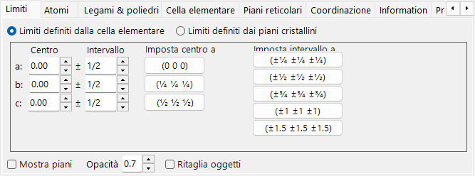

In questa modalità gli assi *a*, *b*, *c* della cella elementare sono l'unità dell'intervallo di disegno.

- **Centro**: scostamento del centro dell'intervallo di disegno dal [Centro di proiezione](#centro-di-proiezione), in coordinate frazionarie (i valori positivi lo spostano verso +*a*, +*b*, +*c*). L'intervallo disegnato è (centro di proiezione + Centro) ± Intervallo. <!-- 261106Cl 作者の決定 H3/H18, C4 -->
- **Intervallo**: limite superiore/inferiore per ciascuno degli assi *a*, *b*, *c*.
- **Pulsanti preimpostati** a destra forniscono valori usati di frequente (ad esempio, cella 1×1×1, cella 2×2×2).

### Limiti definiti dai piani cristallini

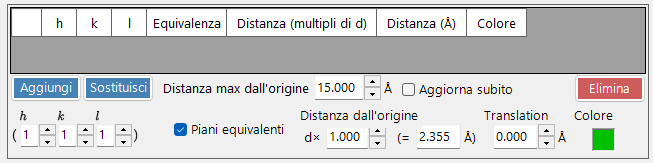

In questa modalità l'area di disegno è delimitata da un insieme di piani cristallini. Se i piani non definiscono una regione spazialmente chiusa, ReciPro aggiunge, per chiuderla, un poliedro quasi sferico di raggio **Dist. max (c. proiez.)** (Å, misurata dal [centro di proiezione](#centro-di-proiezione)). <!-- 261106Cl 作者の決定 C4 -->

#### Elenco dei limiti

Tutti i piani di delimitazione registrati per il cristallo corrente. Usa **Aggiungi / Sostituisci / Elimina** per gestire l'elenco; la casella di controllo più a sinistra disabilita temporaneamente un piano senza eliminarlo.

> Per salvare le modifiche in modo permanente, devi anche premere **Aggiungi** o **Sostituisci** nella **Finestra principale**. Altrimenti le modifiche andranno perse la prossima volta che cambierai la selezione nell'elenco principale dei cristalli.

#### Indici H k l

Imposta il piano di delimitazione tramite il suo indice di Miller. La casella di controllo include i piani cristallograficamente equivalenti generati a partire da (*hkl*) selezionato.

#### Distanza dal centro di proiez.

La distanza dal [centro di proiezione](#centro-di-proiezione) (non dall'origine della cella) al piano di delimitazione, inserita <!-- 261106Cl 作者の決定 C4 --> come multiplo della distanza interplanare *d* di (*hkl*) selezionato (casella **d×**) oppure in Å (la casella tra parentesi). Le due caselle sono collegate: la modifica di una aggiorna l'altra.

Ogni piano si trova dal lato +**g** del centro di proiezione (nel verso della normale di (*hkl*)), e viene disegnato il lato che contiene il centro. Con un solo piano, la regione disegnata è il semispazio che, rispetto a quel piano, sta dal lato del centro. <!-- 261106Cl 作者の決定 D5 -->

- **Traslazione** (Å): sposta l'intera regione delimitata dai piani di questa quantità lungo la normale del (*hkl*) indicato; i valori positivi la spostano verso +**g**, cioè nel verso della normale di (*hkl*). Funziona con qualsiasi numero di piani, anche con un solo piano senza **Piani equivalenti**. <!-- 261106Cl 作者の決定 B11, C5 -->
- **Dist. max (c. proiez.)** (Å): distanza massima dal centro di proiezione, cioè il raggio del poliedro di chiusura usato quando i piani non racchiudono una regione (vedi sopra). <!-- 261106Cl 作者の決定 D3 -->
- **Aggiorna subito**: applica le modifiche al piano selezionato senza premere **Sostituisci**.

#### Mostra piani di delimitazione / Opacità

Mostra o nasconde i piani di delimitazione stessi. Quando sono mostrati, **Opacità** imposta la trasparenza (0 = trasparente, 1 = opaco).

#### Ritaglia oggetti ai piani di delimitazione

Se selezionato, viene renderizzata solo la regione interna definita dai limiti; gli atomi, i legami e i poliedri che intersecano i limiti vengono tagliati.

#### Nascondere gli atomi

Nella scheda Limiti non c'è una casella di controllo per questo. Disattiva invece il pulsante **Atomi** della barra degli strumenti: non viene generato alcun atomo, quindi spariscono anche i legami e i poliedri — utile quando occorre visualizzare solo la cella o i piani reticolari.

### Atomi

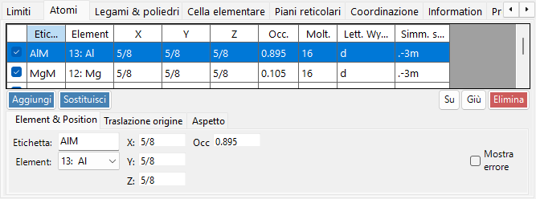

Imposta la specie, la posizione e l'occupazione di ciascun atomo, e il modo in cui ciascuno viene disegnato (raggio, colore, materiale).

#### Elenco degli atomi

L'elenco degli atomi nel cristallo. Usa **Aggiungi / Sostituisci / Elimina** per gestire l'elenco; la casella di controllo più a sinistra nasconde temporaneamente un atomo.

> Per salvare le modifiche in modo permanente, fai clic su **Aggiungi** o **Sostituisci** anche nella **Finestra principale**.

#### Elemento e posizione

- **Etichetta**: etichetta a testo libero per l'atomo (usata nelle legende e nei tooltip).
- **Element**: elemento chimico / stato di ionizzazione.
- **X, Y, Z**: coordinate frazionarie. Numeri reali in 0–1, oppure frazioni come `1/2` o `2/3`.
- **Occ**: occupazione, un numero reale 0–1.

#### Traslazione origine

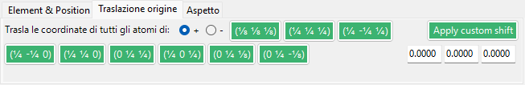

Sposta ogni atomo dello stesso scostamento frazionario. Premi un pulsante preimpostato (ad esempio, per scambiare la scelta dell'origine 1 / 2 per lo stesso gruppo spaziale), oppure inserisci un (Δx, Δy, Δz) personalizzato e premi **Apply custom shift**.

#### Aspetto

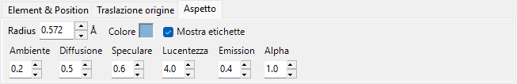

Raggio, colore e materiale per ciascun atomo.

- **Radius**: raggio atomico disegnato.
- **Colore**: colore della superficie.
- **Material**: proprietà di texture / materiale usate dallo shader OpenGL.
- **Applica allo stesso elemento**: applica il raggio e il colore correnti a ogni atomo della stessa specie elementare.

### Legami e poliedri

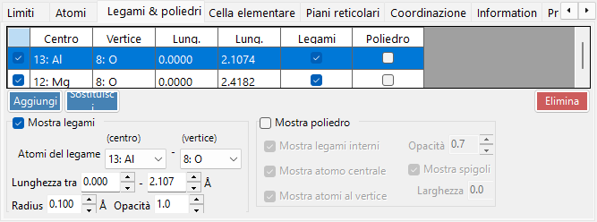

Definisce quali coppie di atomi sono legate (per specie e intervallo di distanza) e come vengono disegnati i legami e i poliedri di coordinazione risultanti.

#### Elenco dei legami

Tutte le regole di legame/poliedro registrate per il cristallo. Usa **Aggiungi / Sostituisci / Elimina**; la casella di controllo più a sinistra disabilita temporaneamente una voce. Come per gli atomi e i limiti, è necessario **Aggiungi** / **Sostituisci** nella **Finestra principale** per rendere permanente la modifica.

#### Proprietà del legame

- **Mostra legami**: disegna i legami di questa regola (la casella di controllo sopra le impostazioni del legame).
- **Atomi del legame** **(centro)** - **(vertice)**: specie elementare usata come atomo centrale del legame / poliedro e come vertice (l'altra estremità).
- **Lunghezza tra** … **-** … (Å): soglie di distanza inferiore e superiore. Le coppie di atomi al di fuori di questo intervallo non vengono disegnate.
- **Radius** (Å): spessore disegnato del legame (raggio del cilindro).
- **Opacità**: opacità del legame (0 = trasparente, 1 = opaco).

#### Proprietà del poliedro

- **Mostra poliedro**: se selezionato, viene disegnato il poliedro definito dal legame corrente (solo se l'insieme centro/vertice è geometricamente valido).
- **Mostra legami interni**: con **Mostra poliedro** attivo, disegna i legami dal centro ai vertici (richiedono anche **Mostra legami**).
- **Mostra atomo centrale**: mostra/nasconde l'atomo centrale.
- **Mostra atomi al vertice**: mostra/nasconde gli atomi ai vertici. Un atomo centrale o di vertice nascosto viene comunque disegnato quando un altro poliedro visualizzato lo mostra, oppure quando è l'estremità di un legame di una definizione senza poliedro. <!-- 261105Cl 監査: 3 つのチェックが描画に効くようになった (7e198f9d) -->
- **Opacità**: opacità delle facce (0 = trasparente, 1 = opaco).
- **Mostra spigoli**: disegna gli spigoli che collegano i vertici.
- **Larghezza**: spessore della linea degli spigoli in pixel (1–5). I valori inferiori a 1 salvati da versioni precedenti vengono disegnati con 1 px. <!-- 261106Cl 作者の決定 H4 -->
- In questa scheda non ci sono caselle di colore: i legami assumono i colori degli atomi alle due estremità e i poliedri il colore del loro atomo centrale (i colori degli atomi si impostano nella scheda [Atomi](#atomi)). <!-- 261105Cl 監査: BondControl の colorControlPolyhedron/Bond/Edges は Visible=False。色は原子の材質から (FormStructureViewer.cs) -->

### Cella elementare

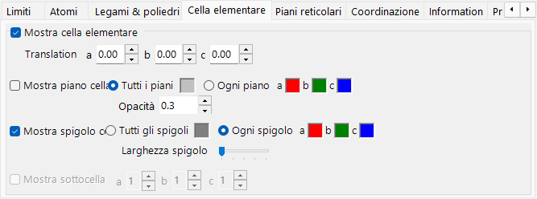

Imposta la posizione della cella elementare disegnata e se mostrarne le facce e gli spigoli.

#### Traslazione

Ogni gruppo spaziale ha un'origine predefinita. Per allontanare il centro della cella elementare disegnata da tale origine, imposta la traslazione lungo *a*, *b*, *c*.

La traslazione è legata al [Centro di proiezione](#centro-di-proiezione): impostare il centro di proiezione a $(x, y, z)$ imposta la traslazione a $(x-0.5,\ y-0.5,\ z-0.5)$. Una traslazione positiva sposta la cella disegnata verso +*a*, +*b*, +*c*. <!-- 261106Cl 作者の決定 H3/H18 -->

#### Mostra piano della cella

Se disegnare le sei facce che delimitano la cella elementare. Quando è abilitato, puoi impostare il colore della faccia e la trasparenza.

#### Mostra spigoli

Se disegnare gli spigoli della cella elementare. Il colore degli spigoli è configurabile.

La casella principale **Mostra cella elementare** (= il pulsante *Cella elementare* della barra degli strumenti) attiva/disattiva l'intera cella. I colori delle facce e degli spigoli si possono impostare per **Tutti i piani** / **Tutti gli spigoli** in una volta sola oppure per **Ogni piano** / **Ogni spigolo** (*a*, *b*, *c* separatamente); **Larghezza spigolo** imposta lo spessore della linea e **Opacità** la trasparenza delle facce.

#### Mostra sottocella

**Mostra sottocella** disegna linee di griglia che dividono la cella nel numero di parti indicato nelle caselle **a**, **b**, **c** (1–10 ciascuna; le caselle sono utilizzabili solo mentre l'opzione è selezionata), sulle facce e all'interno della cella. Le linee che coincidono con gli spigoli della cella non vengono disegnate. Le linee assumono il colore degli spigoli (**Tutti gli spigoli** / **Ogni spigolo**), metà della larghezza degli spigoli (almeno 1 px) e opacità 0.5, e vengono mostrate indipendentemente da **Mostra spigolo cella**. Non sono incluse nell'esportazione del modello 3D. <!-- 261106Cl 作者の決定 H5 -->

### Piani reticolari

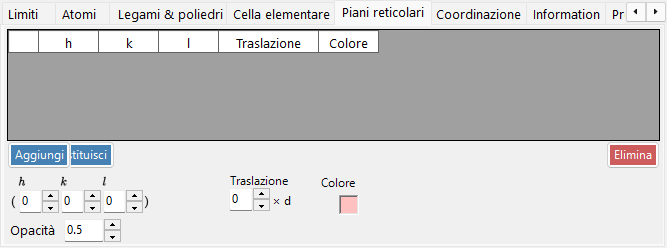

Disegna piani reticolari dati dal loro indice di Miller, includendo facoltativamente i piani cristallograficamente equivalenti.

#### Indici H k l

Specifica il piano reticolare tramite il suo indice di Miller. La casella di controllo include facoltativamente i piani cristallograficamente equivalenti generati a partire da (*hkl*).

#### Traslazione

Sposta i piani reticolari disegnati lungo la loro normale di una frazione della distanza interplanare *d* (**× d**, da −0.5 a 0.5); i valori positivi li spostano verso +**g** (i piani si trovano a **g**·**r** = (*m* + T)*d*). I valori salvati negli elenchi dei cristalli da versioni precedenti vengono quindi disegnati dal lato opposto (0 e ±0.5 appaiono uguali). <!-- 261106Cl 作者の決定 C5 --> Viene disegnato ogni piano della famiglia che attraversa l'intervallo di disegno, uno per ogni *d*. I piani sono fissati al reticolo cristallino: a 0 passano per i punti reticolari e si spostano con la struttura quando cambia il [Centro di proiezione](#centro-di-proiezione). <!-- 261105Cl 監査: LatticePlaneControl numericBoxDistance (−0.5〜0.5, × d)、FormStructureViewer.cs:SetLatticePlanes (4fd9e8c3)。「d の整数倍」は誤り -->

### Coordinazione

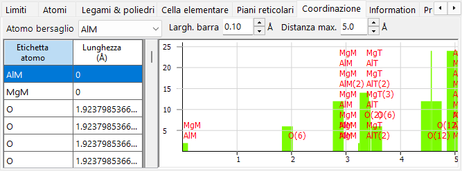

Elenca e rappresenta graficamente gli atomi che coordinano un atomo bersaglio scelto.

#### Tabella (lato sinistro)

Elenca quali atomi circondano l'atomo bersaglio selezionato e a quale distanza. L'atomo bersaglio viene selezionato dal menu a discesa sopra la tabella.

#### Grafico (lato destro)

Istogramma del numero di vicini in funzione della distanza, derivato dagli stessi dati della tabella. Regola **Semilarghezza** (la semilarghezza *w* di ciascuna barra, che copre *d* ± *w*) finché le barre non separano chiaramente i gusci di coordinazione <!-- 261106Cl 作者の決定 B18 --> — questo fornisce una stima visiva del numero di coordinazione.

### Informazioni

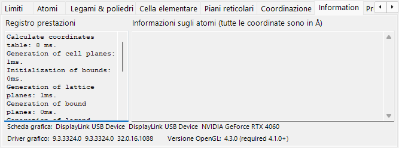

Registro di rendering (tempo per fotogramma, informazioni sulla GPU) e informazioni di base sull'atomo selezionato. In costruzione — i campi potrebbero aumentare nel tempo.

### Proiezione

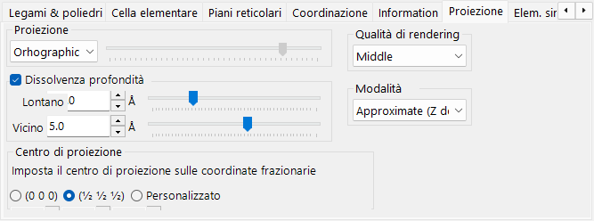

Imposta la modalità di proiezione (ortografica / prospettica), la dissolvenza in profondità, il centro di proiezione, la qualità di rendering e l'algoritmo di trasparenza.

#### Proiezione

- **Orthographic**: proiezione parallela perfetta (punto di vista all'infinito).
- **Perspective**: proiezione prospettica dalla distanza del punto di vista impostata con il cursore.

#### Dissolvenza in profondità

Dissolve gli oggetti distanti nella direzione della profondità (**Dissolvenza profondità**). Il colore viene sfumato linearmente verso il **colore di sfondo**: gli oggetti più vicini di **Vicino** mantengono il proprio colore, quelli più lontani di **Lontano** assumono il colore di sfondo e quelli intermedi vengono interpolati. (L'opacità in sé non cambia.) **Vicino** e **Lontano** sono espressi in Å.

#### Centro di proiezione

Imposta il centro della proiezione sulle coordinate specificate. Attiva **Personalizzato** per inserire coordinate arbitrarie. I valori digitati (da −1 a 1) vengono usati così come sono. Un filmato **Traslazione** (vedi il [Menu File](#menu-file)) controlla automaticamente questi valori e, durante lo spostamento, riconduce ogni coordinata all'intervallo da −0.5 a +0.5 (un periodo reticolare). <!-- 261105Cl 監査: 折り畳むのは SetProjectionCenter (動画の経路) だけ。マクロに投影中心の関数は無い -->

#### Qualità di rendering

Qualità del disegno (suddivisione della mesh, anti-aliasing). Una qualità più alta è più lenta — scegli l'impostazione adatta alla tua GPU.

#### Modalità di trasparenza

Algoritmo usato per gli atomi e i poliedri traslucidi.

- **Approximate (Z depth sorting, OpenGL 4.1+)**: veloce ma può essere impreciso quando molti oggetti traslucidi si sovrappongono.
- **High quality (dual depth peeling, OpenGL 4.1+)**: trasparenza indipendente dall'ordine mediante depth peeling. Compare solo quando **Strumenti ▸ Enable DDP** è attivo (attivo per impostazione predefinita quando PPLL non è disponibile). Il numero di passate di peeling segue l'impostazione di [Qualità di rendering](#qualità-di-rendering).
- **High quality (per-pixel linked list, OpenGL 4.3+)**: trasparenza esatta indipendente dall'ordine; compare solo quando la GPU supporta OpenGL 4.3. Accurata ma lenta; richiede di fatto una GPU dedicata.

### Elementi di simmetria

La scheda **Elem. sim.** disegna gli operatori di simmetria del gruppo spaziale direttamente sul modello 3D (attivabile con il pulsante **Elem. sim.** della barra degli strumenti). Ogni classe di elementi può essere mostrata/nascosta in modo indipendente:

- **Assi di simmetria**: **Rotazioni**, **Eliche**, **Rotoinversioni**
- **Piani**: **Specchi**, **Scorrimenti**
- **Centri di inversione**

L'interruttore principale è **Mostra elementi di simmetria**. Per ciascun gruppo puoi regolare la dimensione del simbolo (%) e il colore e, per gli assi e i piani, anche lo spessore della linea.

### Varie

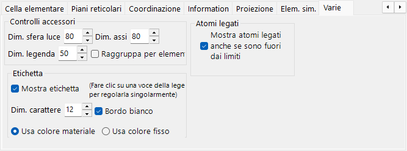

- **Controlli accessori**: imposta le dimensioni di visualizzazione (sfera della luce, assi, legenda). **Raggruppa per elemento** commuta la visualizzazione della legenda.
- **Atomi legati**: **Mostra atomi legati anche se sono fuori dai limiti** continua a disegnare gli atomi legati ad atomi interni all'intervallo di disegno, anche quando ricadono al di fuori di esso.
- **Etichetta**: impostazioni delle etichette degli atomi nella vista 3D (non della legenda) — **Mostra etichetta**, **Dim. carattere**, **Bordo bianco** e il colore delle etichette (**Usa colore materiale** o **Usa colore fisso**). Facendo clic su una voce della legenda degli atomi si attivano/disattivano singolarmente le etichette di quell'atomo (o elemento, con **Raggruppa per elemento**).

---

## Barra degli strumenti

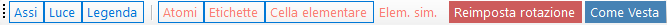

| Pulsante | Descrizione |
|--------|-------------|
| Assi | Mostra l'orientamento degli assi (dimensione = costante reticolare) |
| Luce | Imposta la direzione della luce |
| Legenda | Legenda degli atomi |
| Atomi | Mostra/nasconde gli atomi; legami, poliedri ed etichette sono costruiti sugli atomi, quindi vengono nascosti anch'essi <!-- 261105Cl 監査: toolStripButtonAtomObjects.ToolTipText (2028c4a1) --> |
| Etichette | Commuta le etichette degli atomi |
| Cella elementare | Commuta gli spigoli della cella elementare |
| Elem. sim. | Commuta la sovrapposizione degli elementi di simmetria (vedi sopra) |
| Reimposta rotazione | Torna all'orientamento iniziale |
| Come Vesta | Passa a un aspetto in stile VESTA: i colori e i raggi degli atomi vengono reimpostati e l'elenco dei legami viene **sostituito** dai legami predefiniti |

---

## Vedi anche

- [Finestra principale](0-main-window.md)
- [Database dei cristalli](1-crystal-database.md)
- [Informazioni di simmetria](2-symmetry-information.md)
- [Simulatore di diffrazione](7-diffraction-simulator/index.md)
- [Scorciatoie da tastiera e mouse](21-shortcuts.md)
