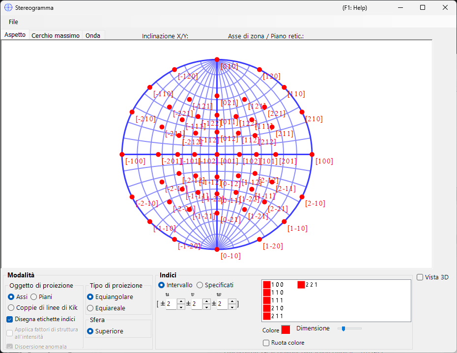
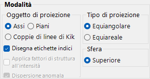
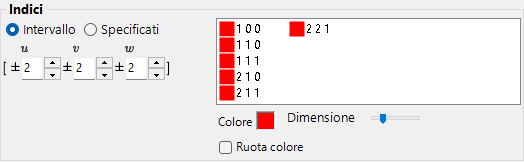
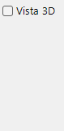
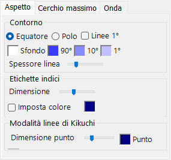
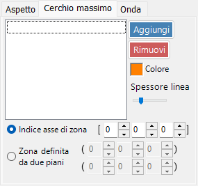
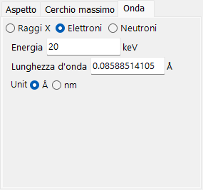

# Stereogramma

Lo **Stereogramma** visualizza le direzioni dei piani e degli assi cristallini mediante la proiezione stereografica.

---

## Scorciatoie da tastiera e mouse

Lo stereogramma in sé è una proiezione 2-D; una sfera 3-D opzionale può essere mostrata con **Vista 3D**.

| Scorciatoia | Azione |
|----------|--------|
| <kbd>F1</kbd> | Apre questa pagina del manuale online |
| Trascinamento sinistro vicino al centro | Inclina il cristallo |
| Trascinamento sinistro nell'area esterna | Ruota il cristallo attorno all'asse di vista |
| Doppio clic sinistro | Commuta tra la proiezione **Piani** e **Assi** |
| Clic destro | Riduci lo zoom |
| Trascinamento destro di un riquadro | Ingrandisci la regione selezionata |
| Trascinamento centrale | Sposta la vista |
| Muovi il mouse (senza pulsante) | Leggi i valori (hkl)/[uvw] sotto il cursore — utile per indicizzare un riflesso misurato (anche nell'emisfero inferiore) <!-- 261105Cl 監査: 下半球の読み取り (268779a1) --> |

Il trascinamento sulla rete ruota il **cristallo**; lo stato di rotazione è condiviso tra tutte le finestre.

Il rendering 3-D utilizza la [navigazione della vista OpenGL](21-shortcuts.md) standard di ReciPro (trascinamento sinistro per ruotare, trascinamento destro / rotella per lo zoom, <kbd>CTRL</kbd> + doppio clic destro per commutare la proiezione) e ruota solo la vista 3-D, non il cristallo stesso.

Le scorciatoie <kbd>CTRL</kbd>+<kbd>SHIFT</kbd> valide per l'intera applicazione, descritte nella [finestra principale](0-main-window.md#keyboard-mouse-shortcuts), funzionano anch'esse mentre questa finestra è attiva.

→ Vedi **[21. Scorciatoie da tastiera e mouse](21-shortcuts.md)** per una panoramica di tutte le finestre.

---

## Area principale

Viene visualizzata la proiezione stereografica dei piani cristallini, degli indici di direzione e delle linee di Kikuchi del cristallo selezionato.

---

## Menu File

Salva o copia come immagine raster (PNG) o come metafile vettoriale (EMF). Un metafile incollato consente di modificare i caratteri e lo spessore delle linee in PowerPoint o in altri editor vettoriali.

| Voce di menu | Descrizione |
|--------------|-------------|
| Salva immagine ▸ come immagine (formato PNG) / come metafile (EMF) | Salva lo stereogramma come file PNG o come file vettoriale EMF <!-- 261105Cl 監査: as Metafile (EMF) の保存を配線 (FormStereonet.cs, 268779a1) --> |
| Copia negli appunti ▸ Come immagine / come metafile (EMF) | Copia lo stereogramma |
| Salva video ▸ Stereogramma / 3D | Salva un filmato di rotazione (MP4) dello stereogramma o della vista 3-D, con la stessa finestra di dialogo delle impostazioni del filmato del [Visualizzatore struttura](5-structure-viewer.md#menu-file) (solo rotazione) |
| Imposta pagina / Anteprima di stampa / Stampa | Stampa lo stereogramma |

---

## Modalità {#mode}

### Bersaglio di proiezione

Seleziona ciò che deve essere proiettato sulla rete.

- **Assi** — proietta gli indici di direzione \([uvw]\).
- **Piani** — proietta le normali dei piani cristallini \((hkl)\).
- **Coppie di Kikuchi** — proietta le coppie di linee di Kikuchi.

### Metodo di proiezione

| Metodo | Descrizione |
|--------|-------------|
| **Equiangolare** (Wulff / stereografico) | Preserva la relazione angolare tra gli elementi proiettati, ma non l'angolo solido. Utilizzato dai cristallografi classici per leggere gli angoli tra assi o tra piani. |
| **Equiareale** (Schmidt / equiareale / Lambert) | Preserva l'angolo solido (l'area) di ciascuna regione, ma distorce gli angoli. Preferito per le figure polari statistiche, in cui conta la densità relativa. |

### Emisfero

Scegli l'emisfero **Superiore** o **Inferiore** come sorgente di proiezione — commuta se la faccia visibile della sfera sia quella più vicina o più lontana dall'osservatore.
Superiore = il lato $+Z$ (verso l'osservatore, si veda l'[Appendice A1.1](appendix/a1-coordinate-system/1-orientation.md)); con **Inferiore** la componente $Z$ di ogni direzione viene invertita prima della proiezione, e i punti vengono disegnati come **cerchi vuoti** anziché pieni.

### Opzioni di visualizzazione

- **Disegna etichette indici**: mostra le etichette degli indici.
- **Fattori di struttura sull’intensità**: quando è selezionato **Piani** o **Coppie di Kikuchi**, pesa ciascun elemento in base al suo fattore di struttura (imposta la sorgente d'onda e la lunghezza d'onda nella [scheda Onda](#wave)). Il peso è $I_{\mathrm{rel}} = |F_{hkl}|^2 / \max|F|^2$ sull'insieme visualizzato: in modalità **Piani** il raggio del punto viene moltiplicato per $\sqrt{I_{\mathrm{rel}}}$ (cioè $\propto |F_{hkl}|$); in modalità **Coppie di Kikuchi** l'opacità della linea è $I_{\mathrm{rel}}$.
- **Dispersione anomala**: include nei fattori di struttura i termini di dispersione anomala dei raggi X $f'$, $f''$. Abilitata solo per i raggi X e in modalità **Piani** / **Coppie di Kikuchi**.

> Per i cristalli trigonali/esagonali, la notazione di Miller–Bravais (4 indici) può essere abilitata da **Opzioni ▸ Usa indici di Miller-Bravais (hkil)** nella finestra principale.

---

## Indici {#indices}

Imposta quali piani / assi cristallini vengono disegnati.

### Modalità intervallo

Specifica un intervallo di indici \([uvw]\) o \((hkl)\). ReciPro enumera ogni indice entro i limiti e proietta ciascuno di essi.

In modalità **Intervallo** i limiti sono $\pm$ i valori inseriti; vengono presi solo gli indici irriducibili, raggruppati in insiemi di indici cristallograficamente equivalenti (a ciascun insieme è assegnato un colore).

### Modalità fattore di struttura

Disponibile solo per **Piani** e **Coppie di Kikuchi**. Proietta i piani con il valore più grande di $|F_{hkl}|^2$ per la sorgente d'onda corrente. **Max** imposta il numero di piani da disegnare (i piani equivalenti sono contati singolarmente; in modalità **Piani** un riflesso parallelo a uno più intenso — un suo ordine superiore o inferiore, ad es. 222 quando 111 è più intenso — viene saltato).

### Modalità specificata

Specifica singolarmente assi o piani particolari. Digita un indice, premi **Aggiungi** per registrarlo, oppure **Rimuovi** per eliminarlo. Quando **Includi indici equivalenti** è selezionato, vengono disegnati anche tutti gli indici cristallograficamente equivalenti.

### Colore / Dimensione {#colour-size}

Imposta il **colore** e la **dimensione** dei punti tracciati. Spunta **Ruota colore** per codificare con colori diversi ciascun insieme di assi/piani equivalenti — utile per distinguere le famiglie in un grafico a più indici.

---

## 3D Options

Visibili quando **Vista 3D** è selezionata; la sfera 3-D compare in un riquadro a destra della rete.

- **Azzera vista**: riporta la vista 3-D alla direzione e allo zoom predefiniti.
- **Etichetta**: disegna le etichette degli indici in 3-D. Le direzioni sono etichettate [uvw]; la forma a quattro indici (con **Usa indici di Miller-Bravais (hkil)** attivo) è usata solo per i piani e le linee di Kikuchi. <!-- 261105Cl 監査: 3D のラベル (FormStereonet.cs, 268779a1) -->
- **Emisfero**: disegna solo i poli dell'emisfero superiore ($Z>0$).
- **Stereogramma**: disegna in 3-D il piano di proiezione (la rete), con i punti proiettati dei poli dell'emisfero superiore.
- **Contorno sfera**: disegna la griglia di latitudine/longitudine della sfera.
- **Linee di proiezione** (con **Stereogramma** attivo): disegna le linee di proiezione ausiliarie di ciascun polo dell'emisfero superiore — un segmento retto dal polo sud $(0,0,-1)$ al polo per Wulff, un arco per Schmidt.
- **Dissolvenza profondità**: intensità della dissolvenza in profondità della vista 3-D.

---

## Menu schede

### Aspetto {#appearance}

#### Contorno {#outline}

Come viene disegnato il contorno dello stereogramma — il cerchio di delimitazione e l'eventuale griglia di latitudine/longitudine a cerchi massimi. Scegli **Equatore** o **Polo**, attiva/disattiva **Linee 1°** e il riempimento **Sfondo**, imposta i colori della griglia **90° / 10° / 1°** e regola lo **Spessore linea** con il cursore.

#### Etichette indici {#index-labels}

- **Dim.** — dimensione delle etichette degli indici.
- **Colore** — usa un unico colore fisso per tutte le etichette degli indici anziché il colore specifico di ciascun punto; utile quando i punti sono codificati per colore ma si desiderano tutte le etichette in un unico colore per migliorare la leggibilità.
- **Separat.** — carattere posto tra gli indici di ciascuna etichetta: **Nessuno** (es. 100), **Spazio** (1 0 0) o **Virgola** (1,0,0).

#### Modalità linee di Kikuchi {#kikuchi-line-mode}

- **Dimensione punto** — dimensione dei punti tracciati.
- **Punto** / **Etichetta** — colori dei punti e delle relative etichette.

### Cerchio massimo {#great-circle}

Disegna cerchi massimi (i cerchi minori non sono supportati). Specificali tramite l'**Indice asse di zona** \([uvw]\) (il cerchio massimo formato dalla zona di quell'asse) oppure tramite **Zona definita da due piani** (l'asse di zona è il loro prodotto vettoriale). Usa **Aggiungi** / **Rimuovi** per modificare l'elenco; togliendo la spunta a una voce, il relativo cerchio viene nascosto. Anche il colore e lo spessore delle linee dei cerchi sono configurabili. I cerchi seguono il metodo di proiezione e l'emisfero scelti in [Modalità](#mode) (Wulff o Schmidt, superiore o inferiore). <!-- 261105Cl 監査: Schmidt・下半球の大円 (268779a1) -->

### Onda {#wave}

Usata solo quando come bersaglio di proiezione è selezionato **Piani** o **Coppie di Kikuchi** (in modalità **Coppie di Kikuchi** la lunghezza d'onda determina anche l'angolo di Bragg, cioè la separazione di ciascuna coppia di linee). Imposta la sorgente d'onda (Raggi X / Elettroni / Neutroni) e la lunghezza d'onda o l'energia necessarie per calcolare i fattori di struttura del cristallo usati da **Fattori di struttura sull’intensità** in [Modalità](#mode).

---

## Vedi anche

- [Finestra principale](0-main-window.md)
- [Geometria di rotazione](4-rotation-geometry.md)
- [Visualizzatore struttura](5-structure-viewer.md)
- [Simulatore di diffrazione](7-diffraction-simulator/index.md)
- [Sistema di coordinate di base e orientazione del cristallo](appendix/a1-coordinate-system/1-orientation.md)
