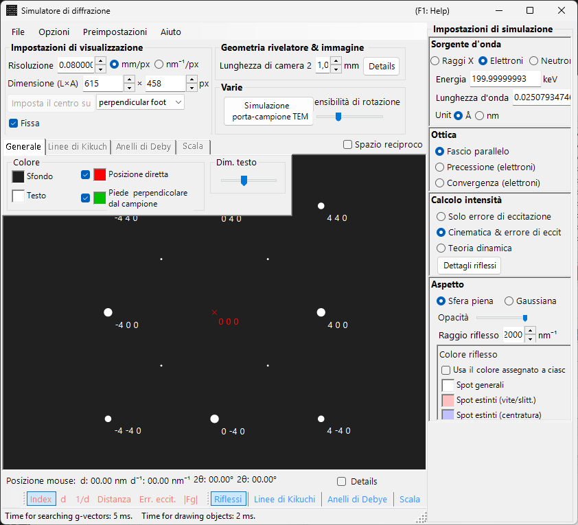
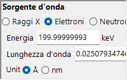
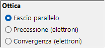
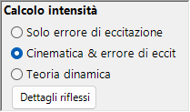
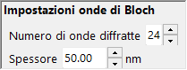
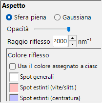

# Simulazione SAED (Selected Area Electron Diffraction)

La simulazione **SAED (Selected Area Electron Diffraction)** calcola i pattern di diffrazione elettronica di un monocristallo prodotti da un fascio elettronico parallelo. Questa è la modalità predefinita del [simulatore di diffrazione](index.md).

> Questa pagina elenca ogni impostazione che compare nel pannello **Impostazioni di simulazione** a destra quando si scelgono **Sorgente d'onda = Elettroni** e **Ottica = Fascio parallelo**. Per le operazioni a livello di finestra, come il disegno e il salvataggio, vedere la [pagina panoramica](index.md).

Condizioni GUI: Sorgente d'onda = Elettroni, Ottica = Fascio parallelo, Calcolo intensità = Solo errore di ecc. / Cinematica & err. ecc. / Teoria dinamica.

---

## Panoramica

Simula il pattern di diffrazione prodotto quando un fascio elettronico parallelo attraversa un campione sottile. Le posizioni degli spot sono fissate dalla relazione geometrica tra la sfera di Ewald e i punti del reticolo reciproco, e la luminosità di ciascuno spot è calcolata secondo la modalità di calcolo dell'intensità selezionata.

---

## Sorgente d'onda {#wave-length}

Impostare la sorgente di radiazione su **Elettroni**. Inserire l'**Energia** (keV) o la **Lungh. d'onda** (Å o nm, commutabile; predefinito Å) e viene calcolata la lunghezza d'onda corretta relativisticamente. Il valore iniziale è 200 keV; il menu **Preimpostazioni** imposta 300 / 200 / 120 kV con un clic. Per le sorgenti a raggi X e a neutroni, vedere [Simulazione di diffrazione a raggi X](5-x-ray-neutron-diffraction.md).

---

## Ottica (fascio incidente) {#incident-beam-mode}

Impostare **Ottica** (la geometria del fascio incidente) su **Fascio parallelo**. Questa è la geometria standard a onda piana usata per SAED e per la diffrazione a raggi X.

> **Nota**: Per gli elettroni è possibile scegliere **Fascio parallelo / Precessione (elettroni) / Convergenza (elettroni)**. La scelta di **Precessione (elettroni)** dà una [simulazione PED](2-ped-simulation.md) e la scelta di **Convergenza (elettroni)** dà una [simulazione CBED](3-cbed-simulation.md); in entrambi i casi il calcolo dell'intensità passa automaticamente a **Teoria dinamica**.

---

## Calcolo intensità {#intensity-calculation}

Seleziona come vengono calcolate le intensità degli spot.

### Solo errore di eccitazione

L'intensità è determinata esclusivamente dalla distanza geometrica tra la sfera di Ewald e il punto del reticolo reciproco (l'errore di eccitazione $S_g$). È massima per $S_g = 0$ — esattamente sulla sfera — e decresce al crescere di $\lvert S_g\rvert$, annullandosi non appena $\lvert S_g\rvert$ supera il **Raggio riflesso** indicato per il punto del reticolo reciproco. Poiché il fattore di struttura del cristallo viene ignorato, questa è la modalità più veloce ed è adatta a verificare le posizioni degli spot di diffrazione.

Solo in questa modalità compaiono le seguenti opzioni:

| Opzione | Descrizione |
|--------|-------------|
| **Escludi tutte le riflessioni proibite** | Nasconde ogni riflessione proibita dal gruppo spaziale (centratura reticolare, assi elicoidali e piani di slittamento). Spuntarla spunta e blocca anche l'opzione successiva. |
| **Escludi le riflessioni proibite dalla centratura reticolare** | Nasconde solo le riflessioni proibite dalla centratura reticolare (attiva per impostazione predefinita). |
| **Disegna tutti i riflessi con lo stesso raggio** | Disegna ogni spot eccitato con il raggio pieno *R*, indipendentemente da $S_g$. |

Le riflessioni proibite che restano visibili sono disegnate nei colori **Spot estinti** (vedere [Aspetto degli spot](#spot-appearance)).

### Cinematica

Oltre all'errore di eccitazione, nel calcolo dell'intensità viene incluso il fattore di struttura cinematico $\lvert F_{hkl} \rvert^2$. Le regole di estinzione vengono riprodotte correttamente, rendendo questa modalità adatta a campioni sottili o a diffrazione debole.

### Dinamica (metodo delle onde di Bloch, solo elettroni)

Un calcolo dinamico rigoroso con il metodo delle onde di Bloch (metodo di Bethe). Riproduce la diffusione multipla e la variazione dell'intensità in funzione dello spessore, ed è necessario per campioni spessi o per diffrazione forte. Disponibile solo quando è selezionato Elettroni. Per la teoria, vedere [Appendice A3. Metodo delle onde di Bloch](../appendix/a3-bloch-wave/calculation.md).

> **Nota**: Quando è selezionato **Teoria dinamica**, sotto compare un pannello **Impostazioni onde di Bloch**.

---

## Impostazioni onde di Bloch (teoria dinamica) {#bloch-wave-settings-dynamical-theory}

Attivo solo quando **Calcolo intensità = Teoria dinamica**.

| Parametro | Descrizione |
|-----------|-------------|
| **Numero di onde diffratte** | Numero di onde di Bloch incluse nel problema agli autovalori (8–1000, predefinito 240). Valori più grandi danno intensità più accurate ma aumentano il tempo di calcolo con $O(N^3)$ |
| **Spessore** | Spessore del campione (nm) usato nel calcolo dinamico (0.01–10000 nm, predefinito 50 nm) |

---

## Aspetto degli spot {#spot-appearance}

Controlla come viene rappresentato ciascuno spot di diffrazione (gruppo **Aspetto**).

- **Sfera piena / Gaussiana** : il modello geometrico del punto del reticolo reciproco (predefinito **Sfera piena**). **Sfera piena** disegna la sezione (un cerchio) tra una sfera e la sfera di Ewald: il raggio della sfera è $R\,I^{1/3}$ per **Cinematica & err. ecc.** (volume della sfera ∝ intensità) ed $R$ per **Solo errore di ecc.**; per **Teoria dinamica** viene disegnato un disco di raggio $R\,I_\text{dyn}^{1/2}$ (area ∝ intensità) senza il taglio con la sfera di Ewald. **Gaussiana** disegna la sezione (una gaussiana 2-D) di una gaussiana 3-D con $\sigma = R$, il cui integrale corrisponde all'intensità di diffrazione.
- **Opacità** : trasparenza dello spot (0 = trasparente, 1 = opaco).
- **Raggio riflesso (R)** : raggio virtuale del punto del reticolo reciproco (nm⁻¹; 0.01–1, predefinito 0.2). La dimensione dello spot è fissata dalla combinazione tra la modalità di **Aspetto** e il **Calcolo intensità** (vedere sopra).
- **Luminosità**, **Scala colori**, **Scala log** : mostrati solo in modalità **Gaussiana**. **Luminosità** scala l'intensità integrata della gaussiana disegnata; **Scala colori** è **Gray** (spot nei colori degli spot indicati sotto), **Cold-warm**, **Spectrum** o **Fire**; **Scala log** visualizza le intensità su scala logaritmica (utile per pattern con grande contrasto di intensità).
- **Colore riflesso** : mostrato finché la **Scala colori** è **Gray** (impostazione iniziale). **Spot generali**, **Spot estinti (vite/slitt.)** e **Spot estinti (centratura)** impostano i colori delle riflessioni permesse e proibite.
- **Colore per cristallo** : se selezionato, gli spot vengono disegnati nel colore assegnato a ciascun cristallo (anche con un solo cristallo).

---

## Etichette degli spot {#spot-labels}

Le etichette sovrapposte agli spot vengono selezionate dalla [barra degli strumenti](index.md#toolbar).

| Etichetta | Contenuto |
|-------|---------|
| **Index** | indici di Miller $(hkl)$; quattro indici $(hkil)$ quando nella finestra principale è attiva **Opzioni ▸ Usa indici di Miller-Bravais (hkil)** e il cristallo usa assi esagonali (le etichette delle linee di Kikuchi, degli anelli di Debye e della vista 3D seguono la stessa impostazione) <!-- 261105Cl 監査: C23 --> |
| **d** | distanza interplanare $d$, in Å o nm secondo l'unità di lunghezza della finestra principale <!-- 261106Cl 作者の決定 C20 --> |
| **1/d** | reciproco della distanza interplanare $1/d$, in nm⁻¹ o Å⁻¹ secondo l'unità di lunghezza della finestra principale <!-- 261106Cl 作者の決定 C2 --> |
| **Distanza** | distanza sul rivelatore tra lo spot e lo spot trasmesso (diretto) (mm), misurata tra le posizioni disegnate, quindi valida anche per un rivelatore inclinato, per la camera di precessione a raggi X e per Back Laue (misurata dal foro del fascio); non viene mostrata quando il fascio trasmesso non cade sul rivelatore <!-- 261105Cl 監査: DrawDiffractionSpotsLabel (C15)。L2 tan2θ は傾けない平板の検出器だけ --> |
| **2θ** | angolo di diffusione $2\theta$ (stessa definizione dei cerchi concentrici della scala 2θ) |
| **χ** | angolo azimutale $\chi$, misurato dalla direzione verso l'alto (ore 12), positivo in senso orario (stessa definizione delle linee radiali della scala azimutale) |
| **Err. eccit.** | errore di eccitazione $S_g$, in nm⁻¹ o Å⁻¹ secondo l'unità di lunghezza della finestra principale |
| **Intensità** | intensità relativa (%) in modalità **Cinematica & err. ecc.**; in modalità **Teoria dinamica** l'intensità relativa (% del fascio diffratto più intenso, escluso 000) e l'ampiezza complessa sulla superficie di uscita. Con **Solo errore di ecc.** non viene mostrato nulla |

---

## Operazioni condivise

Le informazioni sul rivelatore, il ribaltamento, la visualizzazione dello spazio reciproco, le linee di Kikuchi, gli anelli di Debye, le linee di scala, le impostazioni dei colori, il salvataggio e simili sono comuni a tutte le modalità. Vedere la [pagina panoramica](index.md). I dettagli per riflessione ottenuti dal calcolo dinamico possono essere consultati in [informazioni sugli spot di diffrazione](index.md#diffraction-spot-information).

---

## Vedere anche

- [Simulatore di diffrazione (panoramica)](index.md)
- [Calcolo SAED con fascio parallelo](../appendix/a3-bloch-wave/calculation.md#parallel-beam-saed)
- [Simulazione di diffrazione a raggi X](5-x-ray-neutron-diffraction.md)
- [Simulazione della diffrazione elettronica per precessione (PED)](2-ped-simulation.md)
- [Definizione del sistema di coordinate](../appendix/a1-coordinate-system/1-orientation.md)
