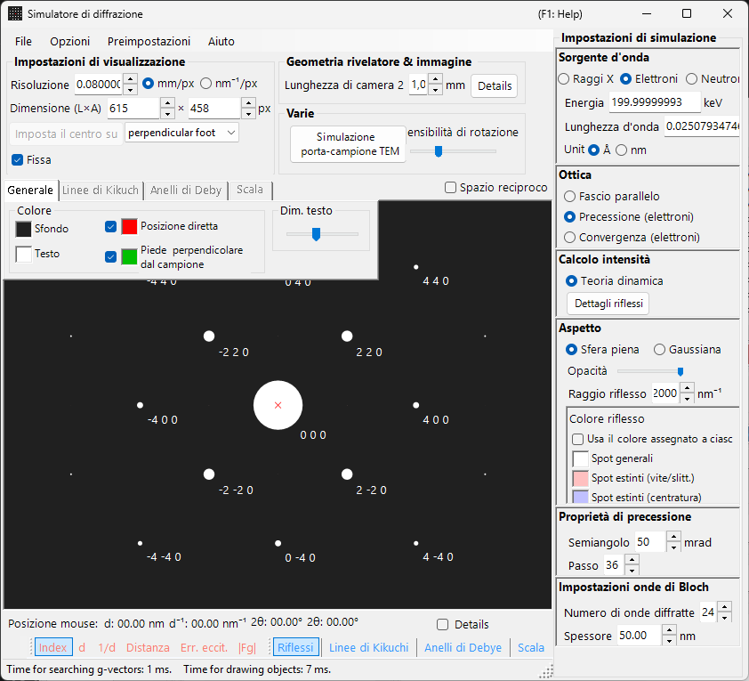
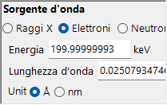
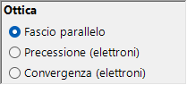
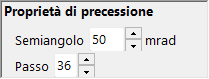
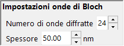
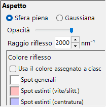

# Simulazione della diffrazione elettronica per precessione (PED)

La simulazione della **PED (Precession Electron Diffraction)** calcola i pattern di diffrazione elettronica ottenuti facendo precessare il fascio incidente lungo un cono attorno all'asse ottico.

> Questa pagina elenca tutte le impostazioni che compaiono sul lato destro quando si seleziona **Sorgente d'onda = Elettroni, Ottica = Precessione (elettroni), Calcolo intensità = Teoria dinamica (automatico)**. Si noti che **la selezione di Precessione (elettroni) in Ottica commuta automaticamente il calcolo dell'intensità su Teoria dinamica**. Per le operazioni a livello dell'intera finestra, come il disegno e il salvataggio, vedere la [pagina panoramica](index.md).

Condizioni GUI: **Sorgente d'onda = Elettroni, Ottica = Precessione (elettroni), Calcolo intensità = Teoria dinamica (automatico)**

---

## Panoramica

Nella PED il fascio elettronico viene fatto precessare lungo un cono attorno all'asse ottico, e i pattern di diffrazione ottenuti per ciascuna direzione del fascio sul cono di precessione vengono integrati. Rispetto alla SAED convenzionale, ciò offre i seguenti vantaggi:

- Gli effetti dinamici vengono mediati, fornendo dati di intensità prossimi ai rapporti di intensità cinematici
- Le riflessioni delle zone di Laue di ordine superiore (HOLZ) si osservano più chiaramente
- È possibile ottenere dati di intensità adatti all'analisi strutturale

---

## Sorgente d'onda {#wavelength-setup}

Poiché la PED è una diffrazione elettronica, selezionare **Elettroni** come **Sorgente d'onda**. Inserendo l'energia degli elettroni (keV) o la lunghezza d'onda (Å o nm, commutabile; predefinito Å) si calcola la lunghezza d'onda corretta relativisticamente.

---

## Ottica {#incident-beam}

In **Ottica** (la geometria del fascio incidente), selezionare **Precessione (elettroni)** (disponibile solo quando è selezionato **Elettroni**).

> **Nota** : la selezione di **Precessione (elettroni)** **commuta automaticamente il calcolo dell'intensità su Teoria dinamica**, e compaiono il pannello delle impostazioni del metodo delle onde di Bloch e il pannello delle impostazioni della precessione. **Solo errore di ecc.** / **Cinematica & err. ecc.** non possono più essere selezionati.

---

## Impostazioni della precessione

Impostare la forma e il campionamento del cono di precessione (gruppo **Proprietà di precessione**).

| Parametro | Descrizione | Consigliato |
|-----------|-------------|-------------|
| **Semiangolo** | Semiapertura del cono di precessione (mrad; 0.1–500, predefinito 50) | 10–40 mrad |
| **Passo** | Numero di direzioni di fascio parallelo campionate sul cono di precessione (2–1080, predefinito 36). Valori maggiori danno un'integrazione più regolare ma aumentano linearmente il tempo di calcolo | 36–72 |

---

## Calcolo dell'intensità e impostazioni del metodo delle onde di Bloch

Nel momento in cui si seleziona **Precessione (elettroni)**, **Calcolo intensità** viene fissato su **Teoria dinamica** (automatico). Per il fascio parallelo in ciascuna direzione di precessione, l'intensità di diffrazione viene calcolata con il metodo delle onde di Bloch (calcolo dinamico), e l'integrazione su tutte le direzioni fornisce il pattern PED.

| Parametro | Descrizione | Consigliato |
|-----------|-------------|-------------|
| **Numero di onde diffratte** | Numero di onde di Bloch incluse nel problema agli autovalori (8–1000, predefinito 240). Valori maggiori danno intensità più accurate ma il tempo di calcolo cresce come $O(N^3)$ | 50–200 |
| **Spessore** | Spessore del campione usato nel calcolo dinamico (nm; 0.01–10000, predefinito 50) | — |

Il costo computazionale è all'incirca "numero di passi × calcolo delle onde di Bloch per direzione". Per i dettagli del calcolo dinamico, vedere [Calcolo dinamico (metodo delle onde di Bloch)](../appendix/a3-bloch-wave/calculation.md).

---

## Aspetto degli spot

Controlla il modo in cui viene disegnato ciascuno spot di diffrazione (gruppo **Aspetto**).

- **Sfera piena / Gaussiana** : modello geometrico dei punti del reticolo reciproco. **Sfera piena** disegna la sezione tra una sfera di raggio $R$ e la sfera di Ewald, mentre **Gaussiana** disegna la sezione (una gaussiana 2D) tra una gaussiana 3D con $\sigma = R$ e la sfera di Ewald.
- **Opacità** : trasparenza dello spot (0 = trasparente, 1 = opaco).
- **Raggio riflesso (R)** : raggio dei punti del reticolo reciproco. Per le intensità dinamiche, l'integrale della gaussiana $=$ Luminosità $\times I_\text{dyn}$, e Sfera piena usa il raggio $R \times I_\text{dyn}^{1/2}$ (in modo che l'area sia proporzionale all'intensità dinamica).
- **Luminosità**, **Scala colori**, **Scala log** : mostrati solo nella modalità **Gaussiana**. **Luminosità** scala l'intensità integrata della gaussiana disegnata; **Scala colori** è **Gray** (spot nei colori degli spot indicati sotto), **Cold-warm**, **Spectrum** o **Fire**; **Scala log** visualizza l'intensità in scala logaritmica.
- **Colore riflesso** : mostrato finché la **Scala colori** è **Gray** (impostazione iniziale): **Spot generali** / **Spot estinti (vite/slitt.)** / **Spot estinti (centratura)**.
- **Colore per cristallo** : disegna gli spot nel colore assegnato a ciascun cristallo.

---

## Confronto con la SAED

| Caratteristica | SAED | PED |
|---------|------|-----|
| Fascio | Parallelo, fisso | In precessione (scansione conica) |
| Effetti dinamici | Grandi | Mediati, minori |
| Riflessioni HOLZ | Deboli | Compaiono marcate |
| Affidabilità dell'intensità | Può essere insufficiente per l'analisi strutturale | Adatta all'analisi strutturale |
| Tempo di calcolo | Breve | Lungo |

---

## Vedi anche

- [Simulatore di diffrazione (panoramica)](index.md)
- [Simulazione della diffrazione dei raggi X](5-x-ray-neutron-diffraction.md)
- [Simulazione SAED](1-saed-simulation.md)
- [Calcolo dinamico (metodo delle onde di Bloch)](../appendix/a3-bloch-wave/calculation.md)
