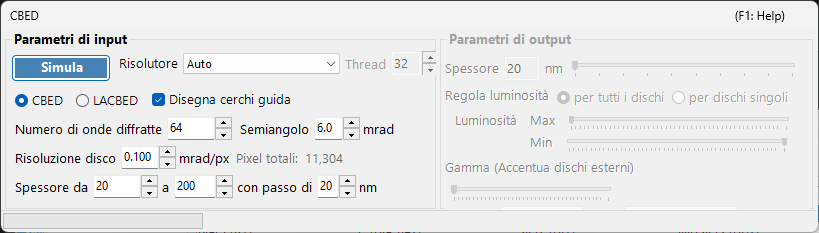
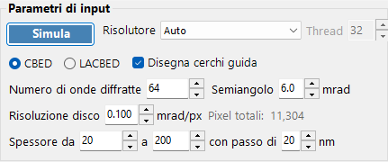
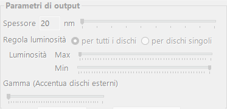

# Simulazione CBED

La **simulazione CBED (Convergent-Beam Electron Diffraction)** calcola e visualizza i pattern di diffrazione a fascio convergente utilizzando il metodo delle onde di Bloch (Bethe). I pattern CBED mostrano dischi di diffrazione anziché spot e contengono informazioni ricche sulla simmetria del cristallo, sullo spessore e sulla struttura.

> Questa pagina elenca tutte le impostazioni della finestra dedicata che si apre quando si seleziona **Sorgente d'onda = Elettroni** e **Ottica = Convergenza (elettroni)** nel [Simulatore di diffrazione](index.md). Selezionando **Convergenza (elettroni)**, il **Calcolo intensità** viene impostato automaticamente su **Teoria dinamica** e si apre questa finestra delle impostazioni CBED. Chiudendo questa finestra con il pulsante × l'**Ottica** torna a **Fascio parallelo**. <!-- 261105Cl 監査: FormDiffractionSimulatorMultislice_FormClosing (UserClosing) --> I dischi calcolati possono essere salvati da **File > Salva dischi CBED** / **Copia dischi CBED** della finestra principale. Per il disegno e il salvataggio dei pattern di diffrazione e per le altre operazioni comuni al simulatore di diffrazione, vedere la [pagina panoramica](index.md).

Condizioni GUI: Sorgente d'onda = Elettroni · Ottica = Convergenza (elettroni) · Calcolo intensità = Teoria dinamica (automatico)

---

## Parametri di input

Finché questa finestra è aperta, i pannelli **Impostazioni onde di Bloch** e **Aspetto** della finestra principale sono disabilitati; il numero di onde e gli spessori vengono presi da qui.

| Parametro | Descrizione | Predefinito / Tipico |
|-----------|-------------|-------------------|
| **CBED** / **LACBED** | **CBED**: pattern standard a fascio convergente in cui ogni disco corrisponde a una riflessione, con il disco trasmesso (000) al centro. **LACBED** (Large-Angle CBED): viene calcolato e disegnato solo il disco trasmesso (000), senza sommare i dischi vicini che si sovrappongono, per cui si può usare un semiangolo maggiore degli angoli di Bragg (LACBED in campo chiaro; la modalità non allarga di per sé il semiangolo). <!-- 261105Cl 監査: BetheMethod.cs cbed_DoWork (LACBED は 000 だけ)、radioButtonLACBED.ToolTip。「ディスクが重なる」は誤り --> Utile per osservare le linee HOLZ (higher-order Laue zone) e la simmetria | CBED |
| **Semiangolo (mrad)** | Semiangolo del cono del fascio convergente (0–2000 mrad). Determina la dimensione di ciascun disco di diffrazione (il diametro del disco nello spazio reciproco corrisponde a $2\alpha$) | predefinito 6 mrad; tipicamente 5–30 mrad |
| **Risoluzione disco (mrad/px)** | Risoluzione angolare all'interno di ciascun disco. Il disco è campionato su una griglia $N\times N$ con $N = \lceil 2\alpha / \text{resolution} \rceil$, e vengono calcolati solo i punti interni al cerchio. Valori più piccoli danno una risoluzione maggiore, ma il numero di direzioni del fascio cresce con il quadrato, quindi anche il tempo di calcolo aumenta in modo quadratico. Il conteggio risultante — il numero di pixel di ciascun disco, cioè le direzioni del fascio incidente all'interno del cerchio di convergenza, ognuna delle quali richiede un calcolo con le onde di Bloch — è mostrato come **Pixel totali** <!-- 261105Cl 監査: label2/labelDivisionNumber.ToolTip --> | predefinito 0.1 mrad/px |
| **Numero di onde diffratte** | Numero massimo di fasci inclusi nel calcolo delle onde di Bloch per ciascuna direzione del fascio incidente (1–2048). Più fasci danno una maggiore accuratezza, ma il costo del problema agli autovalori cresce come $O(N^3)$ | predefinito 64; tipicamente 100–500 |
| **Spessore da / a / con passo di** | Valori iniziale, finale e di passo dello spessore del campione (nm, ciascuno 1–1000). Più spessori vengono calcolati insieme e commutati con il cursore dello spessore sul lato di output | predefinito da 20 a 200 nm, passo 20 nm |
| **Risolutore** | Motore di calcolo. **Auto**; **Eigenproblem with Eigen lib.** / **Eigenproblem with MKL lib.** (diagonalizzazione); **Matrix exp. with Eigen lib.** / **Matrix exp. with MKL lib.** (metodo dell'esponenziale di matrice, v4.794). **Auto** usa il metodo dell'esponenziale di matrice con Eigen e tutti i processori logici quando Eigen è disponibile, altrimenti il problema agli autovalori con MKL. Il percorso dell'esponenziale di matrice richiede spessori equispaziati e in caso contrario ricade sul problema agli autovalori. Le voci MKL non sono offerte su ARM64, e le voci Eigen sono nascoste quando la libreria nativa Eigen non è disponibile | Auto |
| **Thread** | Numero di thread paralleli (1–128). Disabilitato con **Auto**; selezionando un risolutore viene impostato al numero di processori logici (¼ di esso per MKL) | — |
| **Disegna cerchi guida** | Quando selezionato, disegna sul pattern principale cerchi gialli che indicano il contorno di ciascun disco di diffrazione (in LACBED, un cerchio per 000 e croci per le altre riflessioni) | attivo |

---

## Simula / Arresta {#run-stop}

- **Simula** : avvia la simulazione CBED con i parametri di input correnti.
- **Arresta** : annulla il calcolo in corso. Il risultato dell'ultimo calcolo completato resta visualizzato (anche quando un calcolo non riesce). <!-- 261105Cl 監査: Bethe_CbedCompleted (completedDisks ほか) -->

---

## Parametri di output

Una volta completato il calcolo, i parametri di output diventano disponibili. Tutti modificano solo la visualizzazione senza ricalcolare.

| Parametro | Descrizione |
|-----------|-------------|
| **Spessore** | Seleziona con un cursore lo spessore del campione da visualizzare, tra gli spessori dell'ultimo calcolo completato (modificare in seguito le caselle dello spessore in input non lo cambia) (la tabella delle [informazioni sui riflessi di diffrazione](index.md#diffraction-spot-information) lo segue) <!-- 261105Cl 監査: CompletedThicknesses (最後に完了した計算の厚み) --> |
| **Regola luminosità** | **per tutti i dischi**: un'unica scala di luminosità, normalizzata al massimo su tutti i dischi. **per dischi singoli**: ogni disco è normalizzato al proprio massimo (γ viene azzerato a 0 e disabilitato) |
| **Luminosità (Max / Min)** | Limite superiore e inferiore dell'intensità visualizzata, come frazioni del massimo (alla posizione del cursore viene applicata la 4ª potenza). Da regolare quando si desidera enfatizzare caratteristiche deboli |
| **Gamma (Accentua dischi esterni)** | Moltiplica ogni pixel per $\exp(\gamma\,r)$, dove $r$ è la sua distanza dal centro del pattern, per rendere più visibili i dischi esterni scuri ad ampio angolo rispetto al disco trasmesso centrale. Attivo solo con **per tutti i dischi** |
| **Gradiente** | Seleziona la gradazione di intensità tra **Positive** / **Negative** (bianco-nero invertito) |
| **Colore** | Mappa di colori utilizzata per la visualizzazione: **Gray**, **Cold-warm**, **Spectrum** o **Fire** |

---

## Contesto fisico

Nel CBED il fascio incidente è considerato come un cono di onde piane con direzioni diverse. Per ciascuna direzione (ciascun punto all'interno dell'apertura di convergenza = un'onda piana incidente parziale) il metodo delle onde di Bloch risolve l'equazione di Schrödinger degli elettroni all'interno del cristallo, e i risultati vengono riorganizzati come dischi di diffrazione. Le linee HOLZ (higher-order Laue zone) appaiono come linee scure/chiare sottili all'interno dei dischi e derivano da riflessioni nelle zone di Laue superiori. Sono sensibili al parametro reticolare lungo l'asse $c$ e sono utili per l'analisi strutturale tridimensionale.

Per i dettagli teorici, vedere [Calcolo CBED](../appendix/a3-bloch-wave/cbed.md).

---

## Vedere anche

- [Simulatore di diffrazione (panoramica)](index.md)
- [Simulazione SAED](1-saed-simulation.md)
- [Simulazione PED](2-ped-simulation.md)
- [Calcolo CBED](../appendix/a3-bloch-wave/cbed.md)
