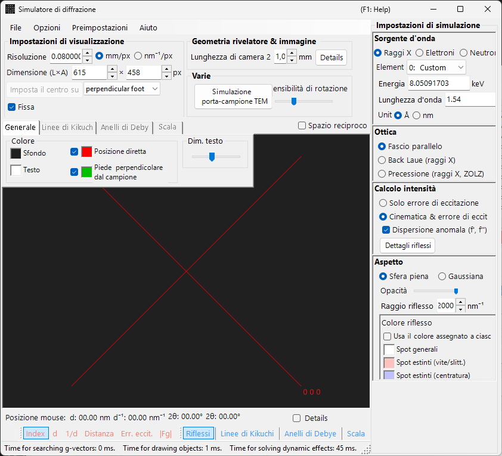
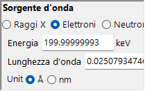
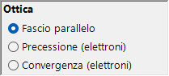
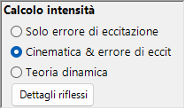
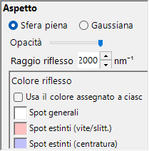
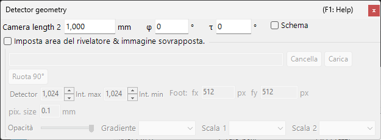

# Simulazione della diffrazione di raggi X / neutroni

La **simulazione della diffrazione di raggi X / neutroni** calcola i pattern di diffrazione di raggi X e neutroni da monocristallo. È una delle modalità principali del [simulatore di diffrazione](index.md).

> Questa pagina elenca tutte le impostazioni che compaiono sul lato destro quando si seleziona **Sorgente d'onda** = **Raggi X** (o **Neutroni**). Per le operazioni a livello di finestra, come il disegno e il salvataggio, consultare la [pagina panoramica](index.md).

Condizioni della GUI: Sorgente d'onda = Raggi X / Neutroni · Ottica = Fascio parallelo / Precessione (raggi X, ZOLZ) / Back Laue (raggi X) · Calcolo intensità = Solo errore di ecc. / Cinematica & err. ecc.

---

## Panoramica

I raggi X hanno una lunghezza d'onda maggiore degli elettroni (Cu Kα: 0.15406 nm = 1.5406 Å), per cui la sfera di Ewald è più fortemente curvata. Di conseguenza, un numero minore di punti del reticolo reciproco soddisfa simultaneamente la condizione di diffrazione rispetto agli elettroni. Poiché il potere di diffusione atomico è piccolo e la diffusione multipla è debole, la teoria cinematica della diffrazione fornisce un'accuratezza sufficiente per le intensità (il calcolo dinamico è supportato solo per gli elettroni).

---

## Sorgente d'onda {#wave-length}

Selezionare **Raggi X** come **Sorgente d'onda**. I raggi X possono essere specificati in due modi: raggi X caratteristici e radiazione di sincrotrone.

### Raggi X caratteristici

La scelta di un **elemento** e di una **transizione** fissa la lunghezza d'onda dei raggi X caratteristici. La transizione è specificata nella notazione di Siegbahn (Kα₁ / Kα₂ / Kβ, ecc.). Lunghezze d'onda Kα₁ di elementi rappresentativi:

| Elemento | Linea | Lunghezza d'onda (Å) | Energia (keV) |
|---------|------|-----------------|--------------|
| Cu | Kα₁ | 1.5406 | 8.048 |
| Mo | Kα₁ | 0.7093 | 17.479 |
| Co | Kα₁ | 1.7890 | 6.930 |
| Cr | Kα₁ | 2.2897 | 5.415 |

### Radiazione di sincrotrone

Impostare **Element** su **0: Custom** e inserire direttamente l'energia (keV) o la lunghezza d'onda (Å). È possibile utilizzare qualsiasi lunghezza d'onda.

---

## Ottica {#incident-beam-mode}

Seleziona la geometria del fascio incidente. Per i raggi X sono disponibili tre modalità.

### Fascio parallelo {#parallel}

L'onda piana standard. Un fascio incidente parallelo utilizzato per SAED e per la diffrazione di raggi X da monocristallo.

### Precessione (raggi X, ZOLZ) — camera di precessione {#precession-x-ray--precession-camera}

Simula una camera di precessione a raggi X. Si tratta di una fotografia di precessione che cattura un singolo strato del reticolo reciproco. Gli anelli di Debye sono disegnati come cerchi di raggio $2L_2\sin\theta$ ($L_2$ = lunghezza di camera 2), come i cerchi della scala 2θ. <!-- 261105Cl 監査: DrawDebyeRing (C6) -->

### Back Laue (raggi X) — Laue in retroriflessione {#back-laue-back-reflection-laue}

Simula un pattern di Laue in retroriflessione con raggi X bianchi (policromatici). In questa geometria di retroriflessione il rivelatore è collocato sul lato della sorgente; le caselle di energia / lunghezza d'onda e il selettore dell'elemento del controllo **Sorgente d'onda** vengono nascosti e al loro posto compare **Flat white**. Gli spot sono proiettati su un rivelatore piano **perpendicolare al fascio**, posto alla lunghezza di camera sul lato della sorgente; l'inclinazione del rivelatore **Tau / Phi** della [geometria del rivelatore](index.md#detector-geometry) non viene usata in questa proiezione.

- Lo spettro bianco è troncato a **50 keV**: le riflessioni vengono raccolte fino a $d = \lambda(50\ \text{keV})/2$ e non si applica alcuna pesatura spettrale.
- Le armoniche $n\mathbf{g}$ che giacciono sulla stessa retta passante per l'origine cadono sullo stesso spot; i loro $\lvert F\rvert^2$ vengono sommati sulla riflessione di ordine più basso e le intensità degli spot sono normalizzate allo spot più intenso.
- **Dispersione anomala (f', f'')** è disabilitata (l'energia non ha un valore unico) e **Raggio riflesso** non ha unità in questa modalità.
- 2θ (posizione del mouse, etichette degli spot e scala 2θ) è l'angolo di diffusione: 180° in corrispondenza del foro del fascio al centro, decrescente verso l'esterno. <!-- 261105Cl 監査: Back Laue の 2θ (C13) -->
- Vengono disegnati tutti i cristalli selezionati; con più di un cristallo (o con **Colore per cristallo** attivo) gli spot di ciascun cristallo assumono il colore di quel cristallo. <!-- 261105Cl 監査: Back Laue の複数結晶 -->

> **Nota**: Le opzioni di **Ottica** seguono la sorgente d'onda. **Precessione (elettroni)** e **Convergenza (elettroni)** compaiono solo quando è selezionato **Elettroni**, mentre le opzioni **Precessione (raggi X, ZOLZ)** e **Back Laue (raggi X)** sopra indicate compaiono solo quando è selezionato **Raggi X**. Per i neutroni è disponibile solo **Fascio parallelo**. A seconda dello stato al momento dell'acquisizione, lo screenshot potrebbe non mostrare le opzioni specifiche dei raggi X.

---

## Calcolo dell'intensità

Seleziona il metodo utilizzato per calcolare le intensità degli spot. Per i raggi X sono disponibili due modalità.

### Solo errore di ecc.

L'intensità è determinata esclusivamente dalla distanza geometrica tra la sfera di Ewald e il punto del reticolo reciproco (l'errore di eccitazione $S_g$). È massima per $S_g = 0$ — esattamente sulla sfera — e decresce al crescere di $\lvert S_g\rvert$, annullandosi non appena $\lvert S_g\rvert$ supera il **Raggio riflesso** indicato per il punto del reticolo reciproco. Il fattore di struttura viene ignorato.

Solo in questa modalità compaiono le opzioni seguenti:

- **Escludi tutte le riflessioni proibite** / **Escludi le riflessioni proibite dalla centratura reticolare** (predefinito: solo centratura reticolare) : nascondono le riflessioni proibite dal gruppo spaziale. Le riflessioni non nascoste vengono disegnate con i colori distinti impostati in **Colore riflesso** (proibite da assi elicoidali/piani di slittamento e proibite dal reticolo).
- **Disegna tutti i riflessi con lo stesso raggio** : disegna ogni spot con la dimensione corrispondente a $S_g = 0$, indipendentemente dal suo errore di eccitazione.

### Cinematica & err. ecc.

Oltre all'errore di eccitazione, il fattore di struttura cinematico $\lvert F_{hkl} \rvert^2$ viene incorporato nell'intensità. Le regole di estinzione sono rigorosamente rispettate. I fattori di Lorentz e di polarizzazione non sono inclusi (si tratta di una simulazione del pattern geometrico).

- **Dispersione anomala (f', f'')** (solo raggi X, attiva per impostazione predefinita) : aggiunge al fattore di struttura (e anche agli anelli di Debye) i termini di dispersione anomala f′, f″ all'energia corrente dei raggi X. In una struttura non centrosimmetrica che contiene diffusori anomali chimicamente distinti, la legge di Friedel cessa allora di valere e le intensità di $hkl$ / $\bar h\bar k\bar l$ differiscono (coppie di Bijvoet); l'effetto è massimo in prossimità di uno spigolo di assorbimento. Disabilitata per Back Laue. Vedere [Fattore di struttura](../appendix/a2-beam-interaction/structure-factor.md).

> **Nota**: La **Teoria dinamica** è disabilitata per i raggi X (disponibile solo quando è selezionata la radiazione elettronica).

---

## Aspetto degli spot

Controlla come viene reso ciascuno spot di diffrazione.

- **Sfera piena / Gaussiana** : modello geometrico del punto del reticolo reciproco. **Sfera piena** disegna la sezione trasversale tra una sfera e la sfera di Ewald; con **Cinematica & err. ecc.** il raggio della sfera è $R \times I_\text{rel}^{1/3}$ (cosicché il *volume* della sfera è proporzionale all'intensità relativa), con **Solo errore di ecc.** è *R* stesso. **Gaussiana** utilizza la sezione trasversale tra una gaussiana 3-D con σ = *R* e la sfera di Ewald (l'integrale della gaussiana 2-D corrisponde all'intensità di diffrazione); gli spot con $\lvert S_g\rvert \ge 3R$ non vengono disegnati.
- **Opacità** : trasparenza dello spot (0 = trasparente, 1 = opaco).
- **Raggio riflesso (R)** : raggio del punto del reticolo reciproco. La dimensione dello spot reso è determinata dalla combinazione di **Aspetto** e **Calcolo intensità**.
- **Luminosità** : attivo solo nella modalità **Gaussiana**. Imposta l'intensità integrata della gaussiana resa.
- **Scala colori** (solo Gaussiana) : **Gray**, **Cold-warm**, **Spectrum** o **Fire**.
- **Scala log** (solo Gaussiana) : visualizza le intensità su scala logaritmica.
- **Colore riflesso** : colori degli spot usati con la scala colori **Gray** (questo gruppo è nascosto per le altre scale colori).
- **Colore per cristallo** : se selezionato, disegna gli spot nel colore assegnato a ciascun cristallo.

---

## Anelli di Debye (policristallino)

È possibile visualizzare gli anelli di Debye di un campione policristallino. Abilitare **Anelli di Debye** sulla barra degli strumenti (vedere [Barra degli strumenti](index.md#toolbar)).

- **Ignora intensità di diffrazione** : disegna tutti gli anelli con lo stesso colore e la stessa intensità (utilizzato per un confronto puramente geometrico che ignora il fattore di struttura).
- **Mostra etichette indici** : visualizza gli indici {*hkl*} accanto a ciascun anello (quattro indici {*hkil*} con **Opzioni ▸ Usa indici di Miller-Bravais (hkil)** attivo per gli assi esagonali). <!-- 261105Cl 監査: DrawDebyeRing (C23) -->

Le impostazioni dettagliate si trovano nella scheda Anelli di Debye del [menu a schede](index.md#drawing-overlay-tabs).

---

## Diffrazione di neutroni

La selezione di **Neutroni** in **Sorgente d'onda** calcola un pattern di diffrazione di neutroni. Inserire l'energia (meV) o la lunghezza d'onda (Å o nm, commutabile; predefinito Å). L'**Ottica** può essere solo **Fascio parallelo**. Il calcolo dell'intensità può essere **Solo errore di ecc.** o **Cinematica & err. ecc.** (la **Teoria dinamica** non è disponibile). L'intensità cinematica utilizza la lunghezza di diffusione del neutrone al posto del fattore di diffusione atomico.

---

## Differenze tra diffrazione di raggi X ed elettronica

| Caratteristica | Diffrazione di raggi X | Diffrazione elettronica |
|---------|-------------------|----------------------|
| Lunghezza d'onda | Lunga (0.5–2.5 Å) | Corta (0.02–0.04 Å) |
| Curvatura della sfera di Ewald | Grande | Piccola (quasi piatta) |
| Riflessioni simultanee | Poche | Molte |
| Fattore di diffusione | Fattore di diffusione atomico $f(s)$ | Fattore di diffusione elettronico $f_e(s)$ |
| Effetti dinamici | Solitamente piccoli | Grandi |
| Regole di estinzione | Rigorosamente rispettate | Possono essere violate dalla diffusione multipla |

---

## Operazioni comuni

Per le operazioni a livello di finestra come la lunghezza della camera, la geometria del rivelatore, il salvataggio dei pattern e le impostazioni dei colori, consultare la [pagina panoramica](index.md). La geometria dettagliata del rivelatore si configura nella finestra di geometria seguente.

---

## Vedere anche

- [Simulatore di diffrazione (panoramica)](index.md)
- [Simulazione SAED](1-saed-simulation.md)
- [Simulazione di diffrazione elettronica in precessione (PED)](2-ped-simulation.md)
- [Simulazione di diffrazione elettronica a fascio convergente (CBED)](3-cbed-simulation.md)
- [Sistema di coordinate — orientazione del cristallo](../appendix/a1-coordinate-system/1-orientation.md)
