# Crystal Diffraction (Simulatore di diffrazione)

**Crystal Diffraction (Simulatore di diffrazione)** simula i pattern di diffrazione di raggi X, neutroni ed elettroni da cristallo singolo.

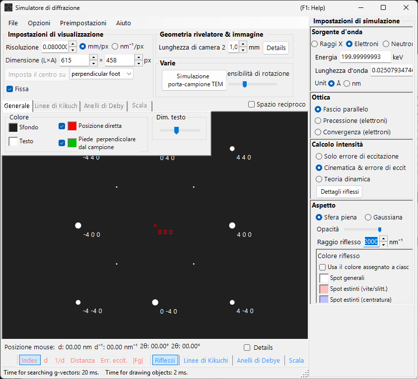

La finestra presenta **a sinistra** un'area di disegno per il pattern di diffrazione e **a destra** i pannelli di impostazione per le proprietà dei riflessi (lunghezza d'onda, fascio incidente, calcolo dell'intensità, aspetto e così via). La combinazione di lunghezza d'onda e fascio incidente determina la modalità di acquisizione (diffrazione di raggi X, SAED, PED, CBED), e i pannelli di destra si riconfigurano di conseguenza.

---

## Come questa pagina e le pagine delle modalità si suddividono il lavoro

- **Questa pagina (hub)**: raccoglie le operazioni comuni a ogni modalità (scorciatoie, menu, barra degli strumenti, informazioni su schermo/rivelatore, schede di overlay, informazioni sui riflessi, geometria del rivelatore, compressione dinamica).
- **Ogni pagina di modalità**: tratta **ogni impostazione che appare a destra** quando quella modalità è selezionata (lunghezza d'onda, fascio incidente, calcolo dell'intensità, aspetto, impostazioni delle onde di Bloch, impostazioni di precessione e così via), in modo che ogni pagina sia autonoma (tra le modalità esiste qualche sovrapposizione).

| Modalità | Contenuto | Pagina |
|------|----------|------|
| **Diffrazione di raggi X (e di neutroni)** | Pattern di diffrazione di raggi X / neutroni da cristallo singolo (parallelo, raggi X a precessione, Back Laue) | [Simulazione di diffrazione di raggi X](5-x-ray-neutron-diffraction.md) |
| **SAED** | Diffrazione elettronica a fascio parallelo (selected-area electron diffraction) | [Simulazione SAED](1-saed-simulation.md) |
| **PED** | Diffrazione elettronica a precessione | [Simulazione PED](2-ped-simulation.md) |
| **CBED** | Diffrazione elettronica a fascio convergente | [Simulazione CBED](3-cbed-simulation.md) |

> **ALCHEMI non è una modalità.** A differenza di raggi X / SAED / PED / CBED, determinati dalla combinazione di lunghezza d'onda e fascio incidente, il simulatore ALCHEMI è una **finestra figlia** che si apre dal menu **Opzioni**; qui è quindi elencato separatamente.

| Finestra figlia | Contenuto | Pagina |
|------|------|------|
| **Simulatore ALCHEMI** | Curve di rocking di ionizzazione risolte per sito (microanalisi potenziata dalla canalizzazione) | [Simulazione ALCHEMI](4-alchemi-simulation.md) |

---

## Riferimento rapido alle modalità

Individua la pagina che ti serve dalla combinazione di **lunghezza d'onda (sorgente)** e **fascio incidente**.

| Lunghezza d'onda | Fascio incidente | Modalità | Pagina |
|------------|--------------------|------|------|
| Elettrone | Parallelo | SAED | [Simulazione SAED](1-saed-simulation.md) |
| Elettrone | Precessione (elettrone = PED) | PED | [Simulazione PED](2-ped-simulation.md) |
| Elettrone | Convergenza (CBED) | CBED | [Simulazione CBED](3-cbed-simulation.md) |
| Raggi X | Parallelo | Diffrazione di raggi X | [Simulazione di diffrazione di raggi X](5-x-ray-neutron-diffraction.md) |
| Raggi X | Precessione (raggi X) | Raggi X a precessione (camera di precessione) | [Simulazione di diffrazione di raggi X](5-x-ray-neutron-diffraction.md) |
| Raggi X | Back Laue | Laue in retrodiffusione | [Simulazione di diffrazione di raggi X](5-x-ray-neutron-diffraction.md) |
| Neutrone | Parallelo | Diffrazione di neutroni | [sezione neutroni della Simulazione di diffrazione di raggi X](5-x-ray-neutron-diffraction.md) |

> **Note**: Le scelte del fascio incidente (**Ottica**) cambiano con la lunghezza d'onda. Per gli elettroni: **Fascio parallelo, Precessione (elettroni), Convergenza (elettroni)**; per i raggi X: **Fascio parallelo, Precessione (raggi X, ZOLZ), Back Laue (raggi X)**; per i neutroni: solo **Fascio parallelo**. Ogni cambio della sorgente d'onda riporta sempre l'ottica a **Fascio parallelo**. La selezione di **Precessione (elettroni)** o **Convergenza (elettroni)** commuta automaticamente il calcolo dell'intensità su **Teoria dinamica**; **Teoria dinamica** è disponibile solo per gli elettroni (selezionando raggi X o neutroni si torna a **Cinematica & err. ecc.**). Back Laue usa un fascio bianco (policromatico).

---

## Scorciatoie da tastiera e mouse

Si applicano alla finestra del pattern di diffrazione condivisa dalle simulazioni di raggi X, SAED e PED. Trascinare sul pattern ruota il **cristallo**. Lo zoom si esegue con la rotellina del mouse oppure con clic destro / trascinamento destro.

| Scorciatoia | Azione |
|----------|--------|
| <kbd>F1</kbd> | Aprire questa pagina del manuale online |
| Trascinamento sinistro vicino al centro | Inclinare il cristallo |
| Trascinamento sinistro nell'area esterna | Far ruotare il cristallo attorno all'asse del fascio |
| Doppio clic sinistro su un riflesso | Mostrare i dettagli del riflesso (indice, *d*, fattore di struttura, errore di eccitazione) |
| Trascinamento centrale | Spostare il pattern |
| <kbd>CTRL</kbd> + Trascinamento centrale | Spostare il centro del rivelatore (quando l'area del rivelatore è mostrata) |
| Rotellina del mouse | Zoom avanti / indietro di ×2 per scatto; il punto sotto il cursore viene portato al centro della vista (con **Fissa** spuntata viene invece mantenuto il centro fissato) |
| Clic destro | Zoom indietro (×1/1.2) |
| Trascinamento destro di un riquadro | Zoom avanti sulla regione selezionata |
| Doppio clic destro sulla barra di stato | Copiare un riepilogo testuale delle impostazioni correnti |
| Doppio clic destro su un pulsante di livello acceso (Riflessi / Linee di Kikuchi / Anelli di Debye / Scala) | Far lampeggiare quel livello accendendolo e spegnendolo |

Le finestre ausiliarie aperte da qui aggiungono ancora qualche scorciatoia:

| Scorciatoia | Azione |
|----------|--------|
| Doppio clic sinistro sullo stereogramma — **Simulazione portacampioni TEM** | Impostare l'inclinazione del portacampioni su quel punto |
| Tasti freccia — **Simulazione portacampioni TEM** | Avanzare l'inclinazione del portacampioni a passi (spunta prima **Abilita tasti freccia**; funziona con qualsiasi finestra di ReciPro in primo piano) |
| Rilasciare un file `.prm` o un'immagine — **Detector geometry** | Caricare la geometria del rivelatore / l'immagine di overlay |
| Rilasciare un profilo `.txt` — **Compressione dinamica** | Caricare profili posizione/tempo/pressione (scegli l'istante con il cursore **Tempo**; trascina le linee verticali nel grafico per impostare fronte/retro) |

Le scorciatoie <kbd>CTRL</kbd>+<kbd>SHIFT</kbd> a livello di applicazione della finestra principale funzionano anche mentre questa finestra è in primo piano (vedi [finestra principale](../0-main-window.md)).

→ Vedi **[21. Scorciatoie da tastiera e mouse](../21-shortcuts.md)** per tutte le finestre a colpo d'occhio.

---

## Percorsi rapidi per obiettivo

| Obiettivo | Partire da | Riferimento |
|------|------------|-----------|
| Produrre diffrazione elettronica a fascio parallelo (SAED) | Impostare **Ottica** su **Fascio parallelo** e la **Sorgente d'onda** su **Elettroni** | [Simulazione SAED](1-saed-simulation.md), [calcolo SAED a fascio parallelo](../appendix/a3-bloch-wave/calculation.md) |
| Produrre diffrazione di raggi X da cristallo singolo | Commutare la **Sorgente d'onda** su **Raggi X** (tubo o sincrotrone) | [Simulazione di diffrazione di raggi X](5-x-ray-neutron-diffraction.md) |
| Produrre diffrazione elettronica a precessione (PED) | Impostare **Ottica** su **Precessione (elettroni)**, quindi impostare il semiangolo e il passo | [Simulazione PED](2-ped-simulation.md) |
| Produrre diffrazione elettronica a fascio convergente (CBED) | Impostare **Ottica** su **Convergenza (elettroni)** e impostare le condizioni nella finestra CBED | [Simulazione CBED](3-cbed-simulation.md), [calcolo CBED](../appendix/a3-bloch-wave/cbed.md) |
| Ispezionare l'elenco dei riflessi dal calcolo dinamico | Selezionare **Teoria dinamica** e premere **Dettagli riflessi** | [Calcolo dinamico (nucleo condiviso)](../appendix/a3-bloch-wave/calculation.md) |
| Confrontare la geometria del rivelatore con un'immagine sperimentale | Aprire le impostazioni della geometria del rivelatore da **Details** in **Geometria rivelatore & immagine sovrapp.** e usare l'immagine di overlay | [Sistema di coordinate del rivelatore](../appendix/a1-coordinate-system/2-diffraction.md) |

---

## Area principale

Il pattern di diffrazione viene simulato al centro dello schermo.

### Uso del mouse

Vedi "Scorciatoie da tastiera e mouse" all'inizio di questa pagina.

### Posizione del mouse

La riga **Posizione mouse:** sopra il pattern mostra, per la posizione del cursore, *d* (nm), *d*⁻¹ (nm⁻¹) e 2θ (in gradi e in rad, oppure in mrad sotto 0.1 rad). Spuntare **Details** aggiunge tre letture di coordinate: le coordinate del rivelatore (mm, origine = piede della perpendicolare dal campione), le coordinate nello spazio reale (mm, origine = cristallo) e le coordinate nello spazio reciproco (nm⁻¹). In modalità Back Laue i valori di *d* e dello spazio reciproco sono mostrati come "-".

---

## Menu "File"

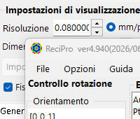

| Voce di menu | Descrizione |
|-----------|-------------|
| **Salva immagine** | Salvare il pattern di diffrazione visualizzato, **come immagine (formato PNG)** o **come metafile (EMF)**. |
| **Salva area rivelatore** | Salvare solo il ritaglio dell'area del rivelatore (PNG / EMF). Visibile solo mentre l'area del rivelatore è mostrata. |
| **Salva dischi CBED** | Solo in modalità CBED: salvare i dischi calcolati **come immagini singole (formato PNG / TIFF)** o **come immagine collettiva (formato PNG / TIFF)**. |
| **Copia** | Copiare l'immagine visualizzata negli appunti (**come immagine** / **come metafile (EMF)**). |
| **Copia area rivelatore** | Copiare solo il ritaglio dell'area del rivelatore. Visibile solo mentre l'area del rivelatore è mostrata. |
| **Copia dischi CBED** | Solo in modalità CBED: copiare i dischi **come immagine collettiva**. |
| **Salva video** | Registrare un video del **Pattern di diffrazione** o della vista dello **Spazio reciproco**. |
| **Imposta pagina / Anteprima di stampa / Stampa** | Stampare il pattern visualizzato. |

### Preimpostazioni {#preset}

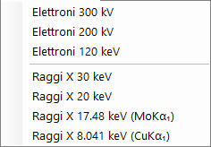

Preimpostazioni fisse della sorgente d'onda, che impostano solo la radiazione e la sua energia: **Elettroni 300 kV**, **Elettroni 200 kV**, **Elettroni 120 keV**, **Raggi X 30 keV**, **Raggi X 20 keV**, **Raggi X 17.48 keV (MoKα₁)** e **Raggi X 8.041 keV (CuKα₁)** (le ultime due selezionano la riga caratteristica Kα₁ di Mo / Cu). Le altre impostazioni (geometria del rivelatore, schede, proprietà dei riflessi) non vengono memorizzate né modificate.

### Menu Opzioni e Guida

| Voce di menu | Descrizione |
|-----------|-------------|
| **Opzioni > Compressione dinamica** | Apre la finestra [Compressione dinamica](#dynamic-compression) (insieme alla finestra della geometria del rivelatore). |
| **Opzioni > Simulatore ALCHEMI...** | Apre il [Simulatore ALCHEMI](4-alchemi-simulation.md). |
| **Guida > Concetto base del metodo di Bethe** | Apre nel browser l'[appendice sulle onde di Bloch](../appendix/a3-bloch-wave/index.md) del manuale online. |

---

## Barra degli strumenti {#toolbar}

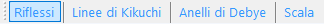

| Pulsante | Descrizione |
|--------|-------------|
| Riflessi | Mostrare / nascondere il livello dei riflessi di diffrazione |
| Linee di Kikuchi | Mostrare / nascondere il livello delle linee di Kikuchi |
| Anelli di Debye | Mostrare / nascondere il livello degli anelli di Debye |
| Scala | Mostrare / nascondere il livello delle linee di scala |
| Index / d / 1/d / Distanza / 2θ / χ / Err. eccit. / \|Fg\| | Scelta dell'etichetta associata a ciascun riflesso (indice, *d*, 1/*d*, distanza, 2θ, χ, errore di eccitazione, fattore di struttura) |

---

## Informazioni su schermo e rivelatore

### Schermo

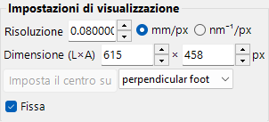

| Elemento | Descrizione |
|------|-------------|
| **Risoluzione** | La dimensione di un pixel dello schermo, in **mm/px** (sul piano del rivelatore) o in **nm⁻¹/px** (selezionabile; predefinito 0.08 mm/px). Non deve necessariamente corrispondere alla dimensione effettiva del pixel del rivelatore; viene trattata come scala di visualizzazione e si aggiorna automaticamente quando esegui lo zoom con il mouse. |
| **Dimensione (L×A)** | Larghezza e altezza in pixel dell'area di disegno. A seconda della risoluzione del display, valori molto grandi potrebbero non essere impostabili. |
| **Imposta il centro su / Fissa** | Porta il centro dell'area di disegno sul piede della perpendicolare (**perpendicular foot**), sul fascio diretto (**direct spot**) o sul centro del rivelatore (**detector**; quest'ultimo solo quando è definita un'area del rivelatore). Con **Fissa** spuntata (predefinito) il centro resta lì: lo spostamento con il mouse è disabilitato e lo zoom mantiene quel centro. |
| **Ribalta orizzontale / Ribalta verticale / Immagine negativa** | Ribaltamenti geometrici (orizzontale / verticale) e inversione del contrasto del pattern visualizzato. Usali per far corrispondere l'orientazione o il contrasto di un'immagine sperimentale. |
| **Spazio reciproco** | Apre accanto al pattern una vista 3D della sfera di Ewald e dei punti del reticolo reciproco, visualizzando quali riflessi sono eccitati. Il suo pannello **Opzioni** imposta i colori (riflessi vicini / lontani dalla sfera di Ewald, sfera di Ewald, origine, guida di direzione), il raggio dei riflessi in 3D (nm⁻¹), la soglia di intensità relativa (%), la trasparenza dei riflessi lontani dalla sfera di Ewald, le etichette e la direzione di vista (pulsanti freccia con un **Passo** angolare, **Reimposta**). |

### Rivelatore (lunghezza di camera)

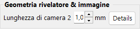

- **Lunghezza di camera 2** : Distanza (mm) dal campione al piede della perpendicolare condotta sul piano del rivelatore (predefinita 1000 mm). Coincide con la consueta lunghezza di camera quando il rivelatore non è inclinato (τ = 0).
- **Details** : Apre la finestra delle impostazioni della geometria del rivelatore (vedi [Geometria del rivelatore](#detector-geometry) di seguito).

### Varie {#misc}

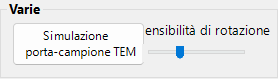

- **Sensibilità di rotazione** : Quantità di rotazione del cristallo per pixel di trascinamento del mouse.
- **Simulazione portacampioni TEM** : Apre la finestra di simulazione collegata al portacampioni (vedi sotto).

---

## Simulazione del portacampioni TEM

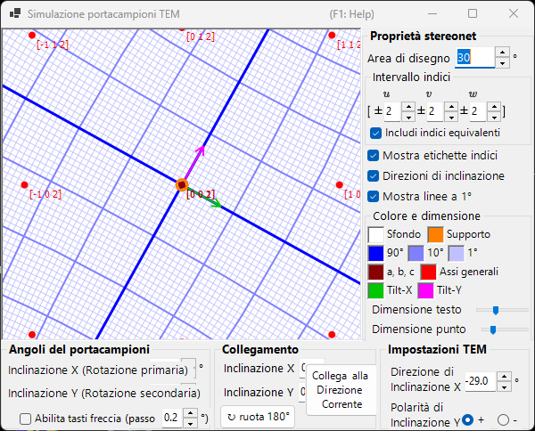

Apre una finestra che collega il pattern di diffrazione a un **portacampioni TEM** a doppia inclinazione (**Inclinazione X** = rotazione primaria, **Inclinazione Y** = rotazione secondaria). L'impostazione degli angoli di inclinazione del portacampioni aggiorna il pattern e l'orientazione del cristallo, e le orientazioni raggiungibili possono essere mostrate su uno stereogramma (aggiunto in v4.914). **Collega alla Direzione Corrente** assume l'orientazione attuale del cristallo come riferimento del portacampioni (ai valori di Inclinazione X / Inclinazione Y indicati); **Impostazioni TEM** fornisce la direzione dell'asse di Inclinazione X sullo schermo (predefinita −29°) e la polarità di Inclinazione Y, e **↻ ruota 180°** ruota il cristallo di 180° attorno al fascio. Un doppio clic sinistro sullo stereogramma imposta l'inclinazione del portacampioni su quel punto, e spuntare **Abilita tasti freccia** consente di avanzare a passi Inclinazione X con ←/→ e Inclinazione Y con ↑/↓ (passo 0.1–2°, predefinito 0.2°). Finché questa finestra è aperta, i tasti freccia funzionano qualunque sia la finestra di ReciPro in primo piano.

---

## Schede di overlay del disegno {#drawing-overlay-tabs}

### Generale {#general}

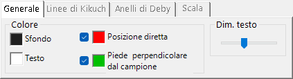

Imposta la dimensione del testo delle etichette (**Dim. testo**) e i colori del **Testo** delle etichette, del marcatore **Piede perpendicolare dal campione**, del marcatore **Posizione diretta** e dello **Sfondo** (i due marcatori possono essere disattivati singolarmente). I colori dei riflessi si impostano in **Aspetto** (vedi le pagine delle modalità); i colori delle linee di Kikuchi, degli anelli di Debye e delle linee di scala nelle rispettive schede. Le impostazioni qui si applicano a tutte le modalità di rendering.

### Linee di Kikuchi

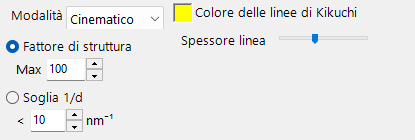

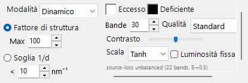

Attiva quando le linee di Kikuchi sono abilitate nella barra degli strumenti.

- **Selezione dei riflessi** : Scegli quali riflessi generano le linee di Kikuchi. O **Fattore di struttura** (i primi *N* riflessi per $\lvert F_{hkl}\rvert$, campo **Max**; 1–1000, predefinito 100) oppure **Soglia 1/d** (tutti i riflessi il cui 1/d è inferiore alla soglia; 0–100 nm⁻¹, predefinito 10).
- **Modalità** : Come vengono disegnate le linee di Kikuchi (predefinito **Cinematico**). Le impostazioni sotto la casella combinata cambiano con la modalità.
    - **Geometrico** : tutte le linee selezionate in un colore fisso.
    - **Cinematico** : la scurezza della linea segue l'intensità relativa cinematica di ogni riflessione.
    - **Dinamico** : profili di banda eccesso/deficiente dinamici a due onde alimentati dalla diffusione termica diffusa, calcolati in background. Le bande di eccesso compaiono sul lato degli angoli alti e i tratti deficienti verso il fascio diretto; lo spessore del campione è condiviso con le impostazioni di intensità. Durante il calcolo vengono disegnate le linee geometriche.
- **Impostazioni Geometrico / Cinematico** : **Colore delle linee di Kikuchi** e **Spessore linea**.
- **Impostazioni Dinamico** :
    - **Eccesso** / **Deficiente** : colori del lato chiaro (contrasto positivo) e scuro (contrasto negativo) delle bande.
    - **Bande** : Numero di bande disegnate con profili dinamici (le *N* migliori per contrasto dinamico; 1–50, predefinito 30).
    - **Qualità** : Punti di campionamento attraverso ogni banda (Veloce 65 / Standard 129 / Alta 257; predefinito Standard).
    - **Contrasto** : Guadagno di visualizzazione applicato al contrasto di banda prima della compressione.
    - **Scala** : Curva di compressione della luminosità (Linear / Log / Tanh; predefinito Tanh). Sono trasformazioni di visualizzazione, non risposte fisiche della camera.
    - **Luminosità fissa** : Blocca la normalizzazione della luminosità, ad es. per confrontare orientazioni o spessori diversi.
    - La riga di avviso grigia riporta la nota di squilibrio sorgente/perdita, il numero di bande disegnate e diagnostiche (ad es. fattore *B* predefinito sostituito negli atomi con *B* = 0).
- (Il precedente parametro separato **Threshold** non esiste più; i riflessi sono limitati solo dalla selezione sopra.)

### Anelli di Debye

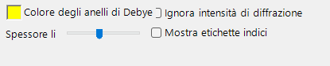

Attiva quando gli anelli di Debye sono abilitati nella barra degli strumenti.

- **Ignora intensità di diffrazione** : Se spuntata, tutti gli anelli di Debye sono disegnati con lo stesso colore e la stessa intensità (ignorando il fattore di struttura del cristallo). Usala per un confronto puramente geometrico.
- **Mostra etichette indici** : Se spuntata, l'(*hkl*) appare vicino a ciascun anello.

### Scala {#scale}

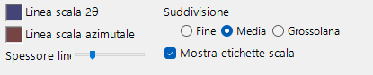

Attiva quando le linee di scala sono abilitate nella barra degli strumenti.

- **Linea scala 2θ / Linea scala azimutale** : **2θ** rappresenta un angolo di diffusione costante (cerchi concentrici), l'azimut rappresenta un angolo di azimut costante (linee radiali dal centro). I colori sono configurabili in modo indipendente.
- **Spessore linea** : Spessore delle linee di scala.
- **Suddivisione** : Densità delle linee di scala, **Fine** / **Media** (predefinito) / **Grossolana**.
- **Mostra etichette scala** : Se disegnare etichette numeriche sulle linee di scala.

(Non esiste una scheda *Misc* separata; la **Sensibilità di rotazione** del mouse si trova nel gruppo **Varie** del pannello di destra, vedi [Varie](#misc) sopra.)

---

## Informazioni sui riflessi di diffrazione {#diffraction-spot-information}

Elenca i dettagli per riflesso calcolati con il metodo delle onde di Bloch (calcolo dinamico). Aprila con il pulsante **Dettagli riflessi** nel pannello del calcolo dell'intensità. In modalità **Solo errore di ecc.** / **Cinematica & err. ecc.** il pulsante elenca i riflessi attualmente disegnati con i loro potenziali elettronici e $P_g$, $Q_g$ (senza ampiezze dinamiche); in modalità CBED la tabella segue lo spessore selezionato nella finestra CBED.

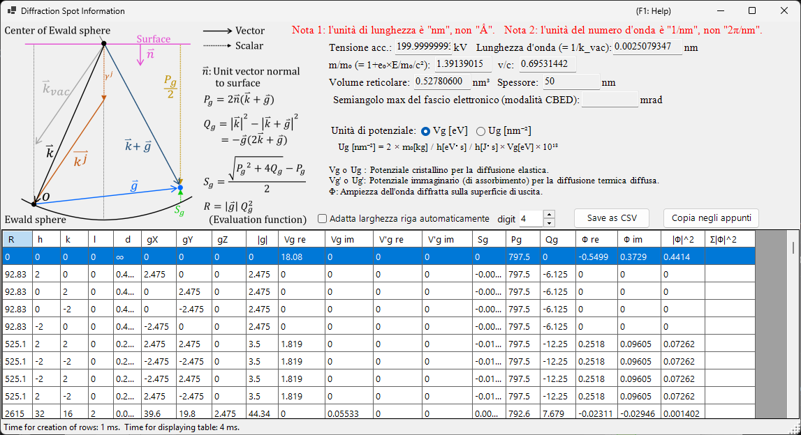

### Schema e definizioni

Lo schema (in alto a sinistra) mostra i vettori sulla sfera di Ewald e definisce le grandezze usate nella tabella ($\hat{\mathbf{n}}$ è il versore normale alla superficie del campione, $\mathbf{k}$ è il vettore d'onda incidente, $\mathbf{g}$ è il vettore del reticolo reciproco).

- $P_g = 2\,\hat{\mathbf{n}} \cdot (\mathbf{k} + \mathbf{g})$
- $Q_g = |\mathbf{k}|^2 - |\mathbf{k} + \mathbf{g}|^2 = -\mathbf{g} \cdot (2\mathbf{k} + \mathbf{g})$
- **Errore di eccitazione:** $S_g = \dfrac{\sqrt{P_g^2 + 4 Q_g} - P_g}{2}$
- **Funzione di valutazione:** $R = |\mathbf{g}|\, Q_g^2$ — ordina i riflessi in base a quanto fortemente sono eccitati (più piccolo = più vicino alla sfera di Ewald = eccitato più fortemente; il fascio trasmesso $g=0$ ha $R=0$ e viene per primo). La tabella è ordinata per $R$ crescente.

### Colonne della tabella

| Colonna | Significato |
|--------|---------|
| **R** | funzione di valutazione $R = \lvert\mathbf{g}\rvert\, Q_g^2$ (sopra; usata per selezionare / ordinare i riflessi) |
| **h, k, (i,) l** | indici di Miller (*i* è l'indice esagonale ridondante, mostrato solo per i cristalli esagonali) |
| **d** | distanza interplanare (nm) |
| **gX, gY, gZ** | componenti del vettore del reticolo reciproco *g* (1/nm) |
| **\|g\|** | modulo di *g* (1/nm) |
| **Vg re / Vg im** | coefficiente di Fourier del potenziale del cristallo per la diffusione elastica, $V_g$ (reale / immaginario) |
| **V'g re / V'g im** | potenziale immaginario (di assorbimento) per la diffusione termica diffusa (TDS), $V'_g$ (reale / immaginario) |
| **Sg** | errore di eccitazione $S_g$ (sopra; 1/nm) |
| **Pg** | grandezza ausiliaria $P_g = 2\,\hat{\mathbf{n}}\cdot(\mathbf{k}+\mathbf{g})$ (sopra) |
| **Qg** | grandezza ausiliaria $Q_g = -\mathbf{g}\cdot(2\mathbf{k}+\mathbf{g})$ (sopra) |
| **Φ re / Φ im** | ampiezza complessa $\Phi$ dell'onda diffratta dinamica sulla superficie di uscita (reale / immaginaria) |
| **\|Φ\|^2** | intensità diffratta $\lvert\Phi\rvert^2$ di quel riflesso |
| **Σ\|Φ\|^2** | somma cumulativa di $\lvert\Phi\rvert^2$ (totale sui riflessi; utile come verifica della conservazione dell'intensità) |

### Unità di potenziale e altri controlli

- **Unità di potenziale** : Commuta il potenziale visualizzato tra **Vg [eV]** (potenziale elettrostatico, eV) e **Ug [nm⁻²]** (la grandezza scalata $U_g = (2 m_0/h^2)\, V_g$ che entra nelle equazioni delle onde di Bloch). Le intestazioni delle colonne cambiano di conseguenza tra *Vg / V'g* e *Ug / U'g*.
- Sopra la tabella sono mostrati la tensione di accelerazione, la lunghezza d'onda ($\lambda = 1/k_\text{vac}$), il rapporto di massa relativistico $m/m_0$, il rapporto di velocità $v/c$, il volume del reticolo, lo spessore del campione e (in modalità CBED) il semiangolo massimo del fascio elettronico.
- **Nota 1:** l'unità di lunghezza è **nm**, non Å. **Nota 2:** l'unità di numero d'onda è **1/nm**, non 2π/nm.
- **Cifra significativa** : numero di cifre significative mostrate nella tabella (1–16, predefinito 4). **Adatta larghezza riga automaticamente** : adatta automaticamente le larghezze delle colonne. **Copia negli appunti** : esporta la tabella come testo che può essere incollato in un foglio di calcolo. **Save as CSV** : scrive la stessa tabella (le colonne visibili) in un file CSV; il separatore decimale è sempre il punto, così il file resta valido anche nelle localizzazioni con la virgola decimale.

---

## Geometria del rivelatore {#detector-geometry}

Una finestra per la configurazione dettagliata della geometria del rivelatore (lunghezza di camera, inclinazione, rotazione) e per l'overlay di un'immagine sperimentale. Aprila da **Details** nel gruppo **Geometria rivelatore & immagine sovrapp.**.

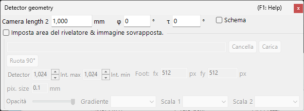

### Impostazioni della geometria del rivelatore

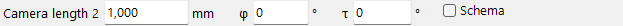

Specifica la geometria di riflessione: **Lunghezza camera 2** (mm, 1–10000, predefinita 1000) e l'inclinazione del rivelatore **τ** (da −200 a 200°) attorno a un asse nel piano con azimut **φ**. Per Back Laue (Laue in retrodiffusione) si usa solo **Lunghezza camera 2**: il pattern viene sempre proiettato su un rivelatore perpendicolare al fascio sul lato della sorgente, e τ / φ non vengono applicati a questa proiezione. Rilasciando un file `.prm` se ne caricano lunghezza d'onda, lunghezza di camera 2, τ, φ, posizione del piede e dimensione del pixel (la sorgente passa a raggi X con lunghezza d'onda personalizzata e l'area del rivelatore viene attivata).

### Area del rivelatore e immagine sovrapposta

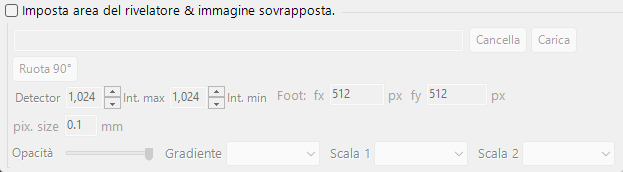

Spunta **Imposta area del rivelatore & immagine sovrapposta.** per specificare il rivelatore: dimensione in pixel (predefinita 1024 × 1024), **dim. pixel** (mm, predefinita 0.1) e la posizione del piede **fx, fy** (**Piede:**, px, predefinita 512, 512). Si può caricare un'immagine sperimentale (**Carica** o trascinamento) e sovrapporla con **Opacità**, **Gradiente** (pellicola positiva/negativa), **Scala 1** (log/lineare), **Scala 2** (Gray / Cold-Warm / Spectrum / Fire), **Int. max / Int. min**, **Ruota 90°** e **Cancella**. **Schema** mostra uno schizzo della geometria. Usa questo per sovrapporre il pattern simulato e un'immagine sperimentale e mettere a punto la geometria del rivelatore.

Vedi anche [Sistema di coordinate del rivelatore](../appendix/a1-coordinate-system/2-diffraction.md) per le definizioni del sistema di coordinate.

---

## Compressione dinamica {#dynamic-compression}

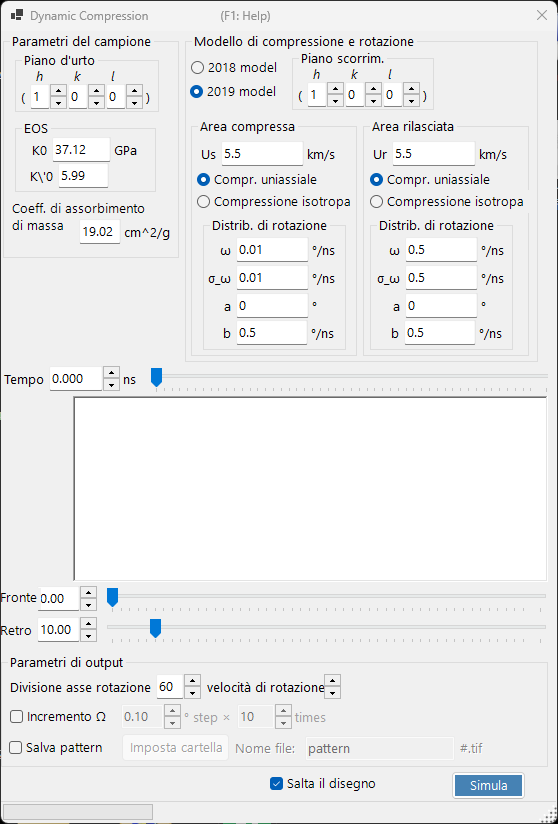

Una finestra per simulare la diffrazione da un campione compresso da onda d'urto (compressione dinamica). Rilascia un file `.txt` separato da tabulazioni con tre colonne (posizione, tempo, pressione) per caricare i profili di pressione per ciascun istante; il cursore **Tempo** (ns) seleziona il profilo mostrato nel grafico. Le due linee verticali nel grafico (**Fronte** / **Retro**) possono essere trascinate per impostare il fronte e il retro della compressione. La finestra contiene inoltre il modello di compressione (**2018 model** / **2019 model**), le velocità d'urto (**Us**, **Ur**, km/s), l'**EOS** (K0, K'0), il **Piano d'urto** / **Piano scorrim.**, le distribuzioni di rotazione delle aree compressa e rilasciata, il coefficiente di assorbimento di massa, l'incremento di Ω e **Salva pattern** (`#.tif`), e si avvia con **Simula**.

---

## Simulatore ALCHEMI

Apre una finestra figlia che calcola **curve di rocking di ionizzazione risolte per sito**: la resa di un canale di ionizzazione scelto mentre il cristallo viene inclinato attraverso le condizioni di Bragg di una fila sistematica, separata per sito atomico. Si apre dal menu **Opzioni**. A differenza della finestra CBED, dispone di una propria area di output e non disegna sulla tela della finestra padre.

→ Vedere **[Simulazione ALCHEMI](4-alchemi-simulation.md)** per tutte le impostazioni e per l'ambito di validità e i limiti noti.

---

## Argomenti correlati

- [Simulazione di diffrazione di raggi X](5-x-ray-neutron-diffraction.md)
- [Simulazione SAED](1-saed-simulation.md)
- [Simulazione PED](2-ped-simulation.md)
- [Simulazione CBED](3-cbed-simulation.md)
- [Simulazione ALCHEMI](4-alchemi-simulation.md)
- [Calcolo dinamico (nucleo condiviso)](../appendix/a3-bloch-wave/calculation.md)
- [Sistema di coordinate del rivelatore](../appendix/a1-coordinate-system/2-diffraction.md)
