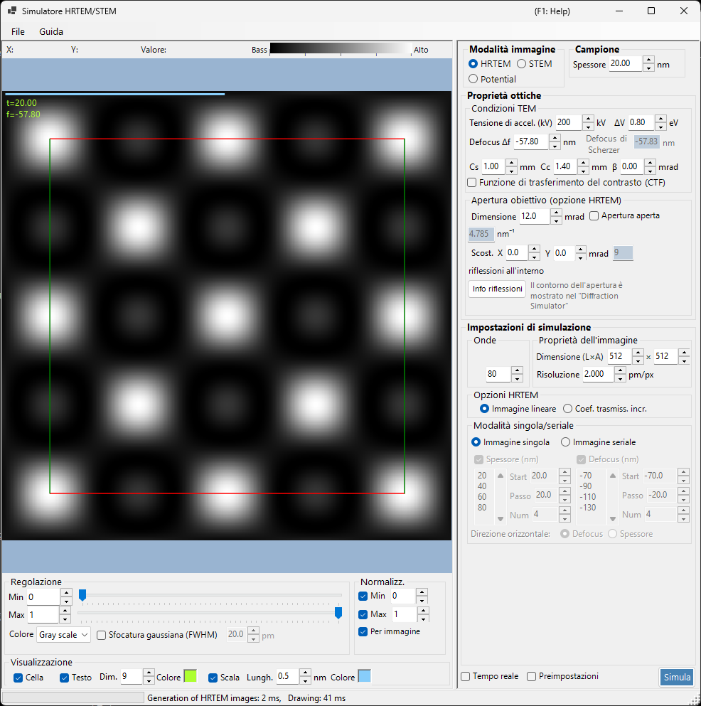
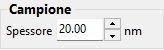
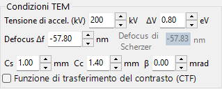
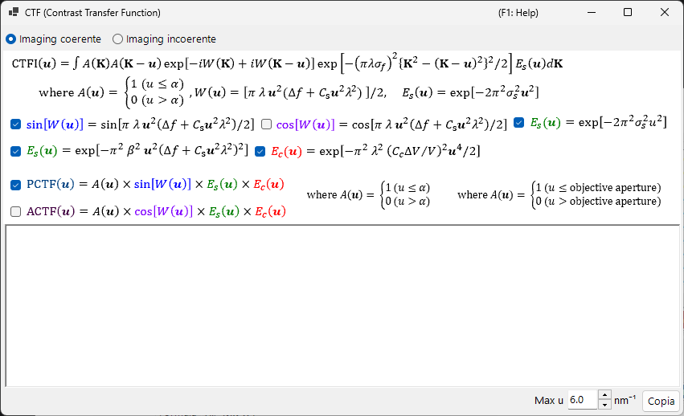
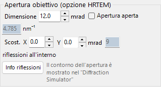
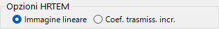
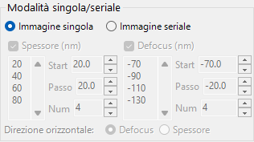
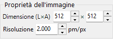
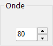

# Simulazione HRTEM

La simulazione **HRTEM (High-Resolution Transmission Electron Microscopy)** calcola immagini TEM ad alta risoluzione con frange reticolari. È la modalità principale del [Simulatore HRTEM/STEM](index.md).

> Questa pagina descrive tutte le impostazioni che compaiono sul lato destro quando **Modalità immagine = HRTEM**. Per i controlli sul lato sinistro — visualizzazione del risultato e regolazione della luminosità — vedere la [pagina panoramica](index.md#display-settings).

---

## Panoramica

Un'immagine HRTEM si forma quando l'onda elettronica trasmessa attraverso il campione viene riprodotta sotto l'influenza delle aberrazioni della lente obiettivo. ReciPro calcola la propagazione dell'onda elettronica all'interno del campione con il metodo delle onde di Bloch (calcolo dinamico) e genera l'immagine HRTEM tramite la funzione di trasferimento del contrasto di fase (PCTF).

### Flusso di calcolo

1. **Metodo delle onde di Bloch**: calcola la propagazione dell'onda elettronica nel potenziale del cristallo e ottiene ampiezza e fase dell'onda uscente
2. **Funzione della lente**: applica le aberrazioni della lente obiettivo (aberrazione sferica $C_s$, defocus $\Delta f$)
3. **Coerenza parziale**: tiene conto della dimensione finita della sorgente (coerenza spaziale) e della fluttuazione di energia (coerenza temporale)
4. **Formazione dell'immagine**: calcola la distribuzione di intensità $|\psi(\mathbf{r})|^2$

Per la teoria, vedere [Appendice A3.2 — Formazione dell'immagine HRTEM](../appendix/a3-bloch-wave/hrtem.md).

---

## Campione

- **Spessore** : spessore del campione (nm). Le immagini HRTEM dipendono fortemente dallo spessore. In modalità **Immagine seriale** questo valore viene ignorato e si usa invece l'elenco degli spessori descritto più avanti.

---

## Condizioni TEM {#tem-conditions}

Imposta le condizioni di imaging della lente obiettivo.

| Parametro | Descrizione | Predefinito / tipico |
|-----------|-------------|-------------------|
| **Tensione di accel.** <!-- 261105Cl 監査: 見出しから (kV) を外した (numericBoxAccVol.HeaderText)。単位は欄の右に出る --> | Tensione di accelerazione (kV). La lunghezza d'onda elettronica corretta relativisticamente è mostrata a destra | 200 kV |
| **Defocus Δf** | Defocus della lente obiettivo (nm). Il valore di riferimento del **Defocus di Scherzer** è mostrato sotto | −57.8 nm |
| **Cs** | Coefficiente di aberrazione sferica (mm). Influisce sulla CTF e sul defocus di Scherzer. Sono ammessi valori negativi (da −20 a 20 mm) | 1.0 mm (predefinito); 0.5–1.0 (convenzionale), < 0.01 (corretto in Cs) |
| **Cc** | Coefficiente di aberrazione cromatica (mm). Determina la sfocatura dell'immagine dovuta alla dispersione in energia | 1.4 mm (predefinito); 1.0–2.0 mm |
| **β** | Semiangolo di illuminazione (mrad). Rappresenta l'effetto della dimensione finita della sorgente (coerenza spaziale) | 0 mrad (predefinito); 0.1–1.0 mrad |
| **ΔV** | Larghezza a metà altezza della dispersione in energia degli elettroni (eV). Insieme a Cc determina la dispersione del fuoco dovuta all'aberrazione cromatica | 0.8 eV (predefinito); 0.5–2.0 eV |

I valori predefiniti indicati sopra valgono solo al primo avvio; successivamente vengono ripristinati gli ultimi valori utilizzati. Internamente ΔV (FWHM) viene convertito in una deviazione standard $\sigma_V = \Delta V / (2\sqrt{2\ln 2})$ e la dispersione del fuoco è $\delta = C_c\,\sigma_V / V$. La funzione di aberrazione è

$$\chi(u) = \pi\lambda\,\Delta f\,u^2 + \tfrac{\pi}{2}\,C_s\lambda^3 u^4 ,$$

e ciascuna onda diffratta viene moltiplicata per $\exp[-i\chi(u)]$, quindi **un Δf negativo corrisponde a sottofocalizzazione** (la convenzione in cui il defocus di Scherzer è negativo).

> **Menu contestuale**: sul pannello Condizioni TEM si possono applicare con un solo clic **Imposta defocus a 0 nm** / **Imposta defocus al valore di Scherzer** / **Condizioni ideali (Cs, Cc, β, ΔV, Δf = 0)** (quest'ultima porta a 0 Cs, Cc, β, ΔV **e anche il defocus**). <!-- 261106Cl 作者の決定 E19: 表示名を理想条件に --> Lo stesso menu contiene quattro preimpostazioni di microscopio — *300kV Cold-FEG senza Cs (Cs 0, Cc 2.8, ΔV 0.3) ARM300F*, *200kV Schottky-FEG UHR (Cs 0.5, Cc 1.1, ΔV 0.8) 2100F*, *200kV Schottky-FEG HR (Cs 1.0, Cc 1.4, ΔV 0.8) 2100F* e *200kV Lab6 HR (Cs 1.0 , Cc 1.4, ΔV 2.0) 2100* — che impostano la tensione di accelerazione, Cs, Cc e ΔV come indicato nella voce e poi portano il defocus al valore di Scherzer (β resta invariato). La casella **Preimpostazioni** in basso a destra apre la finestra che memorizza le proprie condizioni (vedere [Elenco dei preset](index.md#preset-list)). <!-- 261105Cl 監査: プリセット名は ΔV (FormImageSimulator.resx presets1〜4ToolStripMenuItem.Text) -->

### Defocus di Scherzer

Il valore di defocus in prossimità del quale il contrasto di fase è ottimale, calcolato dalla lunghezza d'onda corrente e dall'aberrazione sferica $C_s$ (mostrato come riferimento). Per $C_s$ negativo il valore mostrato è $+\sqrt{\tfrac{4}{3}|C_s|\lambda}$.

$$\Delta f_{\text{Scherzer}} = -\sqrt{\tfrac{4}{3}\,C_s \lambda}\quad\left(\approx -1.155\,\sqrt{C_s \lambda}\right)$$

In questa condizione la PCTF è negativa su un ampio intervallo di frequenze spaziali, per cui le posizioni atomiche appaiono con contrasto scuro. ReciPro adotta questo valore di Scherzer originale (ricavato ponendo il minimo della fase di aberrazione $\chi$ a $-2\pi/3$), e il valore mostrato nella GUI segue questa formula. Si noti che alcuni riferimenti utilizzano invece il valore di *Scherzer esteso* $-1.2\sqrt{C_s\lambda}$, che allarga ulteriormente la banda di trasferimento.

---

## Funzione della lente / Funzione di trasferimento del contrasto (CTF)

Spuntando **Funzione di trasferimento del contrasto (CTF)** si apre una finestra che traccia come le aberrazioni della lente e il defocus trasferiscono il contrasto dell'immagine a ciascuna frequenza spaziale.

- $\sin\chi(u)$ : funzione di trasferimento del contrasto di fase ($\chi(u)$ è la funzione di aberrazione della lente)
- $E_\text{s}(u)$ : funzione di inviluppo della coerenza spaziale; lo smorzamento dovuto alla dimensione finita della sorgente ($\beta$)
- $E_\text{c}(u)$ : funzione di inviluppo della coerenza temporale; lo smorzamento dovuto alla fluttuazione di energia ($C_c$, $\Delta V$)

Ogni curva ha la propria casella: $\sin\chi$, $\cos\chi$, $E_\text{s}$, $E_\text{c}$, **PCTF** $=\sin\chi\,E_\text{s}E_\text{c}$ e **ACTF** $=\cos\chi\,E_\text{s}E_\text{c}$; PCTF e ACTF sono poste a zero al di fuori dell'apertura obiettivo. In modalità HRTEM

$$E_\text{s}(u)=\exp\!\left[-\pi^2\beta^2u^2\left(\Delta f+C_s\lambda^2u^2\right)^2\right],\qquad E_\text{c}(u)=\exp\!\left[-\tfrac{1}{2}\pi^2\lambda^2\delta^2u^4\right].$$

**u max** (nm⁻¹, predefinito 6) imposta il limite superiore dell'asse orizzontale. **Copia** copia negli appunti le curve tracciate come testo separato da tabulazioni. La finestra è disponibile anche in modalità STEM (vedere [Simulazione STEM](2-stem-simulation.md#ctf-stem)); è disabilitata in modalità Potential.

---

## Apertura obiettivo (opzione HRTEM)

Limita le onde diffratte che attraversano l'apertura obiettivo. Il calcolo delle onde di Bloch utilizza sempre il numero di onde impostato in **Onde**; l'apertura seleziona poi quali di questi fasci contribuiscono all'immagine (un fascio passa quando $|\mathbf{g}-\mathbf{c}| < 2\sin(\alpha_\text{obj}/2)/\lambda$, dove $\mathbf{c}$ è il centro dell'apertura). Se passano meno di due fasci, il calcolo si interrompe con un messaggio che chiede di allargare l'apertura.

- **Dimensione** : semiangolo dell'apertura obiettivo (mrad, predefinito 12). Più è piccola, più onde diffratte ad alto angolo vengono tagliate e più i dettagli ad alta risoluzione risultano smussati. Viene mostrato il raggio equivalente nello spazio reciproco $\sin\theta/\lambda$ (nm⁻¹).
- **Scost. X** / **Y** : spostamento del centro dell'apertura obiettivo (mrad). Usato per l'imaging in campo scuro con apertura decentrata; l'illuminazione in sé non viene inclinata.
- **Apertura aperta** : apre l'apertura obiettivo (infinita), così che tutte le onde diffratte contribuiscano all'immagine.
- **riflessioni all'interno** : il numero di fasci diffratti (spot) che cadono all'interno dell'apertura (sola lettura).
- **Info riflessioni** : apre una tabella che elenca i fasci diffratti all'interno dell'apertura (intensità, ampiezza complessa e così via).

> La dimensione dell'apertura obiettivo è mostrata anche nel **Simulatore di diffrazione**.

---

## Opzioni HRTEM (modello di coerenza parziale)

Seleziona come viene inclusa la coerenza parziale (β e la dispersione del fuoco δ). L'onda uscente è calcolata per un'unica direzione di incidenza (l'asse del fascio); la divergenza dell'illuminazione e la dispersione in energia intervengono solo attraverso le funzioni di inviluppo indicate sotto.

- **Immagine lineare** (modello quasi coerente) : calcolo poco costoso. Ciascuna onda diffratta $\psi_g$ dell'onda uscente dinamica viene moltiplicata per $\exp[-i\chi(g)]\,E_\text{s}(g)\,E_\text{c}(g)$ e le onde vengono sommate in modo coerente: $I(\mathbf{r}) = \left|\sum_g \psi_g\,e^{-i\chi(g)}\,E_\text{s}(g)\,E_\text{c}(g)\,e^{2\pi i\,\mathbf{g}\cdot\mathbf{r}}\right|^2$. È accurato quando l'immagine è dominata dall'interferenza con il fascio trasmesso (campioni sottili).
- **Coef. trasmiss. incr.** (coefficiente di trasmissione incrociato) : calcolo costoso ma più accurato. Ogni coppia di fasci $(g,h)$ viene sommata con l'inviluppo mutuo (il coefficiente di trasmissione incrociato completo); è il modello da usare per diffusori forti che eccitano molte onde diffratte intense. Il costo cresce come il quadrato del numero di fasci all'interno dell'apertura.

Per i dettagli, vedere [Appendice A3.2 — Formazione dell'immagine HRTEM](../appendix/a3-bloch-wave/hrtem.md).

---

## Modalità singola/seriale

- **Immagine singola** : calcola una sola immagine HRTEM allo spessore e al defocus correnti.
- **Immagine seriale** : genera un insieme di immagini variando per passi lo spessore e il defocus (serie in spessore / serie focale). Utile per trovare la condizione che meglio corrisponde a un'immagine sperimentale.

Per un'immagine seriale, impostare quanto segue.

| Voce | Descrizione |
|------|-------------|
| **Spessore (nm)** / **Defocus (nm)** | Quale grandezza far variare (sono ammesse entrambe) |
| **Inizio / Passo / Num** | Valore iniziale, ampiezza del passo e numero di immagini. Vengono espansi nella casella di elenco sottostante, che può anche essere modificata direttamente |
| **Direzione orizzontale:** | Quando si fanno variare sia lo spessore sia il defocus, la grandezza disposta lungo la direzione orizzontale della griglia (**Defocus** o **Spessore**) |

Facendo variare sia lo spessore sia il defocus si ottiene una matrice di immagini righe × colonne. **Num** è limitato a 20 per ciascuna grandezza. Quando si fa variare una sola grandezza e le immagini sono più di due, la riga viene disposta su una griglia quasi quadrata.

---

## Proprietà dell'immagine

- **Dimensione (L×A)** : numero di pixel dell'immagine simulata (512×512 per impostazione predefinita).
- **Risoluzione** : risoluzione di campionamento (pm/px, predefinito 2). Il campo visivo è Dimensione × Risoluzione, quindi un valore più piccolo campiona le frange più finemente su un'area più piccola. L'immagine è sintetizzata con una somma di Fourier diretta sui fasci in ogni pixel (senza FFT), per cui il tempo di calcolo dipende dal numero di pixel e dal numero di fasci, non da questo valore.

---

## Onde

- Numero massimo di onde di Bloch utilizzate nel metodo di Bethe (calcolo dinamico), 80 per impostazione predefinita. Un numero maggiore migliora l'accuratezza, ma la risoluzione del problema agli autovalori richiede un tempo $O(N^3)$.

---

## Vedere anche

- [Simulatore HRTEM/STEM (panoramica)](index.md)
- [Simulazione STEM](2-stem-simulation.md)
- [Simulazione del potenziale](3-potential-simulation.md)
- [Appendice A3.2 — Formazione dell'immagine HRTEM](../appendix/a3-bloch-wave/hrtem.md)
