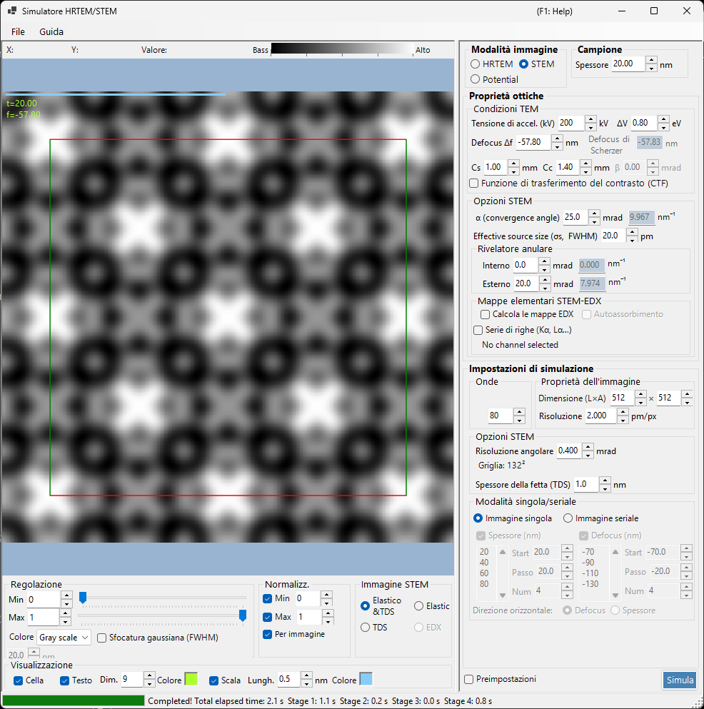
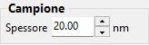
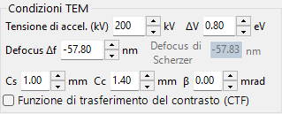
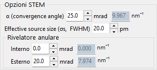
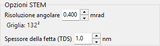
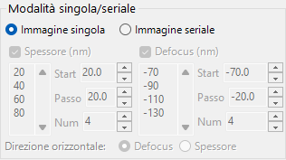
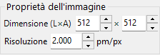
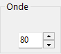
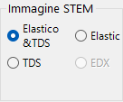
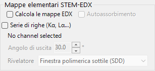

# Simulazione STEM

La simulazione **STEM (Scanning Transmission Electron Microscopy)** calcola immagini di microscopia elettronica a trasmissione a scansione con il metodo delle onde di Bloch.

> Questa pagina elenca tutte le impostazioni che compaiono a destra quando **Modalità immagine = STEM**. Per i controlli di visualizzazione del risultato, luminosità e normalizzazione a sinistra, vedere la [pagina panoramica](index.md). Solo il **bersaglio di visualizzazione** specifico dello STEM è ripetuto di seguito.

---

## Panoramica

Un fascio elettronico convergente viene fatto scansionare sul campione, e gli elettroni trasmessi e diffusi in ciascuna posizione di scansione vengono raccolti da rivelatori anulari. ReciPro calcola l'immagine STEM con il metodo delle onde di Bloch (calcolo dinamico).

### Flusso di calcolo

1. In ciascuna posizione di scansione, calcola le intensità diffratte con il metodo delle onde di Bloch per ogni direzione di incidenza della sonda convergente.
2. Integra l'intensità diffusa sull'intervallo angolare del rivelatore.
3. È possibile calcolare sia il contributo elastico sia quello della diffusione termica diffusa (TDS).

Vedere [Appendice A3.4 — Calcolo STEM](../appendix/a3-bloch-wave/stem.md) per la teoria.

---

## Tipi di rivelatore

| Rivelatore | Intervallo angolare | Contributo principale | Contrasto |
|----------|-------------|-------------------|----------|
| **BF** (campo chiaro) | 0 – angolo di convergenza | Elastico | Contrasto di fase |
| **ABF** (campo chiaro anulare) | Parte interna dell'angolo di convergenza | Elastico | Sensibile agli elementi leggeri |
| **LAADF** (campo scuro anulare a basso angolo) | Appena oltre l'angolo di convergenza | Elastico + TDS | Sensibile alla deformazione |
| **HAADF** (campo scuro anulare ad alto angolo) | Ben oltre l'angolo di convergenza | TDS (anelastico) | Contrasto-Z ($\propto Z^2$) |

> **Impostazioni tipiche del rivelatore** (ciascuna disponibile con un clic dal menu contestuale delle opzioni STEM, tutte con angolo di convergenza α = 25 mrad):
> BF (0–5 mrad) / ABF (12–24 mrad) / LAADF (26–60 mrad) / HAADF (80–250 mrad)

---

## Parametri del campione

- **Spessore** : spessore del campione (nm). Questo valore viene ignorato nella modalità **Immagine seriale**.

---

## Condizioni TEM

| Parametro | Descrizione | Predefinito / tipico |
|-----------|-------------|-------------------|
| **Tensione di accel.** <!-- 261105Cl 監査: 見出しから (kV) を外した (numericBoxAccVol.HeaderText)。単位は欄の右に出る --> | Tensione di accelerazione (kV). La lunghezza d'onda dell'elettrone corretta relativisticamente è mostrata accanto | 200 kV |
| **Defocus Δf** | Defocalizzazione della lente obiettivo (che forma la sonda) (nm) | −57.8 nm |
| **Cs** | Coefficiente di aberrazione sferica (mm). Influenza la dimensione della sonda | 0.5–1.0 mm |
| **Cc** | Coefficiente di aberrazione cromatica (mm) | 1.0–2.0 mm |
| **ΔV** | Larghezza a metà altezza della dispersione di energia degli elettroni (eV) | 0.5–2.0 eV |

> **β (semiangolo di illuminazione) è disabilitato in modalità STEM**, perché l'angolo di convergenza α ne assume il ruolo. Defocus e Cs entrano nella sonda attraverso la stessa funzione di aberrazione $\chi$ dell'HRTEM (Δf negativo = sottofocalizzazione; vedere [Simulazione HRTEM](1-hrtem-simulation.md#tem-conditions)). Anche qui funziona il menu contestuale di **Condizioni TEM** (azzeramento delle aberrazioni, defocus di Scherzer, preimpostazioni di microscopio).

---

## Opzioni STEM (ottiche)

Imposta la geometria della sonda convergente e del rivelatore anulare. Ogni angolo è anche mostrato a destra convertito in un raggio nello spazio reciproco $\sin\theta/\lambda$ (nm⁻¹).

| Parametro | Descrizione | Predefinito / tipico |
|-----------|-------------|-------------------|
| **Semiang. conv. α** | Semiangolo della sonda convergente (mrad). Valori maggiori danno una sonda più fine e modificano il contrasto di diffrazione | 25 mrad (predefinito); 15–25 mrad |
| **Rivelatore anulare — Interno** | Semiangolo di raccolta interno del rivelatore anulare (mrad). Il segnale all'interno di questo angolo è escluso | 0 (predefinito); BF: 0, HAADF: 80 |
| **Rivelatore anulare — Esterno** | Semiangolo di raccolta esterno del rivelatore anulare (mrad). Il segnale all'esterno di questo angolo è escluso | 20 (predefinito); BF: 5, HAADF: 250 |
| **Dim. efficace della sorgente (FWHM)** <!-- 261105Cl 監査: 見出しを numericBoxSTEM_EffectiveSourceSize.HeaderText に合わせた --> | Dimensione effettiva della sorgente di elettroni (pm). Viene applicata dopo il calcolo come convoluzione gaussiana di ogni immagine Elastico / TDS / EDX. Valori maggiori sfocano l'immagine e riducono il contrasto dei dettagli fini | 20 pm (predefinito) |

Gli angoli del rivelatore si applicano solo all'immagine STEM di riferimento (Elastico / TDS / Elastico & TDS); le mappe STEM-EDX non li utilizzano. I valori predefiniti valgono solo al primo avvio; successivamente vengono ripristinati gli ultimi valori utilizzati.

---

## Opzioni STEM (simulazione)

- **Spessore della fetta (TDS)** : spessore della fetta del campione (nm, predefinito 1, intervallo 0.1–10) utilizzato nel calcolo dell'intensità TDS (termica diffusa, anelastica). Valori più piccoli sono più accurati ma più lenti.
- **Risoluzione angolare** : risoluzione di campionamento angolare delle direzioni di incidenza della sonda (mrad, predefinito 0.4). Valori più piccoli campionano la sonda più finemente ma sono più lenti. Le direzioni della sonda formano una griglia $N\times N$ con $N=\lceil 2\times1.05\,\alpha/\Delta\alpha\rceil$, di cui vengono calcolate quelle all'interno di un disco circa il 5 % più grande dell'angolo di convergenza (un margine per l'interpolazione); il numero cresce quindi come il quadrato di $\alpha/\Delta\alpha$, per cui è la leva principale sul tempo di calcolo. La riga sotto la casella mostra la griglia (ad esempio `Griglia: 132²`); per le misure di convergenza vedi [Campionamento angolare della sonda](../appendix/a3-bloch-wave/stem.md#angular-sampling).

---

## Modalità singola/seriale

<!-- 261105Cl 監査: 見出しを画面 (groupBoxSerialImage.Text) と HRTEM のページに合わせた -->

- **Immagine singola** : calcola una sola immagine STEM allo spessore corrente.
- **Immagine seriale** : genera una serie di immagini con spessore / defocalizzazione variati a passi (impostati con **Inizio / Passo / Num**; l'elenco sottostante può anche essere modificato direttamente).

---

## Proprietà dell'immagine

- **Dimensione (L×A)** : numero di pixel nell'immagine scansionata (predefinito 512×512). La soluzione agli autovalori e il calcolo di $I(Q)$ (fasi 1–4 nella barra di stato) non ne dipendono; interviene solo nella sintesi finale dell'immagine nello spazio reale a partire dai coefficienti $I(Q)$, il cui costo è proporzionale a pixel × numero di vettori $Q$.
- **Risoluzione** : risoluzione di campionamento (pm/px).

---

## Onde

- Numero massimo di onde di Bloch utilizzate nel metodo di Bethe (predefinito 80). Il costo del problema agli autovalori scala con il cubo del numero di onde. Come riferimento per le immagini STEM ADF/HAADF: per Si [001] a 200 kV (40–120 mrad) lo scarto è di circa l'1,5 % con 80 e lo 0,5 % con 200; con atomi pesanti e angoli del rivelatore elevati (SrTiO₃, 64–200 mrad) è di circa il 7 % con 200 e l'1 % con 500. I cristalli con cella elementare grande (ad es. ortopirosseno) e quelli il cui anello HOLZ cade negli angoli del rivelatore (ad es. magnetite [001]) possono richiederne 1000 o più. <!-- 261111Cl 追加・変更: STEM の HAADF (TDS) の収束の実測 (|g| の順のビーム、Si [001] は和集合 1054 本・SrTiO₃ は 700 本を基準)。大きな単位胞・検出器の中の HOLZ の環の注意 (8 結晶の確かめ、STEM 設計書 §23) -->

---

## Funzione di trasferimento del contrasto (STEM) {#ctf-stem}

La casella **Funzione di trasferimento del contrasto (CTF)** in **Condizioni TEM** apre la stessa finestra CTF della modalità HRTEM. In modalità STEM offre due scelte:

- **Imaging coerente** : traccia $\sin\chi$, $\cos\chi$, $E_\text{s}$, $E_\text{c}$, PCTF e ACTF come in HRTEM, ma $E_\text{s}(u)=\exp(-2\pi^2\sigma_s^2u^2)$ è ricavata dalla dimensione effettiva della sorgente ($\sigma_s$ = FWHM / $2\sqrt{2\ln2}$), e PCTF / ACTF sono troncate all'angolo di convergenza.
- **Imaging incoerente** : traccia la funzione di trasferimento incoerente, calcolata integrando la funzione della lente sulla sovrapposizione di due aperture formatrici della sonda (campionamento dell'apertura 192 × 192) e moltiplicando per $\exp(-2\pi^2\sigma_s^2u^2)$.

<!-- screenshot: FormCTF in STEM mode, Incoherent imaging selected -->

---

## Bersaglio di visualizzazione STEM (lato risultato) {#stem-display-target}

L'interruttore di visualizzazione in basso a sinistra della finestra seleziona quale componente di diffusione dell'immagine STEM già calcolata mostrare (commutabile senza ricalcolare).

| Bersaglio di visualizzazione | Descrizione |
|----------------|-------------|
| **Elastico** | Immagine della sola diffusione elastica |
| **TDS** | Immagine della sola diffusione termica diffusa |
| **Elastico & TDS** | Somma di elastico + TDS |
| **EDX** | Mappa dei raggi X caratteristici. La riga da mostrare (ad esempio `O-K`) si sceglie nella casella combinata sottostante, e **EDX comune** in *Normalizz.* pone i canali della stessa grandezza (canali di shell: lacune; serie di righe: fotoni X) su un unico intervallo di visualizzazione condiviso, così che passando dall'uno all'altro l'immagine non venga riscalata |

!!! note
    Tutte e tre le immagini sono ricostruite dalla parte reale della somma di Fourier, quindi **Elastico & TDS** è esattamente la somma delle altre due. Fino alla versione 4.944 veniva preso il modulo, il che rompeva questa identità e schiariva leggermente i pixel scuri. Vedi [Ricostruzione di un'immagine reale](../appendix/a3-bloch-wave/stem.md#real-image-reconstruction).

---

## Mappe elementari STEM-EDX {#stem-edx}

Spuntare **Calcola le mappe EDX** per calcolare le mappe dei raggi X caratteristici insieme all'immagine di tipo ADF. Non si tratta di una modalità separata: i segnali elastico, TDS ed EDX provengono tutti dalla stessa esecuzione STEM, e in seguito si passa dall'uno all'altro in [Immagine STEM](#stem-display-target) senza ricalcolare.

Non c'è un selettore di elementi. Quando la casella è spuntata viene calcolato **ogni canale elemento/guscio calcolabile per questo cristallo a questa tensione di accelerazione**, e la riga sotto la casella li elenca (ad esempio `3 mappa/e: O-K, Mg-K, Al-K`). Un canale è disponibile quando la tensione di accelerazione è nell'intervallo 30–400 kV (quello della tabella fornita), la soglia di ionizzazione si trova al di sotto di essa e il guscio è coperto dai dati forniti — K: C–Sn (Z = 6–50), L1–L3: Ca–Rn (Z = 20–86), M1–M3: Zn–Rn (Z = 30–86), M4–M5: As–Rn (Z = 33–86); i canali L e M sommano i sottogusci presenti. La tabella fornita memorizza per ogni canale fattori di forma di ionizzazione completamente relativistici fino a un vettore di diffusione di 16 Å⁻¹, o meno a basse tensioni di accelerazione. Non si estrapola nulla: dove il calcolo richiede un vettore di diffusione più grande di quello coperto da una riga della tabella, il fattore di forma è posto a zero e il canale è contrassegnato con ⚠ nella casella combinata EDX. Se nessun canale è disponibile, il calcolo viene rifiutato con un messaggio esplicativo invece di produrre una mappa vuota.

La griglia delle direzioni della sonda è riportata sotto **Risoluzione angolare** in *Opzioni STEM (simulazione)*; mentre **Calcola le mappe EDX** è spuntata vi si aggiunge la suddivisione consigliata, ad esempio `Griglia: 132² (consigliato: ≥48²)`. Questa griglia è determinata da **Risoluzione angolare** e dall'angolo di convergenza; vedi [Campionamento angolare della sonda](../appendix/a3-bloch-wave/stem.md#angular-sampling). Al di sotto della suddivisione consigliata il residuo hermitiano ±q può superare la tolleranza e interrompere il calcolo, per cui il valore diventa arancione e prima dell'avvio del calcolo compare una finestra di conferma.

!!! warning "Che cosa rappresentano i valori"
    Per un canale di shell (K, L, M) la mappa è il **numero di lacune nei gusci interni generate per elettrone incidente**; non si applica alcuna resa di fluorescenza. Per una serie di righe (Kα, Kβ, Lα, Lβ, Mα), calcolata quando **Serie di righe (Kα, Lα…)** è spuntata, è il **numero di fotoni X generati per elettrone incidente**, in tutte le direzioni e prima della rivelazione: resa di fluorescenza, cascate Coster–Kronig e radiative e ramificazione delle righe (xraylib 4.2.1) sono applicate, la cascata Auger no. Entrambe sono grandezze di modello, non conteggi previsti di raggi X: l'autoassorbimento nel campione, l'angolo solido del rivelatore e l'efficienza del rivelatore **non** sono applicati. Usare le mappe per la distribuzione spaziale e per confrontare spessori o orientazioni, non per una quantificazione assoluta.

### Parametri del rivelatore (riservati)

**Autoassorbimento**, **Angolo di uscita** e **Rivelatore** sono presenti nel pannello ma disabilitati: appartengono al modello del rivelatore non ancora implementato. Sono mostrati perché il pannello non cambi disposizione quando il modello verrà introdotto. Il loro effetto futuro differisce per natura:

| Fattore | Contrasto pixel per pixel in una mappa | Rapporto tra le mappe degli elementi |
|---|---|---|
| Autoassorbimento (angolo di uscita) | **lo modifica** | **lo modifica** |
| Finestra del rivelatore / strato morto / efficienza | nessun effetto | **lo modifica fortemente** |
| Angolo solido del rivelatore, corrente del fascio, tempo di permanenza | nessun effetto | nessun effetto |

L'ultima riga spiega perché ReciPro non espone affatto la corrente del fascio né il tempo di permanenza: moltiplicano ogni pixel di ogni mappa per lo stesso numero, si cancellano in qualunque rapporto e sono invisibili dopo la normalizzazione di visualizzazione.

### Accuratezza e costo

Lo STEM-EDX non impone limiti aggiuntivi al numero di onde né allo spessore della fetta: passa attraverso gli stessi percorsi di calcolo dell'immagine di tipo ADF, quindi le impostazioni che funzionano per lo STEM funzionano anche per l'EDX.

L'accuratezza è lasciata all'utente, esattamente come per il numero di onde o la risoluzione angolare. Come riferimento, l'errore di integrazione in profondità cresce all'incirca in proporzione a **Spessore della fetta (TDS)** — circa 2–3 % a 1 nm, 4–8 % a 2 nm e 12–23 % a 4 nm (relativo al picco, SrTiO₃ a 39 nm). Dimezzare lo spessore della fetta dimezza all'incirca l'errore e raddoppia all'incirca il lavoro di integrazione in profondità.

Con aberrazioni impostate (per esempio Cs = 1 mm con defocus di Scherzer a α = 25 mrad), la fase di aberrazione oscilla rapidamente sulla griglia delle direzioni della sonda, e STEM-EDX può rifiutare il calcolo con un errore *non-Hermitian residual* anche con una griglia fine — questo rifiuto protegge la mappa da artefatti di griglia di alcuni punti percentuali. Ridurre Cs e il defocus (la media di scansione di una mappa EDX non dipende affatto dalle aberrazioni), oppure rendere la **Risoluzione angolare** decisamente più fine accettando un calcolo più lungo.

---

## Costo computazionale

La simulazione STEM è computazionalmente onerosa, quindi impostare i seguenti parametri in modo appropriato.

| Fattore | Impatto |
|--------|--------|
| **Angolo di convergenza** | Maggiore → più sovrapposizione dei dischi CBED → costo più elevato |
| **Onde di Bloch** | Il costo del problema agli autovalori scala come N³ |
| **Risoluzione angolare** | Più fine → più accurata ma il costo scala come N² |
| **Pixel dell'immagine (Dimensione)** | Solo la sintesi finale nello spazio reale (pixel × numero di vettori $Q$); le fasi 1–4 non ne dipendono |

---

## Importanza del fattore di temperatura

Per la simulazione HAADF-STEM, gli atomi devono avere un fattore di temperatura isotropo non nullo (fattore di Debye–Waller). Se il valore è sconosciuto, impostare $B \approx 0.5\ \text{Å}^2$. Con un fattore di temperatura pari a zero, l'intensità TDS è nulla e l'immagine HAADF non viene calcolata correttamente.

| Rivelatore | Intervallo | Contributo principale |
|----------|-------|-------------------|
| BF, ABF | All'interno dell'angolo di convergenza | Elastico |
| LAADF, HAADF | All'esterno dell'angolo di convergenza | Anelastico (TDS) |

---

## Confronto con Dr. Probe

È stato confermato che le simulazioni STEM di ReciPro concordano strettamente con la diffusa GUI Dr. Probe (v1.10). La figura seguente confronta le due per i rivelatori BF, ABF, LAADF e HAADF su una serie di spessori (2.96–60.05 nm), sia in assenza di aberrazioni (a sinistra) sia con Cs = 0.2 mm, defocalizzazione = −25.9 nm (a destra). I due codici concordano per tutti i tipi di rivelatore e tutti gli spessori.

Un rapporto più dettagliato è disponibile come PDF: [Confronto delle simulazioni STEM con la GUI Dr. Probe (v1.10) e ReciPro (v4.854)](https://github.com/seto77/ReciPro/files/10976084/ComparisonSTEMsimulations.pdf).

---

## Confronto con py_multislice

Le mappe STEM-EDX di ReciPro sono state verificate anche con [py_multislice](https://github.com/HamishGBrown/py_multislice), un codice multislice / fonone congelato indipendente. La figura confronta le mappe O-K, Ti-K e Sr-L di SrTiO₃ [001] a 200 kV su una serie di spessori (3,91–62,48 nm), senza aberrazioni (a sinistra) e con Cs = 0,2 mm, defocus = −25,9 nm (a destra).

Le forme normalizzate delle mappe concordano entro 1–2 % per Ti-K e Sr-L nel limite sottile. I **totali** differiscono del ±10–17 % perché i due codici prendono le sezioni d'urto di ionizzazione da fonti diverse (Bote–Salvat in ReciPro, tabelle del gruppo Allen in py_multislice). Il rapporto ReciPro / py_multislice cala inoltre con lo spessore, perché il modello assorbitivo di ReciPro rimuove gli elettroni diffusi termicamente mentre il fonone congelato continua a farli ionizzare — il che quantifica l'errore pratico dell'approssimazione assorbitiva per l'EDX.

Il rapporto completo, con le curve quantitative e l'analisi in frequenza spaziale, è disponibile in PDF: [Confronto di simulazioni STEM-EDX con py_multislice e ReciPro (v4.945, set di dati di ionizzazione v3.0.0)](../../assets/references/STEM_EDX_pyms_comparison.pdf).

---

## Vedere anche

- [Simulatore HRTEM/STEM (panoramica)](index.md)
- [Simulazione HRTEM](1-hrtem-simulation.md)
- [Simulazione del potenziale](3-potential-simulation.md)
- [Appendice A3.4 — Calcolo STEM](../appendix/a3-bloch-wave/stem.md)
