# メインウィンドウ

ReciProを起動すると、メインウィンドウが表示されます。このウィンドウで計算対象の結晶を選択し、回転させ、各種機能を呼び出します。

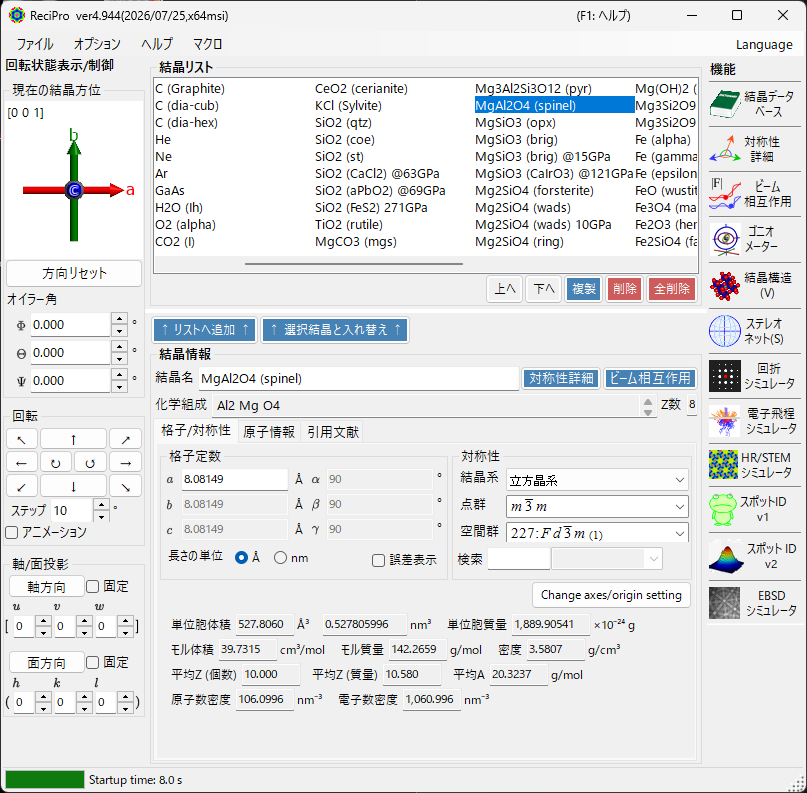

ウィンドウは以下の領域で構成されています：

| 領域 | 位置 | 説明 |
|------|------|------|
| **メニューバー** | 最上部 | ファイル操作、オプション、ヘルプ |
| **回転コントロール** | 左部 | 結晶方位の表示・設定 |
| **結晶リスト** | 中央上部 | 結晶の選択・管理 |
| **結晶情報** | 中央下部 | 格子定数・対称性・原子位置の編集 |
| **機能** | 右部 | シミュレーション・解析ウィンドウの起動 |

---

## キーボード・マウスショートカット

<!-- 261105Cl draft: コードから起こした修正・著者未査読 (根拠: FormMain.cs:FormMain_Load (KeyDown += FormMain_KeyDown は StructureViewer/Stereonet/DiffractionSimulator/SpotIDv1 のみ), FormMain_DragDrop, labelCurrentIndex_DoubleClick, contextMenuStripListBox, toolStripButtons_MouseDown; Crystallography.Controls/FormCaptureGUI.cs:InstallShortcutFilter) -->
メインウィンドウは **アプリ全体** で有効なショートカットを登録します。これらは結晶構造ビューア・ステレオネット・回折シミュレータ・Spot ID v1 の各ウィンドウにフォーカスがある間も動作します。

| ショートカット | 動作 |
|----------------|------|
| <kbd>F1</kbd> | このページのオンラインマニュアルを開く |
| <kbd>CTRL</kbd>+<kbd>SHIFT</kbd> ＋ 矢印キー | 結晶をその方向へ1ステップ回転（2つ同時押しで斜め方向） |
| 起動中に <kbd>CTRL</kbd> を押し続ける | OpenGL を無効にして起動（描画トラブルの回避） |
| 左下の方位ウィジェット（*現在の結晶方位* の軸表示）を左ドラッグ | 結晶を回転 |
| 方位ウィジェットを右ダブルクリック | ウィジェットの画像をクリップボードにコピー |
| 機能ボタンをシングルクリック | そのウィンドウを開閉（最小化中のウィンドウは閉じずに元のサイズに戻す） |
| 機能ボタンをダブルクリック | ウィンドウを強制的に表示し前面へ |
| 結晶リストを右クリック | コンテキストメニュー（名前の変更／CIFで出力／複製／削除） |
| 晶帯軸指数のラベル（*現在の結晶方位* の下の `[u v w]`）をダブルクリック | 最大UVWボックスの表示/非表示 |
| ウィンドウにファイルをドロップ | 結晶リスト（`.xml`, `.out`, `.cdb2`。置換か追加かを確認）または結晶（`.cif`, `.amc`）を読込 |
| <kbd>CTRL</kbd>+<kbd>SHIFT</kbd>+<kbd>ALT</kbd>+<kbd>C</kbd> | アクティブなウィンドウの GUI キャプチャツール（実験的機能）を開く |

→ 全ウィンドウの一覧は **[21. キーボード・マウスショートカット](21-shortcuts.md)** を参照。

---

## 基本ワークフロー

はじめてお使いの方は、次の手順を参考にしてください。

1. **結晶リスト**で計算対象の結晶を選択する。CIF/AMC ファイルを使う場合は **結晶情報** 領域へドラッグ＆ドロップします。
2. 格子定数・原子位置を編集した場合は、**リストへ追加** または **選択結晶と入れ替え** で変更を結晶リストへ反映する。
<!-- 261105Cl draft: コードから起こした修正・著者未査読 (根拠: FormMain.ja.resx label8.Text / toolStripLabel1.Text) -->
3. **回転状態表示/制御**で晶帯軸、結晶面、オイラー角、またはマウスドラッグにより結晶方位を決める。
4. 右側の **機能** から目的の機能を開く。回折、HRTEM/STEM、EBSD などの計算ウィンドウは、現在選択中の結晶と方位を引き継ぎます。

---

## ファイルメニュー

### ファイル

| メニュー項目 | 説明 |
|-------------|------|
| 結晶リストを読込 (現在のリストを消去) | 結晶リストファイル(`*.xml`, `*.out`)を読み込み、現在のリストを置換。読み込む結晶を選ぶダイアログが開く <!-- 261105Cl draft: コードから起こした修正・著者未査読 (根拠: FormMain.cs:ReadCrystalList (showSelectionDialog=true → FormCrystalSelection), SaveCrystalDataToolStripMenuItem_Click) --> |
| 結晶リストを読込 (現在のリストに追加) | 結晶リストを読み込み、現在のリストに追加（同じ選択ダイアログが開く） |
| 結晶リストを初期状態に戻す | ReciPro に同梱の結晶リストを再読込 |
| CIFあるいはAMCファイルから結晶を読み込み | CIF / AMC ファイルから結晶を1つ読み込み |
| 結晶リストを保存 | 現在の結晶リストを保存（書き出す結晶を選ぶダイアログが開く） |
| 選択結晶をCIF形式で書き出し | 選択中の結晶をCIFフォーマットで保存 |
| 現在のリストを消去 | すべての結晶をリストから削除 |
| 閉じる | アプリケーションを終了 |

### オプション

| メニュー項目 | 説明 |
|-------------|------|
| ツールチップを表示 | ツールチップの表示/非表示を切り替え |
| ダークモード | ライト／ダークのカラーテーマを切り替え |
| Use Miller-Bravais (hkil) index | 三方晶・六方晶系で面指数をプログラム全体で4指数  \((hkil)\) 表記にする |
| イオン散乱因子を使用 | 動力学（Bloch 波）電子線計算と菊池プロファイルで、各原子に割り当てたイオンの電子線散乱因子（Peng、$g \neq 0$ の単極子項を含む）を使う。オフのときは中性原子の散乱因子。単位胞が電荷中性でない（$\Sigma q \neq 0$）場合は単極子項を落とし、有限部分（遮蔽イオン形）だけを使う（その旨を通知） <!-- 261105Cl draft: コードから起こした修正・著者未査読 (根拠: FormMain.cs:toolStripMenuItemIonicScattering_CheckedChanged, BetheMethod.cs:ElasticIonModel) --> |
| MKL ライブラリをダウンロード | Intel MKL ネイティブライブラリ（約55 MB）をダウンロード。導入後は大きな計算で自動的に使用される |
| 外部からのマクロ命令を受け付ける (Named Pipe) | Named Pipe `ReciPro.Macro.v1` で待ち受け、外部プログラムから送られたマクロを実行 — [外部制御](20-macro/3-external-control.md) を参照 |
| レジストリを初期化 (要再起動) | 次回起動時にウィンドウサイズ・波長・カメラ長等の設定をリセット |
| Crystallography.Native.dll を無効化 (要再起動) | ネイティブ(C++)ライブラリの読込に失敗する場合にマネージドコードで代替 |
| OpenGLによる全てのレンダリングを無効化 (要再起動) | 古いGPU/リモートデスクトップ環境向け |
| OpenGLによるテキストレンダリングを無効化 (要再起動) | 一部GPUでの文字描画不具合への対処 |
| (experimental) Capture GUI Components | GUIスクリーンショットを保存する開発者向けツール |
| (experimental) Powder diffraction function | 多結晶（粉末）回折ウィンドウを有効化 |

### ヘルプ

| メニュー項目 | 説明 |
|-------------|------|
| アップデート | 新バージョンの確認・インストール |
| ヒント | 使い方のヒントを表示 |
| バージョン履歴 | バージョン履歴を表示 |
| ライセンス | MITライセンスを表示 |
| Github ページ | GitHubリポジトリを開く |
| バグ、要望報告 | GitHub Issuesを開く |
| 使い方 (WEB) | オンラインマニュアル (GitHub Pages 版) を、UI 言語に合わせて開きます。 |

UI 言語の切り替えは別の **Language** メニューで行います（要再起動）。

### Language

UI 言語を切り替えます。English・日本語・Deutsch・Français・Español・Português・Italiano・Русский・简体中文・繁體中文・한국어 の 11 言語に対応しており、メニューには各言語がその言語自身の表記で並びます。変更は再起動後に反映されます。オンラインマニュアルもこの設定に従うので、<kbd>F1</kbd> や **Help ▸ 使い方 (WEB)** は選択中の言語のページを開きます。

### マクロ

<!-- 261105Cl draft: コードから起こした修正・著者未査読 (根拠: FormMain.cs:editorToolStripMenuItem_Click, SetMacroToMenu, macroMenuItem_Click) -->
**編集** で [マクロ](20-macro/index.md) ウィンドウを開き、Python構文のスクリプトで ReciPro の操作を自動化します。マクロウィンドウに登録したマクロは **編集** の下にも並び、選ぶとそのまま実行されます。よく使う処理を繰り返す場合は、[組み込み関数一覧](20-macro/1-built-in-functions.md) と [マクロの使用例](20-macro/2-examples.md) を参照してください。

---

## 回転状態の表示/制御

結晶の回転状態は、回折シミュレータ・Structure Viewer・ステレオネット・HRTEM/STEM シミュレータ・EBSD シミュレータなど他のウィンドウでも共通して使われます。単なる表示上の設定ではなく、シミュレーションで用いる入射ビーム方向と結晶座標系の関係を定義します。短い操作動画は [How to use（動画）](appendix/a0-how-to-use.md) のページにあります。

### 現在の結晶方位

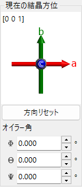

結晶の回転状態がグラフィカルに表示されます。マウスドラッグで回転できます。

結晶軸の色：
- **赤**: *a*軸
- **緑**: *b*軸
- **青**: *c*軸

### 方向リセット
結晶方位を**初期状態**にリセットします。初期状態とは、*c*軸がスクリーンに垂直、*b*軸が画面上方向を向く状態です。

### 晶帯軸
<!-- 261105Cl draft: コードから起こした修正・著者未査読 (根拠: FormMain.cs:numericBoxMaxUVW_ValueChanged, labelCurrentIndex_DoubleClick; FormMain.Designer.cs numericBoxMaxUVW (1–100, 既定 30)) -->
スクリーンに垂直な方向に最も近い晶帯軸指数 [*uvw*] を表示します。候補は既約（gcd = 1）で $|u|+|v|+|w| \le$ max-UVW ボックスの値（1–100、既定 30）の指数です（指数のラベルをダブルクリックするとこのボックスの表示/非表示が切り替わります）。

### オイラー角
**Z–X–Z**系のオイラー角で結晶方位を設定します：
- \(\Phi\): Z軸回転
- \(\Theta\): X軸回転
- \(\Psi\): Z軸回転

回転は \(\Psi \to \Theta \to  \Phi\) の順に適用されます。詳しくは [回転ジオメトリ](4-rotation-geometry.md) および [座標系](appendix/a1-coordinate-system/1-orientation.md) を参照してください。

### 回転

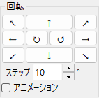

<!-- 261105Cl draft: コードから起こした修正・著者未査読 (根拠: FormMain.cs:ButtonDirection_Click, CheckBoxAnimation_CheckedChanged, Timer_Tick; FormMain.Designer.cs numericBoxStep (既定 10°)) -->
矢印方向に角度**ステップ**（既定 10°）分だけ回転します。↺ / ↻ はスクリーン法線まわりの回転です。**アニメーション**をチェックすると連続回転し、ステップは回転速度（°/s）になります。

### 軸/面投影

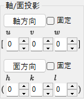

指定した晶帯軸や結晶面の方向に結晶方位を設定します。

<!-- 261105Cl draft: コードから起こした修正・著者未査読 (根拠: FormMain.cs:buttonSetVector_Click, Rotate(Vector3DBase,double), checkBoxFixAxis_CheckedChanged/checkBoxFixPlane_CheckedChanged) -->
- **固定**: チェックすると、以後の回転（矢印・マウスドラッグ）はすべて指定した晶帯軸または面法線のまわりの回転になり、その方向が固定されます。2 つの **固定** は同時にはオンにできず、指数が 0 0 0 のときはチェックできません。
- **軸方向**: 指定した晶帯軸 \([uvw]\) をスクリーン垂直方向に設定します。**面方向**も設定されていて軸がその面内にある（$uh+vk+wl=0$）ときは、その面法線が画面上向きになります。そうでなければ上向きの方向は自動で決まります。
- **面方向**: 指定した結晶面 \((hkl)\) の法線をスクリーン垂直方向に設定します。**軸方向**も設定されていて面内にある（$uh+vk+wl=0$）ときは、その軸が画面上向きになります。そうでなければ上向きの方向は自動で決まります。

### 結晶方位を設定する基本的な方法

| 方法 | こんなとき | 操作場所 |
|------|-----------|---------|
| マウスドラッグ | 結晶軸を見ながら自由に回転させたいとき | 「現在の結晶方位」パネル |
| 矢印ボタン | 小さな回転を繰り返し行いたいとき | 「回転」パネル |
| 晶帯軸 | \([001]\) や \([110]\) など、見たい方向が分かっているとき | 「軸/面投影」/ 晶帯軸の入力 |
| 面法線 | 結晶面 \((hkl)\) をスクリーンに垂直にしたいとき | 「軸/面投影」/ 面の入力 |
| オイラー角 | 再現可能な数値で方位を指定したいとき | 「オイラー角」 |

回転行列と座標系の規約は [回転ジオメトリ](4-rotation-geometry.md) および [Appendix A1. 座標系の定義](appendix/a1-coordinate-system/1-orientation.md) を参照してください。

---

## 結晶リスト

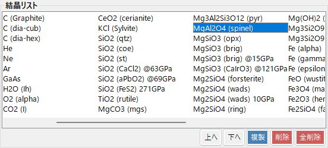

<!-- 261105Cl draft: コードから起こした修正・著者未査読 (根拠: ReciPro/initial.xml (Crystal 66 件), FormMain.ja.resx exportAsCIFFormatToolStripMenuItem.Text) -->
読み込まれた結晶を表示（初期状態で 66 結晶）。結晶を選択すると **結晶情報** に詳細が表示され、計算対象に設定されます。**結晶リストを右クリック**するとコンテキストメニュー（*名前の変更*・*CIFで出力*・*複製*・*削除*）が表示されます。

| ボタン | 動作 |
|--------|------|
| 上へ / 下へ | 選択した結晶の順番を移動 |
| 複製 | 選択中の結晶を複製 |
| 削除 / 全削除 | 選択した結晶またはすべての結晶を削除 |
| リストへ追加 / 選択結晶と入れ替え | 現在の結晶をリスト末尾に追加、または選択中の結晶と置換 |

---

## 結晶情報

格子定数・対称性・原子位置を設定・表示します。CIFファイルやAMCファイルをこの領域にドラッグ＆ドロップして結晶を読み込むこともできます。このコントロールは ReciPro・PDIndexer・CSManager で共通ですが、表示されるタブや機能はソフトごとに異なります。ReciPro では「格子/対称性」「原子情報」「引用文献」の3タブを表示します（状態方程式(EOS)・弾性定数などのタブは他のソフト向けで、ReciPro では表示されません）。

> **重要**: 変更を加えた場合は必ず**リストへ追加**または**選択結晶と入れ替え**ボタンを押してください。押さないと、別の結晶を選択した際に変更内容が失われます。

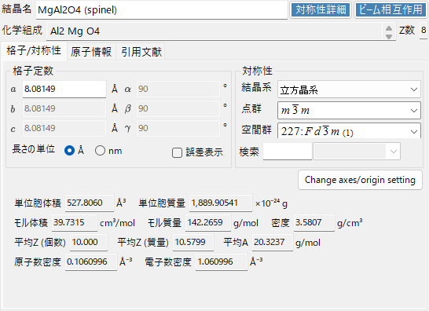

<!-- 261105Cl draft: コードから起こした修正・著者未査読 (根拠: CrystalControl.ja.resx colorControl.HeaderText/ToolTip) -->
上部には**結晶名**・**化学組成**（原子情報から自動算出）・**Z数**（単位胞中の化学式単位数）・**描画色**（3D 構造表示と回折プロファイル曲線で使うこの結晶の表示色）が常に表示されます。**対称性詳細**・**ビーム相互作用** ボタンは、対応する詳細ウィンドウ（[対称性情報](2-symmetry-information.md)・[ビーム相互作用](3-beam-interaction.md)）を開きます。 重量%・原子% や酸化物への換算は、右クリックの [化学組成の詳細](#chemical-composition) で表示できます。

### 格子/対称性 タブ

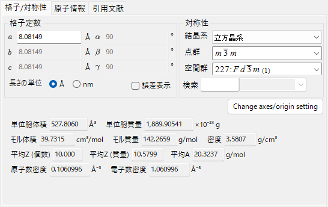

格子定数・対称性と、そこから導かれる量を扱います。

| 項目 | 説明 |
|------|------|
| 格子定数 | 格子定数 a, b, c（**長さの単位**で Å = 10⁻¹⁰ m / nm を選択）と α, β, γ。対称性を指定すると拘束条件（例: 立方晶では a=b=c, α=β=γ=90°）に従って自動調整されます。 |
| 対称性 | **結晶系**・**点群**・**空間群**を選択します。**検索**ボックスに文字列を入力すると候補が一覧表示されます（大文字・小文字を区別）。 |
| 単位胞体積 / 単位胞質量 | 単位胞の体積・質量。体積は**長さの単位**に応じて ų / nm³ で、質量は 10⁻²⁴ g 単位で表示されます。 <!-- 261105Cl draft: コードから起こした修正・著者未査読 (根拠: CrystalControl.resx numericBox*.FooterText/HeaderText, SymmetryControl.ja.resx checkBoxShowError, CrystalControl.cs:buttonChangeAxesOriginSetting_Click) --> |
| モル体積 / モル質量 / 密度 | モル体積（cm³/mol、化学式単位あたり）・モル質量（g/mol）・密度（g/cm³）。これらは**原子情報が入力されているときのみ**表示されます。 |
| 平均Z (個数) / 平均Z (質量) / 平均A | 個数平均・質量平均の平均原子番号と、原子あたりの平均原子量（g/mol）。占有率を含めて計算します。 |
| 誤差表示 | 格子定数の誤差（±）欄を表示します。 |
| Change axes/origin setting | 右クリックメニューの「異なる軸・原点セッティングの空間群に変換」と同じ（同じ空間群の別の軸・原点セッティングへ変換）。 |
| 原子数密度 / 電子数密度 | 単位胞内の原子数・電子数を単位胞体積で割った数密度。**長さの単位**に応じて Å⁻³ / nm⁻³ で表示されます。 |

### 原子情報 タブ

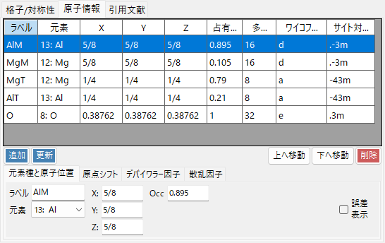

<!-- 261105Cl draft: コードから起こした修正・著者未査読 (根拠: AtomControl.resx multi/wyckLet/siteSymDataGridViewTextBoxColumn.HeaderText) -->
原子の種類・位置・温度因子・散乱因子を設定します。原子リストは **追加**・**更新**（選択行を置換）・**上へ移動/下へ移動**（並べ替え）・**削除** で編集します。原子リストには各サイトの**多重度**・**ワイコフ文字**・**サイト対称性**も表示されます。各原子の項目は次の通りです。

| 項目 | 説明 |
|------|------|
| ラベル | 原子のラベル（任意の識別名）。 <!-- 261105Cl draft: コードから起こした修正・著者未査読 (根拠: AtomControl.ja.resx *DataGridViewTextBoxColumn.HeaderText) --> |
| 元素 | 元素（イオン価数を含む）。 |
| X, Y, Z | 分率座標（0–1）。1/2 や 2/3 などの分数表記でも入力できます。 |
| 占有率 | 占有率（0–1）。 |

原子リストの行を右クリックして **等価な原子位置を表示** を選ぶと、空間群の対称操作で生成される全ての等価位置を一覧する小ウィンドウが開きます。**Copy** ボタンで一覧をタブ区切りテキストとしてコピーできます（表計算ソフトへの貼り付けなどに便利です）。

<!-- 261105Cl draft: コードから起こした修正・著者未査読 (根拠: AtomControl.resx: radioButtonOriginShiftPlus/Minus, buttonOriginShift1–9, buttonOriginShiftCustom) -->
**原点シフト**: 全原子座標の原点を移動します。**+** / **−** で符号を選び、プリセットのベクトル — (⅛ ⅛ ⅛)、(¼ ¼ ¼)、(0 ¼ ⅛)、(¼ 0 ¼)、(0 ¼ ¼)、(¼ ¼ 0)、(¼ −¼ 0)、(¼ −¼ ¼)、(0 ¼ −⅛) — のボタンを押すか、**Apply custom shift** で任意量を指定します。

<!-- 261105Cl draft: コードから起こした修正・著者未査読 (根拠: AtomControl.ja.resx buttonAddAtom/buttonChange/buttonAtomUp/buttonAtomDown/buttonDeleteAtom, tabPageDebyeWaller, label3, label13, radioButtonIsotoropy/Anisotropy, tabPageScatteringFactor, label4-6) -->
**デバイワラー因子（温度因子）**:

| 項目 | 説明 |
|------|------|
| 形式 | U か B のどちらの表記を使うか。切り替えると表示中の値を換算します（$B = 8\pi^2 U$）。 |
| モデル | **等方** か **非等方** か。 |
| U##, β## | 異方性の場合は各成分を入力。U 表記では $U_{ij}$（Ų）、B 表記では無次元の $\beta_{ij} = 2\pi^2 a^*_i a^*_j U_{ij}$（AMCSD のファイルの B(i,j) と同じ）。 |

**散乱因子**: 原子ごとに使用する散乱因子を選びます。

| 波 | 出典・設定 |
|----|-----------|
| X線 | イオン価数を含む散乱因子（International Tables for Crystallography, Vol. C）。 |
| 電子線 | 電子線用散乱因子。中性原子は Peng, Ren, Dudarev & Whelan (1996), *Acta Cryst.* **A52**, 257–276、イオンは Peng (1998), *Acta Cryst.* **A54**, 481–485。 |
| 中性子線 | 中性子散乱長。**Natural isotope abundance**（天然同位体存在比）または **Custom isotope abundance**（任意の同位体組成）を選択。 |

### 引用文献 タブ

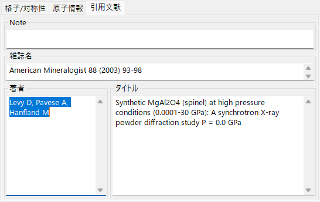

<!-- 261105Cl draft: コードから起こした修正・著者未査読 (根拠: CrystalControl.ja.resx groupBoxAuthors/groupBoxJournal/groupBoxTitle) -->
結晶構造の出典を記録します：**Note**（メモ）・**著者**・**雑誌名**・**タイトル**（論文タイトル）。

### コンテキストメニュー（右クリック）

コントロールの空白部分を右クリックすると、主に次の操作が行えます。

| メニュー項目 | 動作 |
|--------------|------|
| 化学組成の詳細 | [化学組成の詳細](#chemical-composition) ウィンドウを開く (重量%・原子%・規格化した原子数・酸化物などへの換算)。 |
| ビーム相互作用 | [ビーム相互作用](3-beam-interaction.md) ウィンドウを開く。 |
| 対称性詳細 | [対称性情報](2-symmetry-information.md) ウィンドウを開く。 |
| CIFファイル又はAMCファイルから読み込み | CIF / AMC ファイルから結晶を読み込む。 |
| CIFファイルとして出力 | 現在の結晶を CIF 形式で書き出す。 |
| アプリ起動時の格子定数に戻す | 格子定数を最初に読み込んだ値に戻す。 |
| P1に変換 | 空間群を P1 に展開する。 |
| 超構造に変換 | a, b, c を整数倍した超構造に変換する（サイズ指定ダイアログ）。 |
| 異なる軸・原点セッティングの空間群に変換 | 等価な空間群（軸の取り方を変えたセッティング）に変換する。 |

#### 化学組成の詳細 {#chemical-composition}

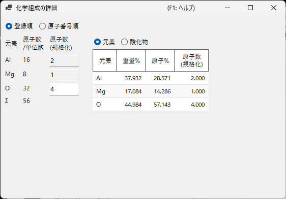

選択中の結晶の化学組成を、原子情報から計算して表示します (各元素の原子数は、そのサイトの 多重度 × 占有率 の合計)。メインウィンドウで結晶を切り替えると、表示も追従します。

- 右の表は元素ごとの **重量%**・**原子%**・**原子数 (規格化)**、左の表は単位胞中の原子数です。左の表の規格化の列の欄をクリックすると、その元素が規格化の基準になり、原子数を入力できます (例: O = 24)。既定の基準は O (無ければ先頭の元素) で、規格化の列は化学式そのものになります。
- **酸化物**・**ハロゲン化物**・**硫化物** (結晶に当てはまるものだけ表示) を選ぶと、各元素の **価数** を使って成分に形式的に換算します。価数は欄で編集できます (8/3 のような分数も可)。入力しない元素は、Fe が 2、それ以外は X 線散乱因子に選んだイオンの価数、無ければよく見られる酸化数になります。**Σ=0** は全体の電荷が 0 になる価数を入れ、**既定に戻す** は入力した価数を消します。入力した価数は結晶に記録され、結晶リストを XML で保存すると一緒に保存されます。
- **登録順** / **原子番号順** で元素の並び順を切り替えます。

---

## 機能パネル {#functions}

ウィンドウ右側の縦並びボタンから、下表の各解析・シミュレーションウィンドウを起動します。

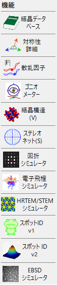

| ボタン | 説明 | 詳細 |
|--------|------|------|
| 結晶データベース | 内蔵／オンラインデータベースからの結晶検索・取込 | [結晶データベース](1-crystal-database.md) |
| 対称性詳細 | 空間群の対称性情報・*International Tables* Vol. A 様式の対称要素図 | [対称性情報](2-symmetry-information.md) |
| ビーム相互作用 | ビームと結晶の相互作用: 反射・減衰・散乱因子・蛍光 | [ビーム相互作用](3-beam-interaction.md) |
| ゴニオメーター | 回転行列の3D表示・オイラー角変換 | [回転ジオメトリ](4-rotation-geometry.md) |
| 結晶構造 | OpenGLによる結晶構造の3D描画 | [結晶構造ビューア](5-structure-viewer.md) |
| ステレオネット | ステレオネット投影 | [ステレオネット](6-stereonet.md) |
| 回折シミュレータ | 電子線・X線の単結晶回折シミュレーション | [回折シミュレータ](7-diffraction-simulator/index.md) |
| 電子飛程シミュレータ | モンテカルロ法による電子飛程（電子軌道）シミュレーション | [電子飛程](8-electron-trajectory.md) |
| HRTEM/STEMシミュレータ | 高分解能TEM/STEM像シミュレーション | [HRTEM/STEMシミュレータ](9-hrtem-stem-simulator/index.md) |
| スポットID v1 | 制限視野回折パターンの指数付け（旧「TEM ID」） | [Spot ID v1](10-spot-id.md) |
| スポットID v2 | 回折スポットの検出・指数付け | [Spot ID v2](11-spot-id-v2.md) |
| EBSDシミュレータ | EBSDパターンシミュレーション | [EBSDシミュレーション](12-ebsd-simulation.md) |
| 粉末回折 | 多結晶（粉末）回折。**オプション ▸ (experimental) Powder diffraction function** で有効化 | — |

---

## 関連項目

- [結晶データベース](1-crystal-database.md)
- [回転ジオメトリ](4-rotation-geometry.md)
- [結晶構造ビューア](5-structure-viewer.md)
- [回折シミュレータ](7-diffraction-simulator/index.md)
- [キーボード・マウスショートカット](21-shortcuts.md)
- [基本座標系と結晶方位](appendix/a1-coordinate-system/1-orientation.md)
