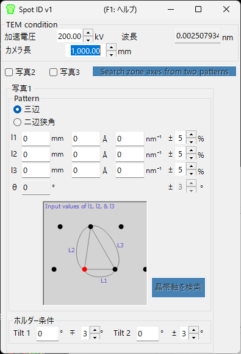

# Spot ID v1（スポット検出・指数付け）

<!-- 261105Cl draft: コードから起こした修正・著者未査読 (根拠: FormSpotIDv1.Designer.cs (画像・スポット検出のコントロール無し)) -->
**Spot ID v1**（旧 **TEM ID**）は、1〜3 枚の回折パターンについて数値入力したスポットジオメトリから、候補となる晶帯軸を検索します。画像からのスポット検出・フィッティング・指数付けは [Spot ID v2](11-spot-id-v2.md) で行います。

---

## キーボード・マウスショートカット

<!-- 261105Cl draft: コードから起こした修正・著者未査読 (根拠: FormSpotIDv1.Designer.cs) -->
Spot ID v1 はスポットのジオメトリを**数値入力**します（旧 *TEM ID* のワークフロー）。画像表示は無く、画像の読み込み・マウスでのズーム・スポット検出・手動スポット指定は [Spot ID v2](11-spot-id-v2.md) の機能です。唯一のショートカットは結果ウィンドウにあります。

| ショートカット | 動作 |
|----------------|------|
| <kbd>F1</kbd> | このページのオンラインマニュアルを開く |
| 結果リストの行をダブルクリック | その結晶を選択し、対応する晶帯軸へ回転 |

→ 全ウィンドウの一覧は **[21. キーボード・マウスショートカット](21-shortcuts.md)** を参照。

---

<!-- 261105Cl 要確認: FormSpotIDv1 (Designer.cs) には画像表示・画像調整・Optics・スポット検出/フィッティング・Index のコントロールが一つも無い (TEM ID の数値入力のみ)。この節から「指数付け」節までは Spot ID v2 (FormSpotIDV2) の機能。削除または 11-spot-id-v2 への移設を著者が判断すること -->
## メインエリア

回折画像を参照用に表示します。ドラッグ＆ドロップまたは**File**メニューから画像を読み込めます。

### 画像調整

| 設定 | 説明 |
|------|------|
| Min / Max | 輝度の範囲（トラックバーでも調整可） |
| Gradient | Positive または Negative |
| Scale | Linear または Log |
| Colour | グレースケール または Cold-Warm |
| Dust & Scratch | 異常に明るい/暗いピクセルを除去 |
| Gaussian blur | ガウシアンブラーの適用 |

---

## 光学系 (Optics)

入射源、エネルギー/波長、カメラ長、検出器のピクセルサイズを入力します。

> dm3/dm4ファイル（Gatan Digital Micrograph）を読み込んだ場合、これらの値は自動設定されます。

---

## スポット検出とフィッティング

**Detect & fit spots** ボタンで回折スポットを自動検出し、2D Pseudo-Voigt関数でフィッティングします。

### 検出オプション

| パラメータ | 説明 |
|-----------|------|
| Number | 検出するスポットの最大数 |
| Nearest neighbour | 検出するスポット間の最小距離 |
| Fitting range | フィッティングする半径（ピクセル単位） |

### テーブル操作

| ボタン | 動作 |
|--------|------|
| Reset range | すべてのスポットのフィッティング範囲を再設定 |
| Show label/symbol | ラベル/シンボルを画像に重畳 |
| Clear all spots | すべてのスポットを削除 |
| Save / Copy | テーブルをタブ区切り形式でエクスポート |
| Re-fit all | すべてのスポットを再フィッティング |

### スポット詳細ウィンドウ

チェックすると別ウィンドウが開き、選択スポット（左）と4方向のプロファイル（右）が表示されます。青＝観測データ、赤＝フィッティング結果。

---

## 指数付け (Index)

**Identify spots** ボタンで、検出したスポットをメインウィンドウで選択した結晶に対して指数付けします。

| 設定 | 説明 |
|------|------|
| Acceptable error | 指数付けの許容誤差 |
| Single grain / Multi grains | 単結晶または多結晶として指数付け |
| Show label/symbol | 指数付けされたラベルを画像に重畳 |
| Refine thickness and direction | 動力学理論（ベーテ法）を適用して精密化 |

---

## スポットジオメトリからの晶帯軸検索（旧 TEM ID）

読み込む画像がない場合でも、制限視野電子回折 (SAED) パターンのジオメトリを手入力して候補晶帯軸を検索できます。TEM観察条件とスポットジオメトリを入力し、**晶帯軸を検索** ボタン（3枚すべてを使う場合は **三枚の写真から晶帯軸を検索**）で候補となる結晶方位を検索します。

### TEM条件

<!-- 261105Cl draft: コードから起こした修正・著者未査読 (根拠: FormSpotIDv1.Designer.cs: numericBoxAccVol / numericBoxCamaraLength / textBoxWaveLength) -->
**加速電圧**（kV、既定 200）と **カメラ長**（mm、既定 1000）を入力します。**Wavelength**（nm）は加速電圧から計算され、読み取り専用で表示されます。

### 写真1・2・3

回折スポットのジオメトリを入力します。

- 検出器上のスポット間距離を入力する場合は **mm** ボックスを使用。
- *d* 値がわかっている場合は **Å** または **nm⁻¹** 単位で入力。

**三辺** : 透過スポットを一頂点とする三角形の三辺の長さを入力。

**二辺狭角** : 透過スポットを含む二辺の長さと、その間の角度を入力。

<!-- 261105Cl draft: コードから起こした修正・著者未査読 (根拠: FormSpotIDv1.cs: textBox_TextChanged / buttonSearch_Click / buttonSearchAll_Click / checkBoxEquivalent*_CheckedChanged、FormSpotIDv1.ja.resx の ToolTip) -->
- **許容誤差**（**±**） : 各辺の長さは %（0〜50、既定 5）、θ は度（0〜30、既定 3）で指定します。入力しない側の値（三辺モードでは θ、二辺狭角モードでは l3）は計算して表示され、入力欄の横に得られたパターンの模式図が描かれます。
- **ホルダー条件** : その写真を撮ったときのゴニオメータホルダーの **Tilt 1** / **Tilt 2**（°）と、それぞれの許容誤差（0〜10°、既定 3°）。写真どうしのホルダー設定の間の角度が計算して表示されます。
- **写真2** / **写真3** : 2 枚目・3 枚目の写真を有効にします。写真の間にあるチェックボックスは、2 枚の写真の l1（または l2）を同じ反射とみなし、その長さをコピーします。
- 写真ごとの **晶帯軸を検索** はその 1 枚だけで、**Search zone axes from two patterns** / **from three patterns** は有効なすべての写真とそれらのホルダー傾斜角の関係を満たす組み合わせを検索します。検索対象はメインウィンドウのリストで選択したすべての結晶です（Spot ID v1 を開いている間はリストの複数選択が可能になります）。候補が 1000 件を超えると一覧は出ず、条件を絞るよう求められます。それ以外は結果ウィンドウが開き、行をダブルクリックするとその結晶を選択してその方位へ回転します。

---

## 関連項目

- [Spot ID v2](11-spot-id-v2.md)
- [回折シミュレータ](7-diffraction-simulator/index.md)
- [メインウィンドウ](0-main-window.md)
- [結晶データベース](1-crystal-database.md)
- [EBSDシミュレーション](12-ebsd-simulation.md)
