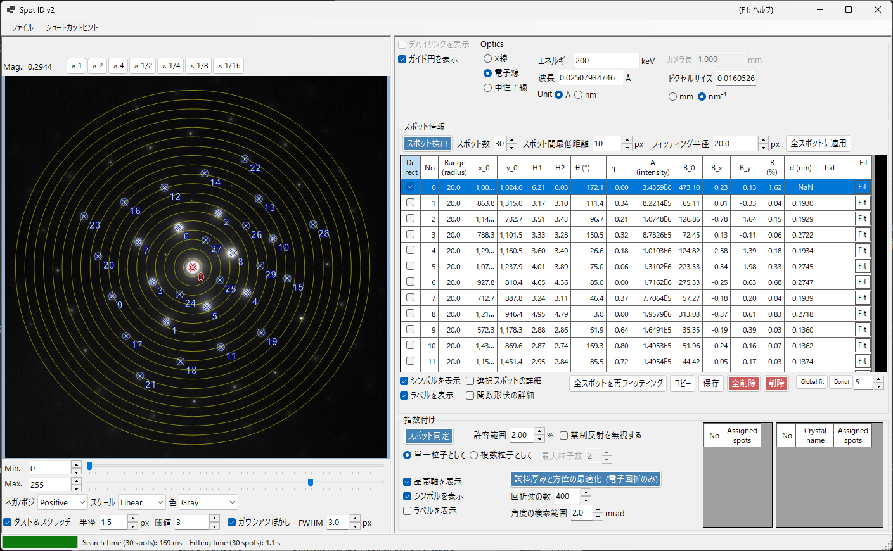
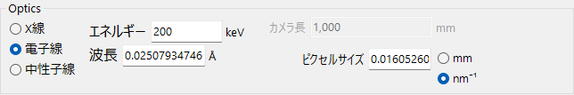
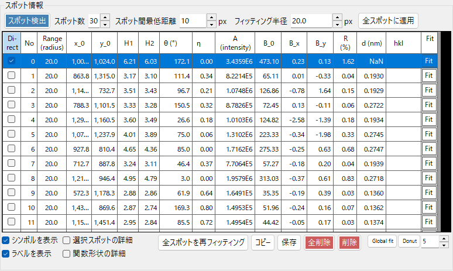
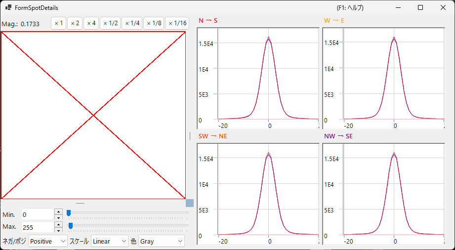
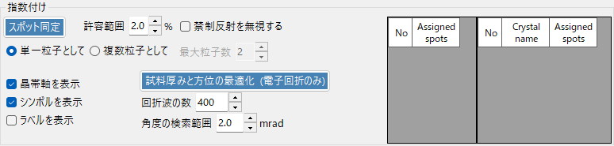

# Spot ID v2

<!-- 261105Cl コードから起こした修正。別担当がコードと再照合済み (誤りは訂正) (根拠: FormSpotIDv1.Designer.cs / FormSpotIDV2.Designer.cs) -->
**Spot ID v2** は、実測の回折画像上でスポットを検出・フィッティングし、指数付けします。[Spot ID v1](10-spot-id.md)（旧 TEM ID）はスポットのジオメトリを数値で入力する別機能です。

---

## キーボード・マウスショートカット

スポット一覧は、読み込んだ画像上で直接作成します。画像ペインの拡大・平行移動は ReciPro 標準の [画像ビュー操作](21-shortcuts.md) で、スポット編集には以下の組み合わせが加わります。

| ショートカット | 動作 |
|----------------|------|
| <kbd>F1</kbd> | このページのオンラインマニュアルを開く |
| 画像を左ダブルクリック | その点にスポットを追加（ピークフィッティング） |
| <kbd>CTRL</kbd> ＋ 左ダブルクリック | スポットを追加し、直接（000）ビームに指定 |
| スポットを左クリック | 最も近いスポットを選択 |
| <kbd>CTRL</kbd> ＋ スポットを右クリック | 最も近いスポットを削除 |
| <kbd>CTRL</kbd> ＋ 矢印キー | 選択中のスポットを1ピクセル移動 |
| 左ドラッグ／中ドラッグ（空き領域） | 画像を平行移動 |
| ホイール | カーソル位置を中心にズームイン／アウト |
| 右ドラッグで矩形選択 | 選択範囲にズームイン |
| 右ダブルクリック | ズームアウト |
| スポット行のヘッダーをダブルクリック（表） | そのスポットへズーム（×2） |

→ 全ウィンドウの一覧は **[21. キーボード・マウスショートカット](21-shortcuts.md)** を参照。

---

## ファイルメニュー

<!-- 261105Cl コードから起こした修正。別担当がコードと再照合済み (誤りは訂正) (根拠: FormSpotIDv1.Designer.cs (画像読み込み無し) / FormSpotIDV2.Designer.cs: saveToolStripMenuItem, copyToolStripMenuItem) -->
回折画像を開きます。ドラッグ&ドロップでも読み込めます。**保存** / **コピー** では表示中の画像をメタファイル (emf) またはイメージファイル (png) として書き出します。Gatan DM3/DM4 ファイルのピクセルサイズが nm⁻¹ で校正されている場合は、線種を電子線にし、加速電圧とピクセルサイズ (nm⁻¹) をファイルから読み込みます（このときカメラ長は不要です）。

**保存 ▸ 候補方位リスト (CSV)...** で指数付けにより得られた方位候補を書き出し、**コピー ▸ 候補方位リスト (TSV)** で同じ表をクリップボードへコピーできます。候補 × 結晶粒ごとに 1 行で、順位・粒番号・結晶名・ZXZ オイラー角 (°)・回転行列の 9 成分・平均二乗残差 (nm⁻²)・割り当てスポット数・スポット → (hkl) の対応が並びます。CSV の小数点は常にピリオドで、TSV はそのまま表計算ソフトへ貼り付けられます。

---

## 光学系 (Optics)

### 入射源

線種 (X線 / 電子線 / 中性子線) と、エネルギー (または波長) を設定します。

### カメラ長 / ピクセルサイズ

カメラ長 (mm) と検出器ピクセルサイズ (mm あるいは nm⁻¹)。nm⁻¹ で校正された Gatan DM ファイルを読み込んだ場合は、ピクセルサイズ (nm⁻¹) がヘッダから入り、カメラ長は使われません（単位が nm⁻¹ の間はカメラ長の欄は無効です）。波長・カメラ長・ピクセルサイズの単位を変えると、スポットの位置 (ピクセル) はそのままで、*d* が新しい校正で計算し直されます。

ウィンドウの位置と校正値（線源、エネルギー、カメラ長、ピクセルサイズの単位と値）は次の起動でも残ります。校正値を持つ画像ファイルを開くと、その値で上書きされます。 <!-- 261105Cl 監査: NumericBoxPixelSize_ValueChanged (8860d40)、FormMain.cs の保存・復元 (dc42de3) -->

<!-- 261105Cl コードから起こした修正。別担当がコードと再照合済み (誤りは訂正) (根拠: FormSpotIDV2.Designer.cs: panel1 の checkBoxShowDebyeRing / checkBoxGuideCircles) -->
**デバイリングを表示**（既定 OFF）・**ガイド円を表示**（既定 ON）で、結晶のデバイリングとガイド円をパターン上に描きます。

---

## スポット情報

- **スポット検出**: 局所最大値とバックグラウンド除去を用いた自動スポット検出。
- **スポット数**: 検出するスポットの最大数を指定します。
- **スポット間最低距離**: 検出スポット間に許す最小間隔 (px)。これより近接したピークは統合され、同一スポットの二重検出を防ぎます。
- **フィッティング半径**: 各スポットのピーク当てはめに用いる円領域の半径 (px)。この円内のピクセルを擬 Voigt 関数でフィッティングします。
- **全スポットに適用**: すべてのスポットのフィッティング半径を、現在の「フィッティング半径」の値に揃えます。
- **削除 / 全削除**: 個別またはすべての検出スポットを削除。
- **保存** / **コピー**: スポットの表を CSV ファイルへ保存、またはタブ区切りのテキストとしてクリップボードへコピー。スポットが 1 個でも使えます。CSV の小数点は常に「.」で、**ファイル ▸ 開く** で読み戻せます（先に画像を読み込んでおく必要があり、スポットは今の一覧の後ろに足されます）。 <!-- 261105Cl 監査: GetSpotListText / readCSV (7f65908) --> <!-- 261105Cl コードから起こした修正。別担当がコードと再照合済み (誤りは訂正) (根拠: FormSpotIDV2.Designer.cs / FormSpotIDV2.ja.resx) -->
- **全スポットを再フィッティング**: 検出済みの全スポットの位置と強度を当てはめ直します。
- **シンボルを表示** / **ラベルを表示**: 観測スポットにシンボル・番号を表示します（既定はどちらも ON）。
- **Global fit**: 全スポット位置を一括でグローバルフィッティングします（実験的機能）。
- **Donut**: ドーナツ型のバックグラウンド除去を適用します（実験的機能）。隣のボックスで、各スポットの外側に設ける環状領域の幅 (px) を指定します（この環の平均を局所バックグラウンドとして差し引きます）。
- **選択スポットの詳細**: チェックすると、選択中のスポットの詳細情報ウィンドウを表示します。
- **関数形状の詳細**（ウィンドウを開いた時点では OFF）: スポットの表で使う 2 次元擬 Voigt 関数とそのパラメータ（x_0, y_0, H1, H2, θ, η, A, B_0, B_x, B_y）の説明図を表示します。

---

## 指数付け

- **スポット同定**: 指数付けアルゴリズムを実行して最適な結晶と晶帯軸を検索。実行中はその位置に **中止** ボタンが現れ、検索を中断できます。画像、2 個以上のスポット、メインウィンドウの結晶リストで選んだ結晶が必要で、足りないときはメッセージで知らせます。Spot ID v2 を開いている間は、メインウィンドウの結晶リストで複数選択ができます。 <!-- 261105Cl 監査: buttonIdentifySpots_Click (494ef52)、FormMain.cs の複数選択 (4020433) -->
- **許容範囲**: 面間隔の相対許容誤差（%、0.1〜10、既定 2）。スポット間の角度の許容誤差は asin(許容範囲)/2 として導かれます。 <!-- 261105Cl コードから起こした修正。別担当がコードと再照合済み (誤りは訂正) (根拠: FormSpotIDV2.cs: ToleranceLength / ToleranceAngle) -->
- **禁制反射を無視する**（既定 OFF、電子線のみ）: チェックすると、らせん軸・映進面によるものも含めすべての消滅則で禁制となる反射を候補から除きます。チェックしない場合は格子の心（I, F, A, B, C, R）による消滅だけを除き、多重回折で現れうるらせん軸・映進面の禁制反射は候補に残します。X 線では常にすべての禁制反射を除きます。 <!-- 261105Cl コードから起こした修正。別担当がコードと再照合済み (誤りは訂正) (根拠: FormSpotIDV2.cs: SetGVector(..., checkBoxIgnoreMultipleDiffraction.Checked, ...) / PolyCrystal.cs: SetGVector) -->
- **単一粒子として / 複数粒子として**: 単結晶として 1 つの方位を探索するか、多結晶（複数粒子）として複数の方位を探索するかを選びます。複数粒子の場合は **最大粒子数** で探索する粒子数の上限を指定します。
- **晶帯軸を表示** / **シンボルを表示** / **ラベルを表示**: 晶帯軸と、計算スポットのシンボル・指数ラベルを重ねます。 <!-- 261105Cl コードから起こした修正。別担当がコードと再照合済み (誤りは訂正) (根拠: FormSpotIDV2.Designer.cs / FormSpotIDV2.ja.resx) -->
- **試料厚みと方位の最適化 (電子回折のみ)**: 線源が **電子線** のときだけ動きます（それ以外ではステータスバーにその旨が出て、計算しません）。 <!-- 261105Cl 監査: ButtonRefineThicknessAndDirection_Click / Bethe_CbedCompleted (ed018ca) --> 選択した粒子について、観測スポット強度を動力学（ブロッホ波）計算と照合し、試料厚さ (nm) と入射方位を最適化します。**回折波の数**（1〜2048、既定 400）は取り入れるビーム数、**角度の検索範囲**（mrad、1〜10、既定 2）は探索する入射方向の角度半幅です。この最適化は中断できません（**中止** ボタンは **スポット同定** 専用です）。終わるまでウィンドウは操作できません。厚さは 50〜549 nm（1 nm 刻み）、入射方向は粒子の現在の方位のまわりの正方格子（刻みは検索範囲の 1/15）で試し、指数付けされたスポットについて Σ (Iobs − a·Icalc)²（a は最適な倍率）が最小になる組を採ります。最適な厚さは回折シミュレーターへ渡され、粒子の方位（メインウィンドウにも反映）は、最適な方向が入射方向になるよう傾けられます（面内の回転は保たれます）。結果（厚さ、傾き (mrad)、晶帯軸、残差）はステータスバーに表示されます。最適な方向が検索範囲の端にあるときは、真の最適が範囲の外にあり得るため、その旨をステータスバーに表示します。もう一度ボタンを押す（新しい方位のまわりを探します）か、範囲を広げてください。 <!-- 261105Cl 方位の精密化の実装に合わせて追記 (根拠: FormSpotIDV2.cs: ButtonRefineThicknessAndDirection_Click / Bethe_CbedCompleted) -->
- **結果**: 最良の一致が結晶名、晶帯軸 [uvw]、各スポットの指数 (hkl) と共に表示。粒子の行を 1 つだけ選ぶと、メインウィンドウでもその粒子の結晶が選ばれ、その方位になります。 <!-- 261105Cl 監査: bindingSourceGrains_CurrentChanged (I11) -->

---

## 関連項目

- [Spot ID v1](10-spot-id.md)
- [回折シミュレータ](7-diffraction-simulator/index.md)
- [メインウィンドウ](0-main-window.md)
- [キーボード・マウスショートカット](21-shortcuts.md)
