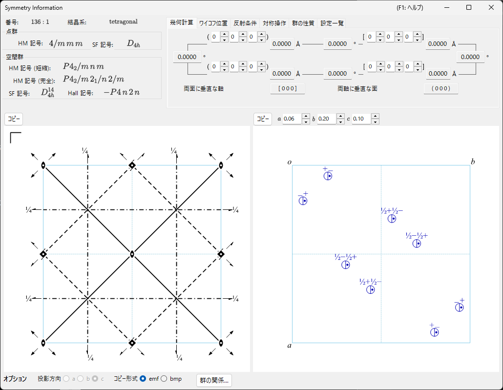
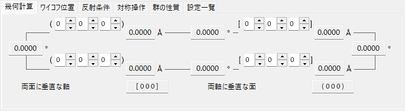
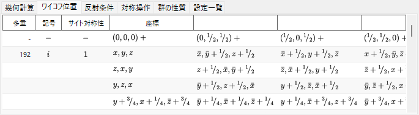
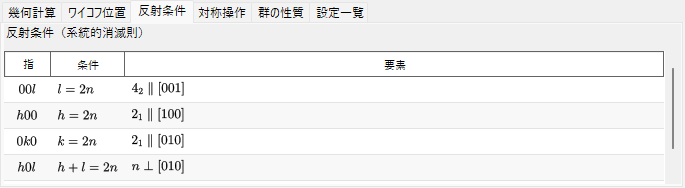
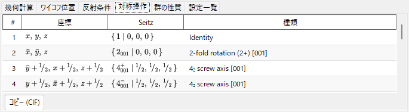
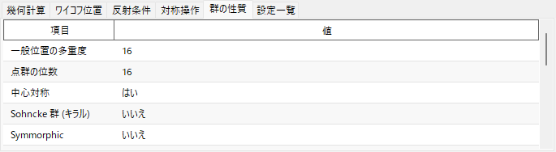
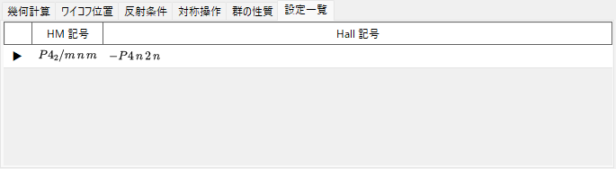
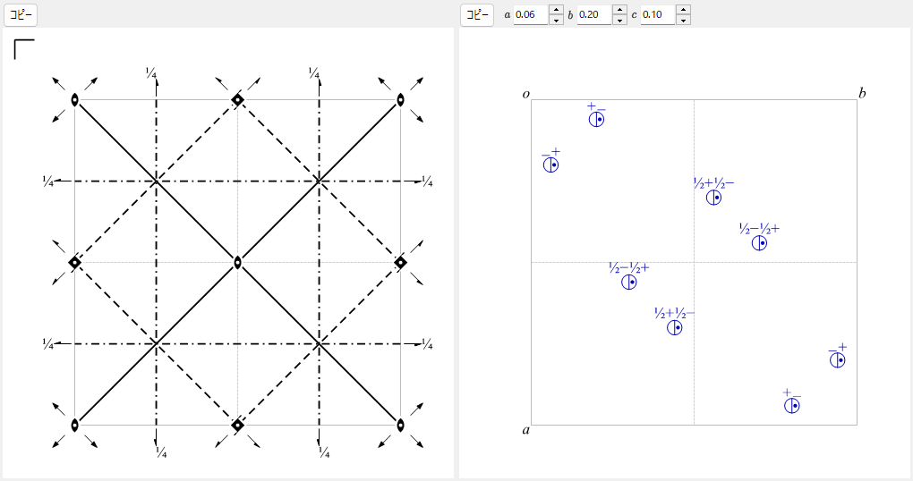

# 対称性情報 (Symmetry Information)

**Symmetry Information** は、選択した結晶の空間群対称性の詳細情報を表示し、さらに*International Tables for Crystallography* Vol. A の様式に沿った対称要素・一般位置の模式図を描画します。

ウィンドウは、空間群の情報（左上）、計算・表のタブ領域（右上）、2つの模式図（下部）から構成されます。

!!! tip "対称性の理論的背景 (Appendix A4)"
    ヘルマン・モーガン/Hall/シェーンフリース記号が実際に何を表しているか、**Properties**（群の性質）タブの群論的分類（中心対称・Sohncke・共型 (シンモルフィック)・極性、…）、下部の対称要素・一般位置模式図の意味、そして **Group Relations...**（群の関係）が示す群・部分群の関係は、すべて **[Appendix A4. 対称性と空間群](appendix/a4-symmetry-space-groups/index.md)** で説明しています。

---

## キーボード・マウスショートカット

このウィンドウに特別なキー／マウスの組み合わせはありません。<kbd>F1</kbd> でこのマニュアルページが開き、2つの **コピー** ボタンで対称要素図・一般位置図をクリップボードへコピーします（**コピー形式** の選択に応じてベクター emf またはラスター bmp）。

→ 全ウィンドウの一覧は **[21. キーボード・マウスショートカット](21-shortcuts.md)** を参照。

---

## 空間群の情報

左上のパネルには、現在の空間群について以下が表示されます。

- **Number**（1〜230）と設定インデックス
- **Crystal System**（結晶系）
- **Point Group**（点群） : ヘルマン・モーガン (HM) 記号とシェーンフリース (SF) 記号 <!-- 261105Cl コードから起こした修正。別担当がコードと再照合済み (誤りは訂正) (根拠: FormSymmetryInformation.cs:LocalizeLabels (groupBoxPointGroup=点群)) -->
- **Space Group**（空間群） : HM短縮記号・HM完全記号・SF記号・**Hall記号**

---

## Geometrics Calculation（幾何計算）

2つの結晶面 \((h_1, k_1, l_1)\),  \((h_2, k_2, l_2)\) または2つの方向指数 \([u_1, v_1, w_1]\),  \([u_2, v_2, w_2]\) を入力すると、次が得られます。

- 各面の面間隔／各軸の長さ
- 2面間（または2軸間）の角度
- 面1の法線と軸1、面2の法線と軸2のなす角（軸が面内にあるとき 90°） <!-- 261105Cl コードから起こした修正。別担当がコードと再照合済み (誤りは訂正) (根拠: FormSymmetryInformation.cs:numericBox_ValueChanged) -->
- **両面に平行な軸**（2 つの面の晶帯軸 [*uvw*]）と **両軸を含む面**（2 つの軸を含む面 (*hkl*)）。符号は [*uvw*] = (*h*₁*k*₁*l*₁) × (*h*₂*k*₂*l*₂)、(*hkl*) = [*u*₁*v*₁*w*₁] × [*u*₂*v*₂*w*₂] の向きです <!-- 261106Cl 作者の決定 B16 --> <!-- 261105Cl 監査: 画面のラベル (FormSymmetryInformation.cs label40/label42) と面・軸の角度のツールチップに合わせた。以前の「垂直な」は逆 -->

これらは現在の単位胞の計量に基づいて計算されます。長さは Å、角度は度で表示されます。

---

## Wyckoff Positions（ワイコフ位置）

<!-- 261105Cl コードから起こした修正。別担当がコードと再照合済み (誤りは訂正) (根拠: FormSymmetryInformation.cs:SetupExtraTables/SetWyckoffPosition) -->
すべてのワイコフ位置について、**多重度**・**記号**（ワイコフ記号）・**サイト対称性**・**座標**（1行に最大4個。それ以上は次の行に続く）を一覧表示します。最初のワイコフ位置（最大の多重度）が一般位置です。複合格子では 格子並進ベクトルがヘッダ行に示されます。R 格子の六方軸では、obverse の 3 つの中心化並進 (0,0,0)+・(2/3,1/3,1/3)+・(1/3,2/3,2/3)+ が示されます。 <!-- 261105Cl 監査: R 群の六方軸でも中心化の行が出る (FormSymmetryInformation.cs, Controls ead58e7) -->

---

## Conditions（反射条件）

複合格子、らせん・映進などの対称操作に由来する反射（出現則）条件を表示します。

<!-- 261105Cl コードから起こした修正。別担当がコードと再照合済み (誤りは訂正) (根拠: FormSymmetryInformation.cs:SetupExtraTables/ChangeCrystal) -->
各行は **指数**（反射の種類。例: $hkl$, $h0l$, $00l$）・**条件**（例: $h+k=2n$）・**要素**（その条件をもたらす格子心付け・対称要素）の3列です。条件が無い場合は *No Condition* と表示されます。

---

## Operations（対称操作）

一般位置のすべての対称操作（格子心付けの並進は展開済み）を、座標トリプレット・Seitz記号・平易な幾何学的種類（例: 「3-fold rotation」「c-glide plane」「screw axis」）で一覧表示します。**コピー (CIF)** で全リストをCIFの `_space_group_symop_operation_xyz` ループとしてクリップボードにコピーできます。

→ この3通りの表記の読み方は **[Appendix A4.1](appendix/a4-symmetry-space-groups/symbols-and-diagrams.md#対称操作対称操作タブ)** を参照してください。

---

## Properties（群の性質）

現在の空間群の群論的分類（一般位置の多重度、点群の位数、中心対称、Sohncke、共型 (シンモルフィック)、極性、掌性対の相手、結晶族・格子系・ブラベー型、算術結晶類、Patterson対称）と、その対称性で許容される巨視的物性（焦電性/強誘電性、圧電性、第二高調波発生、旋光性）を表示します。

→ 各用語の意味は **[Appendix A4.1](appendix/a4-symmetry-space-groups/symbols-and-diagrams.md#群論的分類群の性質タブ)** を参照してください。

---

## Settings（設定一覧）

現在の空間群と同じIT番号を共有するすべての収録済み原点・軸設定の選択を、それぞれのHM記号・Hall記号とともに参考として一覧表示します。現在表示中の設定にはマークが付きます。行を選んでも結晶は変更されません。

---

## 対称要素・一般位置の模式図

下部の2つのパネルは、*International Tables for Crystallography* Vol. A の表記に則った空間群の対称性模式図を再現します。

- **対称要素 (左)**: 回転軸・らせん軸、鏡面・映進面、反転中心・回反点を、慣用の図記号で描画します。
  - 立方晶系の\(F\)格子に関しては、投影した単位胞の左上1/4のみを表示します（[付録 A4.1](appendix/a4-symmetry-space-groups/symbols-and-diagrams.md#symmetry-element-diagram) 参照）。
  - このような対称要素は [Structure Viewer](5-structure-viewer.md) の3Dモデル上にも直接描画することができます。

<!-- 261105Cl コードから起こした修正。別担当がコードと再照合済み (誤りは訂正) (根拠: SymmetryDiagramPositions.cs:ComputeDepthLabel) -->
- **一般位置 (右)**: 一般等価位置を円（コンマ付きは鏡像）で表示し、投影軸方向の高さラベル（`+`、`−`、`½+`、…。[付録 A4.1](appendix/a4-symmetry-space-groups/symbols-and-diagrams.md) 参照）を付記します。
  - 試験点 $(x,y,z)$ は、一般位置図の **コピー** ボタンの右にある **a** / **b** / **c** の欄（範囲 −1〜1、刻み 0.01）で設定します。点群が変わるとその点群の既定値に戻り、同じ点群のまま空間群だけが変わった場合は入力値が保持されます。
  - 立方晶系についてのみ、3回回転軸で結ばれる三つの円をつなぐ補助線が表示されます。

<!-- 261105Cl コードから起こした修正。別担当がコードと再照合済み (誤りは訂正) (根拠: FormSymmetryInformation.cs:ChangeCrystal, SymmetryDiagramCommon.cs:ResolveProjectionAxis) -->
コントロール（ウィンドウ下端の **オプション** パネルと、各模式図の上の **コピー** ボタン）:

- **投影方向**（`a` / `b` / `c`） : 投影する結晶軸を選択します。選択できるのは直方晶（斜方晶）の空間群のみです（既定 `c`）。単斜晶ではユニーク軸、それ以外の晶系では `c` が自動的に使われます。
- **コピー** : 各模式図を、**コピー形式** で選択した形式（ベクター emf ／ラスター bmp）でクリップボードにコピーします。emf は PowerPoint でグループ解除して編集できます。
- **群の関係...**（Group Relations...） : 現在の空間群の極大部分群／極小超群の関係を閲覧するブラウザを開きます。読み方は [Appendix A4.2](appendix/a4-symmetry-space-groups/group-subgroup-relations.md) を参照してください。

---

## 関連項目

- [結晶データベース](1-crystal-database.md)
- [結晶構造ビューア](5-structure-viewer.md)
- [ステレオネット](6-stereonet.md)
- [回転ジオメトリ](4-rotation-geometry.md)
- [メインウィンドウ](0-main-window.md)
- [Appendix A4. 対称性と空間群](appendix/a4-symmetry-space-groups/index.md) — このページの各タブ・模式図の背後にある結晶学・群論の理論的背景。
