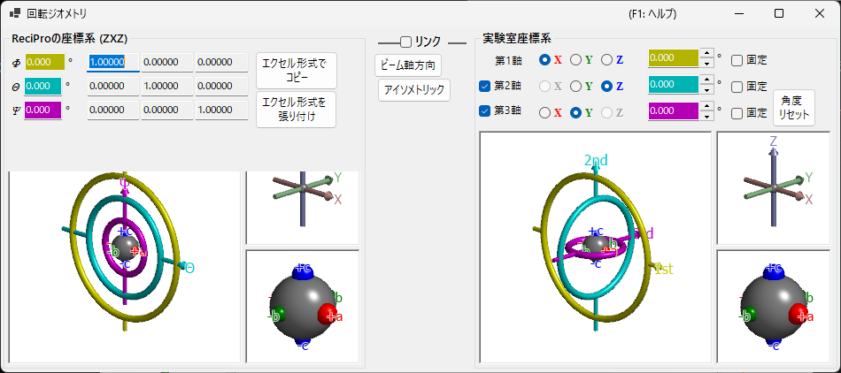

# 回転ジオメトリ (Rotation Geometry)

このウィンドウは、結晶の回転状態を3×3行列で表現し、異なるオイラー座標系間の変換を行います。

ReciProでは **Ψ**、**Θ**、**Φ** の三つのオイラー角を **Z–X–Z** の順に適用して結晶の回転状態を表現します。ただし、この表現は実際のゴニオメーターの回転軸とは必ずしも一致しません。**回転ジオメトリ** ウィンドウでは、ReciProのオイラー角を任意の座標系に変換でき、実験室でのゴニオメーター調整をサポートします。 <!-- 261105Cl 監査: 画面の欄の見出し・ツールチップ (Φ, Θ, Ψ) に合わせ θ → Θ に統一 -->

---

## キーボード・マウスショートカット

6つの3Dビュー（ReciPro／実験のゴニオ・軸・オブジェクトの各パネル）は**連動**しており、どれか1つを回転させると6つすべてが一緒に回転します。操作は ReciPro 標準の [OpenGL ビュー操作](21-shortcuts.md) です。

| ショートカット | 動作 |
|----------------|------|
| <kbd>F1</kbd> | このページのオンラインマニュアルを開く |
| ビューを左ドラッグ | モデルを回転（6ビューが連動） |
| ホイール、または右ドラッグ上下 | ズーム（大きいゴニオビュー） |
| <kbd>CTRL</kbd> ＋ 右ドラッグ上下 | カメラ距離を変更（透視投影時のみ） |
| <kbd>CTRL</kbd> ＋ 右ダブルクリック | 正射投影／透視投影の切替 |

小さい *Axes*・*Objects* ビューはズーム・平行移動が無効です。<kbd>F1</kbd> 以外のキーボードショートカットはありません。

---

## ReciPro座標系 (ZXZ)

ウィンドウ上半分は「ReciProの座標系 (ZXZ)」で表現された回転状態を表示・設定する部分です。

- **Φ, Θ, Ψ** は今の結晶方位 (メインウィンドウのオイラー角) を表示する読み取り専用の欄です。このウィンドウを閉じている間の回転も、開き直したときに表示されます。 <!-- 261105Cl 監査: 読み取り専用の表示・開き直したときの反映 (FormRotation.cs) -->
- **回転行列** には現在の回転状態に対応する3×3回転行列が表示されます。

### Φ, Θ, Ψ (Z–X–Z オイラー角)

結晶方位は3つの回転で表現されます。**結晶に固定した (intrinsic な) 座標系** で記述すると、次の順に適用されます。

1. **Φ** — 最初に **Z** 軸まわりの回転
2. **Θ** — 1回目の回転後の **X** 軸まわりの回転
3. **Ψ** — 2回目の回転後の **Z** 軸まわりの回転

同じ回転を **実験室に固定した座標系** で見ると順序は逆になり、$Z$ まわりの Ψ → $X$ まわりの Θ → $Z$ まわりの Φ となります（[付録 A1.1](appendix/a1-coordinate-system/1-orientation.md) の記述はこちらです）。どちらも下の回転行列 $R$ は同一で、Φ が最も外側（ゴニオメータでいう最上位）、Ψ が最も内側の軸にあたります。

<!-- 261105Cl コードから起こした修正。別担当がコードと再照合済み (誤りは訂正) (根拠: FormRotation.Designer.cs:numericBoxPhi/Theta/Psi, numericBox11–33 ReadOnly=true) -->
Φ, Θ, Ψ の各ボックスと回転行列の 9 個のボックスは**表示専用 (読み取り専用)** です。方位を変えるには、メインウィンドウで結晶を回転するか、**エクセル形式を貼り付け** を使うか、(**リンク** をオンにして) 下の実験室座標系の角度を編集します。変更はメインウィンドウおよびリンクされたシミュレータすべてに反映されます。

### 回転行列

現在の (Φ, Θ, Ψ) から得られる 3 × 3 行列。**エクセル形式でコピー** / **エクセル形式を貼り付け** で表計算ソフトとの間で行列をやり取りできます。

この行列は、ReciPro 内のどこに現れるときも次の 1 つの規約に従います:

$$
\mathbf{v}_{\mathrm{rot}} = R\,\mathbf{v}_{0}
$$

- \(R\) は結晶の**能動回転** (active rotation) を、モニタに固定された実験室座標系 (\(X\)=右、\(Y\)=上、\(Z\)=手前 — [付録 A1.1](appendix/a1-coordinate-system/1-orientation.md) 参照) で表したものです。
- \(\mathbf{v}_{0}\) : 結晶に固定された方向の、**初期方位** (\(c \parallel Z\)、\(b\) は \(YZ\) 面内) におけるデカルト座標 (列ベクトル)。
- \(\mathbf{v}_{\mathrm{rot}}\) : 回転後の同じ方向の座標 (同じく実験室座標系)。
- \(\Phi=\Theta=\Psi=0\) のとき \(R\) は単位行列です。\(R\) は正規直交で行列式 +1 なので、逆変換は転置 \(R^{-1}=R^{\mathsf T}\) で得られます。

オイラー角で書くと \(R = R_Z(\Phi)\,R_X(\Theta)\,R_Z(\Psi)\) です (固定軸まわりの右手回転。ベクトルには \(\Psi\) が最初に作用します):

$$
R=\begin{pmatrix}
\cos\Phi\cos\Psi-\cos\Theta\,\sin\Phi\sin\Psi & -\cos\Phi\sin\Psi-\cos\Theta\,\sin\Phi\cos\Psi & \sin\Theta\,\sin\Phi\\
\sin\Phi\cos\Psi+\cos\Theta\,\cos\Phi\sin\Psi & -\sin\Phi\sin\Psi+\cos\Theta\,\cos\Phi\cos\Psi & -\sin\Theta\,\cos\Phi\\
\sin\Theta\,\sin\Psi & \sin\Theta\,\cos\Psi & \cos\Theta
\end{pmatrix}
$$

結晶学的指数に適用するときは、まず初期方位のデカルト座標に直します: 方向 \([uvw]\) は \(\mathbf{v}_0 = u\mathbf{a}+v\mathbf{b}+w\mathbf{c}\)、面法線 \((hkl)\) は \(\mathbf{v}_0 = h\mathbf{a}^{*}+k\mathbf{b}^{*}+l\mathbf{c}^{*}\) (逆格子基本ベクトル) です。

同じ行列 (\(R_{ij}\) = \(i\) 行 \(j\) 列) は次の場所に現れます:

- このウィンドウの **エクセル形式でコピー** / **エクセル形式を貼り付け** (3 × 3 タブ区切り、上の行から順)
- [マクロ API](20-macro/1-built-in-functions.md) の `Dir.GetRotationMatrix()` / `Dir.SetRotationMatrix()`・`Dir.GetEuler()` (9 要素を行順 \(R_{11}, R_{12}, R_{13}, R_{21}, \ldots, R_{33}\) で列挙)
- [Spot ID v2](11-spot-id-v2.md) が保存する候補リストの **R11**–**R33** 列

### OpenGLウィンドウ

3つのTorus（ドーナツ）で回転軸の状態を3次元的に描画します。

| 色 | オイラー角 | ゴニオメーターレベル |
|----|----------|-------------------|
| **黄** | Φ | 上位（1st）回転軸 |
| **水色** | Θ | 中位（2nd）回転軸 |
| **ピンク** | Ψ | 下位（3rd）回転軸 |

**赤**・**緑**・**青**の矢印は実空間直交座標のX, Y, Z軸です。メインウィンドウに表示される結晶軸とは異なりますのでご注意ください。

<!-- 261105Cl コードから起こした修正。別担当がコードと再照合済み (誤りは訂正) (根拠: FormRotation.cs:createObject) -->
中央の灰色の球はサンプルを表します。赤・緑・青の小球 (**+a/−a**, **+b/−b**, **+c/−c** のラベル付き) は、回転後の結晶の *a*, *b*, *c* 軸 (規格化) の向きを示します (大きい球が + 側)。Φ = Θ = Ψ = 0 では結晶の初期方位 (*c* ∥ +Z、*b* は YZ 面内) を表すので、*a*, *b* が +X, +Y に一致するのは直交格子の場合だけです。

> **注意**: OpenGLウィンドウでのドラッグ操作はこのビューの投影方向のみを変更し、結晶自体は回転しません。結晶を回転するにはメインウィンドウを使用してください。

### ボタン

| ボタン | 動作 |
|--------|------|
| エクセル形式でコピー | 3×3回転行列をタブ区切り (1 行ごとに改行) でクリップボードにコピー。**エクセル形式を貼り付け** でそのまま読み戻せます |
| エクセル形式を貼り付け | クリップボードのタブ区切り3×3数値を回転行列として設定。回転行列 (行と列が正規直交、行列式 +1) でない値はメッセージを出して受け付けず、表計算の丸め程度のずれ (10⁻³ まで) は最も近い回転行列に補正します <!-- 261105Cl 監査: FormRotation.cs の Paste の検査 (RᵀR − I ≤ 1e-3, det > 0) と Copy の改行 (\r\n) --> |
| ビーム軸方向 | メインウィンドウと同じ投影方向（Z軸がスクリーン垂直） |
| アイソメトリック | アイソメトリック投影に切替 |

---

## 実験室座標系

ウィンドウ下半分は、任意の回転軸上でオイラー角を定義し、ゴニオメーターの回転状態を取得・設定する部分です。

### 第1軸・第2軸・第3軸

<!-- 261105Cl コードから起こした修正。別担当がコードと再照合済み (誤りは訂正) (根拠: FormRotation.cs:getExpDirections, RadioButton_CheckedChanged, checkBox1st_CheckedChanged, NumericBoxExp_ValueChanged, RotExp; FormRotation.Designer.cs) -->
ゴニオメーターの各段 (第1軸 = 上位、第2軸 = 中位、第3軸 = 下位) の回転軸を **X**、**Y**、**Z** (実験室座標系の正方向のみ) から選択します。第2軸は第1軸と、第3軸は第2軸と同じ軸にはできません (重なるラジオボタンは無効になります)。既定は **X – Z – Y** です。選択に応じてグラフィックスも変化します。

各軸の角度は対応する色のボックス (黄、水色、ピンク) に表示され、直接入力もできます (単位は度。−180〜180° の外の値は折り返されます)。実験室座標系の回転は ReciPro 自身の行列と同じ流儀で、第1軸を最も外側として合成されます:

$$
R_{\mathrm{exp}} = R_{\mathbf{e}_1}(\omega_1)\,R_{\mathbf{e}_2}(\omega_2)\,R_{\mathbf{e}_3}(\omega_3)
$$

(固定された実験室軸 $\mathbf{e}_i$ まわりの右手回転)。

| コントロール | 動作 |
|-------------|------|
| **第2軸** / **第3軸** | その段を有効/無効にします (1 軸・2 軸のゴニオメーター用)。無効にするとその角度は 0 になります。第2軸を無効にすると第3軸も無効になります。 |
| **固定** | リンク時に新しい方位をゴニオ角へ分解する際、その角度を現在値に固定します (下記)。 |
| **角度をリセット** | 実験室座標系の 3 つの角度をすべて 0 にします。 |

---

## リンク (Link)

**リンク** をチェックすると、ReciPro座標系と実験座標系が連動します。オブジェクトの方位が両システムで一致するようにオイラー角が自動調整されます。

<!-- 261105Cl コードから起こした修正。別担当がコードと再照合済み (誤りは訂正) (根拠: FormRotation.cs:CheckBoxLink_CheckedChanged, SetRotation(Matrix3D), NumericBoxExp_ValueChanged; FormMain.cs:Rotate) -->
**リンク** をチェックした瞬間に、両座標系のずれ $R_{\mathrm{base}} = R_{\mathrm{exp}}^{-1} R$ が記憶され、以後 $R = R_{\mathrm{exp}}\,R_{\mathrm{base}}$ となります。リンク中は:

- 実験室座標系の角度を編集すると、全ウィンドウの結晶が回転します。
- 増分の回転（矢印ボタン、CTRL+SHIFT+矢印キー、メインウィンドウや他ウィンドウでのドラッグ）は、有効かつ **固定** されていないゴニオ角へ数値的に分解され、結晶は**ゴニオメーターで到達できる最も近い方位**に設定されます。固定軸や無効軸がある場合、結晶はマウス操作どおりではなくゴニオメーターの制約に従って動きます。
- メインウィンドウの **固定** も効きます。どちらかがオンなら、増分の回転はその晶帯軸または面法線のまわりの回転にしてから分解されます。 <!-- 261105Cl 監査: Link 中も主窓の固定が効く (FormMain.cs, bc75fdc4) -->
- 方位を直接指定する操作（メインウィンドウの **オイラー角** 欄への入力（このウィンドウの Φ, Θ, Ψ 欄は表示専用）、**回転をリセット**、**軸/面投影** の **方向指数** / **面指数**、このウィンドウの **エクセル形式を貼り付け**、結晶リストで方位の違う結晶に切り替えること、ほかのウィンドウ (指数付けの結果の適用など) やマクロからの方位の設定）は、その方位をそのまま適用し、**リンクを外します**。メインウィンドウのステータスバーにその旨が出ます。ゴニオ角、**固定** の設定、有効な軸はそのまま残ります。**リンク** をチェックし直すと、その時点の方位で結び直します。方位が変わらない操作 (結晶の編集など) ではリンクは外れません。 <!-- 261106Cl 作者の決定 G-13: FormRotation.cs SetRotation(bool) -->

**リンク** がオンのままこのウィンドウを閉じ、その間に結晶を回してから開き直すと、今の方位を基準にリンクを取り直します (**リンク** をチェックし直したのと同じ)。結晶の方位もゴニオ角も飛びません。 <!-- 261105Cl 監査: 開き直したときのリンクの扱い (FormRotation.cs, ecdcec9a) -->

### 使用例

1. 実験室のゴニオメーターで、結晶の *a* 軸をX線入射方向に、*b* 軸を水平方向に合わせる。
2. 実験座標系にゴニオメーターのオイラー角を入力する。
3. メインウィンドウで結晶を回転し、*a* 軸をスクリーン法線方向、*b* 軸を水平方向に設定する。
4. **リンク** をチェック — 以降、メインウィンドウで結晶方位を変えると、必要なゴニオメーター角度が自動表示される。

---

## 関連項目

- [メインウィンドウ](0-main-window.md)
- [ステレオネット](6-stereonet.md)
- [基本座標系と結晶方位](appendix/a1-coordinate-system/1-orientation.md)
- [キーボード・マウスショートカット](21-shortcuts.md)
