# 結晶構造ビューア

**結晶構造ビューア (Structure Viewer)** は、選択した結晶の構造をOpenGLを使って3次元的に描画します。

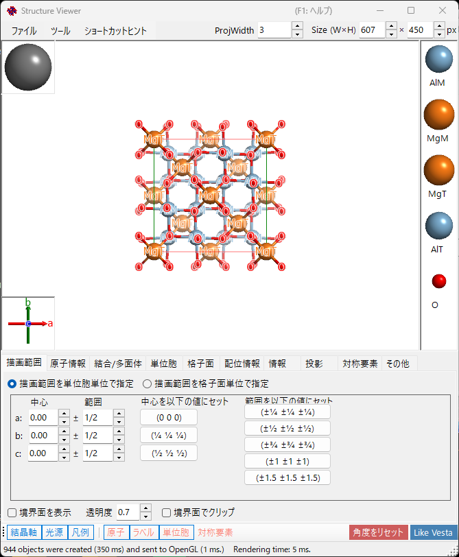

---

## キーボード・マウスショートカット

このウィンドウにはメインの3Dビューに加え、2つの小さなウィジェット（左下の **結晶軸** ボックスと左上の **光源** ボックス）があり、左ドラッグの動作がそれぞれ異なります。メインビューは ReciPro 標準の [OpenGL ビュー操作](21-shortcuts.md) です。

| ショートカット | 動作 |
|----------------|------|
| <kbd>F1</kbd> | このページのオンラインマニュアルを開く |
| <kbd>CTRL</kbd>+<kbd>SHIFT</kbd>+<kbd>C</kbd> | 描画画像をクリップボードにコピー |
| メインビューを左ドラッグ | モデルを回転 |
| 原子を左ダブルクリック | クリックした原子の座標と、その周りの近接原子への距離・結合角を表示（表示中の原子だけを選べます） <!-- 261105Cl 監査: 近接原子はクリックした位置の周り (ca87b772, 8cc95680) --> |
| 右ドラッグ上下、またはホイール | ズーム |
| 中ドラッグ | 平行移動 |
| <kbd>CTRL</kbd> ＋ 右ドラッグ上下 | カメラ距離を変更（透視投影時のみ） |
| <kbd>CTRL</kbd> ＋ 右ダブルクリック | 正射投影／透視投影の切替 |
| **結晶軸** ウィジェットを左ドラッグ | モデルを回転（面内回転なし） |
| **光源** ウィジェットを左ドラッグ | 照明方向を変更 |

メインウィンドウのアプリ全体ショートカット（<kbd>CTRL</kbd>+<kbd>SHIFT</kbd> 系）は、このウィンドウにフォーカスがある間も動作します（[メインウィンドウ](0-main-window.md) 参照）。

→ 全ウィンドウの一覧は **[21. キーボード・マウスショートカット](21-shortcuts.md)** を参照。

---

## メインエリア

画面上部に結晶構造が描画されます。左上に光源の方向、左下に結晶軸の方向、右側に原子の凡例が表示されます。ウィンドウの位置と大きさは次の起動でも残ります。 <!-- 261106Cl 作者の決定 H6 -->
<!-- 261105Cl コードから起こした修正。別担当がコードと再照合済み (誤りは訂正) (根拠: FormStructureViewer.cs:sizeControl1_ValueChanged) -->
> ウィンドウ右上の **サイズ (W×H)** ボックスで 3D ビューのピクセルサイズを指定します (それに合わせてウィンドウがリサイズされます)。保存・コピーされる画像はこのサイズになります。
> その隣の **ProjWidth** ボックスは投影ビューの横幅 (nm) を表示します。値を編集して数値でズームすることもでき、ビュー上の右ドラッグ/ホイールによるズームと連動します。

---

## メニューバー

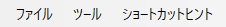

### ファイルメニュー

<!-- 261105Cl コードから起こした修正。別担当がコードと再照合済み (誤りは訂正) (根拠: FormStructureViewer.designer.cs:menuStrip1 / saveImageToolStripMenuItem_Click / initializeDdpDeveloperMenu) -->
| メニュー項目 | 説明 |
|-------------|------|
| 画像を保存 ▸ メイン / 凡例 / 結晶軸 / 光源方向 <!-- 261105Cl 監査 (組 K): 項目名を FormStructureViewer.ja.resx (save*/copy*ToolStripMenuItem) に合わせた --> | メインビュー、原子の凡例、または結晶軸・光源ウィジェットの画像を PNG で保存 |
| コピー ▸ メイン / 凡例 / 結晶軸 / 光源方向 | 画像をコピー（Ctrl+Shift+C はメインビューをコピー） |
| 動画を保存 ▸ メイン / 結晶軸 | メインビューまたは結晶軸ウィジェットの回転・平行移動の動画を MP4 で保存（速度・時間・fps・品質などを設定） |
| 3Dモデルを出力 (3MF/STL) | 表示中の構造を 3D プリント用の立体データとして書き出す |

**ツール** メニュー: **VESTA 風にする**（ツールバーの *VESTA 風* と同じ）と **Enable DDP**（[透明度モード](#透明度モード)に *Dual Depth Peeling* の項目を出す/隠す）。

**ショートカットヒント**（独立したトップレベルメニュー）でキーボードショートカットを一覧できます。

**動画を保存** を選ぶと、下記の「Movie setting」ダイアログが開きます。動画では視点の回転と投影中心の平行移動を、単独または同時に指定できます（**回転** / **平行移動** チェックボックス）。 <!-- 261105Cl 監査: 動画ダイアログの欄名を LocalizationData.cs reg["FormMovie"] の ja に合わせた -->

- **回転**: 下で選んだ回転軸 — **現在の投影**（矢印ボタンで傾斜方向を指定）/ **方向指数** [uvw] / **格子面** (hkl) の法線 — のまわりに、**速度**（°/s、負の値で逆回転）で視点を回転します。回転軸は **OK** を押した時点の結晶方位で決まります。ミラー・ブラベー指数がオンのとき 4 指数で表すのは **格子面** だけで、**方向指数** は常に 3 指数 [uvw] です。 <!-- 261105Cl 監査: FormMovie.cs (OK の時点で回転軸を求め直す、4 指数は格子面だけ, 35fa72fc) -->
- **平行移動**: 投影中心を方向指数 [uvw] に沿って **速度**（格子周期/秒）で平行移動します。この項目は Structure Viewer から開いたときのみ表示され、ON の間は方向指定は **方向指数** のみになります。

動画の長さ（**継続時間**）・フレームレート（**FPS**、1–120）・エンコード品質（**品質**、1–100。大きいほど高ビットレートで大きなファイル）を設定し、コーデック（**H264** / **H265**）を選んで **OK** で MP4 ファイルを生成します。**最終フレームを含める** をオンにすると、t = Duration の最終姿勢・位置のフレームを末尾に 1 枚追加します。（エンコード速度のリストは進捗表示のラベルにのみ使われ、現在はエンコードに影響しません。）

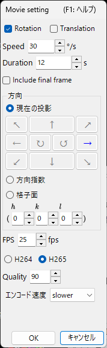

#### 3Dモデルを出力 (3MF/STL)

**3Dモデルを出力 (3MF/STL)** は、画面に描かれている構造モデルを 3D プリント用の立体データとして書き出します。書き出せるのは閉じた立体だけで、原子（球・楕円体）・結合（円柱）・配位多面体が対象です。原子ラベル・境界面・格子面・対称要素の記号は出力しません。 <!-- 261105Cl 監査: 配位多面体を出力し、対称要素は出さない (6c31fc0d) -->単位胞の枠は線分なので、オプションを ON にしたときだけ円柱（角には球）に置き換えて出力します。**境界面で物体をクリップ** は出力に反映されず、境界面をまたぐ物体も切らずに出力します (ダイアログにも注記があります)。 <!-- 261106Cl 作者の決定 H10 -->

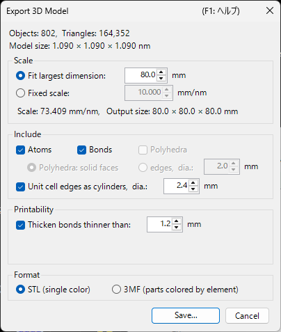

ダイアログ上端には、対象となるオブジェクト数・三角形数と、モデルの実寸（**モデル寸法**、nm）が表示されます。

**スケール** : 出力サイズの決め方

- **最大寸法を指定** : モデルの最長辺が指定した長さ（5–500 mm、既定 80 mm）になるようスケールを自動で決めます。単位胞の枠と多面体の稜線枠を置き換える円柱の太さも含めます。 <!-- 261105Cl 監査: 円柱の太さを含めて合わせる (82e50b62) -->
- **スケール固定** : スケール（mm/nm）を直接指定します。複数の結晶を同じ縮尺で作って並べたいときに使います。切り替えると直前の実効スケールが初期値として入ります。
- 下段に、決まったスケールと出力寸法（**出力寸法**、mm）が表示されます（この円柱の太さも含みます）。

**出力する要素** : 印刷に含める要素

- **原子** / **結合** / **配位多面体** : 画面に表示されている種類だけ選択でき、チェックを外すと画面に出したまま印刷からだけ除外できます。
- **多面体: 面で出力** / **稜線, 径** : 配位多面体を面のある中実の立体として出すか、稜線だけの枠（円柱＋頂点の球、既定 2.0 mm）として出すかを選びます。枠にすると中の原子が見えます。
- **透かしメッシュ: バー径 / ピッチ** : 稜線枠に加え、各面に細いバーの格子を張ります（バー径 0.8–5.0 mm・既定 1.2 mm、ピッチ 1.5–20 mm・既定 5.0 mm）。遠目には面が埋まって見えますが、中は透けて見えます。 <!-- 261105Cl コードから起こした修正。別担当がコードと再照合済み (誤りは訂正) (根拠: FormExport3DModel.cs:PolyhedraAsMesh/PolyBarRadiusNm/PolyPitchNm; FormStructureViewer.cs:ExportModel) -->
- **単位胞の稜を円柱で出力, 径** : 単位胞の枠を指定径（既定 2.4 mm）の円柱に置き換えて含めます。単位胞の枠が表示されているときは既定でチェックが入ります。

**印刷適性** : 細い結合の補強

- **細い結合を太らせる, 下限** : 出力後の直径が指定値（既定 1.2 mm）に満たない結合を、元のプリミティブから指定径で作り直します。細い結合が折れるのを防ぐためのオプションです。OFF のまま細すぎる結合があると赤字の警告が出ます。

**出力形式** : ファイル形式

- **STL (単色)** : 単色のバイナリ STL。
- **3MF (元素ごとに色分け)** : 元素ごとに色分けした 3MF。色の名前には元素名が入ります。

**保存...** を押すとファイル名を尋ねます。書き出しが終わると、三角形数・出力寸法・スケールが左下の情報欄に記録されます。

---

## タブメニュー

### 描画範囲を単位胞単位で指定

結晶の描画範囲を指定します。2つのモードがあります。上部のラジオボタンで切替えます。

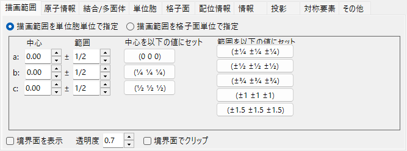

単位胞の *a*, *b*, *c* 軸を単位として描画範囲を指定します。

- **中心 (Center)**: 描画範囲の中心の、[投影中心](#投影中心)からのずれ (分率座標。正で +*a*, +*b*, +*c* の向き)。描く範囲は (投影中心 + 中心) ± 範囲 です。 <!-- 261106Cl 作者の決定 H3/H18, C4 -->
- **範囲 (Range)**: 各軸の上限/下限
- 右側の**プリセットボタン**で頻用値 (1×1×1, 2×2×2 など) を選択可能

### 描画範囲を格子面単位で指定

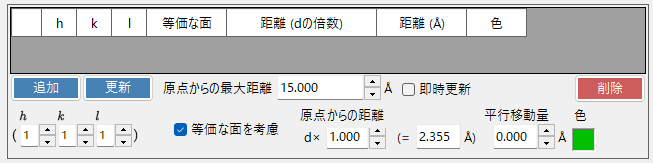

<!-- 261105Cl コードから起こした修正。別担当がコードと再照合済み (誤りは訂正) (根拠: FormStructureViewer.cs:initBounds; BoundControl.resx:numericBoxMaximumDistanceFromOrigin) -->
結晶面の集合で描画領域を定義します。指定した面が空間的に閉じた領域を作らない場合、ReciPro は半径 **原点からの最大距離**（Å。[投影中心](#投影中心)から測る）の球に近い多面体を追加して領域を閉じます。 <!-- 261106Cl 作者の決定 C4 -->

#### 境界面リスト

現在の結晶に登録された境界面のリストです。**追加 / 更新 / 削除** ボタンで操作。左端のチェックボックスで一時的に無効化できます。

> 変更を永続保存するには、メインウィンドウの**リストへ追加**または**選択結晶と入れ替え**も併せて押してください。さもなくば、メインウィンドウで結晶を選び直した時点で変更は失われます。

#### \((hkl)\)指数

境界面をミラー指数で指定します。チェックボックスで結晶学的等価面 (h k l) を一括で含めることができます。

#### 投影中心からの距離

<!-- 261105Cl コードから起こした修正。別担当がコードと再照合済み (誤りは訂正) (根拠: BoundControl.resx:numericBoxDistanceD/numericBoxDistance/numericBoxTranslation/checkBoxImmediateUpdate) -->
[投影中心](#投影中心) (単位胞の原点ではない) から境界面までの距離。選択した (h k l) の *d* 値の倍数（**d×** ボックス）でも、Å（括弧内のボックス）でも入力できます。2 つのボックスは連動し、一方を変更すると他方が更新されます。

- **平行移動量**（Å）: 面で囲んだ領域全体を、指定した (*hkl*) の法線に沿ってこの量だけ動かします。正の値で +**g** の向き ((*hkl*) の法線の向き) に動きます。面の数によらず効き、**等価な面を考慮** を使わない 1 枚の面でも同じです。 <!-- 261106Cl 作者の決定 B11, C5 -->
- **原点からの最大距離**（Å）: 面が領域を閉じないときに使う、閉じるための多面体の半径（上記）。
- **即時更新**: 選択中の面の編集を、**更新** を押さずに即座に反映します。

#### 境界面を表示 / 不透明度

境界面そのものの表示/非表示。表示時は**不透明度 (Opacity)** で透過率を設定 (0=透過、1=不透過)。

#### 境界面で物体をクリップ

チェック時は境界面の内側のみを描画。境界と交差する原子・結合・多面体はクリップされます。

<!-- 261105Cl コードから起こした修正。別担当がコードと再照合済み (誤りは訂正) (根拠: FormStructureViewer.cs:setAtoms, toolStripButtonAtomObjects_CheckedChanged (描画範囲タブに該当チェックボックスは無い)) -->
#### 原子を非表示にするには

描画範囲タブにはそのためのチェックボックスはありません。ツールバーの **原子** ボタンをオフにすると原子が生成されなくなり、結合・多面体も消えます。格子面や単位胞だけを表示したいときに使います。

### 原子情報

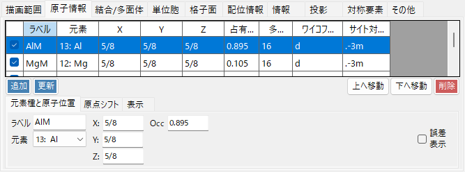

原子の座標と外観を設定します。

#### 原子リスト

結晶に含まれる原子の一覧。**追加 / 更新 / 削除** で操作し、左端チェックボックスで一時的に非表示にできます。

> **重要**: 変更を永続保存するには、メインウィンドウの**リストへ追加**または**選択結晶と入れ替え**を押してください。

#### 元素と位置

- **ラベル (Label)**: 自由記入のラベル (凡例・ツールチップに使用)
- **元素 (Element)**: 元素種・イオン状態
- **X, Y, Z**: 分率座標。0〜1 の実数または `1/2`・`2/3` のような分数表記
- **Occ**: 占有率 (0〜1 の実数)

#### 原点シフト

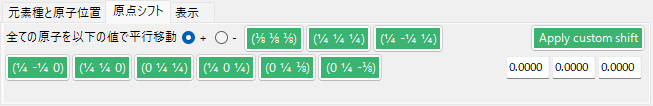

全原子を同じ分率オフセットだけシフトします。プリセットボタン (例: 同一空間群の原点 1/原点 2 切替) を押すか、(Δx, Δy, Δz) を入力して**カスタムシフトを適用**を押します。

#### 表示

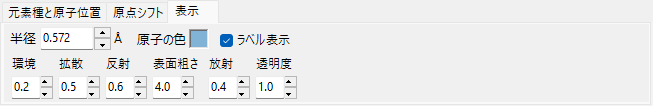

原子ごとの半径・色・マテリアル設定。

- **半径 (Radius)**: 描画時の原子半径
- **原子色 (Atom color)**: 表面色
- **マテリアル (Material)**: OpenGL シェーダで使われるテクスチャ・マテリアル特性
- **同じ元素に適用**: 現在の半径と色を、同じ元素種のすべての原子に一括反映

### 結合/多面体

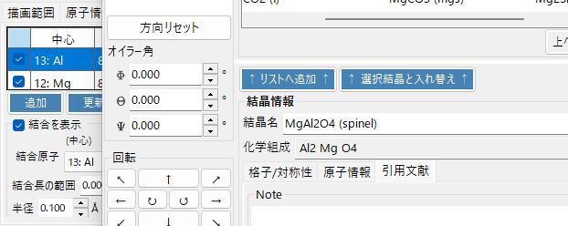

結合と配位多面体を定義します。

#### 結合リスト

結晶に登録された結合・多面体ルールの一覧。**追加 / 更新 / 削除** で操作、左端チェックボックスで一時的に無効化。原子情報や描画範囲と同様、メインウィンドウの**リストへ追加 / 選択結晶と入れ替え**で永続保存します。

#### 結合プロパティ

- **結合を表示**: このルールの結合を描画 (結合設定の上のチェックボックス)
- **結合原子** **(中心)** - **(頂点)**: 結合・多面体の中心となる元素種と、結合の頂点 (反対端) となる元素種
- **結合長の範囲** … - … (Å): 描画対象とする結合長の下限・上限。範囲外の原子対は描画されません
- **半径** (Å): 描画される結合の太さ (円筒半径)
- **不透明度**: 結合の不透明度 (0=透過、1=不透過) <!-- 261105Cl 監査 (組 K): BondControl.ja.resx numericBoxBondAlpha / numericBoxPolyhedronAlpha を「不透明度」に直した -->

#### 多面体プロパティ

- **多面体を表示**: チェック時、結合で定義された配位多面体を描画 (中心/頂点の組合せが幾何学的に有効な場合のみ)
- **結合を表示** (多面体プロパティ内): **多面体を表示** がオンのとき、中心から頂点への結合を描くかどうか（結合プロパティの **結合を表示** もオンのときだけ描かれます）
- **中心を表示**: 多面体の中心原子の表示/非表示
- **頂点を表示**: 頂点原子の表示/非表示。隠した中心・頂点の原子も、表示中の別の多面体が表示する場合や、多面体を作らない定義の結合の端にある場合は描かれます <!-- 261105Cl 監査: 3 つのチェックが描画に効くようになった (7e198f9d) -->
- **不透明度**: 面の不透明度 (0=透過、1=不透過)
- **辺を表示**: 多面体の頂点を結ぶ辺を描画
- **線幅**: 辺の線幅 (ピクセル、1〜5)。古い版で保存された 1 未満の値は 1 px で描きます。 <!-- 261106Cl 作者の決定 H4 -->
- このタブに色の欄はありません。結合は両端の原子の色、多面体は中心原子の色で描かれます（原子の色は [原子情報](#原子情報) タブで設定） <!-- 261105Cl 監査: BondControl の colorControlPolyhedron/Bond/Edges は Visible=False。色は原子の材質から (FormStructureViewer.cs) -->

### 単位胞

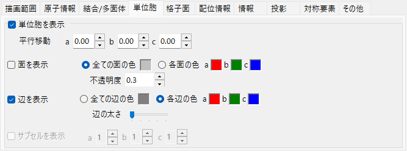

単位胞の描画設定です。

#### 平行移動

空間群にはそれぞれデフォルト原点があります。描画する単位胞の中心をデフォルト原点からずらしたいとき、*a*, *b*, *c* 各軸方向の移動量を入力します。

<!-- 261105Cl コードから起こした修正。別担当がコードと再照合済み (誤りは訂正) (根拠: FormStructureViewer.cs:numericBoxProjectionCenterX_ValueChanged) -->
この平行移動量は[投影中心](#投影中心)と連動しています。投影中心を $(x, y, z)$ にすると、平行移動量は $(x-0.5,\ y-0.5,\ z-0.5)$ に設定されます。平行移動量が正なら、描く単位胞は +*a*, +*b*, +*c* の向きに動きます。 <!-- 261106Cl 作者の決定 H3/H18 -->

#### 面を表示

単位胞を構成する 6 つの面を描画するかどうか。表示する場合は面の色と透過率を設定できます。

#### 辺を表示

単位胞の辺を描画するかどうか。辺の色を設定できます。

<!-- 261105Cl コードから起こした修正。別担当がコードと再照合済み (誤りは訂正) (根拠: FormStructureViewer.cs:setUnitCellPlanes; FormStructureViewer.ja.resx) -->
全体のスイッチは **単位胞を表示**（ツールバーの *単位胞* ボタンと同じ）です。面・辺の色は **全ての面の色** / **全ての辺の色** で一括、または **各面の色** / **各辺の色** で *a*, *b*, *c* ごとに指定できます。**辺の太さ** で線幅、**不透明度** で面の透明度を設定します。

#### サブセルを表示

**サブセルを表示** をオンにすると、**a**・**b**・**c** の欄の数 (各 1〜10。チェックしている間だけ操作できます) で単位胞を等分する格子線を、面上と内部に描きます。単位胞の辺と重なる線は描きません。線の色は辺の色 (**全ての辺の色** / **各辺の色**) に従い、太さは辺の半分 (最小 1 px)、不透明度は 0.5 で、**辺を表示** とは独立に表示されます。3D モデルの出力には含めません。 <!-- 261106Cl 作者の決定 H5 -->

### 格子面

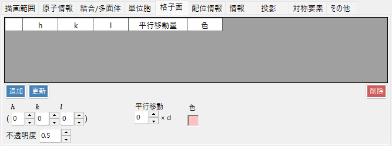

ミラー指数で指定した格子面を描画します。

#### \((hkl)\)指数

格子面をミラー指数で指定します。チェックボックスで結晶学的等価面を一括で含めることができます。

#### 平行移動

格子面を法線方向に、面間隔 *d* に対する割合（**× d**、−0.5〜0.5）だけ平行移動して描画します。正の値で +**g** の向きに動きます (面は **g**·**r** = (*m* + T)*d* の位置)。そのため、以前の版で結晶リストに保存した値は反対側に描かれます (0 と ±0.5 は同じ見た目)。 <!-- 261106Cl 作者の決定 C5 -->描画範囲を横切る同じ族の面は *d* ごとにすべて描かれます。面は結晶格子に固定されていて、0 のとき格子点を通り、[投影中心](#投影中心)を変えると構造とともに動きます。 <!-- 261105Cl 監査: LatticePlaneControl numericBoxDistance (−0.5〜0.5, × d)、FormStructureViewer.cs:SetLatticePlanes (4fd9e8c3)。「d の整数倍」は誤り -->

### 配位情報

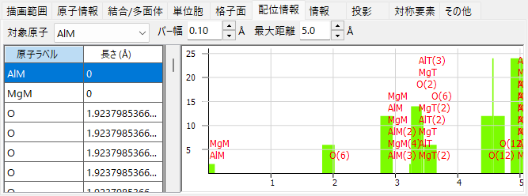

原子の配位情報を表示します。

#### テーブル (左側)

ターゲット原子の周囲にどのような原子がどの距離に存在するかを一覧表示します。ターゲット原子はテーブル上のドロップダウンで選択。

#### グラフ (右側)

左の表のデータをヒストグラム化したものです。**半幅** (各バーの半分の幅 *w*。バーは *d* ± *w* を覆います) を調整して配位殻が分離するところを見つけることで <!-- 261106Cl 作者の決定 B18 -->、配位数を視覚的に推定できます。

### 情報

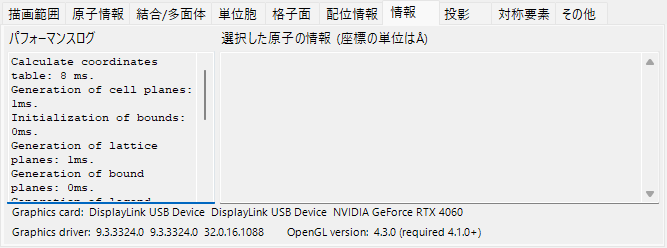

描画ログ (フレーム時間、GPU 情報) と選択原子の基本情報を表示します。実装拡張中。

### 投影

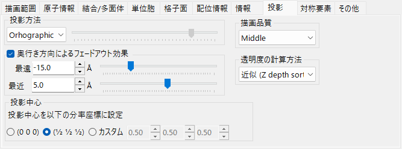

正射投影または透視投影、奥行きフェードアウト、描画品質、透明度モードの設定。

#### 投影方法

- **正射 (Orthographic)**: 完全な平行投影 (視点が無限遠)
- **透視 (Perspective)**: 視点距離をスライダで指定する透視投影

#### 奥行きフェードアウト

<!-- 261105Cl コードから起こした修正。別担当がコードと再照合済み (誤りは訂正) (根拠: Crystallography.OpenGL/Shaders/fragZSORT.c, fragPPLL.c:applyDepthCueing; FormStructureViewer.cs:checkBoxDepthCueing_CheckedChanged) -->
奥行き方向に遠い物体の色を**背景色**へ線形に近づけます（**奥行き方向によるフェードアウト効果**）。**近方 (Near)** より手前の物体は元の色、**遠方 (Far)** より奥の物体は背景色、その間は線形補間です（不透明度そのものは変わりません）。Near / Far の単位は Å です。 <!-- 261105Cl 監査: 欄名を FormStructureViewer.ja.resx label5/label6 (近方/遠方) に合わせた -->

#### 投影中心

投影中心を、指定した座標に設定します。カスタムをオンにすると、自由な座標を入力することができます。手入力した値（−1〜1）はそのまま使われます。動画の **平行移動**（[ファイルメニュー](#ファイルメニュー)）を使うと、この値が自動的に駆動され、各座標は −0.5〜+0.5（1 格子周期）の範囲に折り畳まれます。 <!-- 261105Cl 監査: 折り畳むのは SetProjectionCenter (動画の経路) だけ。マクロに投影中心の関数は無い -->

#### 描画品質

メッシュ分割数とアンチエイリアスの品質設定。品質を上げると描画が遅くなるため、GPU 性能に合わせて選びます。

#### 透明度モード

半透明の原子・多面体の重なりを計算するアルゴリズム。

<!-- 261105Cl コードから起こした修正。別担当がコードと再照合済み (誤りは訂正) (根拠: FormStructureViewer.cs:rebuildTransparencyModeItems, comboBoxTransparency_SelectedIndexChanged; FormStructureViewer.ja.resx:comboBoxTransparency.Items) -->
- **近似 (Z depth sorting, OpenGL 4.1+)**: 高速だが、半透明物体が多数重なる場合は不正確になりうる
- **高品質 (Dual Depth Peeling, OpenGL 4.1+)**: デプスピーリングによる順序非依存透明度。**ツール ▸ Enable DDP** がオンのときだけ表示されます（PPLL が使えない環境では既定でオン）。ピーリングのパス数は[描画品質](#描画品質)に従います。
- **高品質 (Per-Pixel Linked List, OpenGL 4.3+)**: 正確な順序非依存透明度。GPU が OpenGL 4.3 に対応するときだけ表示されます。正確だが低速で、実質的に外付け GPU が必要

### 対称要素

**対称要素**タブは、空間群の対称操作を3Dモデル上に直接描画します（ツールバーの **対称要素** ボタンで表示/非表示を切替）。要素の種類ごとに個別に表示できます。

<!-- 261105Cl コードから起こした修正。別担当がコードと再照合済み (誤りは訂正) (根拠: FormStructureViewer.ja.resx:groupBoxAxes/groupBoxPlanes/groupBoxInversion) -->
- **対称軸**: **回転軸**・**らせん軸**・**回反軸**
- **対称面**: **鏡映面**・**映進面**
- **対称心**

全体のスイッチは **対称要素を表示** です。各グループについてシンボルサイズ（%）と色、対称軸・対称面では線の太さも調整できます。

### その他

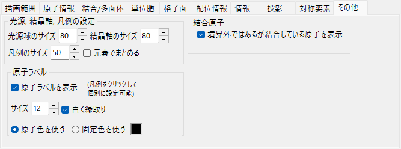

- **光源, 結晶軸, 凡例の設定**: 表示サイズを設定します。「元素でまとめる」で凡例表示を切り替えることができます。
- **結合原子**: 「境界外の結合原子も表示」で、描画範囲の外にあっても、範囲内の原子と結合している原子を表示します。
- **原子ラベル**: 3D 表示の原子ラベル（凡例ではありません）の設定です。**原子ラベルを表示**・**サイズ**・**白く縁取り**、ラベル色（**原子色を使う** / **固定色を使う**）を指定します。原子の凡例の項目をクリックすると、その原子（**元素でまとめる** 時はその元素）のラベル表示を個別に切り替えられます。 <!-- 261105Cl コードから起こした修正。別担当がコードと再照合済み (誤りは訂正) (根拠: FormStructureViewer.cs:legendControl_MouseClick; FormStructureViewer.ja.resx:groupBoxLabel) -->

---

## ツールバー

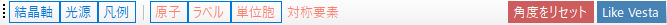

<!-- 261105Cl コードから起こした修正。別担当がコードと再照合済み (誤りは訂正) (根拠: FormStructureViewer.cs:toolStripButtonLikeVesta_Click) -->
| ボタン | 説明 |
|--------|------|
| 結晶軸 | 結晶軸の方向を表示（サイズは格子定数を反映） |
| 光源 | ドラッグで光源方向を変更 |
| 凡例 | 原子の凡例を表示（ラベルまたは元素名） |
| 原子 | 原子の表示切替。結合・多面体・ラベルは原子から作るので、これらも消えます <!-- 261105Cl 監査: toolStripButtonAtomObjects.ToolTipText (2028c4a1) --> |
| ラベル | 原子ラベルの表示切替 |
| 単位胞 | 単位胞の辺の表示切替 |
| 対称要素 | 対称要素オーバーレイの表示切替（上記参照） |
| 回転をリセット | 初期方位に戻す |
| VESTA 風 <!-- 261105Cl 監査 (組 K): toolStripButtonLikeVesta / iLikeVESTAToolStripMenuItem を訳した --> | VESTA 風の外観に変更: 原子の色・半径をリセットし、結合リストを既定の結合で**置き換え**ます |

---

## 関連項目

- [メインウィンドウ](0-main-window.md)
- [結晶データベース](1-crystal-database.md)
- [対称性情報](2-symmetry-information.md)
- [回折シミュレータ](7-diffraction-simulator/index.md)
- [キーボード・マウスショートカット](21-shortcuts.md)
