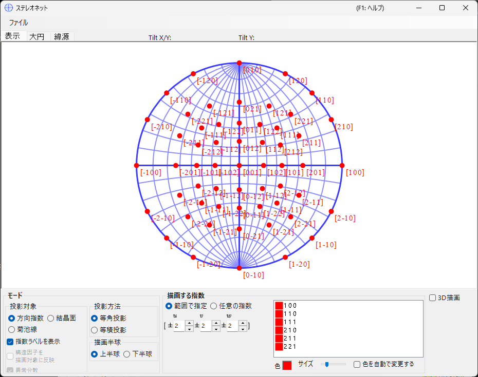
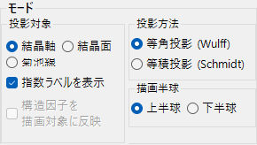
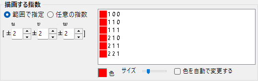
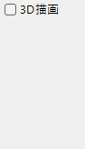
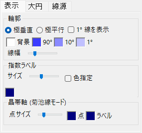
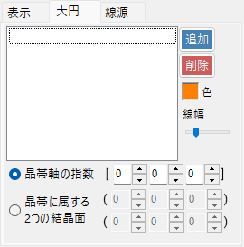
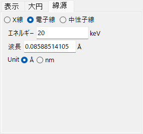

# ステレオネット (Stereonet)

**ステレオネット** は、結晶面や晶帯軸の方向をステレオネット投影で表示します。

---

## キーボード・マウスショートカット

ステレオネット本体は2D投影です。**3D描画** をオンにすると3D球も表示できます。

| ショートカット | 動作 |
|----------------|------|
| <kbd>F1</kbd> | このページのオンラインマニュアルを開く |
| 中心付近を左ドラッグ | 結晶を傾ける |
| 外周を左ドラッグ | 視線軸まわりに結晶を回す |
| 左ダブルクリック | **結晶面** / **方向指数** 投影の切替 |
| 右クリック | ズームアウト |
| 右ドラッグで矩形選択 | 選択範囲にズームイン |
| 中ドラッグ | 平行移動 |
| マウス移動（ボタンなし） | カーソル位置の (hkl)/[uvw] を表示（測定スポットの指数付けに便利） |

ネット上のドラッグによって**結晶**を回転することができます。回転状態は全てのウィンドウで共有されます。

3D描画では ReciPro 標準の [OpenGL ビュー操作](21-shortcuts.md)（左ドラッグ回転・右ドラッグ/ホイールズーム・<kbd>CTRL</kbd> ＋右ダブルクリックで投影切替）で、3Dビューのみを回転します。結晶自体は回転しません。

メインウィンドウのアプリ全体ショートカット（<kbd>CTRL</kbd>+<kbd>SHIFT</kbd> 系）は、このウィンドウにフォーカスがある間も動作します（[メインウィンドウ](0-main-window.md) 参照）。

→ 全ウィンドウの一覧は **[21. キーボード・マウスショートカット](21-shortcuts.md)** を参照。

---

## メインエリア

選択した結晶の結晶面・方向指数・菊池線のステレオネット投影が表示されます。

---

## ファイルメニュー

表示中のステレオネットを保存またはコピーします。保存は**ラスタ形式** (PNG)、コピーは**ラスタ形式**または**ベクタ形式** (EMF) です。ベクタ形式でPowerPointに貼り付ければ、テキストのフォントや線の太さを自由に変更できます。

<!-- 261105Cl コードから起こした修正。別担当がコードと再照合済み (誤りは訂正) (根拠: FormStereonet.Designer.cs:fileToolStripMenuItem; FormStereonet.cs:toolStripMenuItemSaveMovieStereonet_Click/toolStripMenuItemSaveMovie3D_Click) -->
| メニュー項目 | 説明 |
|-------------|------|
| 画像を保存 ▸ as Image (PNG format) / as Metafile (EMF) | ステレオネットを PNG ファイルに保存 (*as Metafile (EMF)* は現在無効。ベクタ形式が必要なときは **クリップボードにコピー ▸ メタファイルとして (EMF)** を使います) |
| クリップボードにコピー ▸ 画像として / メタファイルとして (EMF) | ステレオネットをコピー |
| Save Movie ▸ Stereonet / 3D | ステレオネットまたは 3D ビューの回転動画 (MP4) を保存。[結晶構造ビューア](5-structure-viewer.md#ファイルメニュー)と同じ動画設定ダイアログを使います (回転のみ) |
| プリント設定 / プリントプレビュー / プリント | ステレオネットを印刷 |

---

## モード {#mode}

### 投影対象

ステレオネットへ投影する対象を選択します。

- **方向指数** — 方向指数 \([uvw]\) を投影
- **結晶面** — 結晶面法線 \((hkl)\) を投影
- **菊池線** — 菊池線ペアを投影

### 投影法

| 投影法 | 説明 |
|--------|------|
| **等角投影** (Wulff / Stereographic) | 角度関係を保存するが、立体角（面積）は保存しない。投影対象間の角度を読み取りたいときに使用。 |
| **等積投影** (Schmidt / Lambert) | 立体角（面積）を保存するが、角度関係は保存しない。極点密度のような統計表示に適する。 |

### 描画半球

**上半球**または**下半球**を選択します。観測者から見える球面の側を切り替えます。
<!-- 261105Cl コードから起こした修正。別担当がコードと再照合済み (誤りは訂正) (根拠: FormStereonet.cs:DrawStereoNet) -->
上半球は $+Z$ 側 (観察者側、[付録 A1.1](appendix/a1-coordinate-system/1-orientation.md) 参照) です。**下半球** では各方向の $Z$ 成分を反転してから投影し、点は塗りつぶしではなく**白抜きの円**で描かれます。

### 表示オプション

- **指数ラベルを表示**: 指数ラベルの表示
- **構造因子を描画対象に反映**: **結晶面**あるいは**菊池線**選択時、各点あるいは各線を構造因子で重み付け表示します (線源・波長は[線源タブ](#wave)で設定)。重みは表示中の集合内で規格化した $I_{\mathrm{rel}} = |F_{hkl}|^2 / \max|F|^2$ で、**結晶面** モードでは点の半径に $\sqrt{I_{\mathrm{rel}}}$ (すなわち $|F_{hkl}|$ に比例) を掛け、**菊池線** モードでは線の不透明度を $I_{\mathrm{rel}}$ にします。 <!-- 261105Cl コードから起こした修正。別担当がコードと再照合済み (誤りは訂正) (根拠: FormStereonet.cs:setVector, DrawStereoNet) -->
- **異常分散**: 構造因子に X 線の異常分散項 $f'$, $f''$ を含めます。X 線かつ **結晶面** / **菊池線** モードのときのみ有効です。

> 三方晶・六方晶系では、メインウィンドウの **オプション ▸ Use Miller-Bravais (hkil) index** でミラー・ブラベー（4指数）表記に切り替えられます。

---

## 描画する指数 (Indices)

描画する結晶面/晶帯軸を設定します。

### 範囲モード

\([uvw]\) または\((hkl)\) 指数の範囲を指定。範囲内の全指数を列挙して投影します。

<!-- 261105Cl コードから起こした修正。別担当がコードと再照合済み (誤りは訂正) (根拠: FormStereonet.cs:setVector, radioButtonRange_CheckedChanged) -->
範囲モードでは入力値の $\pm$ が範囲になり、既約な指数だけが取られ、結晶学的に等価な指数の組ごとにまとめられます (組ごとに 1 色)。

### 構造因子の順モード

**結晶面** と **菊池線** でのみ選べます。現在の線源で $|F_{hkl}|^2$ の大きい順に面を投影します。**トップ** で描画する面の数を指定します (等価な面も 1 枚ずつ数えます。**結晶面** モードでは、より強い反射と平行な反射 (その高次・低次反射。例: 111 の方が強ければ 222) は除かれます)。

### 指定モード

特定の軸や面を個別に指定します。指数を入力後 **追加** で描画リストに追加、**削除** で除去。**等価な指数を含める** をチェックすると、結晶学的に等価なすべての指数も含めて描画されます。

### 色/サイズ

投影点の**色** および**サイズ**を設定します。**色を自動で変更する** をチェックすると、等価な軸・面の組ごとに自動で色分けされます。複数の指数ファミリを同時表示する際の判別に有用です。

---

## 3Dオプション

<!-- 261105Cl コードから起こした修正。別担当がコードと再照合済み (誤りは訂正) (根拠: FormStereonet.ja.resx:checkBox3dOption*/button3D_reset/label29; FormStereonet.cs:button3D_reset_Click, Draw3D) -->
**3D描画** をチェックすると表示され、ネットの右側に 3D の球が表示されます。

- **方位リセット**: 3D ビューの向きとズームを既定に戻す
- **指数ラベル**: 3D 上に指数ラベルを描画
- **半球表示**: 上半球 ($Z>0$) の極だけを描画
- **ステレオネット**: 投影面 (ネット) と上半球の極の投影点を 3D 上に描画
- **球面の輪郭**: 球の緯線・経線グリッドを描画
- **投影補助線** (**ステレオネット** オン時): 上半球の各極の投影線を描画 — Wulff では南極 $(0,0,-1)$ から極への直線、Schmidt では円弧
- **奥行フェードアウト**: 3D ビューの奥行きフェードの強さ

---

## タブメニュー

### 表示

#### 輪郭

ステレオネットの外枠 (境界円および大円グリッド) の描画方法。**極垂直** / **極平行** の選択、**1° 線を表示** と **背景** の切替、**90° / 10° / 1°** グリッド色、**線幅** をトラックバーで設定します。

#### 指数ラベル

- **サイズ** — 指数ラベルのサイズ
- **色指定** — 投影点の色とは独立に、すべての指数ラベルを指定色で表示。描画点を色分けしつつラベルは単色で統一したいときに使用してください。
- **区切り** — 各ラベルの指数の間に置く文字: **なし** (例 100) / **スペース** (1 0 0) / **カンマ** (1,0,0)

#### 晶帯軸 (菊池線モード)

- **点サイズ** — 投影点のサイズ
- **点** / **ラベル** — 点とラベルの色

### 大円

<!-- 261105Cl コードから起こした修正。別担当がコードと再照合済み (誤りは訂正) (根拠: FormStereonet.cs:buttonAddCircle_Click, DrawCircles) -->
大円を描画します (小円には対応していません)。**晶帯軸の指数** \([uvw]\) (その軸を含む晶帯の作る大円) または **晶帯に属する2つの結晶面** (晶帯軸は両者の外積) で指定します。**追加** / **削除** でリストを編集し、チェックを外すとその円を非表示にできます。円の**色**と**線幅**も設定可能です。

### 線源 {#wave}

<!-- 261105Cl コードから起こした修正。別担当がコードと再照合済み (誤りは訂正) (根拠: FormStereonet.cs:setVector, DrawStereoNet) -->
投影対象として**結晶面**あるいは**菊池線**を選択している場合にのみ使われます (**菊池線** モードでは波長がブラッグ角、すなわち各線対の間隔も決めます)。[モード](#mode)の**構造因子を描画対象に反映**で用いる結晶構造因子の計算に必要な、線源 (X線 / 電子線 / 中性子線) と波長 (またはエネルギー) を設定します。

---

## 関連項目

- [メインウィンドウ](0-main-window.md)
- [回転ジオメトリ](4-rotation-geometry.md)
- [結晶構造ビューア](5-structure-viewer.md)
- [回折シミュレータ](7-diffraction-simulator/index.md)
- [基本座標系と結晶方位](appendix/a1-coordinate-system/1-orientation.md)
