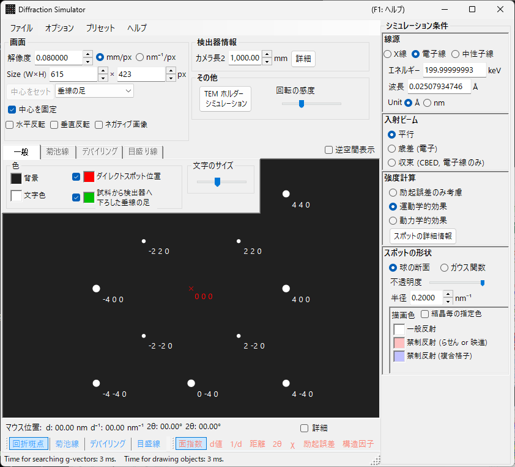
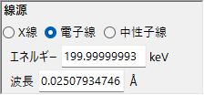
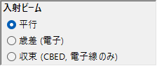
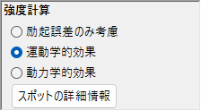
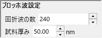
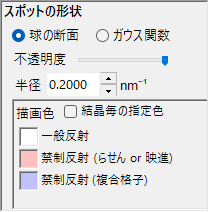

# 制限視野電子回折 (SAED) シミュレーション

**SAED (Selected Area Electron Diffraction)** シミュレーションは、平行な電子ビームによる単結晶電子回折パターンを計算します。[回折シミュレータ](index.md) の基本モードです。

> このページは、**波長 = 電子線 ・ 入射ビーム = 平行** を選んだときに右側の **スポット特性** に現れる設定項目をすべて掲載します。描画・保存などウィンドウ共通の操作は [まとめページ](index.md) を参照してください。

GUI条件: 波長 = 電子線 ・ 入射ビーム = 平行 ・ 強度計算 = 励起誤差のみ / 運動学的 / 動力学的。

---

## 概要

平行な電子ビームが薄い試料に入射したときの回折パターンをシミュレーションします。エワルド球と逆格子点の幾何学的関係に基づいて回折スポットの位置が決まり、強度計算モードに応じて各スポットの明るさが計算されます。

---

## 波長の設定

線源を **電子線** にします。エネルギー (keV) または波長 (Å / nm 切替、既定 Å) を入力すると、相対論的補正付きの波長が計算されます。<!-- 261105Cl コードから起こした修正。別担当がコードと再照合済み (誤りは訂正) (根拠: FormDiffractionSimulator.Designer.cs:waveLengthControl, presetToolStripMenuItem) -->初期値は 200 keV で、**プリセット** メニューから 300 / 200 / 120 kV をワンクリックで設定できます。X線・中性子線については [X線回折シミュレーション](5-x-ray-neutron-diffraction.md) を参照してください。

---

## 入射ビーム

入射ビームのジオメトリを **平行** にします。SAED や X線回折で用いる標準的な平面波ジオメトリです。

> **注記**: 電子線では **平行 / 歳差 (電子=PED) / 収束 (CBED)** が選べます。**歳差** を選ぶと [PEDシミュレーション](2-ped-simulation.md)、**収束** を選ぶと [CBEDシミュレーション](3-cbed-simulation.md) になり、いずれも強度計算が自動的に動力学的へ切り替わります。

---

## 強度計算

スポット強度の計算方法を選択します。

### 励起誤差のみ

エワルド球と逆格子点の幾何学的距離（励起誤差 $S_g$）だけから強度を決定します。$S_g = 0$（球面上）で最大となり、$\lvert S_g \rvert$ が大きくなるほど弱まって、逆格子点に与えた **Radius** を超えると 0 になります。結晶構造因子は無視されるため、最も高速で、回折スポットの位置確認に適します。

<!-- 261105Cl コードから起こした修正。別担当がコードと再照合済み (誤りは訂正) (根拠: FormDiffractionSimulator.cs:radioButtonIntensityCalculationMethod_CheckedChanged, CheckBoxExtinctionAll_CheckedChanged; FormDiffractionSimulator.Designer.cs:checkBoxExtinctionAll/Lattice, checkBoxDrawSameSize) -->
このモードでのみ、次のオプションが現れます。

| オプション | 説明 |
|-----------|------|
| **すべての禁制反射を非表示** | 空間群で禁制となる反射（複合格子・らせん軸・映進面）をすべて隠します。チェックすると次の項目もチェックされて固定されます |
| **複合格子由来の禁制反射を非表示** | 複合格子による禁制反射だけを隠します（既定でオン） |
| **全てのスポットを同じ半径で描画** | 励起されたスポットを $S_g$ によらず半径 *R* いっぱいで描きます |

表示されたままの禁制反射は **禁制反射** の色で描かれます（[スポットの外観](#スポットの外観) 参照）。

### 運動学的

励起誤差に加えて運動学的構造因子 $\lvert F_{hkl} \rvert^2$ を強度に反映します。消滅則が正しく反映され、薄い試料や弱い回折に適します。

### 動力学的（ブロッホ波法・電子線のみ）

ブロッホ波法（ベーテ法）による厳密な動力学計算です。多重散乱と試料厚さ依存の強度変化を再現し、厚い試料や強い回折に必要です。電子線選択時のみ有効です。理論は [Appendix A3. ブロッホ波法](../appendix/a3-bloch-wave/calculation.md) を参照してください。

> **注記**: **動力学的** を選ぶと、下に **ブロッホ波設定** パネルが現れます。

---

## ブロッホ波設定（動力学理論）

**強度計算 = 動力学的** のときだけ有効です。

<!-- 261105Cl コードから起こした修正。別担当がコードと再照合済み (誤りは訂正) (根拠: FormDiffractionSimulator.Designer.cs:numericBoxNumOfBlochWave, numericBoxThickness) -->
| パラメータ | 説明 |
|-----------|------|
| **回折波の数** | 固有値問題に含めるブロッホ波の本数（8〜1000、既定 240）。大きくするほど強度は正確になりますが、計算時間が $O(N^3)$ で増加します |
| **試料厚み** | 動力学計算で用いる試料の厚さ (nm。0.01〜10000 nm、既定 50 nm) |

---

## スポットの外観

各回折スポットの描画方法を制御します。

<!-- 261105Cl コードから起こした修正。別担当がコードと再照合済み (誤りは訂正) (根拠: FormDiffractionSimulator.cs:DrawDiffractionSpots, radioButtonPointSpread_CheckedChanged, comboBoxScaleColorScale_SelectedIndexChanged; FormDiffractionSimulator.Designer.cs:flowLayoutPanelAppearance) -->

- **球の断面 / ガウス関数** (Solid sphere / Gaussian) : 逆格子点の幾何モデル（既定は球の断面）。**球の断面** は球とエワルド球の断面（円）を描きます。球の半径は **運動学的効果** では $R\,I^{1/3}$（球の体積 ∝ 強度）、**励起誤差のみ考慮** では $R$ で、**動力学的効果** ではエワルド球で切らずに半径 $R\,I_\text{dyn}^{1/2}$（面積 ∝ 強度）の円を描きます。**ガウス関数** は $\sigma = R$ の3Dガウス関数の断面（2Dガウス）を描画し積分が回折強度に対応します。
- **不透明度 (Opacity)** : スポットの透過率（0=透過、1=不透過）。
- **半径 (R)** : 逆格子点の仮想半径（nm⁻¹。0.01〜1、既定 0.2）。**スポットの形状**と**強度計算**の組み合わせでスポットサイズが決まります（上記）。
- **明るさ・カラー・ログスケール** : **ガウス関数** のときのみ表示。**明るさ** は描画ガウスの積分強度の倍率、**カラー** は **Gray**（下の描画色を使用）/ **Cold-Warm** / **Spectrum** / **Fire**、**ログスケール** は強度の対数表示（強度差の大きいパターンで有用）。
- **描画色** : **カラー** が **Gray**（初期設定）のときに表示。**一般反射**・**禁制反射 (らせん or 映進)**・**禁制反射 (複合格子)** の色を設定します。
- **結晶毎の指定色** : チェックすると結晶ごとに割り当てた色でスポットを描きます（単結晶でも有効）。

---

## スポットのラベル

スポットに重畳するラベルは [ツールバー](index.md#ツールバー) から選びます。

<!-- 261105Cl コードから起こした修正。別担当がコードと再照合済み (誤りは訂正) (根拠: FormDiffractionSimulator.cs:DrawDiffractionSpotsLabel) -->
| ラベル | 表示内容 |
|--------|---------|
| **面指数** | ミラー指数 $(hkl)$ |
| **d値** | 面間隔 $d$（Å 単位で表示） |
| **1/d** | 面間隔の逆数 $1/d$ (nm⁻¹) |
| **距離** | 検出器上でのダイレクトスポットからの距離 $L_2 \tan 2\theta$ (mm。$L_2$ はカメラ長2。検出器が傾いていない τ = 0 のときの値) |
| **2θ** | 散乱角 $2\theta$ (2θスケールの同心円と同じ定義) |
| **χ** | 方位角 $\chi$。画面の上方向 (12時方向) を 0° として時計回りが正 (方位角スケールの放射線と同じ定義) |
| **励起誤差** | 励起誤差 $S_g$ (nm⁻¹) |
| **構造因子** | **運動学的効果** では相対強度 (%)。**動力学的効果** では相対強度（000 を除く最強回折波に対する %）と出射面での複素振幅。**励起誤差のみ考慮** では何も表示されません |

---

## 共通操作

検出器情報・反転・逆空間表示・菊池線・デバイリング・目盛り線・色設定・保存などは全モード共通です。[まとめページ](index.md) を参照してください。動力学計算で得た各反射の詳細は [回折スポット情報](index.md#回折スポット情報) で一覧できます。

---

## 関連項目

- [回折シミュレータ（まとめ）](index.md)
- [平行ビーム SAED の計算](../appendix/a3-bloch-wave/calculation.md#parallel-beam-saed)
- [X線回折シミュレーション](5-x-ray-neutron-diffraction.md)
- [歳差電子回折 (PED) シミュレーション](2-ped-simulation.md)
- [座標系の定義](../appendix/a1-coordinate-system/1-orientation.md)
