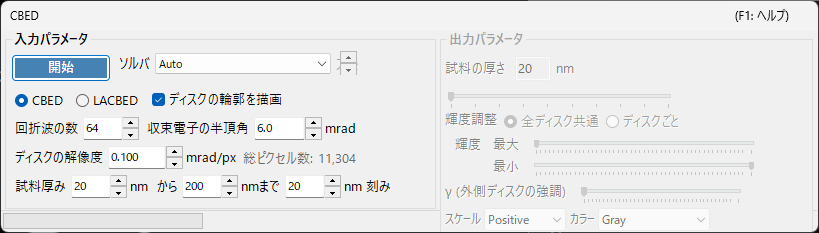
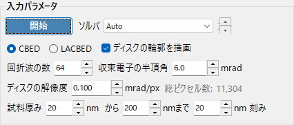
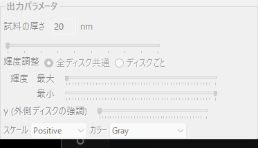

# CBED シミュレーション

**CBED（収束電子回折）シミュレーション**は、ブロッホ波（Bethe）法で収束ビーム回折パターンを計算・表示します。CBEDパターンはスポットの代わりに回折ディスクを示し、結晶の対称性・厚さ・構造に関する豊富な情報を含みます。

> このページは、[回折シミュレータ](index.md) で **波長 = 電子線**・**入射ビーム = 収束 (CBED, 電子線のみ)** を選んだときに開く専用ウィンドウの設定項目をすべて掲載します。入射ビームを収束にすると **強度計算** が自動的に **動力学的効果** へ切り替わり、この CBED 設定ウィンドウが開きます。<!-- 261105Cl draft: コードから起こした修正・著者未査読 (根拠: FormDiffractionSimulatorCBED.cs:FormDiffractionSimulatorCBED_VisibleChanged) -->計算したディスクは本体の **File > Save CBED disks** / **Copy CBED disks** で保存・コピーできます。回折パターンの描画・保存など回折シミュレータ共通の操作は [まとめページ](index.md) を参照してください。

GUI条件: 波長 = 電子線 ・ 入射ビーム = 収束 (CBED, 電子線のみ) ・ 強度計算 = 動力学的効果（自動）

---

## 入力パラメータ

<!-- 261105Cl draft: コードから起こした修正・著者未査読 (根拠: FormDiffractionSimulatorCBED.Designer.cs; FormDiffractionSimulatorCBED.cs:コンストラクタ, ComboBoxSolver_SelectedIndexChanged, buttonSimulate_Click; BetheMethod.cs:cbed_DoWork; FormDiffractionSimulator.cs:radioButtonBeamParallel_CheckedChanged, DrawDiffractionSpots) -->
このウィンドウが開いている間、本体の **ブロッホ波設定** と **スポットの形状** パネルは無効になり、波の数と厚さはここで指定した値が使われます。

| パラメータ | 説明 | 既定値 / 典型値 |
|-----------|------|-----------------|
| **モード** | **CBED**: 各ディスクが一つの反射に対応し、透過ディスク (000) が中心にある標準的な収束ビームパターン。 **LACBED**（大角度CBED）: 大角度収束ビームパターンで、異なる反射のディスクが重なり合う。高次ラウエゾーン (HOLZ) 線や対称性の観察に有用 | CBED |
| **収束電子の半頂角 (mrad)** | 収束ビーム円錐の半頂角（0〜2000 mrad）。各回折ディスクのサイズを決めます（逆空間でのディスク直径は $2\alpha$ に対応） | 既定 6 mrad、典型 5–30 mrad |
| **ディスクの解像度 (mrad/px)** | 各ディスク内の角度分解能。ディスクを $N\times N$（$N = \lceil 2\alpha / \text{解像度} \rceil$）の格子で標本化し、円内の点だけを計算します。小さいほど高解像度ですが、計算するビーム方向数は二乗で増えるため計算時間も二乗で増加します。その数（= 総ビーム方向数）が **総ピクセル数** に表示されます | 既定 0.1 mrad/px |
| **回折波の数** | 各入射ビーム方向でのブロッホ波計算に含めるビームの最大数（1〜2048）。大きいほど精度が上がりますが固有値問題のコストは $O(N^3)$ で増加します | 既定 64、典型 100–500 |
| **試料厚み (〜から〜まで, 刻み)** | 試料厚さ (nm、各 1〜1000) の開始値・終了値・ステップ値。複数厚さをまとめて計算し、出力側の厚さスライダーで切り替えます | 既定 20〜200 nm、20 nm 刻み |
| **ソルバ** | 計算エンジン。**Auto**、**Eigenproblem with Eigen lib.** / **Eigenproblem with MKL lib.**（対角化）、**Matrix exp. with Eigen lib.** / **Matrix exp. with MKL lib.**（行列指数法、v4.794）。**Auto** は Eigen が使えれば Eigen の行列指数法を全論理プロセッサで、使えなければ MKL の固有値問題を用います。行列指数法は等間隔の厚み列が前提で、そうでなければ固有値問題に切り替わります。ARM64 では MKL の項目は出ず、ネイティブ Eigen が使えない環境では Eigen の項目が隠れます | Auto |
| **スレッド** | 並列スレッド数（1〜128）。**Auto** では無効。ソルバを選ぶと論理プロセッサ数（MKL ではその 1/4）に設定されます | — |
| **ディスクの輪郭を描画** | チェックすると本体のパターン上に各回折ディスクの境界を示す黄色い円を描画します（LACBED では 000 は円、他の反射は十字） | オン |

---

## 実行 / 停止

- **開始** : 現在の入力パラメータで CBED シミュレーションを開始します。
- **中止** : 実行中の計算をキャンセルします。

---

## 出力パラメータ

計算が完了すると出力パラメータが操作可能になります。いずれも計算をやり直さずに表示だけを切り替えます。

<!-- 261105Cl draft: コードから起こした修正・著者未査読 (根拠: FormDiffractionSimulatorCBED.cs:generateImage, radioButtonAllDisks_CheckedChanged, TrackBarOutputThickness_Scroll) -->
| パラメータ | 説明 |
|-----------|------|
| **試料の厚さ** | 表示する試料厚さを、入力パラメータの厚さ範囲内でスライダーで選択します（[回折スポット情報](index.md#回折スポット情報) の表も追随） |
| **輝度調整** | **全ディスク共通**: 全ディスク中の最大値で正規化した共通の輝度スケール。**ディスクごと**: 各ディスクをそれぞれの最大値で正規化（γ は 0 に戻され無効） |
| **輝度 (最大 / 最小)** | 表示する強度の上限・下限（最大値に対する割合。スライダー位置の 4 乗が掛かります）。弱い特徴を強調したいときに調整します |
| **γ (外側ディスクの強調)** | 各画素にパターン中心からの距離 $r$ に応じた $\exp(\gamma\,r)$ を掛け、中心の透過ディスクに比べて暗い外側の高角ディスクを見やすくします。**全ディスク共通** のときのみ有効 |
| **スケール** | 強度の階調を **Positive** / **Negative**（白黒反転）から選択します |
| **カラー** | 表示に使うカラーマップ: **Gray** / **Cold-Warm** / **Spectrum** / **Fire** |

---

## 物理的背景

CBED では、入射ビームを異なる方向の平面波の円錐とみなし、各方向（収束絞り内の各点 = 部分入射平面波）についてブロッホ波法で結晶内の電子シュレーディンガー方程式を解き、結果を回折ディスクとして並べ直します。HOLZ（高次ラウエゾーン）線は、上位ラウエゾーンの反射から生じるディスク内の細い暗／明線として現れ、$c$ 軸方向の格子定数に敏感で 3 次元構造解析に有用です。

理論の詳細は [CBED の計算](../appendix/a3-bloch-wave/cbed.md) を参照してください。

---

## 関連項目

- [回折シミュレータ（まとめ）](index.md)
- [SAEDシミュレーション](1-saed-simulation.md)
- [PEDシミュレーション](2-ped-simulation.md)
- [CBED の計算](../appendix/a3-bloch-wave/cbed.md)
