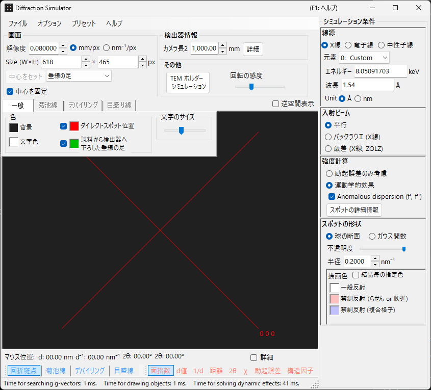
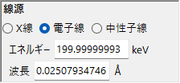
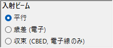
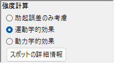
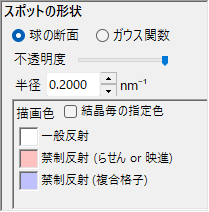
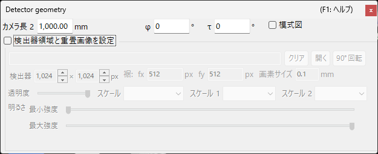

# X線・中性子線回折シミュレーション

**X線・中性子線回折シミュレーション**は、単結晶のX線・中性子線回折パターンを計算します。[回折シミュレータ](index.md) のメインモードのひとつです。

> このページは、**線源 = X線**（または **中性子線**）を選んだときに右側に現れる設定項目をすべて掲載します。描画・保存などウィンドウ共通の操作は [まとめページ](index.md) を参照してください。

GUI条件: 線源 = X線 / 中性子線 ・ 入射ビーム = 平行 / 歳差 (X線, ZOLZ) / バックラウエ (X線) ・ 強度計算 = 励起誤差のみ考慮 / 運動学的効果

---

## 概要

X線は電子線より波長が長く（Cu Kα: 0.15406 nm = 1.5406 Å）、エワルド球の曲率が大きくなります。そのため同時に回折条件を満たす逆格子点の数が電子線に比べて少なくなります。また原子散乱能が小さく多重散乱が弱いので、回折強度は運動学的 (Kinematical) 理論で十分な精度が得られます（動力学的 (Dynamical) 計算は電子線のみ対応）。

---

## 波長の設定

線源で **X線** を選択します。X線には特性X線とシンクロトロン放射光の2通りの指定方法があります。

### 特性X線

**元素** と **遷移** を選ぶと特性X線の波長が決まります。遷移は Siegbahn 記法（Kα₁ / Kα₂ / Kβ など）で指定します。代表的な元素の Kα₁ 波長:

<!-- 261105Cl コードから起こした修正。別担当がコードと再照合済み (誤りは訂正) (根拠: Crystallography/Atom/AtomStatic.cs:CharacteristicXrayWavelength (Mo Kα1 0.70931715 Å, Cr Kα1 2.2897260 Å)) -->
| 元素 | 線種 | 波長 (Å) | エネルギー (keV) |
|------|------|----------|-----------------|
| Cu | Kα₁ | 1.5406 | 8.048 |
| Mo | Kα₁ | 0.7093 | 17.479 |
| Co | Kα₁ | 1.7890 | 6.930 |
| Cr | Kα₁ | 2.2897 | 5.415 |

### シンクロトロン放射光

**元素** を **0: Custom** に設定し、エネルギー (keV) または波長 (Å) を直接入力します。任意の波長を使用できます。

---

## 入射ビーム

入射ビームのジオメトリを選択します。X線では次の3種が選べます。

### 平行

標準の平面波。SAED やX線単結晶回折で用いる平行入射ビームです。

### 歳差 (X線, ZOLZ)（プリセッションカメラ） {#歳差x線プリセッションカメラ}

X線の歳差（プリセッション）カメラをシミュレートします。逆格子の1層だけを取り出して撮影する歳差写真です。

### バックラウエ (X線)（後方反射ラウエ） {#back-laue後方反射ラウエ}

<!-- 261105Cl コードから起こした修正。別担当がコードと再照合済み (誤りは訂正) (根拠: FormDiffractionSimulator.cs:radioButtonBeamParallel_CheckedChanged / SetVector / Draw (BackLaue region)) -->
白色X線による後方反射ラウエパターンをシミュレートします。検出器を線源側に置く後方反射のジオメトリで、**線源** 欄のエネルギー・波長の入力欄と元素の選択欄は隠れ、代わりに **Flat white** と表示されます。スポットは、線源側でカメラ長の位置に**ビームに垂直**に置いた平面検出器へ投影されます。[検出器ジオメトリ](index.md#検出器ジオメトリ) の検出器の傾き **Tau / Phi** はこの投影には使われません。

- 白色X線のスペクトルは **50 keV** で打ち切られます（$d = \lambda(50\ \text{keV})/2$ までの反射を集める）。スペクトルによる重み付けはしません。
- 原点を通る同一直線上の高次反射 $n\mathbf{g}$ は同じスポットに重なるので、その $\lvert F\rvert^2$ を最低次の反射に足し合わせ、最強スポットで規格化します。
- **Anomalous dispersion (f', f'')** は無効（エネルギーが一意でないため）で、このモードでは **半径** に単位がありません。

> **注記**: 入射ビームの選択肢は線源に連動します。**歳差 (電子)**・**収束 (CBED, 電子線のみ)** は **電子線** 選択時のみ、上記の **歳差 (X線, ZOLZ)**・**バックラウエ (X線)** は **X線** 選択時のみ表示されます。**中性子線** では **平行** のみです。スクリーンショットは撮影時の状態によりX線用の選択肢が写っていない場合があります。

---

## 強度計算

スポット強度の計算方法を選択します。X線では次の2通りです。

### 励起誤差のみ考慮

エワルド球と逆格子点の幾何学的距離（励起誤差 $S_g$）だけで強度を決めます。$S_g = 0$（球面上）で最大となり、$\lvert S_g \rvert$ が大きくなるほど弱まって、逆格子点に与えた **半径** を超えると 0 になります。結晶構造因子は無視されます。

<!-- 261105Cl コードから起こした修正。別担当がコードと再照合済み (誤りは訂正) (根拠: FormDiffractionSimulator.cs:radioButtonIntensityCalculationMethod_CheckedChanged / SetVector) -->
このモードでのみ、次のオプションが現れます。

- **すべての禁制反射を非表示** / **複合格子由来の禁制反射を非表示**（既定は複合格子由来のみ）: 空間群で禁制となる反射を隠します。隠さない禁制反射は **描画色** で設定した別の色（らせん・映進由来 / 複合格子由来）で描かれます。
- **全てのスポットを同じ半径で描画** : 励起誤差によらず、すべてのスポットを $S_g = 0$ の大きさで描きます。

### 運動学的効果

励起誤差に加えて運動学的構造因子 $\lvert F_{hkl} \rvert^2$ を強度に反映します。消滅則が厳密に成立します。Lorentz因子・偏光因子は含みません（幾何学的パターンのシミュレーション）。

<!-- 261105Cl コードから起こした修正。別担当がコードと再照合済み (誤りは訂正) (根拠: FormDiffractionSimulator.cs:WaveLengthControl_WaveSourceChanged / SetVector, Crystal.cs:SetVectorOfG) -->
- **Anomalous dispersion (f', f'')**（X線のみ、既定オン。日本語UIでも英語表示）: 現在のX線エネルギーでの異常分散項 f′・f″ を構造因子に加えます（デバイリングにも反映）。化学的に異なる異常散乱体を含む非中心対称な構造では Friedel 則が破れ、$hkl$ と $\bar h\bar k\bar l$ の強度が異なります（Bijvoet 対）。差は吸収端近傍で最も大きくなります。Back Laue では無効です。[構造因子](../appendix/a2-beam-interaction/structure-factor.md) を参照。

> **注記**: **動力学的効果** はX線では無効です（電子線選択時のみ有効）。

---

## スポットの外観

各回折スポットの描画方法を制御します。

<!-- 261105Cl コードから起こした修正。別担当がコードと再照合済み (誤りは訂正) (根拠: FormDiffractionSimulator.cs:Draw (円で塗りつぶすとき / 点広がり関数で描画するとき), FormDiffractionSimulator.ja.resx) -->
- **球の断面 / ガウス関数** : 逆格子点の幾何モデル。**球の断面** は球とエワルド球の断面を描きます。球の半径は **運動学的効果** では $R \times I_\text{rel}^{1/3}$（球の*体積*が相対強度に比例）、**励起誤差のみ考慮** では *R* そのものです。**ガウス関数** は σ = *R* の3Dガウス関数とエワルド球の断面（2Dガウスの積分が回折強度に対応）で、$\lvert S_g\rvert \ge 3R$ のスポットは描きません。
- **不透明度 (Opacity)** : スポットの透過率（0 = 透過、1 = 不透過）。
- **半径 (R)** : 逆格子点の半径。**スポットの形状**と**強度計算**の組み合わせで描画スポットサイズが決まります。
- **明るさ** : **ガウス関数** モードでのみ有効。描画ガウスの積分強度を設定します。 <!-- 261105Cl コードから起こした修正。別担当がコードと再照合済み (誤りは訂正) (根拠: FormDiffractionSimulator.Designer.cs:comboBoxScaleColorScale / FormDiffractionSimulator.cs:comboBoxScaleColorScale_SelectedIndexChanged, FormDiffractionSimulator.ja.resx) -->
- **カラー**（ガウス関数のみ）: **Gray**・**Cold-Warm**・**Spectrum**・**Fire** から選択。
- **ログスケール**（ガウス関数のみ）: 強度を対数表示します。
- **描画色** : カラーが **Gray** のときに使うスポットの色（他のカラーではこの欄は隠れます）。
- **結晶毎の指定色** : チェックすると、各結晶に設定した色でスポットを描画します。

---

## デバイリング（多結晶）

多結晶試料のデバイリングを表示できます。ツールバーの **デバイリング** を有効にしてください（[ツールバー](index.md#ツールバー) 参照）。

<!-- 261105Cl コードから起こした修正。別担当がコードと再照合済み (誤りは訂正) (根拠: FormDiffractionSimulator.ja.resx:checkBoxDebyeRingIgnoreIntensity/checkBoxDebyeRingLabel) -->
- **強度を無視する** : すべてのリングを同色・同強度で描画します（構造因子を無視した純粋に幾何的な比較に使用）。
- **指数を表示する** : 各リングの近傍に (*hkl*) を表示します。

詳細な設定は [描画オーバーレイのタブ](index.md#描画オーバーレイのタブ) のデバイリングタブにあります。

---

## 中性子回折

**線源** で **中性子線** を選ぶと中性子回折パターンを計算します。<!-- 261105Cl コードから起こした修正。別担当がコードと再照合済み (誤りは訂正) (根拠: Crystallography.Controls/Wave/WaveLengthControl.cs:radioButtonWaveSource_CheckedChanged / LengthUnit) -->
エネルギー (meV) または波長 (Å / nm 切替、既定 Å) を入力します。入射ビームは **平行** のみです。強度計算は **励起誤差のみ考慮** / **運動学的効果** が使えます（**動力学的効果** は不可）。運動学的強度には原子散乱因子の代わりに中性子散乱長を用います。

---

## X線回折と電子線回折の違い

| 特徴 | X線回折 | 電子線回折 |
|------|---------|----------|
| 波長 | 長い (0.5–2.5 Å) | 短い (0.02–0.04 Å) |
| エワルド球の曲率 | 大 | 小（ほぼ平面） |
| 同時回折数 | 少 | 多 |
| 散乱因子 | 原子散乱因子 $f(s)$ | 電子散乱因子 $f_e(s)$ |
| 動力学効果 | 通常小さい | 大きい |
| 消滅則 | 厳密に成立 | 多重散乱により破れることあり |

---

## 共通操作

カメラ長・検出器ジオメトリ・パターンの保存・色設定などウィンドウ共通の操作は [まとめページ](index.md) を参照してください。検出器幾何の詳細設定は次のジオメトリウィンドウで行います。

---

## 関連項目

- [回折シミュレータ（まとめ）](index.md)
- [SAED シミュレーション](1-saed-simulation.md)
- [歳差電子回折 (PED) シミュレーション](2-ped-simulation.md)
- [収束電子線回折 (CBED) シミュレーション](3-cbed-simulation.md)
- [座標系 — 結晶方位](../appendix/a1-coordinate-system/1-orientation.md)
