# 回折シミュレータ (Crystal Diffraction)

**回折シミュレータ (Crystal Diffraction)** は、単結晶のX線回折・中性子線回折・電子線回折パターンをシミュレーションします。

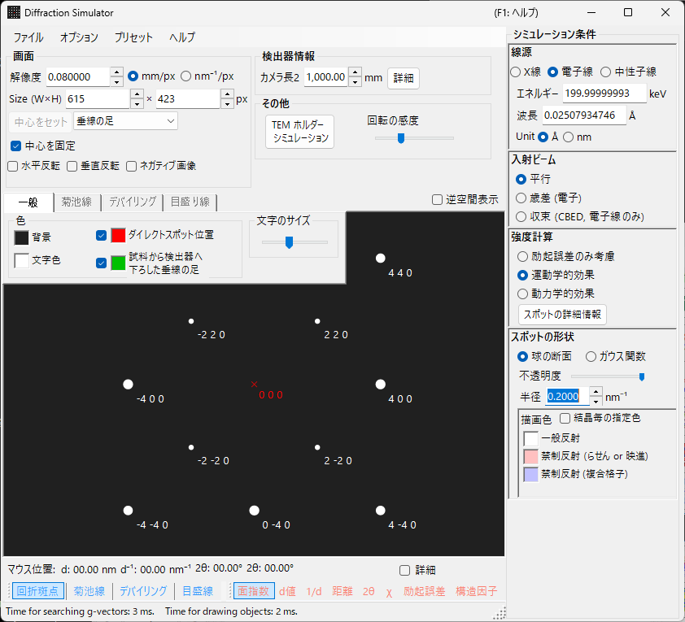

ウィンドウは、**左側**に回折パターンの描画エリア、**右側**に **シミュレーション条件** パネル（線源・入射ビーム・強度計算・外観など）が並びます。線源と入射ビームの組合せで撮影モード（X線回折・SAED・PED・CBED）が決まり、それに応じて右側パネルの構成が切り替わります。

---

## このページと各モードページの分担

- **このページ（まとめ）**: 全モードで共通の操作（ショートカット・メニュー・ツールバー・画面/検出器情報・オーバーレイのタブ・スポット情報・検出器ジオメトリ・動的圧縮）をまとめます。
- **各モードページ**: そのモードを選んだときに **右側に現れる全設定項目**（波長・入射ビーム・強度計算・外観・ブロッホ波設定・歳差の設定など）を、1ページで完結するように網羅します（モード間で一部重複します）。

| モード | 内容 | ページ |
|--------|------|--------|
| **X線（・中性子）回折** | 単結晶X線／中性子回折パターン（平行・歳差X線・Back Laue） | [X線回折シミュレーション](5-x-ray-neutron-diffraction.md) |
| **SAED** | 平行ビーム電子回折（制限視野電子回折） | [SAEDシミュレーション](1-saed-simulation.md) |
| **PED** | 歳差電子回折（プリセッション） | [PEDシミュレーション](2-ped-simulation.md) |
| **CBED** | 収束電子線回折 | [CBEDシミュレーション](3-cbed-simulation.md) |

> **ALCHEMI はモードではありません。** 波長と入射ビームの組合せで決まる X線 / SAED / PED / CBED と違い、ALCHEMI シミュレータは **オプション** メニューから開く**子ウィンドウ**なので、ここでは別枠として掲げます。

| 子ウィンドウ | 内容 | ページ |
|------|------|------|
| **ALCHEMI シミュレータ** | サイト分解のイオン化ロッキングカーブ（チャネリング増強微小分析） | [ALCHEMI シミュレーション](4-alchemi-simulation.md) |

回折シミュレータを隠すと、その子ウィンドウ（スポットの詳細、検出器の幾何、CBED、動的圧縮、TEM ホルダー シミュレーション、ALCHEMI シミュレータ）もすべて隠れます。シミュレータを再び表示したときに自動で開き直すのは、（収束モードの）CBED ウィンドウだけです。 <!-- 261105Cl 監査: FormElectronDiffraction_VisibleChanged (f98bc0d) -->

---

## モード早見表

**線源**と**入射ビーム**の組合せから、設定すべきページを引きます。

| 線源 | 入射ビーム | モード | ページ |
|------|-----------|--------|--------|
| 電子線 | 平行 | SAED | [SAEDシミュレーション](1-saed-simulation.md) |
| 電子線 | 歳差 (電子) | PED | [PEDシミュレーション](2-ped-simulation.md) |
| 電子線 | 収束 (CBED, 電子線のみ) | CBED | [CBEDシミュレーション](3-cbed-simulation.md) |
| X線 | 平行 | X線回折 | [X線回折シミュレーション](5-x-ray-neutron-diffraction.md) |
| X線 | 歳差 (X線, ZOLZ) | 歳差X線（プリセッションカメラ） | [X線回折シミュレーション](5-x-ray-neutron-diffraction.md) |
| X線 | バックラウエ (X線) | 後方反射ラウエ | [X線回折シミュレーション](5-x-ray-neutron-diffraction.md) |
| 中性子線 | 平行 | 中性子回折 | [X線回折シミュレーションの中性子節](5-x-ray-neutron-diffraction.md) |

<!-- 261105Cl コードから起こした修正。別担当がコードと再照合済み (誤りは訂正) (根拠: FormDiffractionSimulator.cs:WaveLengthControl_WaveSourceChanged, radioButtonBeamParallel_CheckedChanged; FormDiffractionSimulator.ja.resx) -->
> **注記**: 入射ビームの選択肢は波長で変わります。電子線では **平行・歳差 (電子)・収束 (CBED, 電子線のみ)**、X線では **平行・歳差 (X線, ZOLZ)・バックラウエ (X線)**、中性子では **平行** のみです。線源を変えると入射ビームは常に **平行** に戻ります。**歳差 (電子)** または **収束** を選ぶと、強度計算は自動的に **動力学的効果** へ切り替わります。**動力学的効果** は電子線でのみ選べ、X線・中性子にすると **運動学的効果** に戻ります。バックラウエは白色（多色）ビームで計算します。

---

## キーボード・マウスショートカット

<!-- 261105Cl コードから起こした修正。別担当がコードと再照合済み (誤りは訂正) (根拠: FormDiffractionSimulator.cs:graphicsBox_MouseWheel / graphicsBox_MouseUp; GraphicsBox.cs:GetWheelZoomFactor) -->
X線・SAED・PED のシミュレーションで共通の回折パターンウィンドウに適用されます。パターン上のドラッグは**結晶**を回転させます。ズームはマウスホイール、または右クリック／右ドラッグで行います。

| ショートカット | 動作 |
|----------------|------|
| <kbd>F1</kbd> | このページのオンラインマニュアルを開く |
| 中心付近を左ドラッグ | 結晶を傾ける |
| 外周を左ドラッグ | ビーム軸まわりに結晶を回す |
| スポットを左ダブルクリック | 反射の詳細を表示（指数・*d*・構造因子・励起誤差） |
| 中ドラッグ | パターンを平行移動 |
| <kbd>CTRL</kbd> ＋ 中ドラッグ | 検出器中心を移動（検出器領域の表示時） |
| マウスホイール | 1 ノッチごとに ×2 でズームイン／アウト。カーソル位置の点が表示の中心に移ります（**中心を固定** 時は固定中心のまま） |
| 右クリック | ズームアウト（×1/1.2） |
| 右ドラッグで矩形選択 | 選択範囲にズームイン |
| ステータスバーを右ダブルクリック | 現在の設定のテキスト要約をコピー: 結晶とオイラー角、線源、エネルギー、波長、入射ビーム、スポット形状、強度計算（動力学的効果のときは厚さ・回折波の数、PED では歳差角も）、検出器の幾何（項目名は英語） <!-- 261105Cl 監査: statusStrip1_MouseDown (C24) --> |
| 点灯中のレイヤーボタン（Spots / Kikuchi / Debye / Scale）を右ダブルクリック | そのレイヤーを点滅 |

ここから開く補助ウィンドウには、さらに以下があります。

| ショートカット | 動作 |
|----------------|------|
| ステレオネットを左ダブルクリック — **TEMホルダー** | ホルダー傾斜をその点に設定 |
| 矢印キー — **TEMホルダー** | ホルダー傾斜をステップ送り（先に **矢印キーを有効化** をチェック。ホルダーのウィンドウがアクティブなときだけ） <!-- 261106Cl 作者の決定 D25 --> |
| `.prm` ファイルや画像をドロップ — **検出器ジオメトリ** | 検出器幾何／重畳画像を読込 |
| `.txt` プロファイルをドロップ — **動的圧縮** | 位置・時刻・圧力のプロファイルを読込（**Time** スライダーで時刻を選択、グラフの縦線で前端・後端を設定） |

メインウィンドウのアプリ全体ショートカット（<kbd>CTRL</kbd>+<kbd>SHIFT</kbd> 系）は、このウィンドウにフォーカスがある間も動作します（[メインウィンドウ](../0-main-window.md) 参照）。

→ 全ウィンドウの一覧は **[21. キーボード・マウスショートカット](../21-shortcuts.md)** を参照。

---

## 目的別最速手順

| 目的 | 操作の入口 | 参照ページ |
|------|------------|------------|
| 平行ビームの電子回折（SAED）を出す | **入射ビーム**を **平行**、**線源**を **電子線**にする | [SAEDシミュレーション](1-saed-simulation.md)、[平行ビーム SAED の計算](../appendix/a3-bloch-wave/calculation.md) |
| X線単結晶回折を出す | **線源**を **X線** に切り替える（放射光では **元素** を **0: Custom** にする） | [X線回折シミュレーション](5-x-ray-neutron-diffraction.md) |
| 歳差電子回折（PED）を出す | **入射ビーム**を **歳差 (電子)** にし、歳差角とステップを設定する | [PEDシミュレーション](2-ped-simulation.md) |
| 収束電子線回折（CBED）を出す | **入射ビーム**を **収束 (CBED, 電子線のみ)** にし、CBED設定ウィンドウで条件を決める | [CBEDシミュレーション](3-cbed-simulation.md)、[CBED の計算](../appendix/a3-bloch-wave/cbed.md) |
| 動力学計算の反射一覧を確認する | **動力学的効果**を選び、**スポットの詳細情報** を押す | [動力学計算（共通コア）](../appendix/a3-bloch-wave/calculation.md) |
| 実験像と重ねて検出器幾何を合わせる | **検出器情報** 欄の **詳細** から検出器ジオメトリ設定を開き、重畳画像を使う | [検出器座標系](../appendix/a1-coordinate-system/2-diffraction.md) |

---

## メインエリア

画面中央に回折パターンがシミュレーションされます。

### マウス操作

ページ冒頭の「キーボード・マウスショートカット」を参照してください。

### マウス位置

<!-- 261105Cl コードから起こした修正。別担当がコードと再照合済み (誤りは訂正) (根拠: FormDiffractionSimulator.cs:graphicsBox_MouseMove, checkBoxMousePositionDetailes_CheckedChanged) -->
パターン上部の **マウス位置:** 行に、カーソル位置の *d*・*d*⁻¹ (メインウィンドウの長さの単位に従って nm・nm⁻¹ または Å・Å⁻¹)・2θ <!-- 261106Cl 作者の決定 C2 -->（度、および rad。0.1 rad 未満は mrad）が表示されます。**詳細** をチェックすると、検出器上の座標（mm、原点は試料から下ろした垂線の足）・実空間座標（mm、原点は結晶）・逆空間座標（nm⁻¹）の 3 つが追加表示されます。バックラウエでは *d* と逆空間座標は「-」表示になり、2θ は散乱角（180° − ビーム軸からの角。中心の入射ビームの穴で 180°）です。 <!-- 261105Cl 監査: Back Laue の 2θ (C13) -->

---

## ファイルメニュー

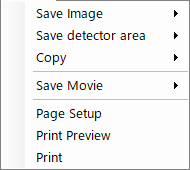

<!-- 261105Cl コードから起こした修正。別担当がコードと再照合済み (誤りは訂正) (根拠: FormDiffractionSimulator.Designer.cs:fileToolStripMenuItem; FormDiffractionSimulator.cs:radioButtonIntensityCalculationMethod_CheckedChanged, FormDiffractionSimulatorCBED.cs:FormDiffractionSimulatorCBED_VisibleChanged) -->
<!-- 261105Cl 監査 (組 K): メニュー項目は FormDiffractionSimulator.ja.resx で訳された。以前の「日本語 UI でも英語表記」を削除 -->

| メニュー項目 | 説明 |
|-------------|------|
| **画像を保存** | 表示中の回折パターンを **画像として (PNG 形式)** または **メタファイルとして (EMF)** で保存 |
| **検出器領域を保存** | 検出器領域のクロップのみを、検出器のピクセル格子で保存 (PNG / EMF)。検出器領域の表示時のみ現れます。重畳画像を含めるかの確認は、重畳画像を読み込んでいるときだけ出ます <!-- 261105Cl 監査: SaveOrCopyDetector (C18) --> |
| **CBED ディスクを保存** | CBED モードのみ。計算したディスクを **個別の画像として (PNG 形式 / TIFF 形式)** または **1 枚にまとめた画像として (PNG 形式 / TIFF 形式)** で保存。検出器領域を表示していても常に CBED のディスクが対象です |
| **コピー** | 表示中の画像をクリップボードへコピー (**画像として** / **メタファイルとして (EMF)**) |
| **検出器領域をコピー** | 検出器領域のクロップのみを、検出器のピクセル格子でコピー。検出器領域の表示時のみ現れます。重畳画像を含めるかの確認は、重畳画像を読み込んでいるときだけ出ます |
| **CBED ディスクをコピー** | CBED モードのみ。ディスクを **1 枚にまとめた画像として** コピー（検出器領域を表示していても常に CBED のディスク） |
| **動画を保存** | **回折パターン** または **逆空間**（逆空間表示）の動画を保存 |
| **プリント設定 / プリントプレビュー / プリント** | 表示中のパターンを印刷 |

### プリセット

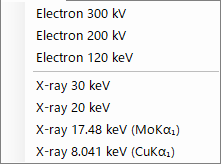

<!-- 261105Cl コードから起こした修正。別担当がコードと再照合済み (誤りは訂正) (根拠: FormDiffractionSimulator.cs:presetToolStripMenuItem_Click; FormDiffractionSimulator.Designer.cs:presetToolStripMenuItem) -->
線源とエネルギーだけを設定する固定のプリセットです: **電子線 300 kV**、**電子線 200 kV**、**電子線 120 kV**、**X線 30 keV**、**X線 20 keV**、**X線 17.48 keV (MoKα₁)**、**X線 8.041 keV (CuKα₁)**（最後の 2 つは Mo / Cu の Kα₁ 特性線を選択）。検出器ジオメトリ・タブ・スポット特性などは保存も変更もされません。

### オプション・ヘルプメニュー

| メニュー項目 | 説明 |
|-------------|------|
| **オプション > 動的圧縮** | [動的圧縮](#動的圧縮) ウィンドウを開きます（検出器ジオメトリのウィンドウも同時に開きます） |
| **オプション > ALCHEMI シミュレータ...** | [ALCHEMI シミュレータ](4-alchemi-simulation.md) を開きます |
| **ヘルプ > Bethe法の基本概念** | オンラインマニュアルの [ブロッホ波法の付録](../appendix/a3-bloch-wave/index.md) をブラウザで開きます |

---

## ツールバー

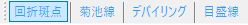

| ボタン | 説明 |
|--------|------|
| 回折斑点 (Spots) | 回折スポットレイヤーの表示／非表示 |
| 菊池線 (Kikuchi) | 菊池線レイヤーの表示／非表示 |
| デバイリング (Debye) | デバイリングレイヤーの表示／非表示 |
| 目盛線 (Scale) | スケール線レイヤーの表示／非表示 |
| 指数ラベル / d値 / 1/d / 距離 / 2θ / χ / 励起誤差 / 強度 <!-- 261106Cl 作者の決定 C11・K1 --> | スポットに添えるラベルの選択 |

---

## 画面と検出器情報

### 画面

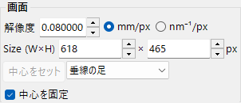

<!-- 261105Cl コードから起こした修正。別担当がコードと再照合済み (誤りは訂正) (根拠: FormDiffractionSimulator.Designer.cs:numericBoxResolution, comboBoxCenter; FormDiffractionSimulator.cs:FixedCenter, radioButtonResoUnit_CheckedChanged) -->
| 項目 | 説明 |
|------|------|
| **解像度** | 画面 1 ピクセルあたりの大きさ。**mm/px**（検出器面上）または **nm⁻¹/px** を選べます（既定 0.08 mm/px）。実際の検出器ピクセルサイズである必要はなく、表示スケールとして扱われ、マウスズームで自動更新されます |
| **サイズ (W×H)** | 描画領域のピクセル幅・高さ。ディスプレイ解像度によっては非常に大きな値は設定できません |
| **中心をセット / 中心を固定** | 描画領域の中心を **垂線の足**・**直接スポット**・**検出器の中心**（検出器領域を設定しているときのみ）のいずれかに合わせます。**中心を固定**（既定でオン）するとその位置に固定され、マウスパンが無効になり、ズームもその中心で行われます |
| **水平反転 / 垂直反転 / ネガティブ画像** | 表示パターンの幾何反転（水平／垂直）と色の反転。**ネガティブ画像** は背景・スポット・ラベル・菊池線・禁制反射・直接スポット・垂線の足・デバイリング・目盛り線の色を反転します（結晶ごとの色、ガウス表示のカラースケール、3D 表示、重畳画像は反転しません）。 <!-- 261105Cl 監査: checkBoxNegativeImage_CheckedChanged (C21) -->実験像の向きやコントラストに合わせるときに使用します |
| **逆空間表示** | パターンの横にエワルド球と逆格子点の 3D 表示を開き、どの反射が励起されているかを可視化します。その **オプション** 欄で色（エワルド球に近い／遠いスポット、エワルド球、原点、方向ガイド）、3D のスポット半径 (nm⁻¹)、相対強度のしきい値 (%)、遠いスポットの透明化、ラベル、視点の方向（矢印ボタンと角度 **ステップ**、**視点をリセット**）を設定します |

### 検出器（カメラ長）

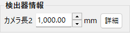

- **カメラ長 2** : 試料から検出器面へ下ろした垂線の足までの距離 (mm、既定 1000 mm)。検出器が傾いていない (τ = 0) ときは通常のカメラ長に一致します。 <!-- 261105Cl コードから起こした修正。別担当がコードと再照合済み (誤りは訂正) (根拠: FormDiffractionSimulator.cs:CameraLength2, DetectorRotation; FormDiffractionSimulator.Designer.cs:numericBoxCameraLength2) -->
- **詳細** : 検出器ジオメトリ設定ウィンドウ（後述の[検出器ジオメトリ](#検出器ジオメトリ)節）を開きます。

### その他

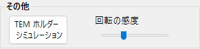

- **回転の感度** : マウスドラッグ 1 ピクセルあたりの結晶回転量。
- **TEMホルダーシミュレーション** : ホルダー連動シミュレーションウィンドウを開きます（下記参照）。

---

## TEMホルダーシミュレーション

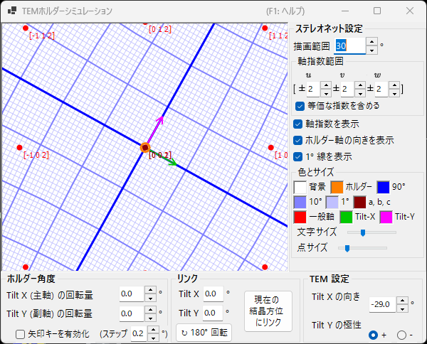

<!-- 261105Cl コードから起こした修正。別担当がコードと再照合済み (誤りは訂正) (根拠: FormDiffractionSimulatorHolder.cs:tiltByArrowKey, buttonLink_Click; FormDiffractionSimulatorHolder.Designer.cs) -->
回折図形をダブルティルトの **TEMホルダー**（**Tilt X** = 主軸、**Tilt Y** = 副軸）と連動させるウィンドウを開きます。ホルダーの傾斜角を設定するとパターンと結晶方位が更新され、到達可能な方位をステレオネット上に表示できます（ver4.914 で追加）。**現在の結晶方位にリンク** は、現在の結晶方位を指定した Tilt X / Tilt Y のときの方位として基準にします。**TEM 設定** では画面上での Tilt X 軸の向き（既定 −29°）と Tilt Y の極性を与え、**↻ 180° 回転** はビーム軸まわりに結晶を 180° 回します (メインウィンドウで軸・面を固定していても、常にビーム軸のまわり)。ステレオネットを左ダブルクリックするとホルダー傾斜をその点に設定でき、**矢印キーを有効化** をチェックしておくと ←/→ で Tilt X、↑/↓ で Tilt Y をステップ送りできます（ステップ 0.1〜2°、既定 0.2°）。矢印キーでホルダーを傾けられるのは、このウィンドウがアクティブなときだけです。 <!-- 261106Cl 作者の決定 D25 -->（シミュレータとともに）隠れていたこのウィンドウを再び表示したときや Tilt X / Tilt Y を変えたときは、その間の回転や結晶の変更を新しい基準として取り込みます。今の方位を今の傾斜での方位とみなし、晶帯軸の一覧も今の結晶で作り直します。 <!-- 261105Cl 監査: FormDiffractionSimulatorHolder.cs OnVisibleChanged / numericBoxTilt_ValueChanged (54e23f0) -->

---

## 描画オーバーレイのタブ

### 一般 (General)

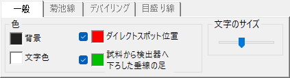

<!-- 261105Cl コードから起こした修正。別担当がコードと再照合済み (誤りは訂正) (根拠: FormDiffractionSimulator.Designer.cs:tabPageGeneral (groupBoxStringSize, groupBoxColor)) -->
ラベルの **文字のサイズ** と、**文字色**・**試料から検出器へ下ろした垂線の足** のマーカー・**直接スポット位置** のマーカー・**背景** の色を設定します（2 つのマーカーはそれぞれ非表示にできます）。スポットの色は **スポットの形状**（各モードページ参照）で、菊池線・デバイリング・目盛り線の色はそれぞれのタブで設定します。ここでの設定はすべての描画モードに反映されます。

### 菊池線 (Kikuchi lines)

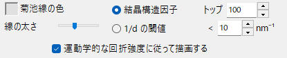

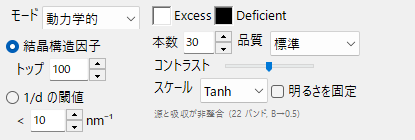

ツールバーで菊池線が有効のときにアクティブになります。

- **反射の選択** : 描画する菊池線の元となる反射を選びます。**結晶構造因子**（$\lvert F_{hkl}\rvert$ の **トップ** *N* 本。1〜1000、既定 100）または **1/d の閾値**（1/d がしきい値以下のすべての反射。0〜100 nm⁻¹、既定 10）。 <!-- 261105Cl コードから起こした修正。別担当がコードと再照合済み (誤りは訂正) (根拠: FormDiffractionSimulator.Designer.cs:numericBoxKikuchiThresholdOfStructureFactor/OfLength; FormDiffractionSimulator.cs:コンストラクタ (comboBoxKikuchiMode/Quality/Scale.SelectedIndex)) -->
- **モード (Mode)** : 菊池線の描画方法を選びます（既定は **運動学的**）。コンボボックスの下の設定はモードに応じて切り替わります。
    - **幾何学的 (Geometric)** : 選択した線をすべて同じ色で描画します。
    - **運動学的 (Kinematical)** : 反射の運動学的相対強度に従って線の濃さを変えます。
    - **動力学的 (Dynamical)** : 熱散漫散乱を源とする 2 波動力学の excess/deficient バンドプロファイルをバックグラウンドで計算して描画します。excess バンドは高角側に、deficient は直接ビーム (000) 側に現れます。試料厚さは強度設定の厚さと共有です。計算中は幾何学的な線が代わりに表示されます。動力学的なバンドは **電子線** のときだけ計算します。X線・中性子線では幾何学的な線で描き、注記に「電子線のみ: 線で表示」と出ます。 <!-- 261105Cl 監査: DrawKikuchiLine / UpdateKikuchiNotice -->
- **幾何学的 / 運動学的 の設定** : **菊池線の色** と **線の太さ**。
- **Dynamical の設定** :
    - **Excess** / **Deficient** : バンドの明るい側 (コントラストが正) と暗い側 (負) の色。
    - **本数 (Bands)** : 動力学プロファイルで描画するバンド数（動力学コントラスト上位 *N* 本。1〜50、既定 30）。
    - **品質 (Quality)** : バンドを横断するサンプル点数（高速 65 / 標準 129 / 高品質 257。既定は標準）。
    - **コントラスト (Contrast)** : 圧縮前にバンドコントラストへ掛ける表示用の利得。
    - **スケール (Scale)** : 明るさの圧縮カーブ（Linear / Log / Tanh。既定は Tanh）。いずれも表示用の変換で、実機カメラの応答ではありません。
    - **明るさを固定 (Lock brightness)** : 明るさの規格化を固定します（方位や厚さを変えて明るさを比較するときに）。
    - 下の灰色の注記には、源と吸収の非整合タグ・描画バンド数・診断（*B* = 0 の原子に既定値を代用した等）が表示されます。
- （かつての独立した **しきい値** パラメータは現在はありません。反射は上記の選択だけで絞り込まれます。） <!-- 261105Cl コードから起こした修正。別担当がコードと再照合済み (誤りは訂正) (根拠: FormDiffractionSimulator.Designer.cs:tabPageKikuchi (旧 Threshold コントロールは存在しない)) -->

### デバイリング (Debye rings)

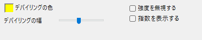

ツールバーでデバイリングが有効のときにアクティブになります。

- **強度を無視する** : チェック時はすべてのデバイリングを同じ色・強度で描画します（結晶構造因子を無視）。純粋に幾何的な比較をしたいときに使います。
- **指数ラベルを表示** : チェック時、各リングの近傍に指数 {*hkl*} を表示します（メインウィンドウの **オプション ▸ ミラー・ブラベー指数 (hkil) を使う** がオンで、結晶が六方晶軸をとるときは 4 指数 {*hkil*}）。 <!-- 261105Cl 監査: DrawDebyeRing (C23)。ラベルは波かっこ -->

### 目盛り線 (Scale)

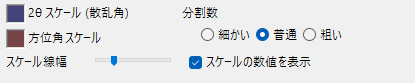

ツールバーで目盛り線が有効のときにアクティブになります。

- **2θ / 方位角 目盛り線** : **2θ** は等散乱角（同心円）、**方位角** は等方位角（中心からの放射状直線）を表します。色はそれぞれ独立に設定できます。バックラウエでは 2θ のラベルは散乱角なので、中心が 180° です。
- **線の太さ** : 目盛り線の太さ。
- **分割数** : 目盛り線の密度。**細かい** / **普通**（既定）/ **粗い**。 <!-- 261105Cl コードから起こした修正。別担当がコードと再照合済み (誤りは訂正) (根拠: FormDiffractionSimulator.Designer.cs:radioButtonScaleDivisionFine/Medium/Coarse) -->
- **目盛りラベルを表示** : 目盛り線に数値ラベルを表示するか。

<!-- 261105Cl コードから起こした修正。別担当がコードと再照合済み (誤りは訂正) (根拠: FormDiffractionSimulator.Designer.cs:tabControl (タブは 一般/菊池線/デバイリング/目盛り線 の 4 枚のみ)) -->
（独立した「その他」タブはありません。マウスの **回転の感度** は右側パネルの **その他** グループにあります。上の [その他](#その他) を参照。）

---

## 回折スポット情報

<!-- 261105Cl コードから起こした修正。別担当がコードと再照合済み (誤りは訂正) (根拠: FormDiffractionSimulator.cs:ButtonDetailsOfSpots_Click; FormDiffractionSpotInfo.cs:SetTable(double, Crystal)) -->
ブロッホ波法（Dynamical 計算）で計算された各反射の詳細を一覧表示します。強度計算パネルの **スポットの詳細情報** ボタンで開きます。**励起誤差のみ考慮** / **運動学的効果** のときは、現在描画されている反射について電子線のポテンシャルと $P_g$・$Q_g$ を一覧します（動力学的振幅は無し）。CBED モードでは CBED ウィンドウで選んだ厚さに追随します。X線・中性子線では、$S_g$・$P_g$・$Q_g$ を実際の波長（屈折の補正なし）で求め、ポテンシャルの列と単位の欄は隠れ、加速電圧・$m/m_0$・$v/c$ は「-」になります。 <!-- 261105Cl 監査: FormDiffractionSpotInfo.cs SetTable (C 組) -->

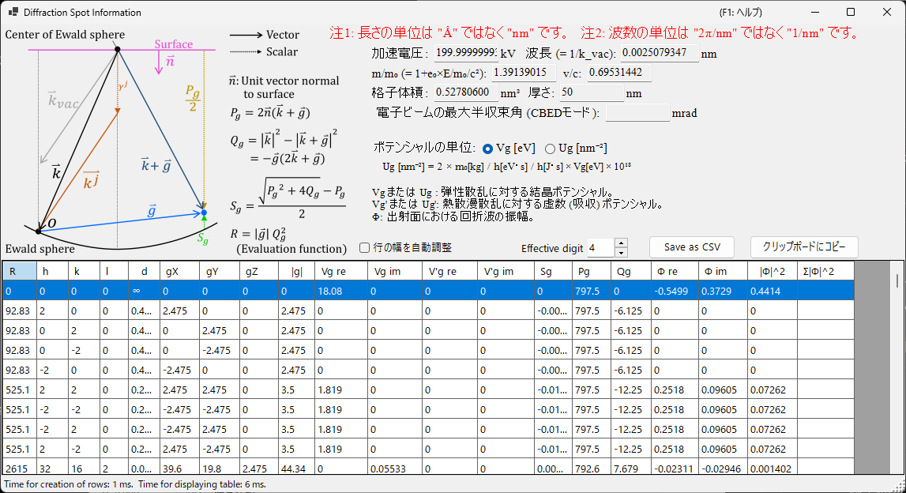

### 模式図と定義

左上の模式図は、エワルド球上のベクトルと、表で使う量の定義を示します（$\hat{\mathbf{n}}$ は試料表面の法線方向の単位ベクトル、$\mathbf{k}$ は入射波数ベクトル、$\mathbf{g}$ は逆格子ベクトル）。

- $P_g = 2\,\hat{\mathbf{n}} \cdot (\mathbf{k} + \mathbf{g})$
- $Q_g = |\mathbf{k}|^2 - |\mathbf{k} + \mathbf{g}|^2 = -\mathbf{g} \cdot (2\mathbf{k} + \mathbf{g})$
- **励起誤差:** $S_g = \dfrac{\sqrt{P_g^2 + 4 Q_g} - P_g}{2}$
- **評価関数:** $R = |\mathbf{g}|\, Q_g^2$ — 反射を励起の強さで順位付けする量（小さいほどエワルド球に近く＝強く励起される。透過波 $g=0$ は $R=0$ で先頭）。表は $R$ の昇順に並びます。

### 表の各列

| 列 | 意味 |
|------|------|
| **R** | 評価関数 $R = \lvert\mathbf{g}\rvert\, Q_g^2$（上記。反射の選択・並べ替えに使用） |
| **h, k, (i,) l** | ミラー指数（*i* は六方晶の冗長指数で、六方晶のときのみ） |
| **d** | 面間隔（nm） |
| **gX, gY, gZ** | 逆格子ベクトル *g* の成分（1/nm） |
| **\|g\|** | *g* の大きさ（1/nm） |
| **Vg re / Vg im** | 弾性散乱に対する結晶ポテンシャルのフーリエ係数 $V_g$（実部・虚部） |
| **V'g re / V'g im** | 熱散漫散乱（TDS）に対応する虚（吸収）ポテンシャル $V'_g$（実部・虚部） |
| **Sg** | 励起誤差 $S_g$（上記。1/nm） |
| **Pg** | 補助量 $P_g = 2\,\hat{\mathbf{n}}\cdot(\mathbf{k}+\mathbf{g})$（上記） |
| **Qg** | 補助量 $Q_g = -\mathbf{g}\cdot(2\mathbf{k}+\mathbf{g})$（上記） |
| **Φ re / Φ im** | 出射面における動力学的回折波の複素振幅 $\Phi$（実部・虚部） |
| **\|Φ\|^2** | その反射の回折強度 $\lvert\Phi\rvert^2$ |
| **Σ\|Φ\|^2** | $\lvert\Phi\rvert^2$ の累積和（全反射の和。強度保存の確認に使える） |

### ポテンシャルの単位とその他のコントロール

- **ポテンシャルの単位** : ポテンシャルの表示単位を **Vg [eV]**（電位、eV）と **Ug [nm⁻²]**（ブロッホ波方程式に入る換算量 $U_g = (2 m_0/h^2)\, V_g$）で切り替えます。単位に応じて表の列見出しも *Vg / V'g* ↔ *Ug / U'g* に変わります。電子線のときだけ表示されます。 <!-- 261106Cl 作者の決定 C5 -->
- 表上部に、加速電圧・波長（$\lambda = 1/k_\text{vac}$）・相対論的質量比 $m/m_0$・速度比 $v/c$・格子体積・試料厚さ・（CBED モードの）収束半角 α が表示されます。厚さは動力学的効果の計算のときだけ（CBED モードでは CBED ウィンドウの厚さ）、最大半角は CBED モードのときだけ表示され、それ以外は「-」です。
- **注1:** 長さの単位は Å ではなく **nm**。**注2:** 波数の単位は 2π/nm ではなく **1/nm**。
- **有効桁数** : 表に表示する有効桁数（1〜16、既定 4）。**行の幅を自動調整** : 列幅の自動調整。**クリップボードにコピー** : 表を表計算ソフトへ貼り付け可能なテキストとして出力します。**CSV で保存** : 同じ表（表示中の列）を CSV ファイルに保存します。小数点は常にピリオドなので、小数点がカンマのロケールでもファイルが壊れません。**クリップボードにコピー** と **CSV で保存** は表が 1 行でも使えます。どちらも先頭に条件を表す `# key: value` の行 (線源、加速電圧またはエネルギー、波長、厚さ、CBED での収束半角、結晶、オイラー角、計算の種類) が付き、列見出しには `d (nm)`・`Sg (nm⁻¹)`・`Qg (nm⁻²)` のように単位が付きます。 <!-- 261106Cl 作者の決定 C22 --> <!-- 261105Cl 監査: ボタン名は LocalizationData.cs (buttonSaveAsFile「CSV で保存」) -->

---

## 検出器ジオメトリ

検出器の幾何（カメラ長・傾き・回転）と、実験像の重畳を詳細に設定するウィンドウです。**検出器情報** パネルの **詳細** から開きます。

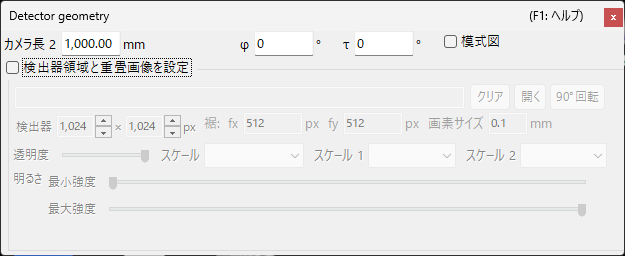

### 検出器ジオメトリ設定

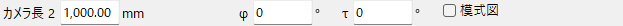

<!-- 261105Cl コードから起こした修正。別担当がコードと再照合済み (誤りは訂正) (根拠: FormDiffractionSimulatorGeometry.Designer.cs; FormDiffractionSimulatorGeometry.cs:FormDiffractionSimulatorGeometry_DragDrop) -->
**カメラ長 2**（mm、1〜10000、既定 1000）と、方位 **φ** の面内軸まわりの検出器の傾き **τ**（−200〜200°）を与えます。Back Laue（後方反射ラウエ）では **カメラ長 2** だけが使われます。 <!-- 261105Cl 監査: このウィンドウは LocalizationData.cs reg["FormDiffractionSimulatorGeometry"] で日本語表示になる。欄名をそれに合わせた -->パターンは常に線源側でビームに垂直な検出器へ投影され、τ / φ はこの投影に使われません。`.prm` ファイルをドロップすると、ファイルに保存されている項目 — 線源（X線の元素と線・電子線・中性子線）と波長、カメラ長 2、τ、φ、垂線の足の位置、ピクセルサイズ、検出器のピクセル数 — を読み込み、検出器領域の表示をオンにします。ファイルに無い項目は変わりません。 <!-- 261105Cl 監査: FormDiffractionSimulatorGeometry_DragDrop (952b457)。以前の「常に X 線・任意波長」は誤り -->

### 検出器領域と重畳画像

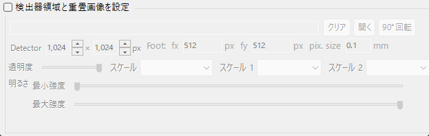

**検出器領域と重畳画像を設定** をチェックすると検出器を指定できます: ピクセル数（既定 1024 × 1024）、**ピクセルサイズ**（mm、既定 0.1）、垂線の足の位置 **垂線の足: fx**, **fy**（px、既定 512, 512。試料から検出器面へ下ろした垂線の足で、検出器を傾けていない（τ = 0）ときだけ直接ビームの位置と一致します）。実験像は **開く** またはドロップで読み込み、**不透明度**・**スケール**（ポジ／ネガ）・**スケール 1**（Log/Linear）・**スケール 2**（Gray / Cold-Warm / Spectrum / Fire）・**最大強度** / **最小強度**・**90°回転**・**クリア** で重ね方を調整します。`.ipa` の画像を読み込むと τ = 0（ファイルが傾きの情報を持たない）、垂線の足は画像の中心、カメラ長 2 はフィルム距離になります。`.prm` ファイルとしても画像としても読めないファイルは、メッセージで知らせます。**模式図** は幾何の模式図を表示します。 <!-- 261105Cl 監査: 欄名は LocalizationData.cs reg["FormDiffractionSimulatorGeometry"] の ja (組 K で Foot は「垂線の足」、Opacity は「不透明度」に直った。Gradient は「スケール」と表示される)。.ipa・読めないファイル (4dc847a)、Foot の定義 (numericBoxFootX/Y.ToolTip) -->シミュレーションパターンと実験像を重ねて検出器幾何を合わせ込むのに使います。

座標系の定義は [検出器座標系](../appendix/a1-coordinate-system/2-diffraction.md) も参照してください。

---

## 動的圧縮

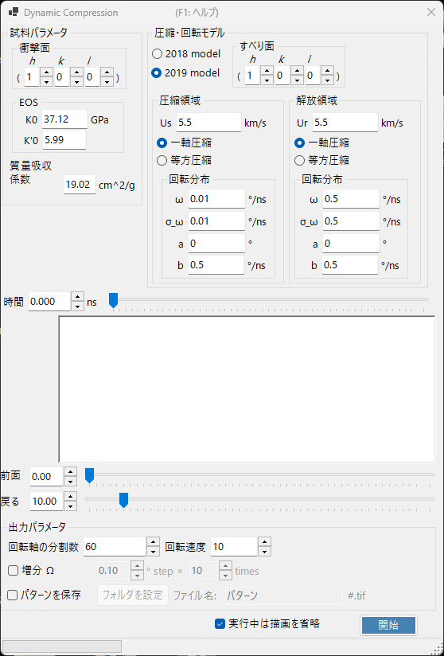

<!-- 261105Cl コードから起こした修正。別担当がコードと再照合済み (誤りは訂正) (根拠: FormDiffractionSimulatorDynamicCompression.cs:FormDiffractionSimulatorDynamicCompression_DragDrop, buttonPaste_Click, graphControl1_LinePositionChanged) -->
衝撃圧縮（動的圧縮）された試料からの回折をシミュレーションするウィンドウです。深さ (µm)・時刻 (ns)・圧力 (MBar) の 3 列をタブ区切りで並べた `.txt` をドロップすると時刻ごとの圧力プロファイルを読み込み、**時間** スライダー (ns) でグラフに表示するプロファイルを選びます。グラフの横軸は深さ (µm) です。グラフ上の 2 本の縦線（**前方** / **後方**）はドラッグで圧縮の前端・後端を設定します。このほか圧縮モデル（**2018 / 2019 model**）、衝撃速度（**Us**、**Ur**、km/s）、**EOS**（K0、K'0）、**衝撃面** / **すべり面**、圧縮域・解放域の回転分布、質量吸収係数、Ω のステップ送り、**パターンを保存**（`#.tif`）を設定し、**開始** で実行します。回転の幅 σ が 0（または回転角の分割数が 0）のときは 1 つの方位として扱います。計算が成功しても失敗しても、終わると結晶とその方位は元に戻ります。 <!-- 261105Cl 監査: 欄名は LocalizationData.cs reg["FormDiffractionSimulatorDynamicCompression"] の ja (組 K で Front / Back は「前方」「後方」に直った)。深さの単位・σ = 0・復元 (fb26838, 4a21154, 8461e90) -->

---

## ALCHEMI シミュレータ

**サイト分解のイオン化ロッキングカーブ**（系統反射列の Bragg 条件を通して結晶を傾けたときの、選んだイオン化チャネルの収量をサイトごとに分けたもの）を計算する子ウィンドウを開きます。**オプション** メニューから開きます。CBED ウィンドウと違い、自前の出力領域を持ち、親のキャンバスには描きません。

→ 全設定と適用範囲・既知の限界は **[ALCHEMI シミュレーション](4-alchemi-simulation.md)** を参照。

---

## 関連項目

- [X線回折シミュレーション](5-x-ray-neutron-diffraction.md)
- [SAEDシミュレーション](1-saed-simulation.md)
- [PEDシミュレーション](2-ped-simulation.md)
- [CBEDシミュレーション](3-cbed-simulation.md)
- [ALCHEMI シミュレーション](4-alchemi-simulation.md)
- [動力学計算（共通コア）](../appendix/a3-bloch-wave/calculation.md)
- [検出器座標系](../appendix/a1-coordinate-system/2-diffraction.md)
