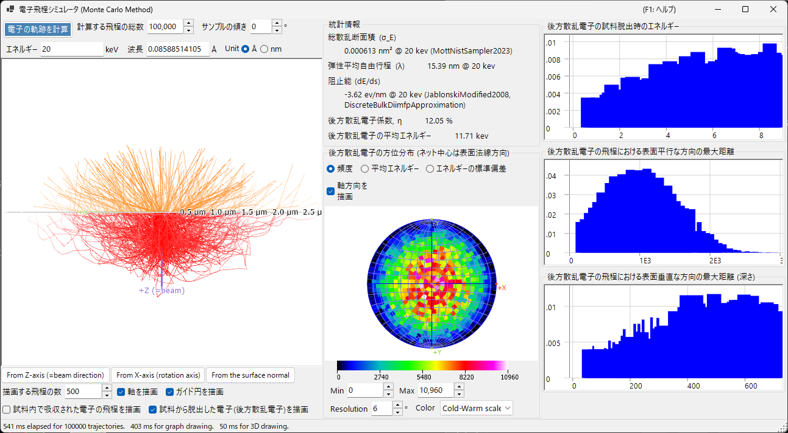
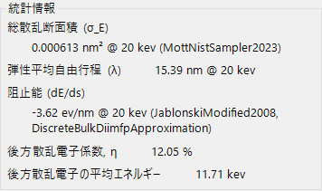
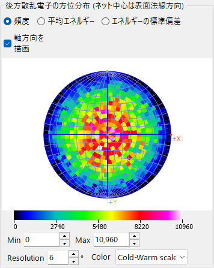
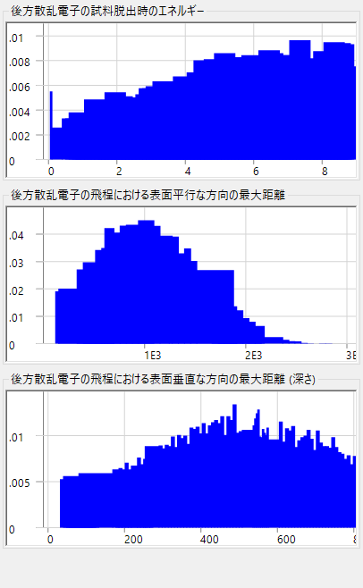

# 電子飛程 (Electron Trajectory)

**電子飛程シミュレータ (Monte Carlo Method)** は、試料内部の電子の軌跡を **モンテカルロ法** で計算します。入射電子は弾性・非弾性散乱を受け、後方散乱電子 (BSE) の分布 — 方位・脱出時のエネルギー・侵入深さ・表面平行方向の広がり — が集計されます。
<!-- 261105Cl コードから起こした修正。別担当がコードと再照合済み (誤りは訂正) (根拠: FormTrajectory.cs (FormMain 以外から参照なし), FormEBSD.cs:new MonteCarlo(...) は独自に実行) -->
[EBSDシミュレーション](12-ebsd-simulation.md) も方位・エネルギー・深さの重み付けに同じモンテカルロエンジンを使いますが、独自の設定で内部的に実行します。このウィンドウの結果が渡されるわけではありません。

ウィンドウは3列構成です。左が **3D の飛程表示**、中央が **統計情報** と **後方散乱電子の方位分布** のステレオネット、右が3つの **ヒストグラム** です。試料の組成と密度はメインウィンドウで選択中の結晶から取られ、このウィンドウで設定するのはビームエネルギー・試料の傾き・飛程の本数だけです。

---

## キーボード・マウスショートカット

電子の飛程は3D OpenGLビューに表示されます。ReciPro 標準の [ビュー操作](21-shortcuts.md) ですが、**平行移動は無効**です — 標準的な視点へはビューのプリセットボタンで切り替えます。

| ショートカット | 動作 |
|----------------|------|
| <kbd>F1</kbd> | このページのオンラインマニュアルを開く |
| 左ドラッグ | モデルを回転 |
| 右ドラッグ上下、またはホイール | ズーム |
| <kbd>CTRL</kbd> ＋ 右ダブルクリック | 正射投影／透視投影の切替 |

→ 全ウィンドウの一覧は **[21. キーボード・マウスショートカット](21-shortcuts.md)** を参照。

---

## 計算条件

ウィンドウ上部のコントロールで計算の条件を決めます。

- **電子の軌跡を計算** : モンテカルロ計算を開始します。下部のステータスバーには、飛程計算・グラフ描画・3D描画それぞれの経過時間が別々に表示されます。
- **計算する飛程の総数** (100〜1,000,000、既定 100,000) : 追跡する入射電子の本数。多いほど以下の各分布の統計ノイズは減りますが、計算時間は本数に比例して増えます。 <!-- 261105Cl コードから起こした修正。別担当がコードと再照合済み (誤りは訂正) (根拠: FormTrajectory.Designer.cs:numericBoxCalcNum/numericBoxSampleTilt, FormTrajectory.cs:EnergyThreshold, CalcMonteCarlo) -->
- **サンプルの傾き** (°、−90〜0、既定 0) : *X* 軸まわりの試料表面の傾き。垂直入射なら 0 のままにします。[EBSDシミュレータ](12-ebsd-simulation.md) と同じ配置を再現するときは **−70°** にします (大きく傾けると後方散乱電子の収率が上がるため)。
- **エネルギー** (keV) / **波長** / **Unit** : 入射電子線の加速電圧と、それに連動した相対論補正済みの電子波長。このエネルギーが、弾性散乱 (NIST Mott) と非弾性散乱 (阻止能・IMFP) の両方の運動エネルギーになります。

計算の後で **サンプルの傾き** や **エネルギー** を変えても、表示中の結果は変わりません。もう一度 **電子の軌跡を計算** を押すまで、描き直し（3D 表示・ステレオネット・ヒストグラム）には軌跡を計算したときの傾きとエネルギーが使われます。 <!-- 261105Cl 監査: FormTrajectory.cs calcTilt/calcEnergy (9890ced0)。欄名は WaveLengthControl.ja.resx -->

<!-- 261105Cl コードから起こした修正。別担当がコードと再照合済み (誤りは訂正) (根拠: FormTrajectory.cs:EnergyThreshold = 2, DrawStatistics / Crystallography/EBSD/MonteCarlo.cs:MonteCarlo(thresholdKev)) -->
電子は試料から出るか、エネルギーが **2 keV**（固定のしきい値）まで下がるまで追跡されます。2 keV より大きいエネルギーで試料から出た電子を後方散乱電子として数え、統計情報の η (全入射電子に対する割合)・平均エネルギー、ステレオネット、ヒストグラムはこれらの電子から求めます。統計情報の散乱断面積・平均自由行程・阻止能は、ビームエネルギーにおけるモデルの値です。

散乱モデル自体はユーザーが選ぶものではありません。弾性散乱断面積は同梱の NIST Mott 表 (適用範囲外では遮蔽 Rutherford にフォールバック)、阻止能は Jablonski (2008) の修正形を使います。実際に使われたモデル名は **統計情報** の散乱断面積と阻止能の隣に表示されます。各モデルの中身は [減衰・輸送](appendix/a2-beam-interaction/attenuation-transport.md) を参照してください。

### 3D の飛程表示

<!-- 261105Cl コードから起こした修正。別担当がコードと再照合済み (誤りは訂正) (根拠: FormTrajectory.cs:Draw3D (Material の Color4)) -->
後方散乱電子の軌跡は**赤**、試料内で吸収された電子の軌跡は**青**で描かれ、電子がエネルギーを失うにつれて16段階で白・透明へと薄くなります。脱出後の経路（下記）は、脱出エネルギーに比例した長さの**橙色**の短い線分です。同心のガイド円には nm (または µm) の目盛りが付き、**+X**・**+Y**・**+Z (=beam)** が座標軸を示します。

- **Z 軸から見る (=ビーム方向)** / **X 軸から見る (回転軸)** / **表面法線から見る** : 視点を標準的な方向 (ビーム方向・回転軸方向・表面法線方向) へ切り替えます。 <!-- 261105Cl 監査: 3 つのボタンは ja に訳された (FormTrajectory.ja.resx buttonViewFromZ/buttonViewFromX/buttonSurfaceNormal, 932c1c09) -->
- **描画する飛程の数** (1〜100,000、既定 500) : 計算した軌跡のうち何本を描くか (10万本すべてを描くと読めず、描画も遅くなります)。計算順に先頭から取り、吸収電子を描かない設定ではそれを飛ばします。
- **軸を描画** / **ガイド円を描画** : 座標軸の矢印と距離の目盛り。
- **試料内で吸収された電子の飛程を描画** : 脱出せずに終わった電子も描きます。
- **脱出後の経路を描画** <!-- 261105Cl 監査: checkBoxDrawPathAfterEscape.Text --> : 後方散乱電子が表面から出たあとの経路も続けて描きます。

---

## 統計情報

<!-- 261105Cl コードから起こした修正。別担当がコードと再照合済み (誤りは訂正) (根拠: FormTrajectory.cs:CalcMonteCarlo (labelCrossSection / labelStoppingPower)) -->
現在のビームエネルギーにおける値です。散乱断面積と阻止能の隣には、それを与えたモデル名が括弧書きで表示されます。

- **総散乱断面積 (σ_E)** (nm²) — 原子1個あたりの全弾性散乱断面積。
- **弾性平均自由行程 (λ)** (nm) — 弾性散乱から次の弾性散乱までの平均距離。
- **阻止能 (dE/ds)** (eV/nm、負値) — 単位経路長あたりに失うエネルギー。
- **後方散乱電子係数, η** (%) — 入射電子のうち入射面から再び出ていく割合。BSE 像のコントラストの源になる量です。
- **後方散乱電子の平均エネルギー** (keV) — 後方散乱電子が脱出する瞬間の平均エネルギー。後方散乱電子が 1 個も無いときは「-」と表示されます（ヒストグラムは空になります）。 <!-- 261105Cl 監査: FormTrajectory.cs DrawStatistics (count == 0) -->

---

## 後方散乱電子の方位分布

後方散乱電子の角度分布を、中心が表面法線方向のステレオネット上に描きます。

- **頻度** / **平均エネルギー** / **エネルギーの標準偏差** : 色に対応させる量。各方向へ出ていく電子の数、その平均エネルギー、あるいはエネルギーのばらつきです。
- **軸方向を描画** : +X / ±Y / ±Z の方向を重ねて表示します。
- **Min** / **Max**・**Resolution**・**Color** : カラースケールの上下限、角度ヒストグラムのビンサイズ、カラーマップ。

---

## ヒストグラム

<!-- 261105Cl コードから起こした修正。別担当がコードと再照合済み (誤りは訂正) (根拠: FormTrajectory.cs:DrawStatistics (hist[i].Count / count)) -->
後方散乱電子についての3つの分布です。各ビンの値は、全後方散乱電子のうちそのビンに入る割合です（ビンの値の総和が1。ビン幅では割っていません）。

### 後方散乱電子の試料脱出時のエネルギー

後方散乱電子が試料から出る時点で **まだ持っているエネルギー** (keV) のヒストグラムです。エネルギー損失ではないことに注意してください。EBSD シミュレータは、自身のモンテカルロ計算で得たこの種の分布を、マスターパターンのエネルギー積分の重みに使います。

### 後方散乱電子の飛程における表面平行な方向の最大距離

各後方散乱電子が脱出するまでに **表面に平行な方向へ** どれだけ広がったか (nm) のヒストグラムです。相互作用体積の横方向の大きさにあたり、BSE 像や EBSD 測定の空間分解能の原理的な限界を与えます。

### 後方散乱電子の飛程における表面垂直な方向の最大距離 (深さ)

各後方散乱電子が脱出するまでに **表面に垂直な方向へ** 到達した最大深さ (nm) のヒストグラムです。

---

## 関連項目

- [EBSDシミュレーション](12-ebsd-simulation.md)
- [EBSDの計算](appendix/a3-bloch-wave/ebsd.md)
- [減衰・輸送](appendix/a2-beam-interaction/attenuation-transport.md) — ここで使う弾性散乱断面積・阻止能・飛程の中身。
- [動力学回折(Bloch波法)](appendix/a3-bloch-wave/index.md)
- [HRTEM/STEMシミュレータ](9-hrtem-stem-simulator/index.md)
- [回折シミュレータ](7-diffraction-simulator/index.md)
