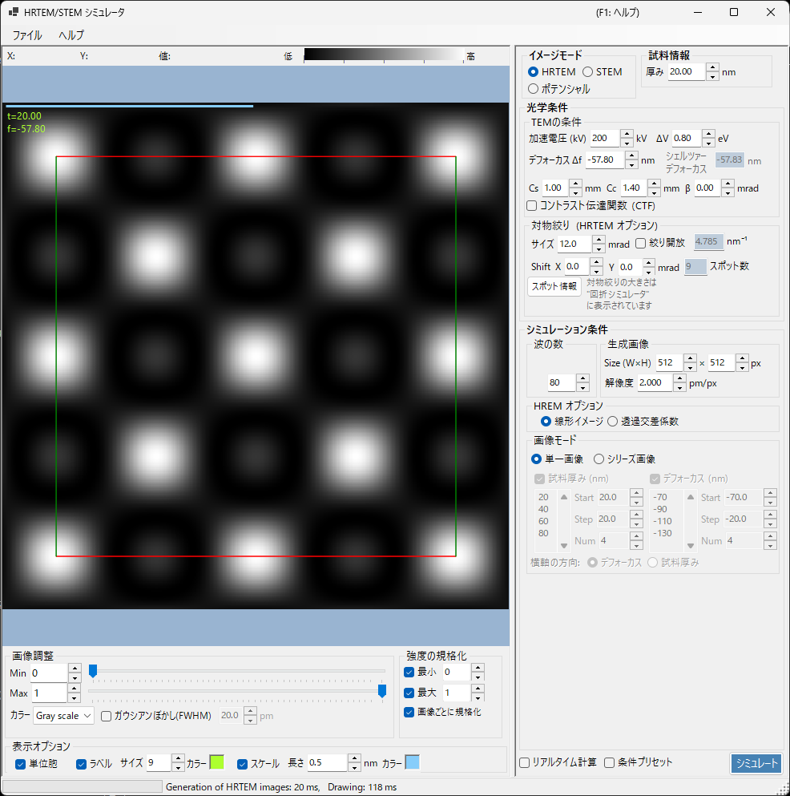
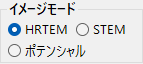
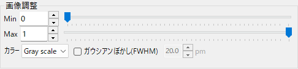
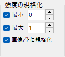
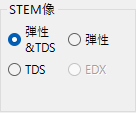
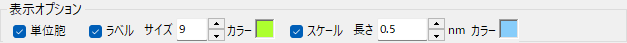
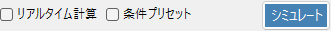
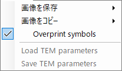
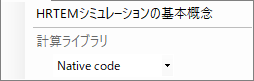

# HRTEM / STEMシミュレータ

**HRTEM/STEM シミュレータ** は、選択した結晶と方位に対するTEM格子縞像（HRTEM）・STEM像・投影ポテンシャルをシミュレーションします。**シミュレート** ボタンで実行します。

ウィンドウは大きく2つに分かれます。**左側**はシミュレーション結果の表示と見た目の調整（描画ボックス・明るさ・カラー・スケールバーなど）、**右側**は計算条件の設定（光学条件・シミュレーション条件）です。

---

## このページと各モードページの分担

- **このページ（まとめ）**: 全モードで共通の操作と、**左側の結果表示・調整** をまとめます。
- **各モードページ**: そのモードを選んだときに **右側に現れる全設定項目** を、1ページで完結するように網羅します（モード間で一部重複します）。

| モード | 内容 | ページ |
|--------|------|--------|
| **HRTEM** | 高分解能TEM格子縞像 | [HRTEMシミュレーション](1-hrtem-simulation.md) |
| **STEM** | 走査透過電子顕微鏡像（BF/ABF/LAADF/HAADF） | [STEMシミュレーション](2-stem-simulation.md) |
| **ポテンシャル** | 投影結晶ポテンシャル（$U_g$ / $U'_g$） | [ポテンシャルシミュレーション](3-potential-simulation.md) |

---

## キーボード・マウスショートカット

結果は1つ以上の画像ペインに表示されます。ReciPro 標準の [画像ビュー操作](../21-shortcuts.md) で、全ペインが連動して拡大・平行移動します。

| ショートカット | 動作 |
|----------------|------|
| <kbd>F1</kbd> | このページのオンラインマニュアルを開く |
| <kbd>CTRL</kbd>+<kbd>C</kbd>（画像グリッドにフォーカス時） | 画像をメタファイルとしてクリップボードへコピー |
| 左ドラッグ／中ドラッグ | 画像を平行移動（全ペイン連動） |
| ホイール上／下 | カーソル位置を中心にズームイン（×2）／ズームアウト（×0.5） |
| 右ドラッグで矩形選択 | 選択範囲にズームイン |
| 右クリック／右ダブルクリック | ズームアウト（×0.5） |
| <kbd>CTRL</kbd> ＋ 右ドラッグで矩形 | 矩形領域を選択 |
| ペインを左ダブルクリック | そのペインを最大化／グリッドに戻す（複数ペイン時） |
| マウス移動（ボタンなし） | カーソル位置の座標（pm）とピクセル値を表示 |

→ 全ウィンドウの一覧は **[21. キーボード・マウスショートカット](../21-shortcuts.md)** を参照。

---

## 目的別クイックルート

| 目的 | 最初に設定する場所 | 参照ページ |
|------|------------------|------------|
| HRTEM像を1枚計算する | **イメージモード**を **HRTEM**、**TEMの条件**で加速電圧とデフォーカスを設定 | [HRTEMシミュレーション](1-hrtem-simulation.md)、[HRTEM 像形成](../appendix/a3-bloch-wave/hrtem.md) |
| STEM像を計算する | **イメージモード**を **STEM**、**STEMオプション**で収束半角と検出器を設定 | [STEMシミュレーション](2-stem-simulation.md)、[STEM の計算](../appendix/a3-bloch-wave/stem.md) |
| 投影ポテンシャルを見る | **イメージモード**を **ポテンシャル** にする | [ポテンシャルシミュレーション](3-potential-simulation.md) |
| 厚さ・デフォーカスシリーズを作る | HRTEMで **単一/シリーズ画像** と画像条件を設定 | [HRTEMシミュレーション](1-hrtem-simulation.md) |
| TDSを含むHAADF-STEMを扱う | 原子変位パラメータ B を 0 でない値にし、STEM検出器を LAADF / HAADF 側へ設定 | [STEM の計算](../appendix/a3-bloch-wave/stem.md) |

---

## 基本ワークフロー

1. メインウィンドウで結晶と方位を決め、このウィンドウを開く。
2. **イメージモード**で HRTEM / STEM / ポテンシャルを選ぶ。
3. **光学条件**で加速電圧、デフォーカス、収差、絞り、STEM収束半角などを設定する（各モードページ参照）。
4. **シミュレーション条件**で厚さ、画像サイズ、分解能、ブロッホ波数、部分コヒーレンスモデルなどを設定する（各モードページ参照）。
5. **シミュレート**を押し、必要に応じて左側の **画像調整**・**強度の規格化**・**表示オプション**で見た目を整える。

---

## イメージモードの選択

{ align=left }

右上の **イメージモード** で計算の種類を選びます。選んだモードに応じて右側のパネル構成（光学条件・シミュレーション条件）が切り替わります。

- **HRTEM** — 高分解能TEM格子縞像 → [HRTEMシミュレーション](1-hrtem-simulation.md)
- **STEM** — 走査透過電子顕微鏡像 → [STEMシミュレーション](2-stem-simulation.md)
- **ポテンシャル** — 投影結晶ポテンシャル → [ポテンシャルシミュレーション](3-potential-simulation.md)

---

## 画像エリア（左側）

ウィンドウ左半分にシミュレーション像が表示されます。上部のステータスバーには、カーソル位置 (**X:**、**Y:**) とカーソル直下の画像の **Value:** (強度) が表示され、その右に現在のカラーマップと明るさ範囲を表す **Low → High** の強度スケールが並びます。

複数枚（シリーズ画像、ポテンシャルの振幅/位相など）はグリッド状に並び、いずれのペインも連動してズーム・平行移動します。

---

## 結果の表示・調整（左側パネル）

左下のパネルでは、計算結果の見た目（明るさ・カラー・規格化・重畳要素）を調整します。これらは全モード共通で、計算をやり直さずに反映されます。

### 画像調整

- **Min / Max** : 表示する明るさのレンジの下限（黒）と上限（白）。トラックバーでコントラストを調整します。
- **カラー** : 画像のカラースケール。**Gray scale**（グレースケール）または **Cold-Warm**（青〜赤）。
- **ガウシアンぼかし(FWHM)** : チェックすると、右の半値全幅 (pm) でガウシアンぼかしを適用し、有限分解能（点像分布）を近似します。チェックしている間は、新しく計算した像にもぼかしを掛けます。半値全幅は、それぞれの像を計算したときの **解像度** (pm/px) でピクセル数に換算します。 <!-- 261105Cl 監査: FormImageSimulator.cs:ApplyGaussianBlur -->

### 強度の規格化

<!-- 261105Cl コードから起こした修正。別担当がコードと再照合済み (誤りは訂正) (根拠: FormImageSimulator.ja.resx:checkBoxNormarizeIndividually.Text) -->
- **画像ごとに規格化** : チェックすると、各画像を個別に規格化します（オフのときはシリーズ全体を共通スケールで規格化）。
- **最小 / 最大** : 規格化の下限・上限を、画像の最小/最大値ではなく右の指定値に固定します。
- **EDX 共通** : [EDX マップ](2-stem-simulation.md#stem-edx) を表示していて、かつ計算結果に複数のチャネルがあるときだけ現れます。同じ量のチャネルどうしを 1 つの表示レンジに揃えます。EDX マップは **最小 / 最大** による変換を受けません。下端は 0 に固定で、上端だけが **画像ごとに規格化** / **EDX 共通** に従います。 <!-- 261105Cl コードから起こした修正。別担当がコードと再照合済み (誤りは訂正) (根拠: FormImageSimulator.cs:FillEdxGrid / RadioButtonHRTEM_CheckedChanged) -->
- ポテンシャルモードではこのグループは表示されません。

### STEM像の表示対象

STEMモードのときだけ表示されます。計算済みのSTEM像のうち、どの散乱成分を表示するかを切り替えます（**弾性** / **TDS** / **弾性 & TDS**）。[STEM-EDX マップ](2-stem-simulation.md#stem-edx) も計算した場合は、4 つ目の選択肢として **EDX** を選べます。STEM固有の項目のため [STEMシミュレーション](2-stem-simulation.md) にも掲載しています。

### 表示オプション

像に重畳する要素を設定します。

- **単位胞** : 投影単位胞の輪郭を重畳し、像コントラストと結晶格子の対応を確認します。<!-- 261105Cl コードから起こした修正。別担当がコードと再照合済み (誤りは訂正) (根拠: FormImageSimulator.cs:drawSymbols) -->**a**・**b**・**c** に平行な辺をそれぞれ赤・緑・青で、画像中心を中心に描きます。
- **ラベル** : 各ペインのラベルを重畳します。HRTEM / STEM では厚さ `t=` とデフォーカス `f=` (nm)、ポテンシャルモードではペイン名（例 *Ug magnitude*）です。**サイズ**（フォントサイズ）と **カラー** を指定できます。 <!-- 261105Cl コードから起こした修正。別担当がコードと再照合済み (誤りは訂正) (根拠: FormImageSimulator.cs:BuildPseudoGrid / simulatePotential) -->
- **スケール** : スケールバーを重畳します。**長さ** (nm) と **カラー** を指定できます。

---

## シミュレーションの実行

- **シミュレート** : 現在の結晶・顕微鏡条件・厚さ・デフォーカス・表示設定で計算を実行します。
- **停止** : 実行中の計算を中断します（計算中のみ表示）。
- **リアルタイム計算** : チェックすると、結晶の回転に合わせて即座に再計算します（STEMモードでは非表示）。
- **条件プリセット** : TEM撮影条件を保存・呼び出すプリセットウィンドウの表示を切り替えます（下の [プリセットリスト](#preset-list) 参照）。

<!-- 261105Cl コードから起こした修正。別担当がコードと再照合済み (誤りは訂正) (根拠: FormPresets.cs:buttonAdd_Click ほか / ImageSimulatorSetting) -->
### プリセットリスト {#preset-list}

<!-- screenshot: Preset list ウィンドウ (FormPresets) に数件登録した状態 -->

**プリセット一覧** ウィンドウは、シミュレータの設定に名前を付けて保存します。保存される項目は、イメージモード、加速電圧、Cs、Cc、ΔV、デフォーカス、β、対物絞り（サイズとシフト）、HRTEM の部分コヒーレンスモデル、厚さ、単一/シリーズの切替、シリーズで振る量（厚さ/デフォーカス）とその **開始 / 刻み / 個数**、シリーズの厚さ/デフォーカスリスト、画像サイズと解像度、ブロッホ波数、STEM の設定（収束半角、検出器角、光源サイズ、スライス厚、角度分解能、**EDX マップを計算**・**線の系列 (Kα, Lα…)**）です。リストは ReciPro の設定とともに保存され、再起動後も残ります。以前の版で保存したプリセットには単一/シリーズの設定が含まれず、適用してもその設定は変わりません。 <!-- 261105Cl 監査: FormPresets.cs ImageSimulatorSetting (SerialImageMode ほか) -->

- 項目をクリックすると、その設定がただちに適用されます。
- **OK** は現在の設定のまま閉じ、**キャンセル**（または <kbd>Esc</kbd>）はウィンドウを開いた時点の設定に戻して閉じます。
- **プリセット一覧を管理** : チェックすると、項目をクリックしても選択だけになり（適用されない）、**名前** の欄と **追加** / **更新** / **名前の変更** / **削除** が現れます。**追加** は現在の設定を指定名で末尾に追加、**更新** は選択項目をその場で現在の設定と名前の欄の名前に置き換え、**名前の変更** は名前だけを変更します。 <!-- 261105Cl 監査: ja の表記は LocalizationData.cs reg["FormPresets"] に合わせた (名前の欄 label1 の ja は組 K で「名前」に直った) -->

顕微鏡のプリセット（ARM300F、2100F など）はこのリストではなく、**TEMの条件** の右クリックメニューにあります（[HRTEMシミュレーション](1-hrtem-simulation.md#tem-conditions) 参照）。

---

## ファイルメニュー

<!-- 261105Cl コードから起こした修正。別担当がコードと再照合済み (誤りは訂正) (根拠: FormImageSimulator.cs:Save / FormImageSimulator.resx: loadTEMParameterToolStripMenuItem.Enabled=False) -->
- **画像を保存** : **画像として (PNG 形式)** / **画像として (TIFF 形式)** / **メタファイルとして (EMF)** で保存。PNG と EMF は表示どおり（表示レンジ・カラースケール）に保存します。**シリーズ画像モードで個別に保存**（既定でオン）を入れると、タイル状の1枚ではなくペインごとに別ファイルへ保存します。TIFF は常にペインごとに浮動小数点の 1 ファイルで、重畳記号は入りません。値は **画像調整** の表示レンジではなく **強度の規格化** を通した後の値です（**ガウシアンぼかし(FWHM)** を適用中ならぼかし後）。既定（**最小** 0・**最大** 1・**画像ごとに規格化**）では各画像が 0〜1 に揃えられるので、計算値そのものが必要なら **最小** / **最大** を外してください。EDX マップは常に変換なしの値です。
- **コピー** : **画像として** または **メタファイルとして (EMF)** クリップボードへコピー。
- **記号を重ね印刷**（既定でオン）: 保存・コピーする PNG / EMF 画像に単位胞・ラベル・スケールバーを焼き込みます。
- **TEMパラメータを読み込み** / **TEMパラメータを保存** : シミュレータの設定を XML ファイル (`*.rpis`) に読み書きします。中身は [プリセット](#preset-list) と同じ項目 (イメージモード、加速電圧、収差、デフォーカス、対物絞り、厚さと単一/シリーズの設定、画像サイズと解像度、STEM の設定など) で、条件の保管や別の PC との共有に使えます。ファイルに無い項目 (古い版で書いたファイルなど) はウィンドウの初期値になり、知らない項目は無視します。読めないファイルはメッセージで知らせます。読み込んでも像は再計算しません。 <!-- 261106Cl 作者の決定 E7: FormPresets.cs ImageSimulatorSetting.SaveXml/LoadXml -->

## ヘルプメニュー

- **HRTEMシミュレーションの基本概念** : HRTEM像形成の解説（[Appendix A3.2](../appendix/a3-bloch-wave/hrtem.md)）を開きます。

計算ライブラリはこのウィンドウでは選びません。HRTEM 像の合成は、ネイティブライブラリ (C++/Eigen) が使えれば自動で使います。使わないようにするには、[メインウィンドウ](../0-main-window.md) の **オプション ▸ Crystallography.Native.dll を無効化 (要再起動)** をオンにします。 <!-- 261106Cl 作者の決定 E12: 計算ライブラリの切替を廃止 -->

---

## 関連項目

- [HRTEMシミュレーション](1-hrtem-simulation.md)
- [STEMシミュレーション](2-stem-simulation.md)
- [ポテンシャルシミュレーション](3-potential-simulation.md)
- [動力学回折(Bloch波法)](../appendix/a3-bloch-wave/index.md)
- [回折シミュレータ](../7-diffraction-simulator/index.md)
- [電子飛程](../8-electron-trajectory.md)
