# 메인 창

ReciPro를 실행하면 메인 창이 나타납니다. 이 창에서 결정을 선택하고, 그 회전을 제어하며, 다양한 기능을 호출합니다.

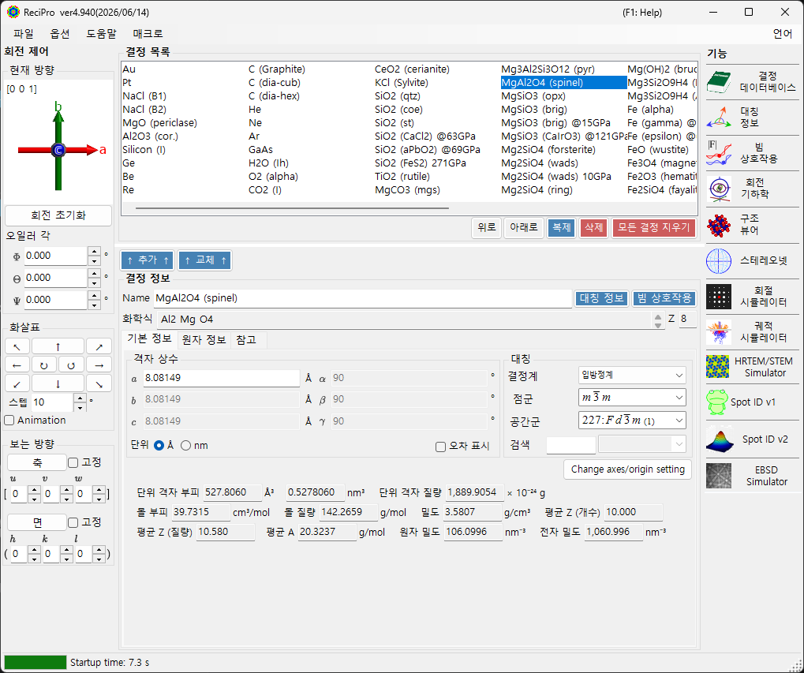

| 영역 | 위치 | 설명 |
|------|----------|-------------|
| **파일 메뉴** | 상단 | 파일 작업, 옵션, 도움말 |
| **회전 제어** | 왼쪽 | 결정 방향 보기/설정 |
| **결정 목록** | 중앙 상단 | 결정 선택 및 관리 |
| **결정 정보** | 중앙 하단 | 격자 상수, 대칭, 원자 편집 |
| **기능** | 오른쪽 | 시뮬레이션/분석 창 실행 |

---

## 키보드 & 마우스 단축키 {#keyboard-mouse-shortcuts}

메인 창은 여러 개의 **응용 프로그램 전역** 단축키를 설치합니다. 구조 뷰어, 스테레오넷, 회절 시뮬레이터, Spot ID v1 창이 포커스를 가지고 있는 동안에도 계속 동작합니다.

| 단축키 | 동작 |
|----------|--------|
| <kbd>F1</kbd> | 온라인 매뉴얼의 이 페이지 열기 |
| <kbd>CTRL</kbd>+<kbd>SHIFT</kbd> + 화살표 키 | 해당 방향으로 결정을 한 단계 회전 (두 개의 화살표를 함께 눌러 대각선) |
| ReciPro 시작 시 <kbd>CTRL</kbd> 누르고 있기 | OpenGL을 비활성화한 상태로 시작 (그래픽 문제 복구용. 이번 실행에만 적용되며 저장되지 않음) |
| 방향 위젯을 왼쪽 드래그 (왼쪽 하단, *현재 방위* 아래) | 결정 회전 |
| 방향 위젯을 오른쪽 더블 클릭 | 위젯 이미지를 클립보드에 복사 |
| 기능 버튼 한 번 클릭 | 해당 창 열기 / 닫기 (최소화된 창은 닫지 않고 원래 크기로 복원) |
| 기능 버튼 더블 클릭 | 창을 강제로 표시하고 맨 앞으로 가져오기 |
| 목록에서 결정을 오른쪽 클릭 | 컨텍스트 메뉴 (이름 바꾸기 / CIF로 내보내기 / 복제 / 삭제) |
| 정대축 지수 레이블(`[u v w]`, *현재 방위* 아래) 더블 클릭 | max-UVW 상자 표시 / 숨기기 |
| 창에 파일 끌어다 놓기 | 결정 목록 (`.xml`, `.out`; 교체할지 추가할지 묻습니다) 또는 결정 (`.cif`, `.amc`) 불러오기 <!-- 261105Cl 監査: .cdb2 はドロップで読めないので外した (FormMain.cs:FormMain_DragDrop) --> |
| <kbd>CTRL</kbd>+<kbd>SHIFT</kbd>+<kbd>ALT</kbd>+<kbd>C</kbd> | 활성 창에 대한 (실험적) GUI 캡처 도구 열기 |

→ 모든 창을 한눈에 보려면 **[21. 키보드 & 마우스 단축키](21-shortcuts.md)**를 참조하십시오.

---

## 기본 작업 흐름

ReciPro를 처음 사용하는 경우 다음 단계를 참조하십시오:

1. **결정 목록**에서 대상 결정을 선택합니다. CIF/AMC 파일을 사용하려면 **결정 정보**로 끌어다 놓으십시오.
2. 격자 상수나 원자 위치를 편집한 경우, 변경 사항이 결정 목록에 다시 기록되도록 **Add** 또는 **Replace**를 누르십시오.
3. **회전 제어**에서 정대축, 결정면, 오일러 각도 또는 마우스 드래그를 사용하여 결정 방향을 설정합니다.
4. **기능**에서 원하는 도구를 엽니다. 회절, HRTEM/STEM, EBSD 및 기타 계산 창은 현재 선택된 결정과 방향을 사용합니다.

---

## 파일 메뉴

### File

| 메뉴 항목 | 설명 |
|-----------|-------------|
| 결정 목록 불러오기 (현재 목록 교체) | 결정 목록 파일(`*.xml`, `*.out`)을 불러오고 현재 목록을 대체. 대화 상자에서 불러올 결정을 고를 수 있음 |
| 결정 목록 불러오기 (현재 목록에 추가) | 결정 목록 파일을 불러와 현재 목록에 추가 (같은 선택 대화 상자 사용) |
| 초기 결정 목록으로 재설정 | ReciPro에 기본 포함된 결정 목록 다시 불러오기 |
| CIF 또는 AMC 파일에서 결정 가져오기 | CIF / AMC 파일에서 결정 하나를 불러오기 |
| 결정 목록 저장 | 현재 결정 목록 저장 (대화 상자에서 저장할 결정을 고를 수 있음) |
| 선택한 결정을 CIF 파일로 내보내기 | 선택한 결정을 CIF 형식으로 저장 |
| 모든 결정 지우기 | 목록에서 모든 결정 제거 |
| 종료 | 응용 프로그램 닫기 |

### Options

| 메뉴 항목 | 설명 |
|-----------|-------------|
| 툴팁 표시 | 모든 창의 툴팁(컨트롤, 툴바·메뉴 항목, 표의 셀, 탭의 툴팁)을 표시하거나 숨깁니다. 이 설정은 다음 시작 시에도 유지됩니다 <!-- 261106Cl 作者の決定 C9 --> <!-- 261106Cl 作者の決定 A20 --> |
| 다크 모드 | 밝은 색상 테마와 어두운 색상 테마 간 전환 |
| 밀러-브라베 (hkil) 지수 사용 | 응용 프로그램 전체에서 삼방/육방 결정계에 4-지수 표기법 사용 |
| 이온 산란 인자 사용 | 동역학적 (블로흐파) 전자 계산(키쿠치 프로파일 포함)에서 각 원자에 지정된 이온에 대해 이온 전자 산란 인자 (Peng)를 사용. $g \neq 0$ 의 단극(monopole) 항은 탄성 계수 $U_g$ 에만 더해짐 (TDS 흡수와 키쿠치 TDS 원천은 유한한 이온 부분을 사용). 체크를 해제하면 중성 원자 인자를 사용. 단위 격자가 전기적으로 중성이 아니면 ($\Sigma q \neq 0$) 단극 항을 버리고 유한한 (차폐 이온) 부분만 사용하며, 이 옵션을 켤 때 안내가 표시됨 |
| MKL 라이브러리 다운로드 | Intel MKL 네이티브 라이브러리(약 55 MB)를 다운로드. 설치 후에는 큰 계산에 자동으로 사용됨 |
| Accept external macro commands (named pipe) | 명명된 파이프 `ReciPro.Macro.v1` 에서 대기하며 외부 프로그램이 보낸 매크로를 실행 — [외부 제어](20-macro/3-external-control.md) 참조 |
| 종료 시 레지스트리 설정 초기화 (재시작 후 적용) | 다음 재시작 시 설정 초기화 |
| Crystallography.Native 라이브러리 사용 안 함 (재시작 필요) | 네이티브(C++) 라이브러리를 불러오지 못할 경우 관리 코드로 대체 |
| 모든 OpenGL 렌더링 사용 안 함 (재시작 필요) | 구형 GPU / 원격 데스크톱용 |
| OpenGL 텍스트 렌더링 사용 안 함 (재시작 필요) | 일부 GPU의 텍스트 렌더링 문제에 대한 임시 해결책 |
| GUI 구성 요소 캡처... | GUI 스크린샷 저장용 개발자 도구 |
| 분말 회절 기능 (개발 중) | 다결정(분말) 회절 창 활성화 |

### Help

| 메뉴 항목 | 설명 |
|-----------|-------------|
| 업데이트 확인 | ReciPro의 새 버전이 있는지 확인하고 설치 |
| 힌트 | 사용 힌트 표시 (사용 중단됨) |
| 버전 기록 | 버전 기록 대화 상자 열기 |
| 라이선스 | MIT 라이선스 표시 |
| GitHub 저장소 | 브라우저에서 ReciPro 저장소 열기 |
| 버그, 요청 또는 의견 보고 | GitHub Issues 페이지 열기 |
| 도움말 (웹) | UI 언어와 일치하는 페이지로 GitHub Pages의 온라인 매뉴얼 열기 |

UI 언어는 별도의 **언어** 메뉴에서 전환합니다 (재시작 필요).

### Language

UI 언어를 전환합니다. English, 日本語, Deutsch, Français, Español, Português, Italiano, Русский, 简体中文, 繁體中文, 한국어의 11개 언어를 지원하며, 메뉴에는 각 언어가 그 언어의 문자로 표시됩니다. 변경 사항은 ReciPro를 재시작한 후 적용됩니다. 온라인 매뉴얼도 같은 설정을 따르므로, <kbd>F1</kbd> 키와 **도움말 ▸ 도움말 (웹)** 은 선택한 언어의 페이지를 엽니다.

### Macro

**Editor** 는 [매크로](20-macro/index.md) 창을 열어 Python 스타일 스크립트로 ReciPro 작업을 자동화합니다. 그 창에 등록된 매크로는 **Editor** 아래에도 나열되며, 선택하면 바로 실행됩니다. 반복되는 작업 흐름은 [내장 함수](20-macro/1-built-in-functions.md) 및 [매크로 예제](20-macro/2-examples.md)를 참조하십시오.

---

## 결정 방향 제어

결정의 회전 상태는 회절 시뮬레이터, 구조 뷰어, 스테레오넷, HRTEM/STEM 시뮬레이터, EBSD 시뮬레이터 및 기타 창에서 공유됩니다. 이는 단순한 보기 설정이 아니라 — 입사빔 방향과 시뮬레이션에 사용되는 결정 좌표 관계를 정의합니다. 짧은 비디오 튜토리얼은 [사용법](appendix/a0-how-to-use.md) 페이지에서 볼 수 있습니다.

### 현재 방향

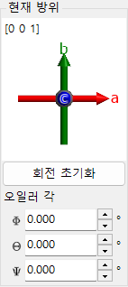

결정 방향을 표시합니다. 드래그하여 회전합니다. 축: 빨강 = *a*, 초록 = *b*, 파랑 = *c*.

### 회전 초기화
초기 상태로 재설정: *c*-축이 화면에 수직, *b*-축이 위쪽.

### 정대축
화면 법선에 가장 가까운 정대축 [*uvw*]를 표시합니다. 후보는 $|u|+|v|+|w| \le$ (max-UVW 상자의 한계값, 1–100, 기본값 30)을 만족하는 기약 지수 (gcd = 1) 입니다. 지수 레이블을 더블 클릭하면 이 상자를 표시하거나 숨길 수 있습니다.

### 오일러 각도 (Z-X-Z)
**Z–X–Z** 오일러 각도로 결정 방향을 설정합니다:

- \(\Phi\): Z-축 회전
- \(\Theta\): X-축 회전
- \(\Psi\): Z-축 회전

회전은 \(\Psi \to \Theta \to \Phi\) 순서로 적용됩니다. 자세한 내용은 [회전 기하학](4-rotation-geometry.md) 및 [부록 A1. 좌표계](appendix/a1-coordinate-system/1-orientation.md)를 참조하십시오.

### 화살표

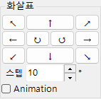

각도 스텝만큼 회전합니다 (기본값 10°). ↺ / ↻ 는 화면 법선을 축으로 회전합니다. 연속 회전은 Animation을 체크하십시오. 이때 스텝은 °/s 단위의 회전 속도가 됩니다.

### 보는 방향

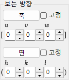

정대축 [*uvw*] 또는 결정면 (*hkl*)을 화면에 수직으로 정렬합니다.

- **고정**: 체크하면, 이후의 회전 (화살표, 마우스 드래그)이 모두 지정된 정대축 또는 면 법선을 축으로 수행되어 그 방향이 고정됩니다. 두 **고정** 상자 중 하나만 켤 수 있으며, 지수가 0 0 0 인 동안에는 체크할 수 없습니다.
- **축**: 입력한 정대축 \([uvw]\)을 화면에 수직으로 배치합니다. **면**도 설정되어 있고 그 축이 면 안에 있으면 ($uh+vk+wl=0$) 면 법선이 화면에서 위쪽을 향하며, 그렇지 않으면 위쪽 방향이 자동으로 선택됩니다.
- **면**: 입력한 결정면 \((hkl)\)의 법선을 화면에 수직으로 배치합니다. **축**도 설정되어 있고 그 축이 면 안에 있으면 ($uh+vk+wl=0$) 그 축이 화면에서 위쪽을 향하며, 그렇지 않으면 위쪽 방향이 자동으로 선택됩니다.

### 방향을 설정하는 기본 방법

| 방법 | 사용 시기 | 위치 |
|--------|----------|-------|
| 마우스 드래그 | 결정 축을 보면서 자유롭게 회전하고 싶을 때. | **현재 방향** 패널 |
| 화살표 버튼 | 작고 반복 가능한 회전을 원할 때. | **화살표** 패널 |
| 정대축 | \([001]\) 또는 \([110]\)과 같은 관찰 방향을 알고 있을 때. | **보는 방향** / 정대축 입력 |
| 면 법선 | 결정면 \((hkl)\)을 화면에 수직으로 두고 싶을 때. | **보는 방향** / 면 입력 |
| 오일러 각도 | 재현 가능한 수치적 방향이 필요할 때. | **오일러 각도 (Z-X-Z)** |

회전 행렬과 좌표 규약은 [회전 기하학](4-rotation-geometry.md) 및 [부록 A1. 좌표계](appendix/a1-coordinate-system/1-orientation.md)를 참조하십시오.

---

## 결정 목록

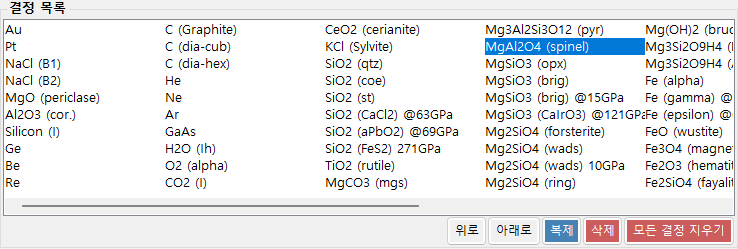

기본 설치에는 66개의 결정이 있습니다. 선택하여 세부 정보를 보고 계산용으로 설정합니다. 결정 목록에서 **결정을 오른쪽 클릭**하면 컨텍스트 메뉴가 나타납니다: *이름 바꾸기*, *CIF로 내보내기*, *복제*, *삭제*.

| 버튼 | 동작 |
|--------|--------|
| 위로 / 아래로 | 순서 변경 |
| 복제 | 선택한 결정 복사 |
| 삭제 / 모든 결정 지우기 | 선택한 결정 / 모든 결정 제거 |
| 추가 / 교체 | 목록에 추가하거나 선택한 항목 대체 |

---

## 결정 정보

격자 상수, 대칭, 원자를 편집하고; 구조를 불러오려면 CIF/AMC 파일을 끌어다 놓으십시오. 이 컨트롤은 ReciPro, PDIndexer, CSManager에서 공유되지만, 표시되는 탭과 기능은 응용 프로그램마다 다릅니다. ReciPro는 **기본 정보**, **원자 정보**, **참고** 탭을 표시합니다 (EOS, Elasticity 및 기타 탭은 다른 응용 프로그램용이며 ReciPro에서는 표시되지 않습니다).

> **중요**: 변경 사항을 저장하려면 **추가** 또는 **교체**를 누르십시오.

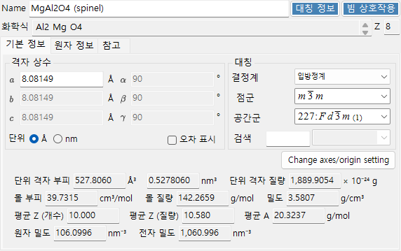

패널 상단에는 항상 **Name** (결정 이름), **화학식** (원자 목록에서 계산), **Z** (단위 격자당 화학식 단위 수), **색** (결정의 표시 색. 3D 구조 뷰와 회절 프로파일 곡선에 사용)이 표시됩니다. **대칭 정보** · **빔 상호작용** 버튼은 각각 [대칭 정보](2-symmetry-information.md) · [빔 상호작용](3-beam-interaction.md) 창을 엽니다. 질량%, 원자% 및 산화물로의 환산은 오른쪽 클릭 메뉴의 [화학 조성 상세](#chemical-composition)에서 볼 수 있습니다.

### 기본 정보 탭 {#basic-info-tab}

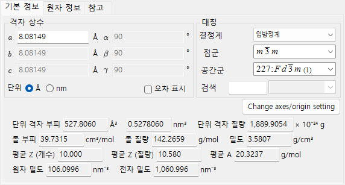

격자 상수, 대칭 및 그로부터 유도된 양.

| 항목 | 설명 |
|------|------|
| 격자 상수 | 격자 상수 a, b, c (**단위**: Å = 10⁻¹⁰ m 또는 nm. 단위는 다음 시작 시에도 유지됩니다) 및 α, β, γ. 대칭을 선택하면 자동으로 제한됩니다 (예: 입방의 경우 a=b=c, α=β=γ=90°). |
| 대칭 | **결정계** · **점군** · **공간군**을 선택합니다. **검색** 상자에 입력하여 일치하는 후보를 나열합니다 (대소문자 구분). |
| 단위 격자 부피 / 단위 격자 질량 | 단위 격자의 부피와 질량. 부피는 **단위** 선택에 따라 ų / nm³로, 질량은 10⁻²⁴ g 단위로 표시됩니다. |
| 몰 부피 / 몰 질량 / 밀도 | 몰 부피 (cm³/mol, 화학식 단위당), 몰 질량 (g/mol), 밀도 (g/cm³). **원자가 입력된 경우에만** 표시됩니다. |
| 평균 Z (개수) / 평균 Z (질량) / 평균 A | 개수 평균 · 질량 평균 원자 번호와 원자당 평균 원자량 (g/mol). 점유율이 반영됩니다. |
| 오차 표시 | 격자 상수의 오차 (±) 입력란을 표시합니다. |
| Change axes/origin setting | 컨텍스트 메뉴의 **축/원점 설정 변경** 과 같습니다. 같은 공간군의 다른 축/원점 설정으로 변환합니다. |
| 원자 밀도 / 전자 밀도 | 단위 격자 부피당 원자 수와 전자 수. **단위** 선택에 따라 Å⁻³ / nm⁻³로 표시됩니다. |

### 원자 정보 탭 {#atom-tab}

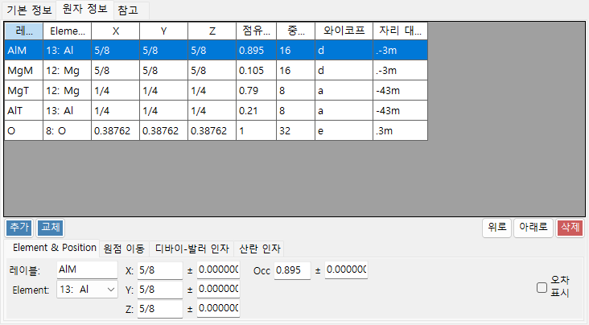

각 원자의 종, 위치, 온도 인자, 산란 인자를 설정합니다. **추가**, **교체** (선택한 행 대체), **위로/아래로** (순서 변경), **삭제**로 원자 목록을 편집합니다. 원자 목록에는 각 자리의 다중도 (**다중도**), 와이코프 문자 (**와이코프**), 자리 대칭 (**자리 대칭**)도 표시됩니다. 각 원자는 다음을 가집니다:

| 항목 | 설명 |
|------|------|
| Label | 원자 레이블 (임의의 식별자). |
| Element | 원소 (이온 원자가 포함). |
| X, Y, Z | 분율 좌표 (0–1). 1/2 또는 2/3과 같은 분수를 입력할 수 있습니다. |
| Occ | 점유율 (0–1). |

원자 행을 마우스 오른쪽 버튼으로 클릭하고 **등가 원자 위치 표시**를 선택하면 공간군의 대칭 연산으로 생성되는 모든 위치를 나열하는 작은 창이 열립니다. 창의 **Copy** 버튼은 목록을 탭으로 구분된 텍스트로 복사합니다 (예: 스프레드시트에 붙여넣기 용도).

**원점 이동**: 모든 원자 좌표의 원점을 이동합니다. **+** / **−** 로 부호를 고른 다음 프리셋 벡터 — (⅛ ⅛ ⅛), (¼ ¼ ¼), (0 ¼ ⅛), (¼ 0 ¼), (0 ¼ ¼), (¼ ¼ 0), (¼ −¼ 0), (¼ −¼ ¼), (0 ¼ −⅛) — 중 하나를 누르거나, 임의의 양에는 **Apply custom shift**를 사용하십시오.

**원자 변위 (B)** (디바이-월러 인자 / 온도 인자):

| 항목 | 설명 |
|------|------|
| Notation | U 또는 B 표기법 사용. 표기를 바꾸면 표시된 값이 환산됩니다 ($B = 8\pi^2 U$). |
| Model | 등방성 또는 비등방성. |
| U##, β## | 비등방성의 경우 각 성분을 입력: U 표기는 $U_{ij}$ (Ų), B 표기는 무차원 $\beta_{ij} = 2\pi^2 a^*_i a^*_j U_{ij}$ (AMCSD 파일의 B(i,j)와 같음). |

**Scattering factor**: 각 원자에 사용되는 산란 인자를 선택합니다.

| 방사선 | 출처 / 설정 |
|-----------|------|
| X-ray | 이온 원자가를 포함한 산란 인자 (International Tables for Crystallography, Vol. C). |
| Electron | 전자 산란 인자 — 중성 원자는 Peng, Ren, Dudarev & Whelan (1996), *Acta Cryst.* **A52**, 257–276; 이온은 Peng (1998), *Acta Cryst.* **A54**, 481–485. |
| Neutron | 중성자 산란 길이. **Natural isotope abundance** 또는 **Custom isotope abundance** (임의의 동위원소 조성)을 선택합니다. |

### 참고 탭 {#reference-tab}

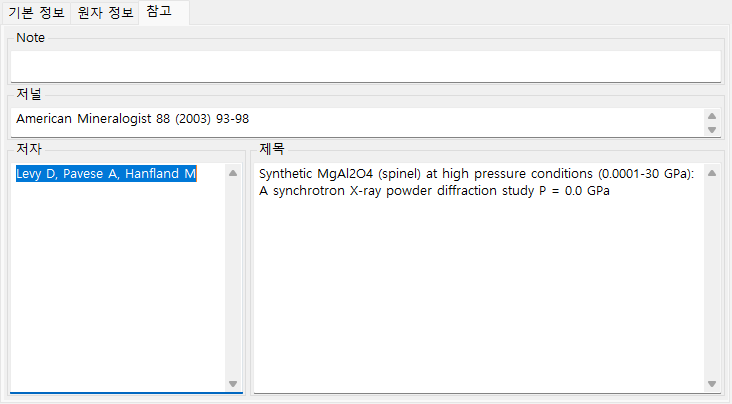

구조의 출처를 기록합니다: **Note**, **Authors**, **Journal**, **Title**.

### 컨텍스트 메뉴 (오른쪽 클릭)

컨트롤의 빈 영역을 오른쪽 클릭하면 다음 주요 작업이 나타납니다:

| 메뉴 항목 | 동작 |
|-----------|------|
| 화학 조성 상세 | [화학 조성 상세](#chemical-composition) 창을 엽니다 (질량%, 원자%, 정규화한 원자 수, 산화물 등으로 환산). |
| 빔 상호작용 | [빔 상호작용](3-beam-interaction.md) 창을 엽니다. |
| 대칭 정보 | [대칭 정보](2-symmetry-information.md) 창을 엽니다. |
| CIF 또는 AMC에서 가져오기... | CIF / AMC 파일에서 결정을 불러옵니다. |
| CIF로 내보내기 | 현재 결정을 CIF로 내보냅니다. |
| 격자 상수 되돌리기 | 셀 상수를 처음 불러온 값으로 복원합니다. |
| P1 공간군으로 변환 | 구조를 공간군 P1로 확장합니다. |
| 초구조로 변환 | a, b, c의 정수 배수를 갖는 초격자로 변환합니다 (크기 대화 상자). |
| 축/원점 설정 변경 | 등가 공간군 (다른 축 설정)으로 변환합니다. |

#### 화학 조성 상세 {#chemical-composition}

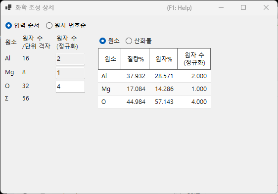

현재 결정의 화학 조성을 원자 목록에서 계산하여 표시합니다 (각 원소의 원자 수는 해당 자리들의 다중도 × 점유율의 합). 창은 메인 창에서 선택한 결정을 따라 갱신됩니다.

- 오른쪽 표는 원소별 **질량%**, **원자%**, **원자 수 (정규화)** 를 보여 주고, 왼쪽 표는 단위 격자당 원자 수를 보여 줍니다. 왼쪽 표의 정규화 열에서 칸을 클릭하면 그 원소가 정규화 기준이 되며, 원자 수를 입력할 수 있습니다 (예: O = 24). 기본 기준은 O (없으면 첫 번째 원소)이며, 정규화 열은 화학식 그대로가 됩니다.
- **산화물**, **할로겐화물**, **황화물** (결정에 적용 가능한 것만 표시)은 각 원소의 **원자가** 를 사용해 조성을 성분으로 형식적으로 환산합니다. 원자가는 편집할 수 있습니다 (8/3 같은 분수도 가능). 입력하지 않으면 Fe 는 2, 다른 원소는 X 선 산란 인자에 선택한 이온의 원자가, 없으면 흔한 산화수를 사용합니다. **Σ=0** 은 전체 전하가 0 이 되는 원자가를 넣고, **기본값 복원** 은 입력한 원자가를 지웁니다. 입력한 원자가는 결정에 기록되며 XML 결정 목록에 함께 저장됩니다.
- **입력 순서** / **원자 번호순** 으로 원소의 순서를 바꿉니다.

---

## 기능 패널 {#functions}

오른쪽의 세로 버튼 막대는 아래에 나열된 분석 및 시뮬레이션 창을 실행합니다.

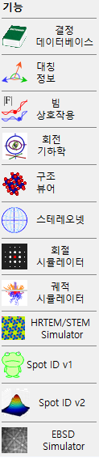

| 버튼 | 설명 | 세부 정보 |
|--------|-------------|---------|
| 결정 데이터베이스 | 번들 / 온라인 데이터베이스에서 결정 검색 및 가져오기 | [1. 결정 데이터베이스](1-crystal-database.md) |
| 대칭 정보 | 공간군 정보 및 *International Tables* Vol. A 대칭 도표 | [2. 대칭 정보](2-symmetry-information.md) |
| 빔 상호작용 | 빔-결정 상호작용: 반사, 감쇠, 산란 인자, 형광 | [3. 빔 상호작용](3-beam-interaction.md) |
| 회전 기하학 | 3D 회전 행렬 / 고니오미터 각도 | [4. 회전 기하학](4-rotation-geometry.md) |
| 구조 뷰어 | 3D 결정 구조 | [5. 구조 뷰어](5-structure-viewer.md) |
| 스테레오넷 | 입체 투영 | [6. 스테레오넷](6-stereonet.md) |
| 회절 시뮬레이터 | 단결정 X선 / 전자 회절 | [7. 회절 시뮬레이터](7-diffraction-simulator/index.md) |
| 궤적 시뮬레이터 | 몬테카를로 전자 궤적 시뮬레이션 | [8. 전자 궤적](8-electron-trajectory.md) |
| HRTEM/STEM 시뮬레이터 | HRTEM / STEM 이미지 시뮬레이션 | [9. HRTEM/STEM 시뮬레이터](9-hrtem-stem-simulator/index.md) |
| Spot ID v1 | SAED 패턴 지수화 (이전 명칭 "TEM ID") | [10. Spot ID v1](10-spot-id.md) |
| Spot ID v2 | 스폿 검출 & 지수화 | [11. Spot ID v2](11-spot-id-v2.md) |
| EBSD 시뮬레이터 | EBSD 패턴 시뮬레이션 | [12. EBSD 시뮬레이션](12-ebsd-simulation.md) |
| 분말 회절 | 다결정(분말) 회절 — **옵션 ▸ 분말 회절 기능 (개발 중)**으로 활성화 | - |

---

## 참고

- [결정 데이터베이스](1-crystal-database.md)
- [회전 기하학](4-rotation-geometry.md)
- [구조 뷰어](5-structure-viewer.md)
- [회절 시뮬레이터](7-diffraction-simulator/index.md)
- [키보드 & 마우스 단축키](21-shortcuts.md)
- [기본 좌표계 & 결정 방향](appendix/a1-coordinate-system/1-orientation.md)
