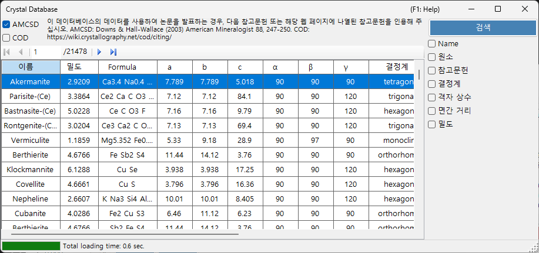
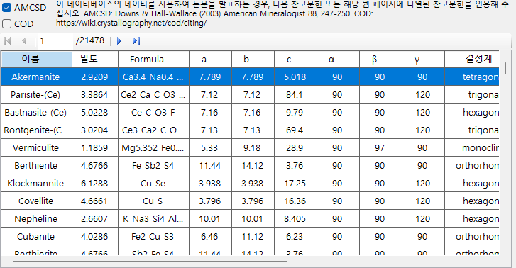
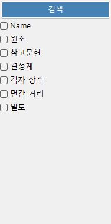
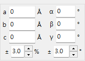

# 결정 데이터베이스

**결정 데이터베이스**는 **AMCSD** 및 **COD** 확인란으로 선택할 수 있는 두 가지 출처에서 결정 구조를 검색하고 가져오는 기능을 제공합니다.

- **AMCSD** : 기본 포함된 [American Mineralogist Crystal Structure Database](https://www.rruff.net/) (20,000개 이상의 구조).
- **COD** : [Crystallography Open Database](https://www.crystallography.net/cod/). 파일이 크기 때문에 설치 프로그램에는 포함되어 있지 않습니다. 데이터베이스 파일은 처음 사용할 때 자동으로 다운로드됩니다. 서버에서 파일이 갱신되면 다시 다운로드하라는 메시지가 표시됩니다.

이 데이터베이스를 사용할 때는 다음 참고 문헌을 인용해 주십시오.

**AMCSD** 사용 시:

> Downs, R.T. and Hall-Wallace, M. (2003) The American Mineralogist Crystal Structure Database. *American Mineralogist* **88**, 247-250.

**COD** 사용 시:

> Gražulis, S. et al. (2009) Crystallography Open Database – an open-access collection of crystal structures. *Journal of Applied Crystallography* **42**, 726-729.
>
> Gražulis, S. et al. (2012) Crystallography Open Database (COD): an open-access collection of crystal structures and platform for world-wide collaboration. *Nucleic Acids Research* **40**, D420-D427.

---

## 키보드 & 마우스 단축키

이 창에는 보조 키 조합이 없으며, 일반 클릭으로 조작합니다. 명확하지 않은 유일한 입력은 다음과 같습니다.

| 단축키 | 동작 |
|----------|--------|
| <kbd>F1</kbd> | 온라인 매뉴얼의 이 페이지를 엽니다 |
| 임의의 검색 필드에서 <kbd>ENTER</kbd> | 데이터베이스 검색을 실행합니다 (**검색** 버튼과 동일) |
| 결과 표에서 행을 클릭 | 해당 결정을 메인 창에 불러옵니다 |
| **주기율표** 팝업에서 원소를 클릭 | 해당 필터를 순환합니다: *포함할 수도 있음* → *반드시 포함* → *반드시 제외* |

→ 모든 창을 한눈에 보려면 **[21. 키보드 & 마우스 단축키](21-shortcuts.md)**를 참조하십시오.

---

## 표

검색 조건과 일치하는 결정을 표시합니다. 결정을 선택하면 메인 창의 결정 정보로 전송됩니다. **추가** 또는 **교체**를 눌러 결정 목록에 추가합니다.

---

## 검색 옵션

아래에 검색 조건을 입력하고 **검색** 버튼 또는 **Enter** 키를 누릅니다.

| 조건 | 설명 |
|-----------|-------------|
| **Name** | 결정 이름 |
| **원소** | 주기율표 선택기 (포함 가능/필수 포함/포함 불가) |
| **참고문헌** | 제목, 저널, 저자 |
| **결정계** | 결정계 선택 |
| **격자 상수** | 격자 상수와 오차 |
| **면간 거리** | 강한 반사의 d 값과 오차 |
| **밀도** | 밀도와 오차 |

### Name

결정 이름에 대한 자유 텍스트 일치. 부분 일치가 허용되며 대소문자는 구분하지 않습니다. 확인란이 선택된 조건만 적용되며, 여러 조건은 AND로 결합됩니다.

### 원소 {#element}

**주기율표** 버튼을 눌러 원소 선택기를 엽니다. 각 원소 버튼은 세 가지 상태를 순환합니다.

- **포함할 수도 있음** (기본값 — 노란색)
- **반드시 포함** (파란색)
- **반드시 제외** (빨강)

결정은 *반드시 포함* 원소를 모두 포함하고 *반드시 제외* 원소는 하나도 포함하지 않아야 합니다. **원소** 조건이 켜져 있는 동안에는 원자 데이터가 없는 항목이 제외됩니다.

창 상단의 세 버튼은 한 번의 클릭으로 모든 원소를 세 가지 상태 중 하나로 초기화합니다.

### 참고문헌

출판 메타데이터에 대한 자유 텍스트 일치(부분 일치, 대소문자 무시): 논문 제목, 저널 이름, 저자 목록.

### 결정계

검색을 특정 결정계로 제한합니다 (cubic, tetragonal, orthorhombic, hexagonal, trigonal, monoclinic, triclinic). 첫 번째 항목인 *Unknown*은 제한을 두지 않습니다.

### 격자 상수 검색

목표 격자 상수 *a*, *b*, *c* (Å)와 *α*, *β*, *γ* (°), 그리고 허용 오차를 입력합니다. 허용 오차는 *a*, *b*, *c*에 공통인 상대 허용 오차(±%) 하나와 각도에 공통인 절대 허용 오차(±°) 하나입니다. 값이 0이면 해당 파라미터는 무시됩니다.

### 면간 거리

*d* 값(면간 거리)을 최대 세 개까지 입력하고(Å, 사용할 값마다 체크), 각각에 상대 허용 오차(±%)를 지정합니다. 입력한 모든 값이 데이터베이스에 저장된 그 결정의 가장 강한 반사(λ = 1.54 Å에서의 X선 분말 강도 순으로 최대 16개) 중 하나와 일치하면 그 결정이 검색됩니다. **산란 인자 무시**를 선택하면 대신 단위 격자로부터 계산되는 기하학적으로 가능한 모든 *d* 값(소광 반사 포함)과 비교합니다. 실험에서 회절 피크 위치만 알고 있을 때 유용합니다.

### 밀도

상대 허용 오차(±%) 범위 내에서 질량 밀도(g/cm³)로 필터링합니다.

---

## 함께 보기

- [메인 창](0-main-window.md)
- [대칭 정보](2-symmetry-information.md)
- [빔 상호작용](3-beam-interaction.md)
- [구조 뷰어](5-structure-viewer.md)
