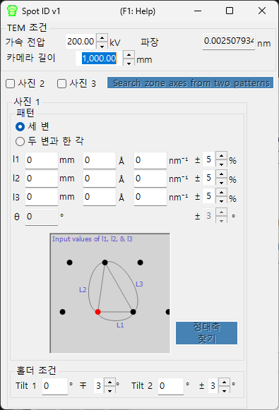

# Spot ID v1

**Spot ID v1** (이전의 **TEM ID**)은 1~3장의 회절 패턴에 대해 수치로 입력한 스폿 기하학으로부터 후보 정대축을 검색합니다. 이미지에서의 스폿 검출, 피팅, 지수화는 [Spot ID v2](11-spot-id-v2.md) 에서 수행합니다.

---

## 키보드 및 마우스 단축키

Spot ID v1 은 스폿 기하학을 **수치 입력**으로 받으며(이전의 *TEM ID* 작업 흐름), 이미지 뷰가 없습니다(이미지 불러오기, 마우스 확대/축소, 스폿 검출 및 수동 스폿 선택은 [Spot ID v2](11-spot-id-v2.md) 에 속합니다). 유일한 단축키는 결과 창에 있습니다.

| 단축키 | 동작 |
|----------|--------|
| <kbd>F1</kbd> | 온라인 매뉴얼의 이 페이지를 엽니다 |
| 결과 목록의 행을 더블 클릭 | 해당 결정을 선택하고 일치하는 정대축으로 회전합니다 |

→ 모든 창을 한눈에 보려면 **[21. 키보드 및 마우스 단축키](21-shortcuts.md)** 를 참조하십시오.

---

## 스폿 기하학으로부터의 정대축 검색 (이전의 TEM ID)

불러올 이미지가 없는 경우에도, 제한시야 전자 회절(SAED) 패턴의 기하학을 직접 입력하여 후보 정대축을 검색할 수 있습니다. TEM 관찰 조건과 스폿 기하학을 입력한 다음 사진의 **정대축 찾기** (여러 사진을 함께 쓰려면 **두 패턴에서 정대축 찾기** / **세 패턴에서 정대축 찾기**)를 눌러 후보 결정 방위를 찾습니다.

### TEM 조건

**가속 전압** (kV, 기본값 200)과 **카메라 길이** (mm, 기본값 1000)를 입력합니다. **파장** (nm)은 전압으로부터 계산되어 읽기 전용으로 표시됩니다.

### 사진 1, 2, 3

회절 스폿의 기하학을 입력합니다.

- 검출기 상의 스폿 간 거리를 입력하려면 **mm** 상자를 사용합니다.
- *d* 값을 알고 있다면 **Å** 또는 **nm⁻¹** 단위로 입력합니다.

**세 변** 모드 : direct spot 을 한 꼭짓점으로 하는 삼각형의 세 변 길이를 입력합니다.

**두 변과 한 각** 모드 : 두 변(direct spot 포함)의 길이와 그 사이의 각도를 입력합니다.

- 허용 오차(**±** 상자) : 각 길이에는 % 단위의 허용 오차(0–50, 기본값 5)가, θ 에는 도 단위의 허용 오차(0–30, 기본값 3)가 있습니다. 입력하지 않은 값(세 변 모드에서는 θ, 두 변 모드에서는 l3)은 계산되어 표시되며, 그 결과 패턴의 스케치가 입력란 옆에 그려집니다.
- **홀더 조건** : 사진을 찍었을 때 고니오미터 홀더의 **Tilt 1** / **Tilt 2** (°)와 각각의 허용 오차(0–10°, 기본값 3°). 사진 간 홀더 설정 사이의 각도가 계산되어 표시됩니다.
- **사진 2** / **사진 3** : 두 번째와 세 번째 사진을 사용합니다. 사진 사이의 확인란은 두 사진의 l1 (또는 l2)을 같은 반사로 취급하여 그 길이를 복사합니다.
- **정대축 찾기**는 사진 한 장을 검색하고, **두 패턴에서 정대축 찾기** / **세 패턴에서 정대축 찾기**는 사진들과 그 사이의 홀더 경사각에 부합하는 조합을 검색합니다. 사진 3은 **사진 3**이 체크되어 있고 그 값이 모두 입력된 경우에만 사용되며, 그렇지 않으면 사진 두 장을 사용합니다. 사진 한 장의 결과 표(**정대축 찾기**)에는 g1, d1, g2, d2가 항상 표시되고, 세 변 모드에서는 g3과 d3이, 두 변과 한 각 모드에서는 θ가 추가로 표시됩니다. <!-- 261105Cl 監査: buttonSearchAll_Click (afd65e0)、FormSpotIDv1Results.SetDataSet (46d91db) --> 검색은 메인 창 목록에서 선택한 모든 결정에 대해 수행됩니다(Spot ID v1 이 열려 있는 동안에는 다중 선택이 가능합니다). 후보가 1000개를 넘으면 아무것도 나열하지 않고 조건을 좁히도록 요청하며, 그렇지 않으면 결과 창이 열립니다. 행을 더블 클릭하면 그 결정을 선택하고 해당 방위로 회전합니다. 각 후보 정대축의 부호는 교과서의 관례인 **g**₁ × **g**₂ 를 따르므로, 2026-11 이전 버전과 비교하면 부호가 반대입니다 (방위는 같습니다). <!-- 261106Cl 作者の決定 B16 -->

---

## 함께 보기

- [Spot ID v2](11-spot-id-v2.md)
- [회절 시뮬레이터](7-diffraction-simulator/index.md)
- [메인 창](0-main-window.md)
- [결정 데이터베이스](1-crystal-database.md)
- [EBSD 시뮬레이션](12-ebsd-simulation.md)
