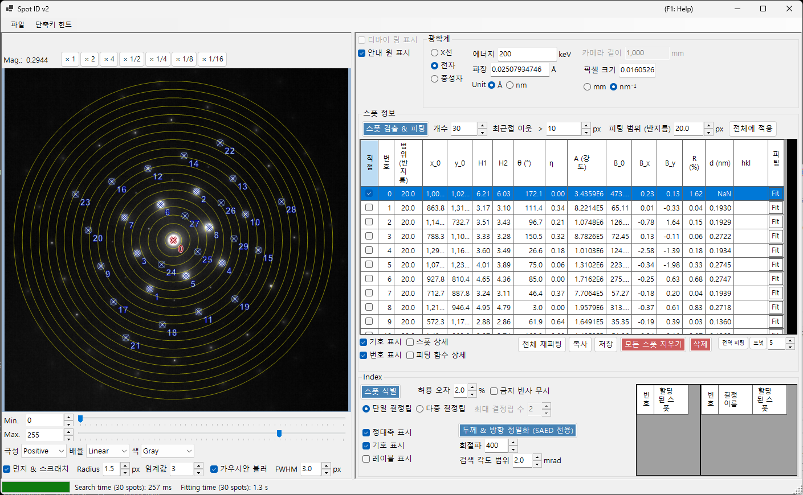
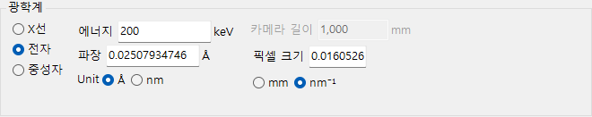
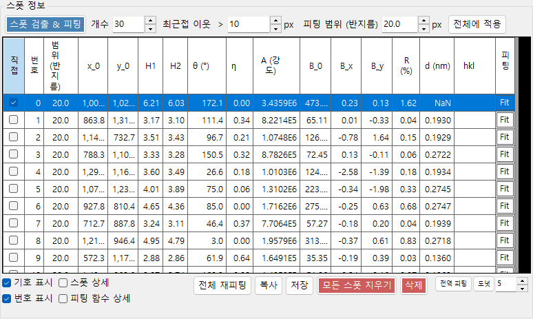
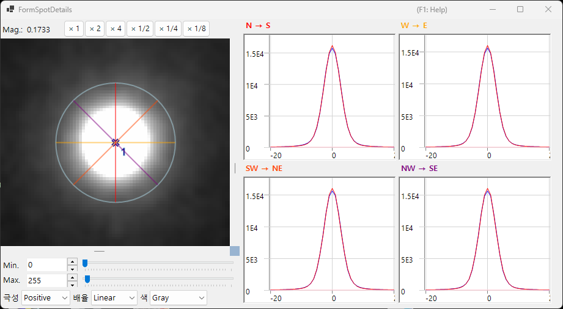
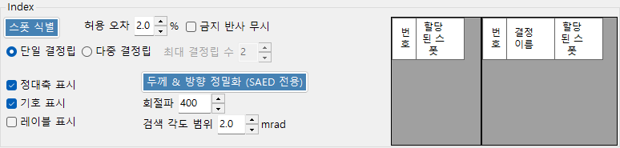

# Spot ID v2

**Spot ID v2** 는 실험 회절 이미지에서 회절 스폿을 검출하고 피팅하여 지수화합니다. 반면 [Spot ID v1](10-spot-id.md) (이전의 TEM ID)은 스폿 기하학을 수치 입력으로 받습니다.

---

## 키보드 & 마우스 단축키

스폿 목록은 불러온 이미지 위에서 직접 작성합니다. 이미지 창은 이동/확대·축소에 ReciPro의 표준 [이미지 보기 탐색](21-shortcuts.md)을 사용하며, 스폿 편집에는 아래의 조합이 추가됩니다.

| 단축키 | 동작 |
|----------|--------|
| <kbd>F1</kbd> | 온라인 매뉴얼의 이 페이지를 엽니다 |
| 이미지를 왼쪽 더블 클릭 | 해당 지점에 스폿을 추가합니다 (피크 피팅) |
| <kbd>CTRL</kbd> + 왼쪽 더블 클릭 | 스폿을 추가하고 직접빔(000)으로 표시합니다 |
| 스폿을 왼쪽 클릭 | 가장 가까운 스폿을 선택합니다 |
| <kbd>CTRL</kbd> + 스폿을 오른쪽 클릭 | 가장 가까운 스폿을 삭제합니다 |
| <kbd>CTRL</kbd> + 화살표 키 | 선택한 스폿을 1픽셀씩 미세 이동합니다 |
| 왼쪽 드래그 / 가운데 드래그 (빈 영역) | 이미지를 이동합니다 |
| 마우스 휠 | 커서 위치에서 확대/축소합니다 |
| 오른쪽 드래그로 상자 그리기 | 선택한 영역으로 확대합니다 |
| 오른쪽 더블 클릭 | 축소합니다 |
| 스폿의 행 머리글을 더블 클릭 (표) | 해당 스폿으로 확대합니다 (×2) |

→ 모든 창을 한눈에 보려면 **[21. 키보드 & 마우스 단축키](21-shortcuts.md)** 를 참조하세요.

---

## 파일 메뉴

회절 이미지를 엽니다. **저장** / **복사**는 표시된 이미지를 메타파일 (EMF) 또는 이미지 (PNG)로 저장·복사합니다. 이미지는 끌어서 놓기로도 불러올 수 있습니다. nm⁻¹ 단위로 보정된 Gatan DM3/DM4 파일의 경우, 방사선이 전자로 설정되고 가속 전압과 픽셀 크기(nm⁻¹)를 파일에서 읽습니다(이 경우 카메라 길이는 필요 없습니다).

**저장 ▸ Candidate list (CSV)...** 는 지수 결정으로 얻은 방위 후보를 내보내고, **복사 ▸ Candidate list (TSV)** 는 같은 표를 클립보드에 복사합니다. 후보 × 결정립마다 한 행씩, 순위·결정립 번호·결정 이름·ZXZ 오일러 각(°)·회전 행렬의 아홉 성분·평균 제곱 잔차(nm⁻²)·할당된 스폿 수·스폿 → (hkl) 대응이 나열됩니다. CSV의 소수점은 항상 마침표이며, TSV는 스프레드시트에 그대로 붙여 넣을 수 있습니다.

---

## 광학계

### 입사선원

방사선 종류(X선 / 전자 / 중성자)를 선택하고 에너지 또는 파장을 설정합니다.

### 카메라 길이 / 픽셀 크기

카메라 길이(mm)와 검출기 픽셀 크기(mm 또는 nm⁻¹). nm⁻¹ 단위로 보정된 Gatan DM 파일을 불러오면 픽셀 크기(nm⁻¹)를 파일 헤더에서 읽으며, 카메라 길이는 사용되지 않습니다 (단위가 nm⁻¹인 동안에는 카메라 길이 상자가 비활성화됩니다). 파장, 카메라 길이 또는 픽셀 크기의 단위를 바꾸면 스폿 위치(픽셀)는 그대로 두고, 그 *d* 값을 새 보정으로 다시 계산합니다.

창 위치와 보정 값(선원, 에너지, 카메라 길이, 픽셀 크기의 단위와 값)은 다음 시작 시에도 유지됩니다. 보정 정보를 담은 이미지 파일을 열면 그 값으로 덮어씁니다. <!-- 261105Cl 監査: NumericBoxPixelSize_ValueChanged (8860d40)、FormMain.cs の保存・復元 (dc42de3) -->

**디바이 링 표시** (기본값 꺼짐)는 메인 창에서 선택한 모든 결정의 디바이 링을 그립니다. 여러 결정을 선택하면 결정마다 고유한 색으로 그리며, 링의 중심은 직접 스폿이고 현재 보정(파장, 카메라 길이, 픽셀 크기)을 사용합니다. 소멸 규칙으로 금지되는 반사의 링은 그리지 않습니다. **안내 원 표시** (기본값 켬)는 패턴 위에 안내 원을 그립니다. <!-- 261106Cl 作者の決定 I10 -->

---

## 스폿 정보

- **스폿 검출 & 피팅**: 국소 극대값과 배경 차감을 이용한 자동 스폿 검출.
- **개수**: 검출할 스폿의 최대 개수.
- **최근접 이웃**: 검출된 스폿 사이에 허용되는 최소 간격(px). 이보다 가까운 피크들은 병합되어 동일 스폿의 이중 검출을 방지합니다.
- **피팅 범위 (반지름)**: 각 스폿의 피크를 피팅하는 데 사용되는 원형 영역의 반지름(px). 이 원 안의 픽셀들은 의사 포크트(pseudo-Voigt) 함수로 피팅됩니다.
- **전체에 적용**: 모든 스폿의 피팅 반지름을 현재 **피팅 범위 (반지름)** 값으로 설정합니다.
- **삭제 / 모든 스폿 지우기**: 선택한 스폿 또는 검출된 모든 스폿을 제거합니다.
- **저장** / **복사**: 스폿 표를 CSV 파일로 저장하거나, 탭으로 구분된 텍스트로 클립보드에 복사합니다. 스폿이 하나뿐이어도 동작합니다. CSV는 소수점 구분 기호로 항상 마침표를 사용하며, **파일 ▸ 불러오기**로 다시 읽을 수 있습니다 (먼저 이미지를 불러와야 하며, 읽은 스폿은 이미 나열된 스폿에 추가됩니다). <!-- 261105Cl 監査: GetSpotListText / readCSV (7f65908) -->
- **전체 재피팅**: 검출된 모든 스폿의 위치와 강도를 다시 피팅합니다.
- **기호 표시** / **번호 표시**: 관측 스폿 위에 표식 기호 / 번호를 표시합니다(둘 다 기본값 켬).
- **전역 피팅**: 모든 스폿 위치를 한꺼번에 전역 피팅합니다(실험적 기능).
- **도넛**: 도넛 모양의 배경 차감을 적용합니다(실험적 기능). 옆의 상자에서 각 스폿을 둘러싼 고리 영역의 폭(px)을 설정하며, 이 고리 영역의 평균값이 국소 배경으로 차감됩니다.
- **스폿 상세**: 선택하면 현재 선택된 스폿에 대한 상세 정보를 보여주는 창이 열립니다.
- **피팅 함수 상세** (창을 열 때는 꺼짐): 스폿 표에서 사용하는 2차원 의사 포크트(pseudo-Voigt) 함수와 그 파라미터(x_0, y_0, H1, H2, θ, η, A, B_0, B_x, B_y)를 그림으로 보여줍니다.

---

## Index

- **스폿 식별**: 인덱싱 알고리즘을 실행하여 가장 잘 일치하는 결정과 정대축을 찾습니다. 실행 중에는 그 자리에 **정지** 버튼이 나타나며, 이 버튼으로 검색을 중단합니다. 이미지를 불러와 있고, 스폿이 두 개 이상 있으며, 메인 창의 결정 목록에서 결정을 하나 이상 선택해야 합니다. 그렇지 않으면 무엇이 빠졌는지 메시지로 알려 줍니다. Spot ID v2 가 열려 있는 동안 메인 창의 결정 목록은 다중 선택이 가능합니다. <!-- 261105Cl 監査: buttonIdentifySpots_Click (494ef52)、FormMain.cs の複数選択 (4020433) -->
- **허용 오차**: 면간거리의 상대 허용 오차(%, 0.1–10, 기본값 2). 스폿 사이의 각도 허용 오차는 이로부터 asin(허용 오차)/2 로 유도됩니다.
- **금지 반사 무시** (기본값 꺼짐, 전자 회절 전용): 선택하면 나선축과 미끄럼면에 의해 금지되는 반사를 포함한 모든 계통적 소멸 반사가 후보 반사에서 제외됩니다. 선택하지 않으면 격자 중심화(I, F, A, B, C, R)에 의한 소멸만 제외되므로, 다중 회절로 나타날 수 있는 나선축/미끄럼면 금지 반사는 후보로 남습니다. X선과 중성자에서는 항상 모든 소멸 반사가 제외됩니다 (운동학적 취급). 이때 상자는 체크된 채 회색으로 표시되며, 선원을 전자로 되돌리면 이전 상태로 돌아갑니다. <!-- 261106Cl 作者の決定 I4 -->
- **단일 결정립 / 다중 결정립**: 단일 방위(단결정)를 탐색하거나, 여러 방위(다결정 / 다결정립 영역)를 탐색합니다. 여러 결정립의 경우 **최대 결정립 수**가 탐색할 결정립 개수의 상한을 설정합니다.
- **정대축 표시** / **기호 표시** / **레이블 표시**: 정대축과 계산 스폿의 기호 / 지수 레이블을 겹쳐 표시합니다.
- **두께 & 방향 정밀화 (SAED 전용)**: 선원이 **전자**일 때만 동작합니다 (그 밖의 경우에는 상태 표시줄에 그렇게 표시되고 아무것도 계산하지 않습니다). <!-- 261105Cl 監査: ButtonRefineThicknessAndDirection_Click / Bethe_CbedCompleted (ed018ca) --> 관측된 스폿 강도를 동역학적 (블로흐파) 계산과 맞추어 선택한 결정립의 시료 두께(nm)와 빔 방향을 정밀화합니다. **회절파** (1–2048, 기본값 400)는 빔의 수이고, **검색 각도 범위** (mrad, 1–10, 기본값 2)는 탐색하는 입사 방향의 각도 반폭입니다. 정밀화는 중단할 수 없으며 (**정지** 버튼은 **스폿 식별** 전용입니다), 끝날 때까지 창은 비활성화됩니다. 두께 50–549 nm (1 nm 간격)와, 결정립의 현재 방위 주위의 정사각 격자 위에 놓인 입사 방향 (간격 = 검색 범위의 1/15)을 시도하여, 지수가 매겨진 스폿에 대한 Σ (Iobs − a·Icalc)² (a: 최적 배율 인자)를 최소화하는 쌍을 채택합니다. 최적 두께는 회절 시뮬레이터로 전달되고, 결정립의 방위 (계산 중에 메인 창의 결정이 바뀌지 않았다면 메인 창에도 적용)는 최적 방향이 빔 방향이 되도록 기울어집니다. 면내 회전은 유지됩니다. 결과 (두께, mrad 단위의 기울기, 정대축, 잔차)는 상태 표시줄에 표시됩니다. 최적 방향이 검색 범위의 가장자리에 있으면 최적값이 범위 밖에 있을 수 있으므로 상태 표시줄에 그렇게 표시됩니다. 이때는 버튼을 다시 누르거나 (그러면 정밀화된 방위를 중심으로 검색합니다) 범위를 넓히십시오. <!-- 261105Cl 方位の精密化の実装に合わせて追記 (根拠: FormSpotIDV2.cs: ButtonRefineThicknessAndDirection_Click / Bethe_CbedCompleted) -->
- **Results**: 가장 잘 일치하는 결과가 결정 이름, 정대축 [uvw], 그리고 개별 스폿 지수(hkl)와 함께 표시됩니다. 단일 결정립 행을 선택하면 메인 창에서도 그 결정이 선택되고 그 방위가 설정됩니다. <!-- 261105Cl 監査: bindingSourceGrains_CurrentChanged (I11) -->

---

## 관련 항목

- [Spot ID v1](10-spot-id.md)
- [회절 시뮬레이터](7-diffraction-simulator/index.md)
- [메인 창](0-main-window.md)
- [키보드 & 마우스 단축키](21-shortcuts.md)
