# EBSD 시뮬레이션

**EBSD 시뮬레이터**는 주사전자현미경(SEM)에서 얻어지는 전자후방산란회절(EBSD) 패턴 — 키쿠치 패턴 — 을 동역학 이론 계산으로 시뮬레이션합니다. 몬테카를로 시뮬레이션으로 후방산란 전자(BSE)의 각도/에너지/깊이 분포를 계산하고, 결정의 동역학적(블로흐파) **master pattern**을 구성한 뒤, 현재 결정 방위에 대해 이를 검출기에 투영합니다. 실험으로 얻은 EBSD 이미지를 불러와 **지수를 결정**할 수도 있습니다. 그 이미지를 가장 잘 설명하는 방위가 자동으로 탐색됩니다([실험 이미지](#실험-이미지)).

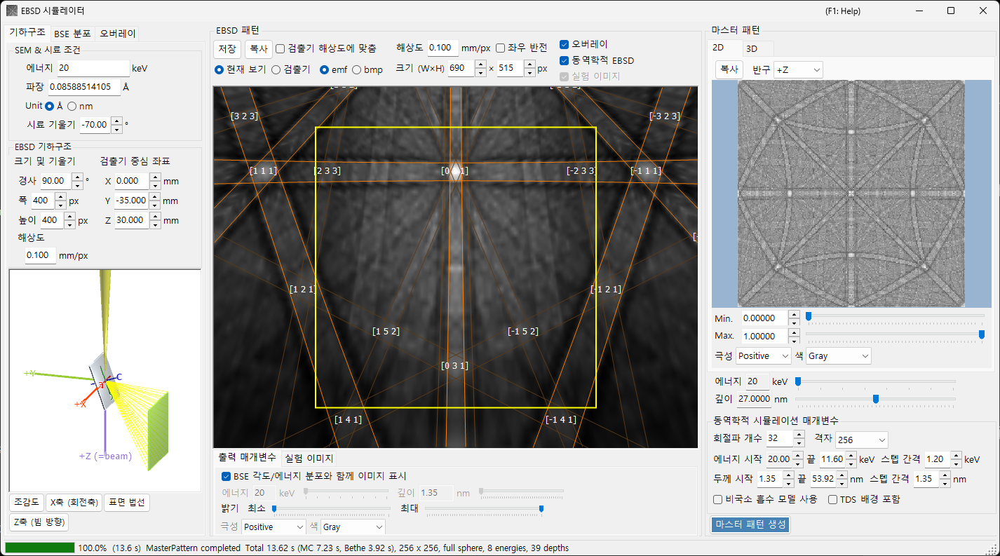

창은 세 개의 열로 구성되어 있습니다.

- **왼쪽** : 시뮬레이션 조건. 탭으로 **기하구조**(시료/검출기 기하학 및 3D 보기), **BSE 분포**(후방산란 전자 분포), **오버레이**(키쿠치 선 및 기타 주석)를 선택합니다.
- **가운데** : 현재 결정 방위에 대한 EBSD(키쿠치) 패턴. 그 아래의 탭으로 **시뮬레이션 이미지**와 **실험 이미지**를 선택합니다.
- **오른쪽** : 방위에 무관한 master pattern(**2D** 및 **3D** 탭).

아래쪽 상태 표시줄에는 실행 중인 계산의 진행 상황과 결과 요약이 표시됩니다. 창이 좁으면 긴 메시지는 오른쪽 끝에서 잘리지만, 마우스를 올리면 전체 내용이 표시됩니다.

---

## 키보드 및 마우스 단축키

가운데의 EBSD(키쿠치) 패턴과 오른쪽의 master pattern 보기는 서로 다른 마우스 동작에 반응합니다.

| 단축키 | 동작 |
|----------|--------|
| <kbd>F1</kbd> | 온라인 매뉴얼의 이 페이지를 엽니다 |
| 패턴의 중심 부근을 왼쪽 드래그 | 결정을 기울입니다 |
| 패턴의 바깥쪽 영역을 왼쪽 드래그 | 결정을 회전시킵니다 |
| 패턴을 더블 클릭 | 커서 아래의 검출기 하위 셀을 선택하고 통계를 표시합니다 (**Zone axis** 선택이 켜져 있는 동안에는 정대축을 추가합니다. [정대축 선택](#정대축-선택) 참조) |
| 이미지 파일을 창에 놓기 | 실험 EBSD 이미지로 불러옵니다 |
| 3D 보기(기하학 / master 구)를 왼쪽 드래그 | 회전 |
| 3D 보기에서 오른쪽 드래그 또는 마우스 휠 | 확대/축소 |
| <kbd>CTRL</kbd> + 3D 보기에서 오른쪽 더블 클릭 | 정사영 / 원근 전환 |
| 2D master pattern에서 드래그 / 휠 | 이미지 이동 / 확대·축소 |

3D 보기는 ReciPro의 표준 [보기 탐색](21-shortcuts.md)을 사용합니다(이동은 비활성화).

→ 모든 창을 한눈에 보려면 **[21. 키보드 및 마우스 단축키](21-shortcuts.md)**를 참조하세요.

---

## 작업 흐름

**마스터 패턴 생성**을 누르면 다음 단계가 순서대로 실행됩니다.

1. **몬테카를로 BSE 시뮬레이션** : 현재 결정 조성, 밀도, 가속 전압 및 시료 기울기를 사용하여 1000만 개의 입사 전자를 시료 내부에서 추적합니다(탄성 산란: Mott/NIST 단면적; 비탄성 산란: 유전 응답 모델). 이로부터 후방산란 전자의 *침투 깊이 × 출사 방향 × 출사 에너지* 의 결합 분포가 얻어집니다.
2. **자동 범위 선택** : 그 분포로부터 동역학 계산에 사용되는 에너지 범위(입사 에너지에서 에너지 손실의 약 95 백분위까지)와 깊이 범위가 자동으로 설정됩니다. 여기서 깊이는 master pattern의 두께, 즉 출사 방향을 따라 잰 경로 길이(소스 깊이 ÷ cos χ. χ는 출사 방향과 시료 표면 법선이 이루는 각)입니다. 깊이 범위는 검출기에 도달하는 전자의 이 경로 길이의 99.9 백분위(유효숫자 2자리로 올림)까지이며, 표면에 가까울수록 촘촘한 40단계의 부등간격으로 나뉩니다.
3. **master pattern 구성** : 각 에너지와 깊이에 대해 동역학적 회절(블로흐파) 문제를 풀고 방향의 구 위에서 적분하며, 몬테카를로 분포로 가중하여 모든 방향에 대한 후방산란 회절 강도를 구합니다. 결과는 등면적(Roşca–Lambert) 격자에 저장됩니다.
4. **가중을 적용한 검출기 투영** : 현재 결정 방위에 대해, 각 검출기 픽셀이 대하는 방향의 강도를 master pattern에서 조회하여 키쿠치 패턴으로 그리며, 선택적으로 BSE 각도/에너지 분포로 가중합니다.

에너지와 깊이 범위는 **에너지·깊이 범위를 MC에서 자동 설정**이 체크되어 있는 동안(기본값. 이때 범위 입력란은 읽기 전용입니다) 1–2단계에서 자동으로 설정됩니다. 체크를 해제하면 손으로 입력한 범위로 구성합니다. 이때 몬테카를로는 입력란을 바꾸지 않으며, 손으로 입력한 범위는 저장되어 다음 시작 시 복원됩니다. <!-- 261106Cl 作者の決定 C11 --> 사용할 수 없는 범위 — 하한이 상한보다 작지 않은 경우, 가속 전압을 넘는 에너지(몬테카를로 시작 전에 검사합니다), 또는 몬테카를로 분포에서 완전히 벗어난 범위 — 는 구성하지 않으며, 메시지로 이유와 값을 알려 줍니다. <!-- 261106Cl 作者の決定 F5/F15 -->

---

## 기하구조

### SEM & 시료 조건

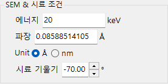

- **에너지** : 입사빔의 가속 전압(keV). 이 값은 다음 시작 시에도 유지됩니다. <!-- 261106Cl 作者の決定 D4 -->
- **파장** : 전자 파장, 에너지와 연동됩니다. **Unit** 으로 Å 또는 nm를 선택합니다.
- **시료 기울기** : 시료 기울기 각도(일반적으로 −70°). EBSD에서의 큰 기울기는 후방산란 전자 수율을 증가시킵니다. 값을 바꾸면 몬테카를로 결과(BSE 분포와 그 가중치)는 버려집니다(**시뮬레이션**을 다시 실행하십시오). master pattern은 기울기에 의존하지 않으므로 유지됩니다. <!-- 261106Cl 作者の決定 F17 -->

### EBSD 기하구조

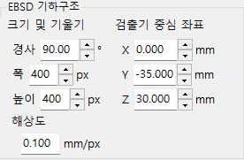

검출기(형광 스크린)는 픽셀 수와 픽셀 크기로 정의되는 직사각형입니다.

- **크기 및 기울기** : **기울기** 는 검출기 스크린의 기울기(°)로, 수평면(빔에 수직인 면)을 기준으로 잽니다. 0° = 수평 스크린, 90° = 수직 스크린(기본값). **폭**·**높이** 는 검출기의 픽셀 수입니다. <!-- 261105Cl 監査: numericBoxDetTilt.ToolTip (EbsdDetectorGeometry の法線 (0, sin d, −cos d)) -->
- **해상도** : 검출기 1픽셀의 물리적 크기(mm/px). 따라서 검출기의 물리적 크기는 폭 × 해상도, 높이 × 해상도가 됩니다.
- **검출기 중심 좌표** : 빔 충돌 지점을 기준으로 한 검출기 중심의 위치 **X**·**Y**·**Z**(mm)로, 현미경(실험실) 좌표계로 나타냅니다. **Y** 는 빔(Z)과 시료 기울기 축(X) 모두에 수직인 수평 방향의 어긋남이며, 기울어진 시료 표면 안의 방향이 아닙니다. <!-- 261105Cl 監査: numericBoxDetY.ToolTip --> Y와 Z는 기울기와 함께 카메라 길이를 결정하며, X는 좌우 방향의 어긋남입니다.

실험 이미지를 불러오면 검출기 1픽셀이 이미지 1픽셀에 대응하도록 **폭**·**높이** 가 이미지 크기에 맞춰집니다(**해상도** 는 변경되지 않습니다).

기하학은 **기하구조** 탭의 3D 보기에서 확인할 수 있습니다.

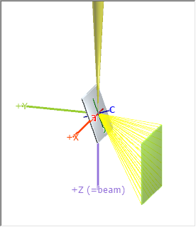

회색 판은 시료, 녹색 직사각형 판은 검출기, 보라색 **+Z (=beam)**은 입사빔입니다. (시료에 고정된) 결정 **a / b / c** 축도 함께 표시됩니다. **조감도**, **표면 법선**, **X축 (회전축)** 및 **Z축 (빔 방향)** 버튼은 보기를 표준 방향으로 맞춥니다. 좌표계 정의는 [부록 A1. 좌표계](appendix/a1-coordinate-system/2-diffraction.md)를 참조하세요.

---

## BSE 분포

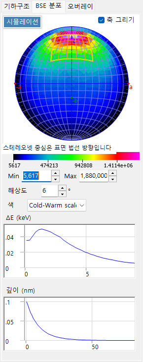

**BSE 분포** 탭은 몬테카를로 후방산란 전자 분포를 표시합니다. **시뮬레이션**을 사용하여 다시 계산합니다. 몬테카를로는 한 번에 하나만 실행됩니다. 하나가 실행 중일 때(**시뮬레이션** 또는 **마스터 패턴 생성**의 첫 단계로 시작된 것)는 **시뮬레이션**을 눌러도 새로 시작하지 않으며, 상태 표시줄이 기다리거나 **정지**를 누르도록 안내합니다. <!-- 261105Cl 監査: FormEBSD.cs buttonBSE_Click (monteCarloCts) -->

- **Stereonet** : 후방산란 전자의 각도 분포(출사 방향의 히스토그램). 중심은 표면 법선 방향이며, 노란색 윤곽선은 검출기가 대하는 직사각형 영역을 표시합니다. **축 그리기**는 결정 축을 겹쳐 표시하며, 색상 스케일(**Min** / **Max**, **Resolution**, **색**)을 조정할 수 있습니다.
- **ΔE (keV)** : 후방산란 전자의 에너지 손실 분포.
- **깊이 (nm)** : 검출된 후방산란 전자의 소스 깊이 분포로, **소스 깊이 (MC)** 의 정의(기본값: 마지막 비탄성 산란 이벤트)를 따릅니다 — master pattern을 가중할 때 쓰는 깊이와 같은 정의입니다.

이 분포들은 [전자 궤적](8-electron-trajectory.md)과 동일한 몬테카를로 엔진으로 계산되며, master pattern을 가중하는 데 사용됩니다. 결정이나 가속 전압을 바꾸면 이 결과는 master pattern과 함께 버려지며(창이 닫혀 있는 동안 바꾼 경우에는 다시 열 때 적용됩니다), 무엇을 버렸는지는 상태 표시줄에 표시됩니다. **ΔE** 또는 **깊이** 그래프를 더블 클릭하면 그 값을 텍스트(x와 y, 탭 구분)로 클립보드에 복사합니다. <!-- 261106Cl 作者の決定 F23 --> <!-- 261105Cl 監査: FormEBSD.cs SetCrystal / 電圧の変更 / 開き直し (4bc81f06) -->

---

## 오버레이

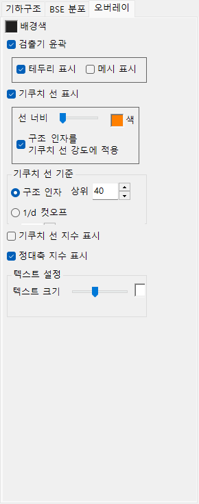

**오버레이** 탭은 EBSD 패턴 위에 그려지는 주석을 설정합니다.

- **배경색** : 배경 색상.
- **검출기 윤곽** : 검출기 윤곽선. **테두리 표시**(검출기 가장자리의 노란색 직사각형) / **메시 표시**(분할 격자).
- **기쿠치 선 표시** : 키쿠치 선을 그립니다. **선 너비** / **색**, 그리고 **구조 인자를 기쿠치 선 강도에 적용**(각 선이 구조 인자에 비례하여 배경색으로 흐려집니다).
- **기쿠치 선 기준** : 어떤 키쿠치 선을 그릴지: **구조 인자**(구조 인자 기준 **상위** *N* 개) 또는 **1/d 컷오프**(1/d가 임계값 미만인 것, nm⁻¹). 두 가지를 전환하면 선을 즉시 다시 그립니다. <!-- 261105Cl 監査: 1/d Cutoff 側にもハンドラを配線 (d88da429) -->
- **기쿠치 선 지수 표시** : 키쿠치 선(밴드)의 지수를 표시합니다.
- **정대축 지수 표시** : 정대축 지수를 표시합니다.
- **텍스트 설정** : 지수 레이블의 **텍스트 크기** / **색**.

---

## Master pattern

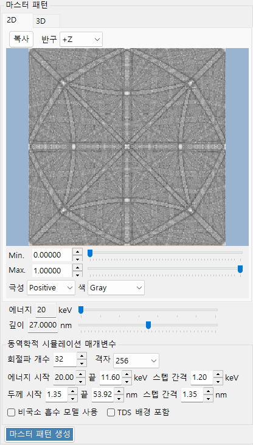

master pattern은 모든 방향에 걸친 후방산란 회절 강도로, **마스터 패턴 생성**을 통해 동역학 이론으로 미리 계산됩니다(**정지** 로 실행 중인 계산을 중단할 수 있습니다).

원자 변위 매개변수가 0(B = 0)인 원자 위치가 있으면 **마스터 패턴 생성**을 누를 때 확인 대화 상자가 나타납니다. B = 0인 위치는 흡수를 만들지 않으며, 모든 위치가 B = 0이면 **비국소 후방산란 소스**를 쓴 master pattern은 검게 비어 버립니다. **확인**을 누르면 그 위치에 등방성 B = 0.5 Ų를 넣고 계산하며(값은 나중에 메인 창에서 바꿀 수 있습니다), **취소**를 누르면 계산하지 않고 멈춥니다. 이방성 매개변수(Bij)를 입력한 위치는 그대로 둡니다.

- **2D** 탭 : 반구의 등면적(Lambert) 투영. **반구**는 투영할 반구(+Z / −Z)를 선택합니다.
- **3D** 탭 : 강도가 매핑된 구. 마우스로 회전할 수 있으며, 왼쪽 위의 삽입 화면에 동기화된 결정 축(a/b/c)이 표시됩니다. **축 레이블** / **축 화살표**는 레이블/화살표를 토글하며, **축 방향 보기**는 옆에 입력한 정대축 [u v w]을 따라 내려다봅니다.
- **에너지 / 깊이** 슬라이더 : 미리 볼 에너지/깊이 슬라이스를 선택합니다.
- 어느 보기든 **복사**로 클립보드에 보낼 수 있습니다.
- **동영상 저장**(**3D** 탭) : 구면 master pattern이 회전하는 동영상(MP4)을 저장합니다. 회전 방향·속도·길이·fps·품질은 [구조 뷰어](5-structure-viewer.md)와 같은 "Movie setting" 대화 상자에서 지정합니다. 이 3D 보기만 회전하며, 결정 방위(메인 창의 오일러 각)는 바뀌지 않습니다.

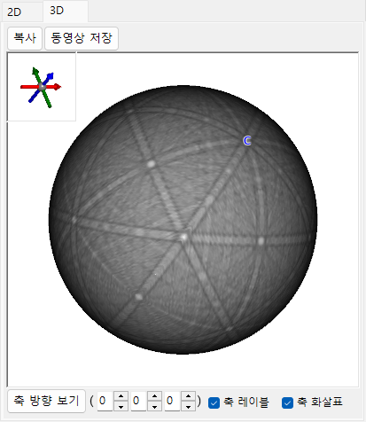

### 동역학적 시뮬레이션 매개변수

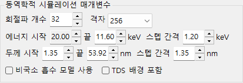

- **회절파 개수** : 블로흐파 계산에 포함되는 회절 빔(파동)의 수. 파동이 많을수록 정확하지만 느립니다.
- **격자** : master pattern 격자의 해상도(한 변의 픽셀 수, 64–8192, 기본값 256). 4096과 8192는 중간 데이터에 매우 큰 메모리가 필요하므로(기본값인 16개 에너지 × 40개 깊이에서 4096은 약 344 GB, 8192는 약 1374 GB, 2048에서도 약 86 GB) 에너지·깊이 단계 수를 크게 줄여야 실제로 사용할 수 있습니다. 메모리가 부족하면 계산이 "MasterPattern failed"로 끝납니다(ReciPro 자체는 계속 실행됩니다).
- **에너지·깊이 범위를 MC에서 자동 설정** (기본값 켬) : 체크되어 있는 동안 몬테카를로가 아래 두 범위를 설정하며 그 입력란은 읽기 전용입니다. 체크를 해제하면 입력란에 입력한 범위로 master pattern을 구성하며([작업 흐름](#작업-흐름) 참조), 그 범위는 다음 시작 시에도 유지됩니다. 이 설정은 다음 시작 시에도 유지됩니다. <!-- 261106Cl 作者の決定 F5/F15 -->
- **에너지 시작 … 끝 … 스텝 간격 …** : 적분되는 에너지 범위 및 스텝(keV); 위의 상자가 체크되어 있는 동안 몬테카를로 결과로부터 자동으로 설정됩니다.
- **깊이 시작 … 끝 … 스텝 간격 …** : 적분되는 깊이 범위 및 스텝(nm)으로, 깊이는 출사 방향을 따라 잰 경로 길이입니다; 마찬가지로 자동으로 설정됩니다. 자동 설정된 깊이는 부등간격이므로, 입력란에는 가장 얕은 점, 상한, 첫 구간 폭이 기준값으로 표시됩니다. 입력란을 직접 바꾸면 그 값에 의한 등간격 깊이로 전환됩니다.
- **비국소 흡수 모델 사용** : 비국소 흡수 모델을 사용합니다.
- **비국소 후방산란 소스** (기본값 켬) : 원자 위치에 국소화된 후방산란 소스를 후방 반구에서 적분한 비국소 흡수 퍼텐셜 형식(U'_back)으로 바꿉니다. 둘 다 같은 물리적 단면적을 쓰므로 배경을 더하는 것이 아니라 모델을 전환하는 것입니다.
- **소스 깊이 (MC)** : (에너지 × 깊이) 가중에 쓰는 결맞음 후방산란 소스의 깊이를 어떤 몬테카를로 이벤트로 정할지 선택합니다. 마지막 비탄성 산란(기본값), 종류를 가리지 않는 마지막 수송 이벤트, 또는 마지막 결맞음 상실 중에서 고릅니다. 마지막 옵션에서는 어느 원자에서 산란했는지의 정보를 시료에 남길 만큼 국소화된 이벤트만 소스를 재설정합니다. 탄성 산란은 Debye–Waller 인자에서 정해지는 열확산 확률 1 − exp(−2B s²)로(Bloch 파가 다루는 결맞음 Bragg 산란은 재설정하지 않음), 비탄성 산란은 내각·고손실 여기면 항상, 원자가 여기면 운동량 전달이 플라즈몬 차단 q_c = ω_p/v_F 를 넘는 비율만큼 재설정합니다(플라즈몬과 비국소 전자–정공 쌍은 Bloch 상태를 유지). 소스가 얕을수록 Kikuchi 변조가 약해지므로 마지막 옵션은 자유 매개변수 없이 수송만으로 확산 배경을 정합니다. 바꾸면 저장된 전자를 다시 비닝할 뿐 몬테카를로를 다시 실행하지 않습니다.
- **에너지 손실에 따라 대비 감소** (기본 켜짐; 이 설정은 다음 시작 시에도 유지되지만 E_c는 유지되지 않음; 비대칭 가우스는 E_c = 0.8 keV, 히스토그램 + 전자별 A는 0.9 keV) : 각 에너지 슬라이스의 키쿠치 대비에 A(E) = exp(−(E0 − E)/E_c) 를 곱하고(E0 는 가속 에너지, E 는 출사 에너지), 잃은 부분을 방향 평균한 평탄한 받침으로 옮깁니다. 밴드를 뺀 밝기는 변하지 않습니다. 몬테카를로 가중치는 후방산란 전자를 한 개씩 세지만, 에너지를 많이 잃은 전자는 날카로운 키쿠치 대비를 거의 갖지 않습니다. 이 보정을 끄면 모든 슬라이스가 대비를 온전히 가져 밴드가 E0 의 단색 전자보다 약 12 % 넓어집니다(Si, 20 kV). E_c 는 작을수록 감쇠가 강해지는 유효 매개변수이며, 물질에 공통인 상수가 아닙니다. 비대칭 가우스의 기본값 0.8 keV 는 종래의 계산 조건에서 Si 20 kV 실측 패턴(Si004 데이터)의 밴드 폭(유효 파장비 α ≈ 1.017)에 맞춘 보정값을 기준으로 합니다. 값은 물질과 보정에 쓰는 반사에 따라 달라지며, Botallackite 보정 예에서는 채택한 반사에 따라 약 0.43~0.71 keV 가 얻어졌습니다. 밴드 폭을 정량적으로 비교할 때는 에너지·깊이 격자, 합성 방법, 평가 지표 등을 바꾸면 다시 보정하십시오. 값을 바꾸면 기존 슬라이스의 가중치만 다시 곱하며, master pattern 도 몬테카를로도 다시 계산하지 않습니다.
- **표면 비정질층** : 비정질 표면층(자연 산화막, 오염, 연마·이온 밀링 손상층)의 두께(nm). 결맞음 후방산란 소스가 이 층 안에 있는 전자는 Kikuchi 변조를 갖지 않으며, 전자당 같은 세기의 방향 평균(균일) 성분으로 더해집니다. 층 아래의 소스는 결정 표면부터 깊이를 잽니다. 수송은 결정과 같은 조성·밀도로 계산하며 수 nm면 충분합니다. 0이면 비활성이고, 바꾸면 저장된 전자를 다시 비닝할 뿐 몬테카를로를 다시 실행하지 않습니다.
- **형광체 응답으로 전자 가중** (기본 ON, E_dead = 2 keV) : 몬테카를로의 각 전자를 1개 1표로 세는 대신 형광 스크린의 발광량 φ(E) = max(0, E − E_dead)으로 가중합니다. 에너지가 높은 전자일수록 기울어진 시료에서 전방으로 나가므로 패턴의 상하 강도 기울기가 완만해지고 (Si, 20 kV에서 검출기 상하비 약 2.5 → 1.7) 정대축 밝기도 약간 낮아집니다. 검출기 평면의 비닝과 빈별 에너지 분포에 적용되며, 변경 시 저장된 전자를 다시 비닝할 뿐 몬테카를로를 다시 실행하지 않습니다. 전자를 직접 계수하는 검출기에서는 끄십시오. E_dead는 형광체의 불감층 (문턱) 에너지로, Al 코팅 P43 스크린에서는 0〜3 keV가 일반적입니다.
- **Energy filter E >** (keV; 기본값 0 = 끔) : 검출기 앞에 놓인 이상적인 고역 통과 에너지 필터입니다. 출사 에너지가 이 값 이하인 전자는 패턴에 기여하지 않습니다. 변경하면 저장된 전자를 다시 비닝할 뿐 몬테카를로를 다시 실행하거나 master pattern을 다시 만들지 않습니다.
- **MC 히스토그램으로 에너지 분포** (기본 OFF) : 방향 빈마다의 출사 에너지 분포를 평균과 좌우 퍼짐으로 만든 비대칭 가우스 대신, 몬테카를로 전자의 원시 히스토그램(φ 가중, 마스터 패턴의 이웃한 두 에너지 슬라이스에 선형 배분)으로 만듭니다. 가우스는 가속 전압 부근의 피크를 2~3분의 1로 과소평가하여 밴드를 넓게 보이게 합니다. 켜면 **에너지 손실에 따라 대비 감소**의 A(E) 도 에너지 슬라이스의 값이 아니라 전자마다 자신의 출사 에너지로 곱한 뒤 배분합니다. 히스토그램 + 전자별 A 모드에서는 E_c를 수정하지 않은 동안 Si004, 20 kV의 고정 18개 밴드 폭 중앙값으로 얻은 잠정값 0.9 keV로 전환됩니다. 다른 지표(예: 이미지 전체 상관)는 다른 값을 줍니다. E_c를 수정한 뒤에는 분포를 바꿔도 입력값을 유지합니다. 변경 시 저장된 전자를 재비닝할 뿐 몬테카를로는 다시 실행하지 않습니다.

---

## EBSD 패턴

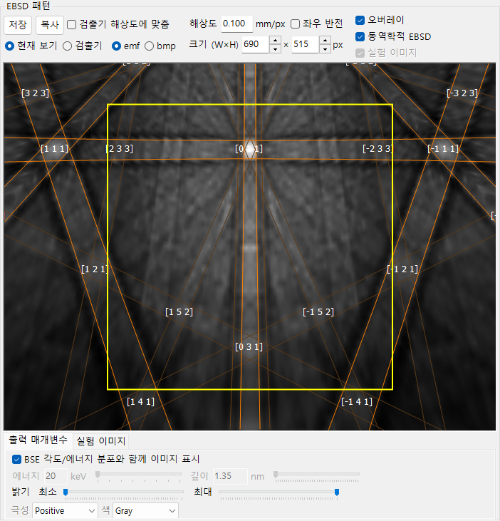

가운데 패널은 현재 결정 방위에 대한 EBSD(키쿠치 밴드) 패턴을 표시합니다. 패턴 위쪽의 막대에서 무엇을 그릴지와 복사 방법을 지정합니다.

- **동역학적 EBSD** : 구성된 master pattern을 검출기에 투영합니다. 해제하면 배경만 남습니다.
- **오버레이** : **오버레이** 탭에서 설정한 키쿠치 선·지수·검출기 윤곽을 겹쳐 그립니다.
- **실험 이미지** : 불러온 실험 이미지를 겹쳐 표시합니다(아래 참조).
- **좌우 반전** : 패턴과 모든 오버레이를 좌우로 반전합니다. 해제 상태(기본값)는 검출기에서 시료를 바라보는 방향, 즉 EBSD 카메라가 기록하는 자연스러운 이미지입니다. 실험 이미지의 좌우가 반대일 때만 체크하세요.
- **해상도**(mm/px)·**크기 (W×H)**(px) : 표시 보기의 해상도와 크기.
- **저장** : 옆에서 선택한 범위·해상도로 패턴을 파일에 저장합니다. 형식(PNG / TIFF / EMF)은 저장 대화 상자에서 선택합니다.
  - **Pattern values (\*.csv)** 를 선택하면 이미지가 아니라 검출기 픽셀 격자 위의 원시 강도 값을 기록합니다. `#` 헤더 줄에는 조건(결정, 검출기 래스터와 픽셀 크기, 전압, 도 단위의 검출기·시료 기울기, 검출기 X/Y/Z, …)과 최솟값·최댓값이 기록됩니다. <!-- 261105Cl 監査: 傾斜角は度で書く (FormEBSD.cs, 5f7484d1) -->
  - 범위가 **검출기**이고 **동역학적 EBSD**를 표시하며 실험 이미지를 겹치지 않을 때(불러오지 않았거나 **실험 이미지**의 체크가 해제된 경우)의 TIFF는 16비트 그레이스케일로 기록됩니다(256단계로 양자화되지 않습니다). <!-- 261105Cl 監査: 16 bit の条件 (FormEBSD.cs, 5f7484d1) --> 이때 **오버레이**는 체크 여부와 관계없이 포함되지 않으며, 픽셀 값은 패턴 자체의 최솟값–최댓값을 0–65535로 선형 매핑한 것입니다(사용된 최솟값과 최댓값은 상태 표시줄에 표시됩니다. 절댓값이 필요하면 csv 내보내기를 사용하십시오).
- **복사** : 옆에서 선택한 범위·형식으로 패턴을 클립보드에 복사합니다.
  - **현재 보기**는 이동·확대한 그대로의 표시 범위를, **검출기**는 검출기 영역만 복사합니다(후자에서는 노란색 테두리가 포함되지 않아 이미지가 검출기 가장자리에서 정확히 끝납니다).
  - **emf**는 확장 메타파일로 복사하여 키쿠치 선과 지수 레이블을 벡터로 유지하고, **bmp**는 전체를 래스터화합니다.
  - **검출기 해상도에 맞춤**은 이미지 1픽셀 = 검출기 1픽셀로 복사합니다(긴 변은 4096 px로 제한). 해제하면 화면 해상도가 사용됩니다.

### 시뮬레이션 이미지

첫 master pattern을 구성하기 전에는 아래의 표시 행(BSE 분포와 슬라이스, 밝기와 대비, 색)만 비활성화되며, 몬테카를로 설정(**소스 깊이 (MC)**, **에너지 손실에 따라 대비 감소**, **표면 비정질층**, **형광체 응답으로 전자 가중**, **Energy filter E >**, **MC 히스토그램으로 에너지 분포**)은 처음부터 바꿀 수 있습니다. <!-- 261106Cl 作者の決定 F16 -->

- **BSE 각도/에너지 분포 포함** (기본값 켬) : 체크하면 단일 슬라이스 대신 BSE 분포(에너지, 깊이, 방향)로 가중하여 패턴을 합성합니다.
- **에너지 / 깊이** : 위 항목이 꺼져 있을 때 표시할 에너지/깊이 슬라이스를 선택합니다.
- **밝기**(**최소** / **최대**), **대비**, **극성**, **색** : 시뮬레이션 패턴의 흑·백 레벨을 표시 범위에 대한 %로 지정하고(슬라이더는 선형), 그 표시 범위의 폭, 극성, 색상 스케일을 정합니다. 대비 0이면 표시 범위가 패턴 자체의 강도 범위와 같아지고, -1이면 10배로 넓어지며(대비가 10분의 1로 약해짐), +1이면 10분의 1로 좁아집니다. 범위의 중심은 고정됩니다.
- **배경 평탄화** (**FWHM**, px; 기본 OFF, 100 px) : 시뮬레이션 패턴에서 가우시안으로 흐리게 한 사본을 빼서 완만하게 변하는 밝기 분포를 제거하고, 배경을 보정한 실측 패턴과 밴드·정대축을 비교할 수 있게 합니다. 반치폭은 검출기 픽셀 단위이며 줌과 무관합니다. 표시 이미지와 PNG/TIFF 내보내기에 적용되며 CSV 내보내기는 원시값을 유지합니다.

### 실험 이미지

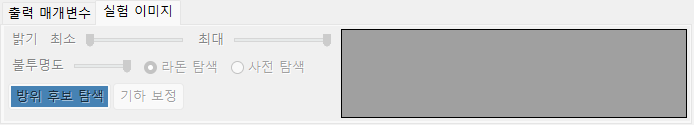

EBSD 이미지 파일(TIFF·PNG·BMP·JPEG. 16비트 TIFF는 비트 심도를 유지한 채 읽습니다)을 창 위에 놓으면 실험 패턴으로 불러옵니다. 이미지는 검출기 영역에, 시뮬레이션 패턴의 위·키쿠치 선 오버레이의 아래에 그려지므로 시뮬레이션과 실측을 직접 비교할 수 있습니다. 불러올 때 검출기의 **폭**·**높이** 도 이미지 크기에 맞춰집니다.

- **밝기**(**최소** / **최대**), **대비** : 겹친 실험 이미지의 흑·백 레벨을 표시 범위에 대한 %로 지정하고, 그 표시 범위의 폭을 정합니다(슬라이더는 선형이며, 규약은 시뮬레이션 패턴과 같습니다). 실험 이미지에만 작용합니다.
- **배경 평탄화** (**FWHM**, px; 기본 OFF, 100 px) : 실험 이미지에서 가우시안으로 흐리게 한 사본을 빼서 완만하게 변하는 밝기 분포를 제거합니다. 강도 슬라이더는 평탄화된 값에 대해 작용합니다.
- **이미지에 맞추기** : 시뮬레이션 패턴의 **최소**, **최대**, **대비**를 설정하여, 그 2 %와 98 % 강도 레벨이 실험 이미지의 해당 레벨과 같은 회색으로 표시되게 합니다. 백분위수로 맞추므로 방위 해에 의존하지 않으며, 페데스탈(바닥값)이나 정대축의 밝은 픽셀 몇 개에도 영향을 받지 않습니다. 극성, 색, 양쪽의 **배경 평탄화** 설정은 바꾸지 않으므로, 누르기 전에 평탄화를 양쪽 모두 켜거나 모두 끄십시오.
- **불투명도** : 겹친 실험 이미지의 불투명도(0 = 투명 ~ 100 % = 불투명). 낮추면 아래의 시뮬레이션 패턴이 보입니다.

이미지를 설명하는 방위는 두 가지 엔진 중 하나로 탐색합니다.

- **라돈 탐색** : 실험 이미지의 라돈 변환(직선 검출) 맵에 운동학적 키쿠치 밴드 템플릿을 대조하여 방위를 탐색합니다. master pattern 없이도 동작하며, 있을 경우 시뮬레이션 패턴과의 robust ZNCC(평균을 제거한 정규화 상호상관)로 후보를 다시 순위 매깁니다.
- **사전 탐색** : 동역학 master pattern에서 모든 방위의 사전 패턴을 생성하여 robust ZNCC로 전수 비교합니다. master pattern이 필요하고 몇 초가 걸리지만 라돈 탐색보다 확실합니다.

**방위 후보 탐색**은 선택한 엔진을 실행하여 좋은 순으로 최대 10개의 후보를 나열합니다. master pattern이 있으면 최상위 후보는 ±0.25°까지 정밀화됩니다. 열의 의미는 다음과 같습니다.

| 열 | 의미 |
|----|------|
| **#** | 순위(0이 최상) |
| **Score** | 라돈 밴드 증거의 *z* 값 |
| **Bands** | 일치한 밴드 수 / 시야 내 예측 밴드 수 |
| **ZNCC** | 시뮬레이션 패턴과의 상관 |
| **Strong bands (hkl)** | 일치한 밴드의 지수(라돈 탐색 전용) |

**행을 클릭하면 그 방위가 프로그램 전체에 적용되어**, 시뮬레이션 패턴이 실험 이미지 위에 다시 그려지고 다른 창의 결정 방위도 함께 따라갑니다.

### 정대축 선택

<!-- screenshot: FormEBSD, measured-pattern tab: the zone-axis picking controls (Zone axis / [u v w] / + geometry / Find / Clear) and the picked points -->

이미지 전체를 대조하는 대신, 실험 이미지 위에서 손으로 고른 밴드 교차점(정대축)으로부터 방위를 구할 수도 있습니다.

- **Zone axis** : 선택 기능을 켭니다. 켜져 있는 동안 패턴을 왼쪽 더블 클릭하면 점이 추가되고, <kbd>CTRL</kbd> + 왼쪽 더블 클릭은 화면상 5픽셀 이내의 점을 제거하며, <kbd>SHIFT</kbd> + 왼쪽 더블 클릭은 점을 선택합니다(선택한 점은 노란색, 나머지는 번호가 붙은 청록색으로 그려집니다). 꺼져 있으면 더블 클릭은 평소처럼 검출기 셀을 선택합니다.
- **[u v w]** : 선택한 점의 정대축 지수. 0 0 0 으로 두면 탐색이 지수를 할당하며, 지수를 입력하면 탐색이 그 지수로 제약됩니다(저대칭 결정이나 고지수 축에 유용).
- **+ geometry** : 예측한 정대축 위치와 고른 위치 사이의 픽셀 잔차를 최소화하여 방위와 함께 검출기 중심(X, Y, Z, mm)도 최적화합니다. 지수가 할당된 점이 4개 이상 필요하며, 이 경우 후보를 선택하면 정밀화된 기하도 함께 적용됩니다.
- **Find** : 고른 정대축을 설명하는 방위를 탐색합니다(점 2개 이상. 보통 3개면 충분하며 2개로는 모호합니다). 각도 허용 오차는 2°이며, 아무것도 찾지 못하면 5°로 다시 시도합니다. 최대 10개의 후보가 같은 후보 표에 기록되며, 행을 클릭하면 위와 같이 적용됩니다.
- **Clear** : 고른 점, 입력한 지수, 마지막 정대축 탐색의 후보를 모두 지웁니다(실행 취소 불가). 새 실험 이미지를 불러와도 마찬가지입니다.

**기하 보정**은 검출기 기하(패턴 센터 PC와 검출기 거리 DD)를 방위와 번갈아 최적화하여 시뮬레이션과 실험 패턴의 ZNCC를 최대화합니다. master pattern이 필요하며, 검출기 기울기는 고정한 채 결과를 **검출기 중심 좌표** 의 X/Y/Z 칸에 되돌려 씁니다. 이때 검출기는 놓여 있던 쪽(+Y 또는 −Y)에 그대로 둡니다. <!-- 261105Cl 監査: +Y 側の検出器も側を保つ (e1d645d5) --> SEM의 빔 주사에 의한 패턴 센터 이동은 1 mm 미만이므로, 보통 실험 시작 시 한 번 보정하면 일련의 이미지에 그대로 사용할 수 있습니다.

---

## 함께 보기

- [전자 궤적](8-electron-trajectory.md) — 각도/에너지/깊이 가중에 사용되는 몬테카를로 전자 궤적 / BSE 시뮬레이션.
- [회절 시뮬레이터](7-diffraction-simulator/index.md) — 동역학적(블로흐파) 전자 회절.
- [부록 A1. 좌표계](appendix/a1-coordinate-system/2-diffraction.md) — 시료/검출기 좌표계의 정의.
