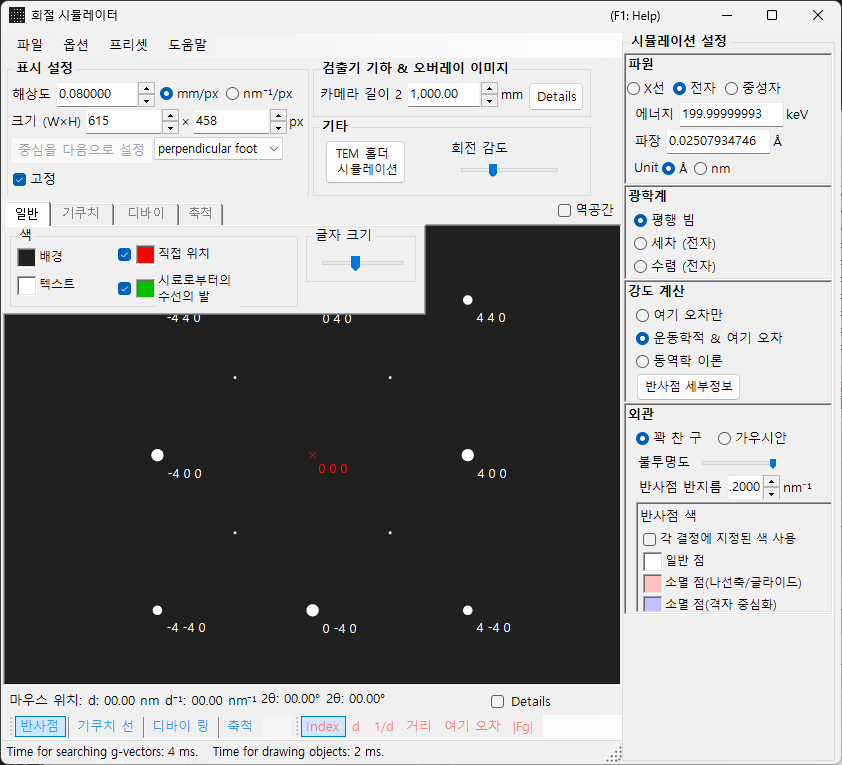
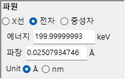
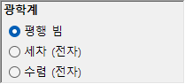
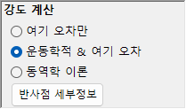
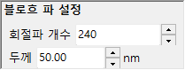
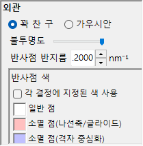

# SAED (Selected Area Electron Diffraction) 시뮬레이션

**SAED (Selected Area Electron Diffraction)** 시뮬레이션은 평행 전자빔에 의해 생성되는 단결정 전자 회절 도형을 계산합니다. 이것은 [회절 시뮬레이터](index.md)의 기본 모드입니다.

> 이 페이지는 **파원** = **전자** 및 **광학계** = **평행 빔**을 선택했을 때 오른쪽 **시뮬레이션 설정** 패널에 나타나는 모든 설정을 나열합니다. 그리기 및 저장과 같은 창 전체 작업에 대해서는 [개요 페이지](index.md)를 참조하십시오.

GUI 조건: 파원 = 전자, 광학계 = 평행 빔, 강도 계산 = 여기 오차만 / 운동학적 & 여기 오차 / 동역학 이론.

---

## 개요

평행 전자빔이 얇은 시료를 통과할 때 생성되는 회절 도형을 시뮬레이션합니다. 스폿 위치는 에발트 구와 역격자점 사이의 기하학적 관계에 의해 고정되며, 각 스폿의 밝기는 선택한 강도 계산 모드에 따라 계산됩니다.

---

## 파원 {#wave-length}

방사선원을 **전자**로 설정합니다. 에너지(keV) 또는 파장(Å 또는 nm, 전환 가능, 기본값 Å)을 입력하면 상대론적으로 보정된 파장이 계산됩니다. 초기값은 200 keV이며, **프리셋** 메뉴에서 300 / 200 / 120 kV를 한 번에 설정할 수 있습니다. X선 및 중성자 선원에 대해서는 [X선 회절 시뮬레이션](5-x-ray-neutron-diffraction.md)을 참조하십시오.

---

## 광학계 {#incident-beam-mode}

**광학계**(입사빔 기하학)를 **평행 빔**으로 설정합니다. 이것은 SAED 및 X선 회절에 사용되는 표준 평면파 기하학입니다.

> **Note**: 전자의 경우 **평행 빔** / **세차 (전자)** / **수렴 (전자)** 를 선택할 수 있습니다. **세차 (전자)** 를 선택하면 [PED 시뮬레이션](2-ped-simulation.md)이 되고 **수렴 (전자)** 를 선택하면 [CBED 시뮬레이션](3-cbed-simulation.md)이 되며, 두 경우 모두 강도 계산이 자동으로 **동역학 이론**으로 전환됩니다.

---

## 강도 계산

스폿 강도를 어떻게 계산할지 선택합니다.

### 여기 오차만

강도는 에발트 구와 역격자점 사이의 기하학적 거리(여기 오차 $S_g$)만으로 결정됩니다. $S_g = 0$, 즉 구 위에 정확히 놓일 때 가장 크고, $\lvert S_g\rvert$가 커질수록 감소하며, $\lvert S_g\rvert$가 역격자점에 지정된 **반사점 반지름**을 초과하면 0이 됩니다. 결정 구조 인자를 무시하므로 가장 빠른 모드이며 회절 스폿 위치 확인에 적합합니다.

이 모드에서만 다음 옵션이 나타납니다:

| 옵션 | 설명 |
|--------|-------------|
| **모든 금지 반사 제외** | 공간군에 의해 금지된 모든 반사(격자 중심화, 나선축, 글라이드면)를 숨깁니다. 체크하면 다음 옵션도 체크되고 잠깁니다. |
| **격자 중심화로 금지된 반사 제외** | 격자 중심화로 금지된 반사만 숨깁니다(기본값 켜짐). |
| **모든 반사점을 동일한 반지름으로 그리기** | $S_g$와 관계없이 여기된 모든 스폿을 최대 반지름 *R*로 그립니다. |

표시된 채로 남은 금지 반사는 **소광 점** 색으로 그려집니다([스폿 표시](#spot-appearance) 참조).

### 운동학적 & 여기 오차

여기 오차에 더해 운동학적 구조 인자 $\lvert F_{hkl} \rvert^2$가 강도에 반영됩니다. 소광 규칙이 올바르게 반영되어 이 모드는 얇은 시료나 약한 회절에 적합합니다.

### 동역학 이론 (블로흐파 방법, 전자 전용)

블로흐파 방법(Bethe 방법)에 의한 엄밀한 동역학적 계산입니다. 다중 산란과 두께에 따른 강도 변화를 재현하며, 두꺼운 시료나 강한 회절에 필요합니다. **전자**를 선택한 경우에만 사용할 수 있습니다. 이론에 대해서는 [부록 A3. 블로흐파 방법](../appendix/a3-bloch-wave/calculation.md)을 참조하십시오.

> **Note**: **동역학 이론**을 선택하면 아래에 **블로흐파 설정** 패널이 나타납니다.

---

## 블로흐파 설정 (동역학 이론)

**강도 계산 = 동역학 이론**일 때만 활성화됩니다.

| 매개변수 | 설명 |
|-----------|-------------|
| **회절파 개수** | 고유값 문제에 포함되는 블로흐파의 수(8–1000, 기본값 240). 값이 클수록 강도가 더 정확해지지만 계산 시간이 $O(N^3)$로 증가합니다 |
| **두께** | 동역학적 계산에 사용되는 시료 두께(nm)(0.01–10000 nm, 기본값 50 nm) |

---

## 스폿 표시 {#spot-appearance}

각 회절 스폿이 어떻게 렌더링되는지를 제어합니다.

- **꽉 찬 구 / 가우시안** : 역격자점의 기하학적 모델(기본값 **꽉 찬 구**). **꽉 찬 구**는 구와 에발트 구 사이의 단면(원)을 그립니다. 구의 반지름은 **운동학적 & 여기 오차**에서는 $R\,I^{1/3}$(구의 부피 ∝ 강도), **여기 오차만**에서는 $R$입니다. **동역학 이론**에서는 에발트 구로 자르지 않고 반지름 $R\,I_\text{dyn}^{1/2}$의 원판(면적 ∝ 강도)을 그립니다. **가우시안**은 $\sigma = R$인 3차원 가우스 함수의 단면(2차원 가우스 함수)을 그리며, 그 적분이 회절 강도에 대응합니다.
- **불투명도** : 스폿의 투명도(0 = 투명, 1 = 불투명).
- **반사점 반지름 (R)** : 역격자점의 가상 반지름(nm⁻¹; 0.01–1, 기본값 0.2). 스폿 크기는 **외관** 모드와 **강도 계산**의 조합에 의해 정해집니다(위 참조).
- **밝기**, **색 척도**, **로그 척도** : **가우시안** 모드에서만 표시됩니다. **밝기**는 렌더링된 가우스 함수의 적분 강도를 조정합니다. **색 척도**는 **Gray**(아래의 반사점 색으로 스폿을 그림), **Cold-warm**, **Spectrum**, **Fire** 중 하나입니다. **로그 척도**는 강도를 로그 스케일로 표시합니다(강도 대비가 큰 도형에 유용).
- **반사점 색** : **색 척도**가 **Gray**(초기 설정)일 때 표시됩니다. **일반 점**, **소광 점(나선축/글라이드)**, **소광 점(격자 중심화)**으로 허용 반사와 금지 반사의 색을 설정합니다.
- **결정별 지정 색** : 체크하면 각 결정에 할당된 색상으로 스폿이 그려집니다(결정이 하나일 때도 마찬가지).

---

## 스폿 레이블

스폿 위에 겹쳐 표시되는 레이블은 [도구 모음](index.md#toolbar)에서 선택합니다.

| 레이블 | 내용 |
|-------|---------|
| **Index** | 밀러 지수 $(hkl)$. 메인 창의 **옵션 ▸ 밀러-브라베 (hkil) 지수 사용**이 켜져 있고 결정이 육방 축을 쓰면 네 지수 $(hkil)$ (키쿠치선, 디바이 링, 3D 레이블도 같은 설정을 따름) <!-- 261105Cl 監査: C23 --> |
| **d** | 면간 거리 $d$. 메인 창의 길이 단위에 따라 Å 또는 nm <!-- 261106Cl 作者の決定 C20 --> |
| **1/d** | 면간 거리의 역수 $1/d$. 메인 창의 길이 단위에 따라 nm⁻¹ 또는 Å⁻¹ <!-- 261106Cl 作者の決定 C2 --> |
| **거리** | 검출기 상에서 스폿과 투과(직접) 스폿 사이의 거리(mm). 그려진 위치 사이에서 재므로 기울어진 검출기, X선 세차 카메라, 후방 라우에(빔 구멍에서 잼)에서도 성립합니다. 투과빔이 검출기를 벗어나면 표시되지 않습니다 <!-- 261105Cl 監査: DrawDiffractionSpotsLabel (C15)。L2 tan2θ は傾けない平板の検出器だけ --> |
| **2θ** | 산란각 $2\theta$ (2θ 눈금의 동심원과 같은 정의) |
| **χ** | 방위각 $\chi$. 화면 위쪽(12시 방향)을 0°로 하여 시계 방향이 양수 (방위각 눈금의 방사선과 같은 정의) |
| **여기 오차** | 여기 오차 $S_g$. 메인 창의 길이 단위에 따라 nm⁻¹ 또는 Å⁻¹ |
| **강도** | **운동학적 & 여기 오차** 모드에서는 상대 강도(%), **동역학 이론** 모드에서는 상대 강도(가장 강한 회절빔에 대한 %, 000 제외)와 출사면의 복소 진폭. **여기 오차만**에서는 아무것도 표시되지 않습니다 |

---

## 공통 작업

검출기 정보, 뒤집기, 역공간 표시, 키쿠치선, 디바이 링, 축척선, 색상 설정, 저장 등은 모든 모드에 공통입니다. [개요 페이지](index.md)를 참조하십시오. 동역학적 계산에서 얻은 반사별 세부 정보는 [회절 스폿 정보](index.md#diffraction-spot-information)에서 살펴볼 수 있습니다.

---

## 관련 항목

- [회절 시뮬레이터 (개요)](index.md)
- [평행빔 SAED 계산](../appendix/a3-bloch-wave/calculation.md#parallel-beam-saed)
- [X선 회절 시뮬레이션](5-x-ray-neutron-diffraction.md)
- [세차 전자 회절 (PED) 시뮬레이션](2-ped-simulation.md)
- [좌표계의 정의](../appendix/a1-coordinate-system/1-orientation.md)
