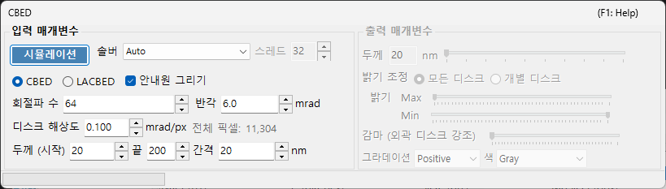
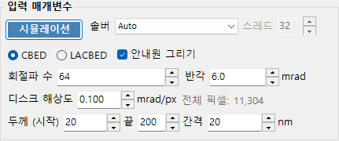
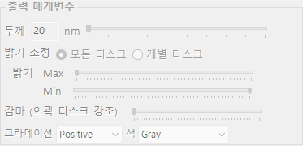

# CBED 시뮬레이션

**CBED (Convergent-Beam Electron Diffraction, 수렴빔 전자 회절) 시뮬레이션**은 블로흐파(Bethe) 방법을 사용하여 수렴빔 회절 패턴을 계산하고 표시합니다. CBED 패턴은 스폿 대신 회절 디스크를 보여주며, 결정 대칭, 두께, 구조에 관한 풍부한 정보를 담고 있습니다.

> 이 페이지는 [회절 시뮬레이터](index.md)에서 **파원** = **전자** 및 **광학계** = **수렴 (전자)** 를 선택할 때 열리는 전용 창의 모든 설정을 정리합니다. **수렴 (전자)** 를 선택하면 **강도 계산** 이 자동으로 **동역학 이론** 으로 설정되고, 이 CBED 설정 창이 열립니다. 이 창을 × 버튼으로 닫으면 **광학계** 는 **평행 빔** 으로 돌아갑니다. <!-- 261105Cl 監査: FormDiffractionSimulatorMultislice_FormClosing (UserClosing) --> 계산된 디스크는 메인 창의 **파일 > CBED 디스크 저장** / **CBED 디스크 복사**로 저장할 수 있습니다. 회절 패턴의 그리기와 저장, 그 밖에 회절 시뮬레이터 공통 동작에 대해서는 [개요 페이지](index.md)를 참조하십시오.

GUI 조건: 파원 = 전자 · 광학계 = 수렴 (전자) · 강도 계산 = 동역학 이론 (자동)

---

## 입력 매개변수

이 창이 열려 있는 동안에는 메인 창의 **블로흐파 설정** 및 **외관** 패널이 비활성화되며, 파의 수와 두께는 여기서 지정한 값이 사용됩니다.

| 매개변수 | 설명 | 기본값 / 일반값 |
|-----------|-------------|-------------------|
| **CBED** / **LACBED** | **CBED**: 각 디스크가 하나의 반사에 대응하고 투과 디스크(000)가 중앙에 오는 표준 수렴빔 패턴. **LACBED** (Large-Angle CBED): 투과(000) 디스크만 계산하여 그리며 겹치는 이웃 디스크를 더하지 않으므로, 브래그 각보다 큰 반각을 쓸 수 있음(명시야 LACBED. 이 모드 자체가 반각을 넓히지는 않음). <!-- 261105Cl 監査: BetheMethod.cs cbed_DoWork (LACBED は 000 だけ)、radioButtonLACBED.ToolTip。「ディスクが重なる」は誤り --> 고차 라우에 영역(HOLZ) 선과 대칭을 관찰하는 데 유용 | CBED |
| **수렴 반각 α (mrad)** | 수렴빔 원뿔의 반각(0–2000 mrad). 각 회절 디스크의 크기를 결정함(역공간에서의 디스크 지름은 $2\alpha$ 에 대응) | 기본값 6 mrad, 일반값 5–30 mrad |
| **디스크 해상도 (mrad/px)** | 각 디스크 내부의 각 분해능. 디스크는 $N = \lceil 2\alpha / \text{resolution} \rceil$ 인 $N\times N$ 격자로 샘플링되며, 원 내부의 점만 계산됨. 값이 작을수록 분해능이 높아지지만, 빔 방향 수가 제곱으로 증가하므로 계산 시간도 제곱으로 증가함. 그 결과로 얻어지는 수 — 각 디스크의 픽셀 수, 즉 수렴 원 안의 입사빔 방향 수로, 방향마다 블로흐파 계산이 한 번씩 필요함 — 는 **전체 픽셀**로 표시됨 <!-- 261105Cl 監査: label2/labelDivisionNumber.ToolTip --> | 기본값 0.1 mrad/px |
| **회절파 수** | 각 입사빔 방향에서 블로흐파 계산에 포함되는 최대 빔 수(1–2048). 빔 수가 많을수록 정확도가 높아지지만, 고유값 문제의 비용은 $O(N^3)$ 로 증가함 | 기본값 64, 일반값 100–500 |
| **두께 (시작) / 끝 / 간격** | 시료 두께(nm, 각각 1–1000)의 시작, 끝, 단계 값. 여러 두께가 함께 계산되며 출력 측의 두께 슬라이더로 전환됨 | 기본값 20–200 nm, 간격 20 nm |
| **솔버** | 계산 엔진. **Auto**, **Eigenproblem with Eigen lib.** / **Eigenproblem with MKL lib.** (대각화), **Matrix exp. with Eigen lib.** / **Matrix exp. with MKL lib.** (행렬 지수 방법, v4.794). **Auto**는 Eigen을 사용할 수 있으면 Eigen과 모든 논리 프로세서로 행렬 지수 방법을 사용하고, 그렇지 않으면 MKL 고유값 문제를 사용함. 행렬 지수 경로는 두께가 등간격이어야 하며, 그렇지 않으면 고유값 문제로 대체됨. ARM64에서는 MKL 항목이 제공되지 않으며, 네이티브 Eigen 라이브러리를 사용할 수 없으면 Eigen 항목이 숨겨짐 | Auto |
| **스레드** | 병렬 스레드 수(1–128). **Auto**에서는 비활성화되며, 솔버를 선택하면 논리 프로세서 수(MKL의 경우 그 ¼)로 설정됨 | — |
| **안내원 그리기** | 체크하면 메인 패턴 위에 각 회절 디스크의 경계를 나타내는 노란 원을 그림(LACBED에서는 000에 원, 그 밖의 반사에 십자 표시) | 켜짐 |

---

## 시뮬레이션 / 정지

- **시뮬레이션** : 현재 입력 매개변수로 CBED 시뮬레이션을 시작합니다.
- **정지** : 실행 중인 계산을 취소합니다. 마지막으로 완료된 계산의 결과는 계속 표시됩니다(계산이 실패한 경우에도). <!-- 261105Cl 監査: Bethe_CbedCompleted (completedDisks ほか) -->

---

## 출력 매개변수

계산이 완료되면 출력 매개변수를 사용할 수 있게 됩니다. 이들은 모두 재계산 없이 표시만 변경합니다.

| 매개변수 | 설명 |
|-----------|-------------|
| **두께** | 마지막으로 완료된 계산의 두께 중에서(그 뒤에 입력란의 두께를 바꿔도 달라지지 않음) 표시할 시료 두께를 슬라이더로 선택([회절 스폿 정보](index.md#diffraction-spot-information) 표도 이를 따름) <!-- 261105Cl 監査: CompletedThicknesses (最後に完了した計算の厚み) --> |
| **밝기 조정** | **모든 디스크**: 하나의 밝기 스케일을 사용하며, 모든 디스크에 걸친 최댓값으로 정규화. **개별 디스크**: 각 디스크를 그 디스크의 최댓값으로 정규화(γ는 0으로 초기화되고 비활성화됨) |
| **밝기 (Max / Min)** | 표시되는 강도의 상한과 하한으로, 최댓값에 대한 비율로 지정(슬라이더 위치는 4제곱하여 적용됨). 약한 특징을 강조하고 싶을 때 조정 |
| **감마 (외곽 디스크 강조)** | 각 픽셀에 $\exp(\gamma\,r)$ 를 곱하여($r$ 은 패턴 중심으로부터의 거리) 중앙 투과 디스크에 비해 어두운 외곽 대각도 디스크를 더 잘 보이게 함. **모든 디스크**일 때만 활성 |
| **계조** | 강도 계조를 **Positive** / **Negative** (흑백 반전) 중에서 선택 |
| **색** | 표시에 사용하는 컬러 맵: **Gray**, **Cold-warm**, **Spectrum**, **Fire** |

---

## 물리적 배경

CBED에서는 입사빔을 서로 다른 방향을 가진 평면파의 원뿔로 간주합니다. 각 방향(수렴 조리개 내부의 각 점 = 하나의 부분 입사 평면파)에 대해 블로흐파 방법이 결정 내부의 전자 슈뢰딩거 방정식을 풀고, 그 결과가 회절 디스크로 재배열됩니다. HOLZ(고차 라우에 영역) 선은 디스크 내부에 가는 어두운/밝은 선으로 나타나며, 상위 라우에 영역의 반사에서 생겨납니다. 이들은 $c$ 축을 따르는 격자 상수에 민감하며 3차원 구조 분석에 유용합니다.

이론적인 세부 사항은 [CBED 계산](../appendix/a3-bloch-wave/cbed.md)을 참조하십시오.

---

## 관련 항목

- [회절 시뮬레이터 (개요)](index.md)
- [SAED 시뮬레이션](1-saed-simulation.md)
- [PED 시뮬레이션](2-ped-simulation.md)
- [CBED 계산](../appendix/a3-bloch-wave/cbed.md)
