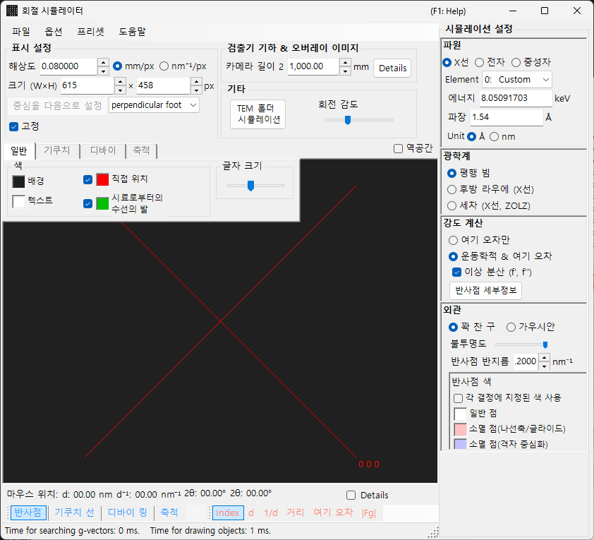
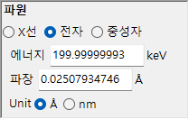
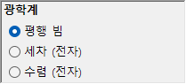
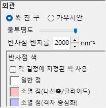
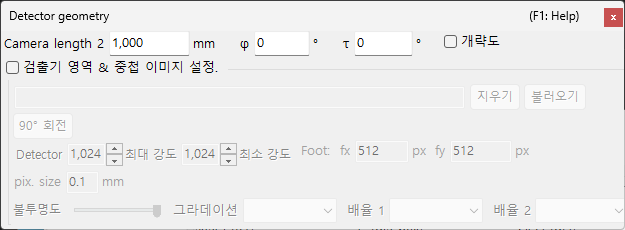

# X선 / 중성자 회절 시뮬레이션

**X선 / 중성자 회절 시뮬레이션**은 단결정 X선 및 중성자 회절 패턴을 계산합니다. [회절 시뮬레이터](index.md)의 주요 모드 중 하나입니다.

> 이 페이지는 **파원** = **X선**(또는 **중성자**)을 선택했을 때 오른쪽에 나타나는 모든 설정을 나열합니다. 그리기 및 저장과 같은 창 전체 작업은 [개요 페이지](index.md)를 참조하십시오.

GUI 조건: 파원 = X선 / 중성자 · 광학계 = 평행 빔 / 세차 (X선, ZOLZ) / 후방 라우에 (X선) · 강도 계산 = 여기 오차만 / 운동학적 & 여기 오차

---

## 개요

X선은 전자보다 파장이 길기 때문에(Cu Kα: 0.15406 nm = 1.5406 Å) 에발트 구의 곡률이 더 큽니다. 그 결과, 전자의 경우보다 회절 조건을 동시에 만족하는 역격자점이 더 적습니다. 원자의 산란력이 작고 다중 산란이 약하기 때문에, 운동학적 회절 이론으로도 강도에 대해 충분한 정확도를 얻을 수 있습니다(동역학적 계산은 전자에 대해서만 지원됩니다).

---

## 파원 {#wave-length}

**파원**으로 **X선**을 선택합니다. X선은 두 가지 방식으로 지정할 수 있습니다: 특성 X선과 싱크로트론 방사광.

### 특성 X선

**Element**와 **전이**를 선택하면 특성 X선 파장이 결정됩니다. 전이는 Siegbahn 표기법(Kα₁ / Kα₂ / Kβ 등)으로 지정합니다. 대표적인 원소의 Kα₁ 파장:

| 원소 | 선 | 파장 (Å) | 에너지 (keV) |
|---------|------|-----------------|--------------|
| Cu | Kα₁ | 1.5406 | 8.048 |
| Mo | Kα₁ | 0.7093 | 17.479 |
| Co | Kα₁ | 1.7890 | 6.930 |
| Cr | Kα₁ | 2.2897 | 5.415 |

### 싱크로트론 방사광

**Element**를 **0: Custom**으로 설정하고 에너지(keV) 또는 파장(Å)을 직접 입력합니다. 임의의 파장을 사용할 수 있습니다.

---

## 광학계 {#incident-beam-mode}

입사빔의 기하학을 선택합니다. X선에는 세 가지 모드를 사용할 수 있습니다.

### 평행 빔 {#parallel}

표준 평면파입니다. SAED 및 단결정 X선 회절에 사용되는 평행 입사빔입니다.

### 세차 (X선, ZOLZ) — 세차 카메라 {#precession-x-ray--precession-camera}

X선 세차 카메라를 시뮬레이션합니다. 역격자의 단일 층을 포착하는 세차 사진입니다. 디바이 링은 2θ 눈금 원과 같이 반지름 $2L_2\sin\theta$ ($L_2$ = 카메라 길이 2) 의 원으로 그려집니다. <!-- 261105Cl 監査: DrawDebyeRing (C6) -->

### 후방 라우에 (X선) — 후방반사 라우에 {#back-laue-back-reflection-laue}

백색(다색) X선으로 후방반사 라우에 패턴을 시뮬레이션합니다. 이 후방반사 기하학에서는 검출기가 선원 쪽에 배치되며, **파원** 컨트롤의 에너지 / 파장 입력란과 원소 선택이 숨겨지고 그 대신 **Flat white** 가 표시됩니다. 스폿은 선원 쪽의 카메라 길이 위치에 놓인 **빔에 수직인** 평면 검출기에 투영되며, [검출기 기하](index.md#detector-geometry)의 검출기 기울기 **Tau / Phi**는 이 투영에 사용되지 않습니다.

- 백색 스펙트럼은 **50 keV**에서 잘립니다: 반사는 $d = \lambda(50\ \text{keV})/2$까지 수집되며, 스펙트럼 가중치는 적용되지 않습니다.
- 원점을 지나는 같은 직선 위의 고조파 $n\mathbf{g}$는 같은 스폿에 떨어집니다. 그 $\lvert F\rvert^2$는 가장 낮은 차수의 반사에 합산되며, 스폿 강도는 가장 강한 스폿을 기준으로 정규화됩니다.
- **이상 분산 (f', f'')**은 비활성화되며(에너지가 하나로 정해지지 않기 때문), 이 모드에서는 **반사점 반지름**에 단위가 없습니다.
- 2θ (마우스 위치, 스폿 레이블, 2θ 눈금)는 산란각입니다: 중앙의 빔 구멍에서 180° 이며 바깥쪽으로 갈수록 작아집니다. <!-- 261105Cl 監査: Back Laue の 2θ (C13) -->
- 선택한 결정은 모두 그려집니다. 결정이 둘 이상이면(또는 **결정별 지정 색**이 켜져 있으면) 각 결정의 스폿은 그 결정의 색으로 그려집니다. <!-- 261105Cl 監査: Back Laue の複数結晶 -->

> **Note**: **광학계** 옵션은 파원에 따라 달라집니다. **세차 (전자)** 와 **수렴 (전자)** 는 **전자** 가 선택된 경우에만 나타나는 반면, 위의 **세차 (X선, ZOLZ)** 와 **후방 라우에 (X선)** 옵션은 **X선** 이 선택된 경우에만 나타납니다. 중성자의 경우 **평행 빔** 만 사용할 수 있습니다. 캡처 시점의 상태에 따라 스크린샷에 X선 전용 옵션이 표시되지 않을 수 있습니다.

---

## 강도 계산

스팟 강도를 계산하는 데 사용되는 방법을 선택합니다. X선에는 두 가지 모드를 사용할 수 있습니다.

### 여기 오차만

강도는 에발트 구와 역격자점 사이의 기하학적 거리(여기 오차 $S_g$)에 의해서만 결정됩니다. $S_g = 0$, 즉 구 위에 정확히 놓일 때 가장 크고, $\lvert S_g\rvert$가 커질수록 감소하며, $\lvert S_g\rvert$가 역격자점에 지정된 **반사점 반지름**을 초과하면 0이 됩니다. 구조 인자는 무시됩니다.

이 모드에서만 다음 옵션이 나타납니다:

- **모든 금지 반사 제외** / **격자 중심화로 금지된 반사 제외** (기본값: 격자 중심화만) : 공간군에 의해 금지된 반사를 숨깁니다. 숨기지 않은 반사는 **반사점 색**에서 설정한 별도의 색(나선축/글라이드에 의한 금지, 격자에 의한 금지)으로 그려집니다.
- **모든 반사점을 동일한 반지름으로 그리기** : 여기 오차와 관계없이 모든 스폿을 $S_g = 0$일 때의 크기로 그립니다.

### 운동학적 & 여기 오차

여기 오차에 더해, 운동학적 구조 인자 $\lvert F_{hkl} \rvert^2$가 강도에 반영됩니다. 소광 규칙이 엄격하게 준수됩니다. 로런츠 인자와 편광 인자는 포함되지 않습니다(이것은 기하학적 패턴의 시뮬레이션입니다).

- **이상 분산 (f', f'')** (X선 전용, 기본값 켜짐) : 현재 X선 에너지에서의 이상 분산 항 f′, f″를 구조 인자에 더합니다(디바이 링에도 적용). 화학적으로 서로 다른 이상 산란체를 포함하는 비중심대칭 구조에서는 프리델 법칙이 깨져 $hkl$ / $\bar h\bar k\bar l$ 강도가 달라집니다(Bijvoet 쌍). 이 효과는 흡수단 근처에서 가장 강합니다. 후방 라우에에서는 비활성화됩니다. [구조 인자](../appendix/a2-beam-interaction/structure-factor.md)를 참조하십시오.

> **Note**: **동역학 이론**은 X선에 대해 비활성화됩니다(전자 방사선이 선택된 경우에만 사용 가능).

---

## 스팟 표시

각 회절 스팟이 렌더링되는 방식을 제어합니다.

- **꽉 찬 구 / 가우시안** : 역격자점의 기하학적 모델입니다. **꽉 찬 구**는 구와 에발트 구 사이의 단면을 그립니다. **운동학적 & 여기 오차**에서는 구의 반지름이 $R \times I_\text{rel}^{1/3}$이고(따라서 구의 *부피*가 상대 강도에 비례), **여기 오차만**에서는 *R* 그대로입니다. **가우시안**은 σ = *R*인 3차원 가우스 함수와 에발트 구 사이의 단면을 사용하며(2차원 가우스 함수의 적분이 회절 강도에 대응), $\lvert S_g\rvert \ge 3R$인 스팟은 그리지 않습니다.
- **불투명도** : 스팟의 투명도(0 = 투명, 1 = 불투명).
- **반사점 반지름 (R)** : 역격자점의 반지름입니다. 렌더링되는 스팟 크기는 **외관**과 **강도 계산**의 조합에 의해 결정됩니다.
- **밝기** : **가우시안** 모드에서만 활성화됩니다. 렌더링되는 가우스 함수의 적분 강도를 설정합니다.
- **색 척도** (가우시안 전용) : **Gray**, **Cold-warm**, **Spectrum**, **Fire**.
- **로그 척도** (가우시안 전용) : 강도를 로그 스케일로 표시합니다.
- **반사점 색** : **Gray** 색 척도에서 사용하는 스팟 색상입니다(다른 색 척도에서는 이 그룹이 숨겨집니다).
- **결정별 지정 색** : 선택하면 각 결정에 할당된 색상으로 스팟을 그립니다.

---

## 디바이 링 (다결정)

다결정 시료의 디바이 링을 표시할 수 있습니다. 도구 모음에서 **디바이 링**을 활성화합니다([도구 모음](index.md#toolbar) 참조).

- **회절 강도 무시** : 모든 링을 동일한 색상과 강도로 그립니다(구조 인자를 무시하는 순수한 기하학적 비교에 사용).
- **지수 레이블 표시** : 각 링 근처에 지수 {*hkl*} 를 표시합니다(육방 축에서 **옵션 ▸ 밀러-브라베 (hkil) 지수 사용** 이 켜져 있으면 네 지수 {*hkil*}). <!-- 261105Cl 監査: DrawDebyeRing (C23) -->

세부 설정은 [탭 메뉴](index.md#drawing-overlay-tabs)의 **디바이 링** 탭에 있습니다.

---

## 중성자 회절

**파원**에서 **중성자**를 선택하면 중성자 회절 패턴을 계산합니다. 에너지(meV) 또는 파장(Å 또는 nm, 전환 가능, 기본값 Å)을 입력합니다. **광학계**는 **평행 빔**만 가능합니다. 강도 계산은 **여기 오차만** 또는 **운동학적 & 여기 오차**일 수 있습니다(**동역학 이론**은 사용할 수 없습니다). 운동학적 강도는 원자 산란 인자 대신 중성자 산란 길이를 사용합니다.

---

## X선 회절과 전자 회절의 차이

| 특징 | X선 회절 | 전자 회절 |
|---------|-------------------|----------------------|
| 파장 | 길다 (0.5–2.5 Å) | 짧다 (0.02–0.04 Å) |
| 에발트 구 곡률 | 크다 | 작다 (거의 평평함) |
| 동시 반사 | 적다 | 많다 |
| 산란 인자 | 원자 산란 인자 $f(s)$ | 전자 산란 인자 $f_e(s)$ |
| 동역학적 효과 | 일반적으로 작다 | 크다 |
| 소광 규칙 | 엄격하게 준수됨 | 다중 산란에 의해 위반될 수 있음 |

---

## 공통 작업

카메라 길이, 검출기 기하학, 패턴 저장, 색상 설정과 같은 창 전체 작업은 [개요 페이지](index.md)를 참조하십시오. 자세한 검출기 기하학은 아래의 기하학 창에서 구성합니다.

---

## 같이 보기

- [회절 시뮬레이터 (개요)](index.md)
- [SAED 시뮬레이션](1-saed-simulation.md)
- [세차 전자 회절 (PED) 시뮬레이션](2-ped-simulation.md)
- [수렴빔 전자 회절 (CBED) 시뮬레이션](3-cbed-simulation.md)
- [좌표계 — 결정 배향](../appendix/a1-coordinate-system/1-orientation.md)
