# Janela principal

Quando o ReciPro é iniciado, a janela principal aparece. A partir dessa janela você seleciona o cristal, controla sua rotação e invoca as diversas funções.

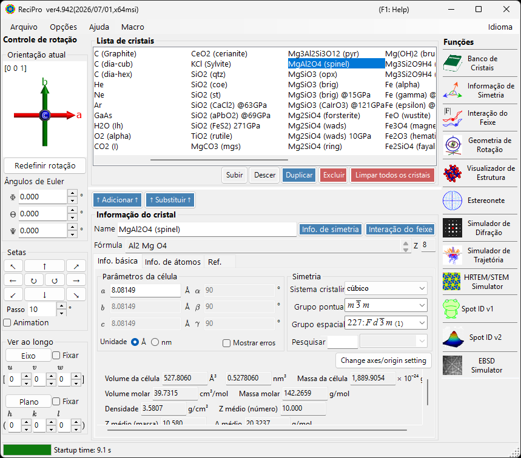

| Área | Localização | Descrição |
|------|----------|-------------|
| **Menu Arquivo** | Topo | Operações de arquivo, opções, ajuda |
| **Controle de rotação** | Esquerda | Visualizar/definir a orientação do cristal |
| **Lista de cristais** | Centro superior | Selecionar e gerenciar cristais |
| **Informação do cristal** | Centro inferior | Editar parâmetros de rede, simetria, átomos |
| **Funções** | Direita | Iniciar janelas de simulação/análise |

---

## Atalhos de teclado e mouse {#keyboard-mouse-shortcuts}

A janela principal instala vários atalhos **válidos para todo o aplicativo**. Eles continuam funcionando enquanto as janelas Visualizador de estrutura, Estereonete, Simulador de difração e Spot ID v1 estão em foco.

| Atalho | Ação |
|----------|--------|
| <kbd>F1</kbd> | Abrir esta página do manual on-line |
| <kbd>CTRL</kbd>+<kbd>SHIFT</kbd> + teclas de seta | Girar o cristal um passo nessa direção (mantenha duas setas pressionadas para uma diagonal) |
| Manter <kbd>CTRL</kbd> pressionado enquanto o ReciPro inicia | Iniciar com o OpenGL desativado (recuperação para problemas gráficos; apenas nesta execução, não é salvo) |
| Arrastar com o botão esquerdo o widget de orientação (canto inferior esquerdo, abaixo de *Orientação atual*) | Girar o cristal |
| Clique duplo com o botão direito no widget de orientação | Copiar a imagem do widget para a área de transferência |
| Clique único em um botão de função | Abrir / fechar essa janela (uma janela minimizada é restaurada em vez de fechada) |
| Clique duplo em um botão de função | Forçar a janela a ficar visível e trazê-la para a frente |
| Clique direito em um cristal na lista | Menu de contexto (Renomear / Exportar como CIF / Duplicar / Excluir) |
| Clique duplo no rótulo do índice do eixo de zona (`[u v w]`, abaixo de *Orientação atual*) | Mostrar / ocultar a caixa max-UVW |
| Soltar um arquivo sobre a janela | Carregar uma lista de cristais (`.xml`, `.out`; pergunta se deve substituir ou anexar) ou um cristal (`.cif`, `.amc`) <!-- 261105Cl 監査: .cdb2 はドロップで読めないので外した (FormMain.cs:FormMain_DragDrop) --> |
| <kbd>CTRL</kbd>+<kbd>SHIFT</kbd>+<kbd>ALT</kbd>+<kbd>C</kbd> | Abrir a ferramenta (experimental) de captura da GUI para a janela ativa |

→ Consulte **[21. Atalhos de teclado e mouse](21-shortcuts.md)** para ver todas as janelas de relance.

---

## Fluxo de trabalho básico

Se você é novo no ReciPro, siga estes passos:

1. Selecione o cristal desejado na **Lista de cristais**. Para usar um arquivo CIF/AMC, arraste-o e solte-o na **Informação do cristal**.
2. Se você editar parâmetros de rede ou posições de átomos, pressione **Adicionar** ou **Substituir** para que as alterações sejam gravadas de volta na lista de cristais.
3. Defina a orientação do cristal no **Controle de rotação** usando um eixo de zona, um plano cristalino, ângulos de Euler ou arrastando com o mouse.
4. Abra a ferramenta desejada em **Funções**. As janelas de cálculo de difração, HRTEM/STEM, EBSD e outras usam o cristal e a orientação atualmente selecionados.

---

## Menu Arquivo

### Arquivo

| Item de menu | Descrição |
|-----------|-------------|
| Carregar lista de cristais (substituir lista atual) | Carregar um arquivo de lista de cristais (`*.xml`, `*.out`), substituindo a lista atual; uma caixa de diálogo permite escolher quais cristais carregar |
| Carregar lista de cristais (adicionar à lista atual) | Carregar um arquivo de lista de cristais e anexá-lo à lista atual (com a mesma caixa de diálogo de seleção) |
| Redefinir para a lista de cristais inicial | Recarregar a lista de cristais que acompanha o ReciPro |
| Importar cristal de arquivo CIF ou AMC | Carregar um único cristal de um arquivo CIF / AMC |
| Salvar lista de cristais | Salvar a lista de cristais atual (uma caixa de diálogo permite escolher quais cristais gravar) |
| Exportar o cristal selecionado como arquivo CIF | Salvar o cristal selecionado no formato CIF |
| Limpar todos os cristais | Remover todos os cristais da lista |
| Sair | Fechar o aplicativo |

### Opções

| Item de menu | Descrição |
|-----------|-------------|
| Mostrar dicas | Mostrar ou ocultar as dicas de ferramenta em todas as janelas — as dos controles, dos itens da barra de ferramentas e dos menus, das células das tabelas e das abas; a configuração é mantida para a próxima inicialização <!-- 261106Cl 作者の決定 C9 --> <!-- 261106Cl 作者の決定 A20 --> |
| Modo escuro | Alternar entre os temas de cores claro e escuro |
| Usar índice de Miller-Bravais (hkil) | Usar a notação de 4 índices para os sistemas trigonal/hexagonal em todo o aplicativo |
| Usar fatores de dispersão iônicos | Usar os fatores de espalhamento de elétrons iônicos (Peng) para os íons atribuídos aos átomos nos cálculos dinâmicos de elétrons (ondas de Bloch), incluindo os perfis de Kikuchi; o termo de monopolo $g \neq 0$ é somado apenas aos coeficientes elásticos $U_g$ (a absorção TDS e a fonte TDS de Kikuchi usam a parte iônica finita). Quando desmarcado, são usados os fatores de átomos neutros. Se a célula unitária não for eletricamente neutra ($\Sigma q \neq 0$), o termo de monopolo é descartado e apenas a parte finita (íon blindado) é usada; um aviso é exibido quando a opção é ativada |
| Baixar biblioteca MKL | Baixar a biblioteca nativa Intel MKL (~55 MB); depois de instalada é usada automaticamente em cálculos grandes |
| Accept external macro commands (named pipe) | Escutar no pipe nomeado `ReciPro.Macro.v1` e executar macros enviadas por programas externos — ver [Controle externo](20-macro/3-external-control.md) |
| Redefinir configurações do registro ao sair (efetivo após reiniciar) | Redefinir as configurações na próxima reinicialização |
| Desativar biblioteca Crystallography.Native (requer reinício) | Voltar ao código gerenciado caso a biblioteca nativa (C++) não consiga ser carregada |
| Desativar toda a renderização OpenGL (requer reinício) | Para GPUs mais antigas / área de trabalho remota |
| Desativar renderização de texto OpenGL (requer reinício) | Solução alternativa para problemas de renderização de texto em algumas GPUs |
| Capturar componentes da GUI... | Ferramenta de desenvolvedor para salvar capturas de tela da GUI |
| Função de difração de pó (em desenvolvimento) | Ativar a janela de difração policristalina (de pó) |

### Ajuda

| Item de menu | Descrição |
|-----------|-------------|
| Verificar atualizações | Verificar se há uma nova versão do ReciPro disponível e instalá-la |
| Dicas | Exibir dicas de uso (obsoleto) |
| Histórico de versões | Abrir a caixa de diálogo do histórico de versões |
| Licença | Exibir a licença MIT |
| Repositório GitHub | Abrir o repositório do ReciPro em um navegador |
| Relatar erros, solicitações ou comentários | Abrir a página de Issues do GitHub |
| Ajuda (Web) | Abrir o manual on-line no GitHub Pages, na página correspondente ao idioma da interface |

O idioma da interface é alternado pelo menu **Idioma** separado (requer reinicialização).

### Idioma

Alternar o idioma da interface. Estão disponíveis onze idiomas — English, 日本語, Deutsch, Français, Español, Português, Italiano, Русский, 简体中文, 繁體中文 e 한국어 — cada um exibido na sua própria escrita. A alteração entra em vigor após reiniciar o ReciPro. O manual on-line segue a mesma configuração, de modo que <kbd>F1</kbd> e **Ajuda ▸ Ajuda (Web)** abrem a página no idioma escolhido.

### Macro

**Editor** abre a janela [Macro](20-macro/index.md) para automatizar as operações do ReciPro com scripts em estilo Python. As macros registradas nessa janela também são listadas abaixo de **Editor**; escolher uma delas a executa diretamente. Para fluxos de trabalho repetidos, consulte as [funções integradas](20-macro/1-built-in-functions.md) e os [exemplos de macro](20-macro/2-examples.md).

---

## Controle da orientação do cristal

O estado de rotação do cristal é compartilhado pelo simulador de difração, o Visualizador de estrutura, a Estereonete, o simulador HRTEM/STEM, o simulador EBSD e outras janelas. Não é apenas uma configuração de visualização — ele define a direção do feixe incidente e a relação de coordenadas do cristal usada nas simulações. Um breve tutorial em vídeo está disponível na página [Como usar](appendix/a0-how-to-use.md).

### Orientação atual

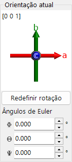

Mostra a orientação do cristal. Arraste para girar. Eixos: vermelho = *a*, verde = *b*, azul = *c*.

### Redefinir rotação
Redefine para o estado inicial: eixo *c* perpendicular à tela, eixo *b* para cima.

### Eixo de zona
Mostra o eixo de zona [*uvw*] mais próximo da normal da tela. Os candidatos são os índices irredutíveis (mdc = 1) com $|u|+|v|+|w| \le$ o limite da caixa max-UVW (1–100, padrão 30); clique duas vezes no rótulo do índice para mostrar ou ocultar essa caixa.

### Ângulos de Euler (Z-X-Z)
Defina a orientação do cristal com ângulos de Euler **Z–X–Z**:

- \(\Phi\): rotação em torno do eixo Z
- \(\Theta\): rotação em torno do eixo X
- \(\Psi\): rotação em torno do eixo Z

As rotações são aplicadas na ordem \(\Psi \to \Theta \to \Phi\). Consulte [Geometria de rotação](4-rotation-geometry.md) e [Apêndice A1. Sistema de coordenadas](appendix/a1-coordinate-system/1-orientation.md) para mais detalhes.

### Setas

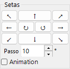

Gira pelo ângulo **Passo** (padrão 10°). ↺ / ↻ giram em torno da normal da tela. Marque **Animation** para uma rotação contínua; **Passo** passa então a ser uma velocidade em °/s.

### Visualizar ao longo de

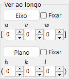

Alinha um eixo de zona [*uvw*] ou um plano cristalino (*hkl*) perpendicular à tela.

- **Fixar**: quando marcado, todas as rotações subsequentes (setas, arrasto com o mouse) são realizadas em torno do eixo de zona ou da normal do plano especificados, de modo que essa direção permanece fixa. Apenas uma das duas caixas **Fixar** pode estar marcada, e ela não pode ser marcada enquanto o índice for 0 0 0.
- **Eixo**: coloca o eixo de zona inserido \([uvw]\) perpendicular à tela. Se **Plano** também estiver definido e o eixo estiver contido nesse plano ($uh+vk+wl=0$), a normal do plano é apontada para cima na tela; caso contrário, uma direção para cima é escolhida automaticamente.
- **Plano**: coloca a normal do plano cristalino inserido \((hkl)\) perpendicular à tela. Se **Eixo** também estiver definido e estiver contido no plano ($uh+vk+wl=0$), esse eixo é apontado para cima na tela; caso contrário, uma direção para cima é escolhida automaticamente.

### Maneiras básicas de definir a orientação

| Método | Usar quando | Onde |
|--------|----------|-------|
| Arrastar com o mouse | Você quer girar livremente enquanto observa os eixos cristalinos. | Painel **Orientação atual** |
| Botões de seta | Você quer rotações pequenas e repetíveis. | Painel **Setas** |
| Eixo de zona | Você conhece a direção de observação, como \([001]\) ou \([110]\). | **Visualizar ao longo de** / entrada de eixo de zona |
| Normal do plano | Você quer um plano cristalino \((hkl)\) normal à tela. | **Visualizar ao longo de** / entrada de plano |
| Ângulos de Euler | Você precisa de uma orientação numérica reproduzível. | **Ângulos de Euler (Z-X-Z)** |

Consulte [Geometria de rotação](4-rotation-geometry.md) e [Apêndice A1. Sistemas de coordenadas](appendix/a1-coordinate-system/1-orientation.md) para as matrizes de rotação e as convenções de coordenadas.

---

## Lista de cristais

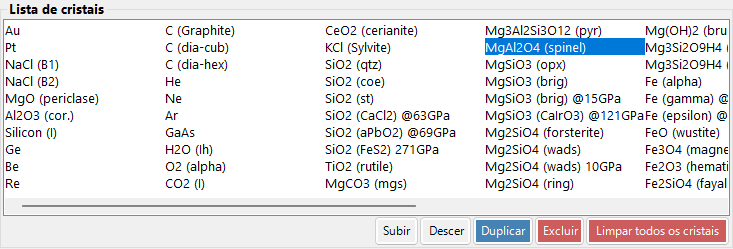

66 cristais na instalação padrão. Selecione para ver os detalhes e definir para os cálculos. **Clique direito em um cristal** na Lista de cristais para um menu de contexto: *Renomear*, *Exportar como CIF*, *Duplicar*, *Excluir*.

| Botão | Ação |
|--------|--------|
| Subir / Descer | Reordenar |
| Duplicar | Copiar o cristal selecionado |
| Excluir / Limpar todos os cristais | Remover o cristal selecionado / todos os cristais |
| Adicionar / Substituir | Adicionar à lista ou substituir a entrada selecionada |

---

## Informação do cristal

Edite os parâmetros de rede, a simetria e os átomos; arraste e solte arquivos CIF/AMC para carregar uma estrutura. Este controle é compartilhado pelo ReciPro, PDIndexer e CSManager, mas as abas e os recursos exibidos diferem conforme o aplicativo. O ReciPro exibe as abas **Info. básica**, **Info. de átomos** e **Ref.** (as abas EOS, Elasticidade e outras são destinadas aos outros aplicativos e não são exibidas no ReciPro).

> **Importante**: Pressione **Adicionar** ou **Substituir** para salvar as alterações.

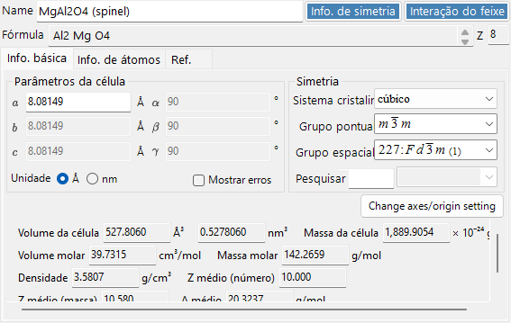

A parte superior do painel sempre exibe **Name** (nome do cristal), **Fórmula** (fórmula química, calculada a partir da lista de átomos), **Z** (número de unidades de fórmula por célula unitária) e **Cor** (a cor de exibição do cristal, usada na visualização 3D da estrutura e nas curvas de perfil de difração). Os botões **Info. de simetria** e **Interação do feixe** abrem as janelas [Informação de simetria](2-symmetry-information.md) e [Interação do feixe](3-beam-interaction.md). Para % em massa, % atômica e conversão em óxidos, clique com o botão direito e escolha [Detalhes da composição química](#chemical-composition).

### Aba Info. básica {#basic-info-tab}

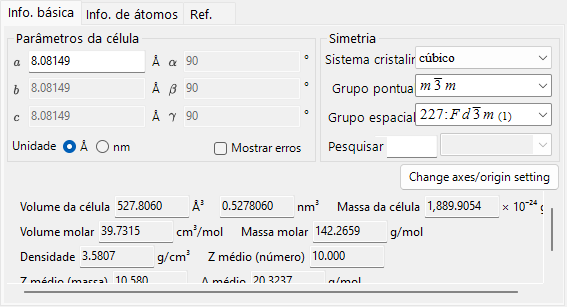

Parâmetros de rede, simetria e grandezas derivadas deles.

| Item | Descrição |
|------|------|
| Parâmetros da célula | Parâmetros de rede a, b, c (**Unidade**: Å = 10⁻¹⁰ m ou nm; a unidade é mantida para a próxima inicialização) e α, β, γ. A escolha de uma simetria os restringe automaticamente (por exemplo, a=b=c, α=β=γ=90° para cúbico). |
| Simetria | Escolha o **Sistema cristalino**, o **Grupo pontual** e o **Grupo espacial**. Digite na caixa **Pesquisar** para listar os candidatos correspondentes (diferencia maiúsculas de minúsculas). |
| Volume da célula / Massa da célula | Volume e massa da célula unitária. O volume é exibido em ų / nm³ conforme a seleção de **Unidade**; a massa, em 10⁻²⁴ g. |
| Volume molar / Massa molar / Densidade | Volume molar (cm³/mol, por unidade de fórmula), massa molar (g/mol) e densidade (g/cm³). Exibidos **somente quando os átomos foram inseridos**. |
| Z médio (número) / Z médio (massa) / A médio | Número atômico médio ponderado por número e por massa, e peso atômico médio por átomo (g/mol). As ocupações são levadas em conta. |
| Mostrar erros | Mostrar os campos de erro (±) dos parâmetros da célula. |
| Change axes/origin setting | O mesmo que o item do menu de contexto **Alterar configuração de eixos/origem**: converte para outra configuração de eixos/origem do mesmo grupo espacial. |
| Densidade atômica / Densidade eletrônica | Número de átomos e de elétrons por volume da célula, exibidos em Å⁻³ / nm⁻³ conforme a seleção de **Unidade**. |

### Aba Info. de átomos {#atom-tab}

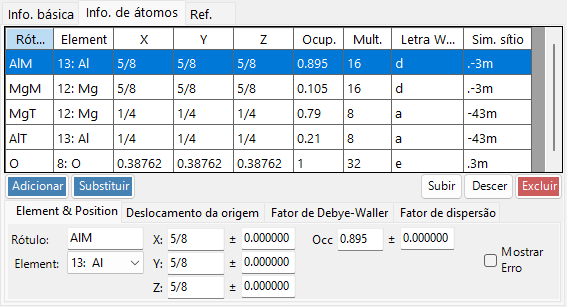

Defina a espécie, a posição, o fator de temperatura e o fator de espalhamento de cada átomo. Edite a lista de átomos com **Adicionar**, **Substituir** (substituir a linha selecionada), **Subir/Descer** (reordenar) e **Excluir**. A lista de átomos também mostra, para cada sítio, sua multiplicidade (**Mult.**), a letra de Wyckoff (**Letra Wyck.**) e a simetria do sítio (**Sim. sítio**). Cada átomo possui:

| Item | Descrição |
|------|------|
| Rótulo | Rótulo do átomo (qualquer identificador). |
| Element | Elemento (incluindo a valência iônica). |
| X, Y, Z | Coordenadas fracionárias (0–1). Frações como 1/2 ou 2/3 podem ser inseridas. |
| Occ | Ocupação (0–1). |

Clique com o botão direito em uma linha de átomo e escolha **Mostrar posições equivalentes do átomo** para abrir uma pequena janela que lista todas as posições geradas pelas operações de simetria do grupo espacial; seu botão **Copy** copia a lista como texto separado por tabulações (por exemplo, para colar em uma planilha).

**Deslocamento da origem**: desloca a origem de todas as coordenadas atômicas. Escolha o sinal com **+** / **−** e pressione um dos vetores predefinidos — (⅛ ⅛ ⅛), (¼ ¼ ¼), (0 ¼ ⅛), (¼ 0 ¼), (0 ¼ ¼), (¼ ¼ 0), (¼ −¼ 0), (¼ −¼ ¼), (0 ¼ −⅛) — ou use **Apply custom shift** para um valor arbitrário.

**Deslocamento (B)** (fator de Debye–Waller / de temperatura):

| Item | Descrição |
|------|------|
| Notation | Usar a notação U ou B. Ao trocar, os valores exibidos são convertidos ($B = 8\pi^2 U$). |
| Modelo | Isotropia ou anisotropia. |
| U##, β## | Para o caso anisotrópico, inserir cada componente: $U_{ij}$ em Ų, ou na notação B os $\beta_{ij} = 2\pi^2 a^*_i a^*_j U_{ij}$ adimensionais (iguais a B(i,j) nos arquivos AMCSD). |

**Fator de dispersão**: escolha o fator de espalhamento usado para cada átomo.

| Radiação | Fonte / configuração |
|-----------|------|
| Raios X | Fatores de espalhamento incluindo a valência iônica (International Tables for Crystallography, Vol. C). |
| Elétrons | Fatores de espalhamento de elétrons — átomos neutros de Peng, Ren, Dudarev & Whelan (1996), *Acta Cryst.* **A52**, 257–276; íons de Peng (1998), *Acta Cryst.* **A54**, 481–485. |
| Nêutrons | Comprimentos de espalhamento de nêutrons. Escolha **Natural isotope abundance** ou **Custom isotope abundance** (uma composição isotópica arbitrária). |

### Aba Ref. {#reference-tab}

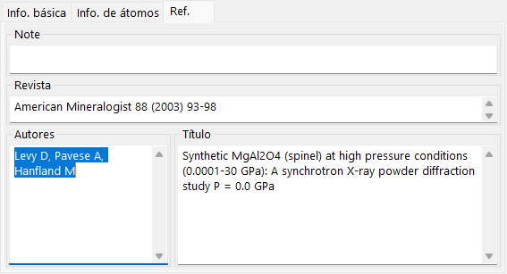

Registre a fonte da estrutura: **Note**, **Autores**, **Revista** e **Título**.

### Menu de contexto (clique direito)

Clique direito em uma área vazia do controle para estas ações principais:

| Item de menu | Ação |
|-----------|------|
| Detalhes da composição química | Abre a janela [Detalhes da composição química](#chemical-composition) (% em massa, % atômica, número de átomos normalizado, conversão em óxidos). |
| Interação do feixe | Abre a janela [Interação do feixe](3-beam-interaction.md). |
| Informação de simetria | Abre a janela [Informação de simetria](2-symmetry-information.md). |
| Importar de CIF ou AMC... | Carrega um cristal de um arquivo CIF / AMC. |
| Exportar para CIF | Exporta o cristal atual como CIF. |
| Reverter constantes de célula | Restaura as constantes de célula para os valores carregados inicialmente. |
| Converter para o grupo espacial P1 | Expande a estrutura para o grupo espacial P1. |
| Converter em superestrutura | Converte em uma superestrutura com múltiplos inteiros de a, b, c (caixa de diálogo de tamanho). |
| Alterar configuração de eixos/origem | Converte em um grupo espacial equivalente (uma configuração de eixos diferente). |

#### Detalhes da composição química {#chemical-composition}

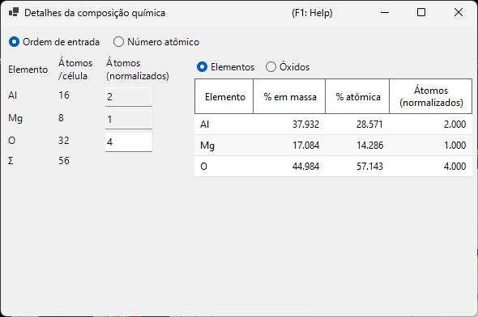

Mostra a composição do cristal atual, calculada a partir da lista de átomos (o número de átomos de cada elemento é a soma de multiplicidade × ocupação nos seus sítios). A janela acompanha o cristal selecionado na janela principal.

- A tabela da direita mostra **% em massa**, **% atômica** e **Átomos (normalizados)** de cada elemento; a tabela da esquerda mostra os átomos por célula. Clique numa caixa da coluna normalizada da tabela esquerda para usar esse elemento como referência e digite o seu número de átomos (por exemplo, O = 24). Por padrão a referência é O (ou o primeiro elemento) e a coluna normalizada mostra a fórmula química.
- **Óxidos**, **Haletos** e **Sulfetos** (só aparecem os aplicáveis ao cristal) convertem formalmente a composição em componentes usando a **Valência** de cada elemento. As valências podem ser editadas (frações como 8/3 são aceitas). Se não forem digitadas, Fe vale 2, os demais elementos usam a valência do íon escolhido para o fator de espalhamento de raios X ou, se não houver, um estado de oxidação comum. **Σ=0** define a valência que anula a carga total e **Restaurar padrão** apaga as valências digitadas. As valências digitadas ficam com o cristal e são salvas nas listas de cristais em XML.
- **Ordem de entrada** / **Número atômico** alternam a ordem dos elementos.

---

## Painel de funções {#functions}

A faixa vertical de botões à direita inicia as janelas de análise e simulação listadas abaixo.

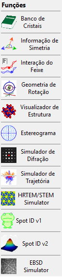

| Botão | Descrição | Detalhes |
|--------|-------------|---------|
| Banco de Cristais | Pesquisar e importar cristais dos bancos de dados incluídos / on-line | [1. Banco de dados de cristais](1-crystal-database.md) |
| Informação de Simetria | Informações de grupo espacial e diagramas de simetria das *International Tables* Vol. A | [2. Informação de simetria](2-symmetry-information.md) |
| Interação do Feixe | Interação feixe–cristal: reflexões, atenuação, fatores de espalhamento, fluorescência | [3. Interação do feixe](3-beam-interaction.md) |
| Geometria de Rotação | Matriz de rotação 3D / ângulos do goniômetro | [4. Geometria de rotação](4-rotation-geometry.md) |
| Visualizador de Estrutura | Estrutura cristalina 3D | [5. Visualizador de estrutura](5-structure-viewer.md) |
| Estereonete | Projeção estereográfica | [6. Estereonete](6-stereonet.md) |
| Simulador de Difração | Difração de raios X / elétrons de monocristal | [7. Simulador de difração](7-diffraction-simulator/index.md) |
| Simulador de Trajetória | Simulação de Monte Carlo de trajetórias eletrônicas | [8. Trajetórias eletrônicas](8-electron-trajectory.md) |
| Simulador HRTEM/STEM | Simulação de imagem HRTEM / STEM | [9. Simulador HRTEM/STEM](9-hrtem-stem-simulator/index.md) |
| Spot ID v1 | Indexação de padrões SAED (antigo "TEM ID") | [10. Spot ID v1](10-spot-id.md) |
| Spot ID v2 | Detecção e indexação de pontos | [11. Spot ID v2](11-spot-id-v2.md) |
| Simulador EBSD | Simulação de padrões EBSD | [12. Simulação EBSD](12-ebsd-simulation.md) |
| Difração de Pó | Difração policristalina (de pó) — ativar via **Opções ▸ Função de difração de pó (em desenvolvimento)** | - |

---

## Veja também

- [Banco de dados de cristais](1-crystal-database.md)
- [Geometria de rotação](4-rotation-geometry.md)
- [Visualizador de estrutura](5-structure-viewer.md)
- [Simulador de difração](7-diffraction-simulator/index.md)
- [Atalhos de teclado e mouse](21-shortcuts.md)
- [Sistema de coordenadas básico e orientação do cristal](appendix/a1-coordinate-system/1-orientation.md)
