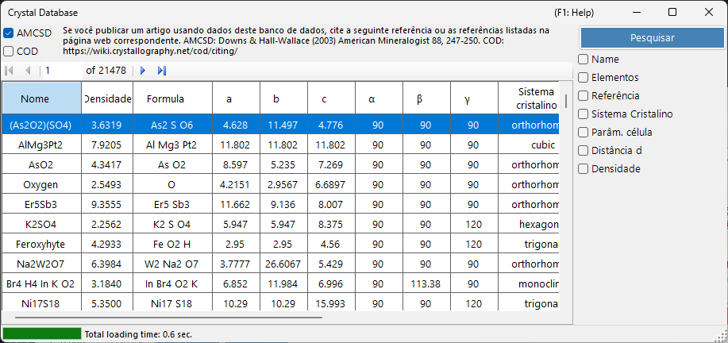
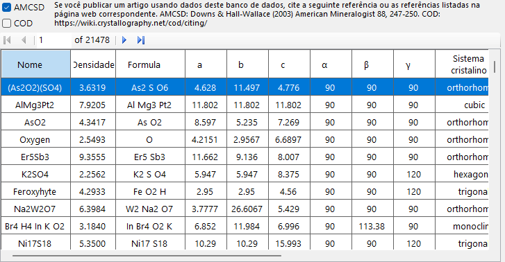
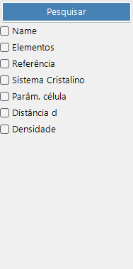

# Banco de dados de cristais

O **Banco de dados de cristais** oferece funções para pesquisar e importar estruturas cristalinas de duas fontes, selecionáveis com as caixas de seleção **AMCSD** e **COD**:

- **AMCSD** : o [American Mineralogist Crystal Structure Database](https://www.rruff.net/) incluído (mais de 20.000 estruturas).
- **COD** : o [Crystallography Open Database](https://www.crystallography.net/cod/). Como o arquivo é grande, ele não é incluído no instalador; o arquivo do banco de dados é baixado automaticamente na primeira utilização. Quando o arquivo é atualizado no servidor, você é solicitado a baixá-lo novamente.

Por favor, cite as seguintes referências ao utilizar esses bancos de dados.

Ao utilizar **AMCSD**:

> Downs, R.T. and Hall-Wallace, M. (2003) The American Mineralogist Crystal Structure Database. *American Mineralogist* **88**, 247-250.

Ao utilizar **COD**:

> Gražulis, S. et al. (2009) Crystallography Open Database – an open-access collection of crystal structures. *Journal of Applied Crystallography* **42**, 726-729.
>
> Gražulis, S. et al. (2012) Crystallography Open Database (COD): an open-access collection of crystal structures and platform for world-wide collaboration. *Nucleic Acids Research* **40**, D420-D427.

---

## Atalhos de teclado e mouse

Esta janela não possui combinações com teclas modificadoras; ela é operada por cliques comuns. As únicas entradas não óbvias são:

| Atalho | Ação |
|----------|--------|
| <kbd>F1</kbd> | Abrir esta página do manual online |
| <kbd>ENTER</kbd> em qualquer campo de pesquisa | Executar a pesquisa no banco de dados (equivale ao botão **Pesquisar**) |
| Clicar em uma linha da tabela de resultados | Carregar esse cristal na janela principal |
| Clicar em um elemento no pop-up **Tabela Periódica** | Alternar seu filtro: *ignore* → *must include* → *must exclude* |

→ Consulte **[21. Atalhos de teclado e mouse](21-shortcuts.md)** para uma visão geral de cada janela.

---

## Tabela

Exibe os cristais que correspondem aos critérios de pesquisa. Selecione um cristal para transferi-lo para a Informação do cristal da janela principal. Pressione **Adicionar** ou **Substituir** para adicioná-lo à Lista de cristais.

---

## Opções de pesquisa

Insira abaixo os critérios de pesquisa e pressione o botão **Pesquisar** ou a tecla **Enter**.

| Critério | Descrição |
|-----------|-------------|
| **Name** | Nome do cristal |
| **Elementos** | Seletor da tabela periódica (pode/deve/não deve conter) |
| **Referência** | Título, periódico, autor |
| **Sistema Cristalino** | Selecionar o sistema cristalino |
| **Parâm. célula** | Constantes de rede e erro |
| **Distância d** | Valores de d das reflexões intensas e erro |
| **Densidade** | Densidade e erro |

### Name

Correspondência de texto livre com o nome do cristal. Correspondências parciais são permitidas; maiúsculas e minúsculas não são diferenciadas. Apenas os critérios cujas caixas de seleção estão marcadas são aplicados, e eles são combinados com E lógico (AND).

### Element

Pressione o botão **Tabela Periódica** para abrir o seletor de elementos. Cada botão de elemento alterna entre três estados:

- **pode ou não incluir** (padrão — amarelo)
- **deve incluir** (azul)
- **deve excluir** (vermelho)

Um cristal deve conter todos os elementos marcados como *deve incluir* e nenhum dos marcados como *deve excluir*; as entradas sem dados de átomos são excluídas enquanto o critério **Elementos** estiver ativo.

Os três botões na parte superior da janela redefinem todos os elementos para um dos três estados com um único clique.

### Reference

Correspondência de texto livre (parcial, sem diferenciar maiúsculas de minúsculas) com os metadados da publicação: título do artigo, nome do periódico e lista de autores.

### Crystal system

Restringe a pesquisa a um sistema cristalino específico (cubic, tetragonal, orthorhombic, hexagonal, trigonal, monoclinic, triclinic). O primeiro item, *Unknown*, não aplica nenhuma restrição.

### Pesquisa por parâmetros de célula

Insira as constantes de rede desejadas *a*, *b*, *c* (Å) e *α*, *β*, *γ* (°) e os erros aceitáveis: uma tolerância relativa (±%) comum a *a*, *b*, *c* e uma tolerância absoluta (±°) comum aos ângulos. Um valor 0 significa que o parâmetro é ignorado.

### d-spacing

Insira até três distâncias *d* (Å; marque cada uma para usá-la), cada uma com uma tolerância relativa (±%). Um cristal corresponde quando todos os valores inseridos coincidem com alguma das suas reflexões mais intensas armazenadas no banco de dados (até 16, ordenadas pela intensidade de difração de pó de raios X em λ = 1,54 Å). Com **Ignorar fator de dispersão** marcado, os valores são comparados com todas as distâncias *d* geometricamente possíveis calculadas a partir da célula unitária (incluindo as reflexões sistematicamente ausentes). Útil quando, a partir de um experimento, somente as posições dos picos de difração são conhecidas.

### Density

Filtrar pela densidade de massa (g/cm³) dentro de uma tolerância relativa (±%).

---

## Veja também

- [Janela principal](0-main-window.md)
- [Informação de simetria](2-symmetry-information.md)
- [Interação do feixe](3-beam-interaction.md)
- [Visualizador de estrutura](5-structure-viewer.md)
