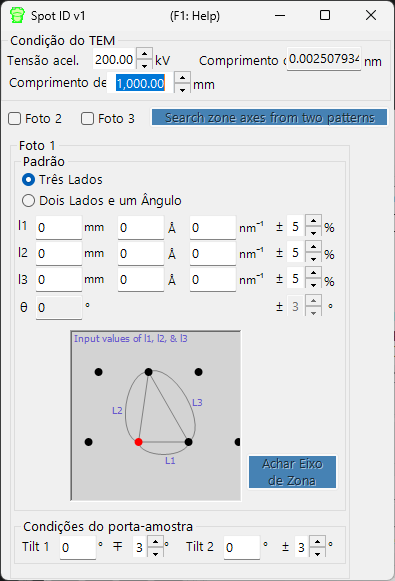

# Spot ID v1

**Spot ID v1** (o antigo **TEM ID**) busca eixos de zona candidatos a partir da geometria das reflexões de um a três padrões de difração, inserida numericamente. A detecção, o ajuste e a indexação de reflexões numa imagem são feitos no [Spot ID v2](11-spot-id-v2.md).

---

## Atalhos de teclado e mouse

O Spot ID v1 recebe a geometria das reflexões como **entrada numérica** (o antigo fluxo de trabalho *TEM ID*); não tem visualização de imagem (o carregamento de imagens, o zoom com o mouse, a detecção de reflexões e a seleção manual de reflexões pertencem ao [Spot ID v2](11-spot-id-v2.md)). O único atalho está na janela de resultados:

| Atalho | Ação |
|----------|--------|
| <kbd>F1</kbd> | Abrir esta página do manual online |
| Clique duplo em uma linha da lista de resultados | Selecionar esse cristal e girá-lo até o eixo de zona correspondente |

→ Consulte **[21. Atalhos de teclado e mouse](21-shortcuts.md)** para uma visão geral de todas as janelas.

---

## Busca de eixo de zona a partir da geometria das reflexões (antigo TEM ID)

Quando você não tem uma imagem para carregar, ainda é possível buscar eixos de zona candidatos inserindo manualmente a geometria de um padrão de difração de elétrons de área selecionada (SAED). Insira as condições de observação do TEM e a geometria das reflexões e, em seguida, pressione **Encontrar Eixo de Zona** de uma foto (ou **Search zone axes from two/three patterns** para usar várias fotos juntas) para encontrar orientações de cristal candidatas.

### Condição do TEM {#tem-condition}

Insira **Tensão acel.** (kV, padrão 200) e **Comprimento de câmera** (mm, padrão 1000). O **Comprimento de onda** (nm) é calculado a partir da tensão e exibido somente para leitura.

### Foto 1, 2, 3 {#photo-1-2-3}

Insira a geometria das reflexões de difração.

- Para inserir a distância entre reflexões no detector, use a caixa **mm**.
- Se você conhece o valor de *d*, insira-o nas unidades **Å** ou **nm⁻¹**.

Modo **Três Lados** : Insira os comprimentos dos três lados de um triângulo que tem o direct spot como um dos vértices.

Modo **Dois Lados e um Ângulo** : Insira os comprimentos de dois lados (incluindo o direct spot) e o ângulo entre eles.

- Tolerâncias (as caixas **±**) : cada comprimento tem uma tolerância em % (0–50, padrão 5) e θ em graus (0–30, padrão 3). O valor não inserido (θ no modo de três lados, l3 no modo de dois lados) é calculado e exibido, e um esboço do padrão resultante é desenhado ao lado das entradas.
- **Condições do porta-amostra** : **Tilt 1** / **Tilt 2** (°) do porta-amostra goniométrico com que a foto foi obtida, cada um com uma tolerância (0–10°, padrão 3°). Os ângulos entre as configurações do porta-amostra das fotos são calculados e exibidos.
- **Foto 2** / **Foto 3** : ativam a segunda e a terceira fotos. As caixas de seleção entre as fotos tratam l1 (ou l2) de duas fotos como a mesma reflexão e copiam o seu comprimento.
- **Encontrar Eixo de Zona** (na Foto 1, **Achar Eixo de Zona**) busca numa única foto; **Search zone axes from two patterns** / **from three patterns** busca combinações consistentes com todas as fotos ativadas e com os ângulos de inclinação do porta-amostra entre elas. A busca percorre todos os cristais selecionados na lista da janela principal (a seleção múltipla fica habilitada enquanto o Spot ID v1 está aberto). Se forem encontrados mais de 1000 candidatos, nada é listado e você é solicitado a restringir as condições; caso contrário, a janela de resultados é aberta. Clique duas vezes numa linha para selecionar o cristal e girá-lo até essa orientação.

---

## Veja também

- [Spot ID v2](11-spot-id-v2.md)
- [Simulador de difração](7-diffraction-simulator/index.md)
- [Janela principal](0-main-window.md)
- [Banco de dados de cristais](1-crystal-database.md)
- [Simulação EBSD](12-ebsd-simulation.md)
