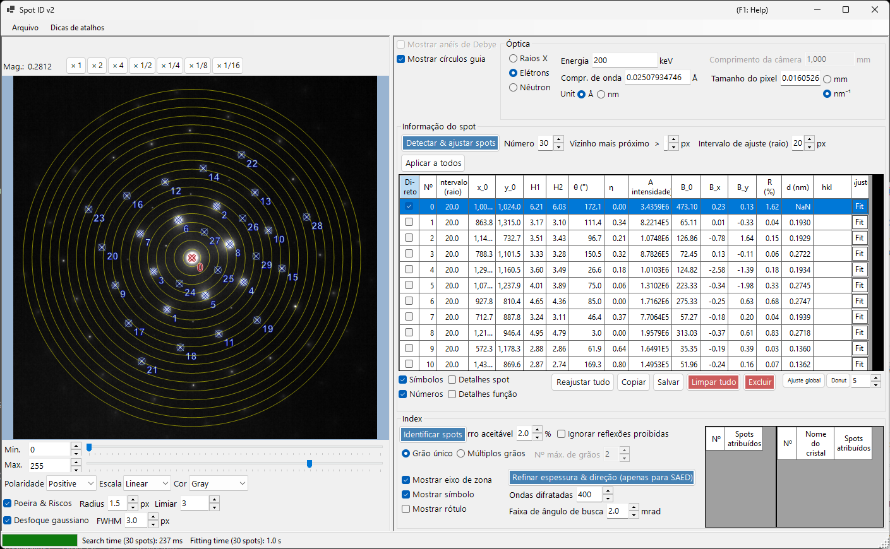
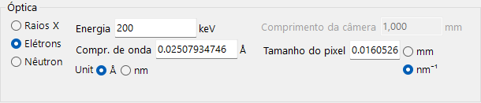
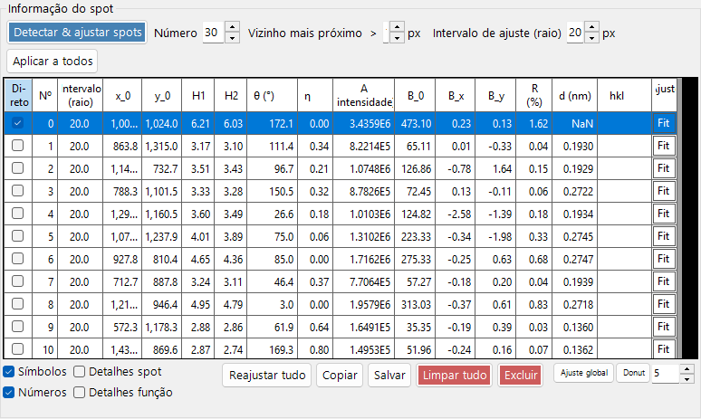
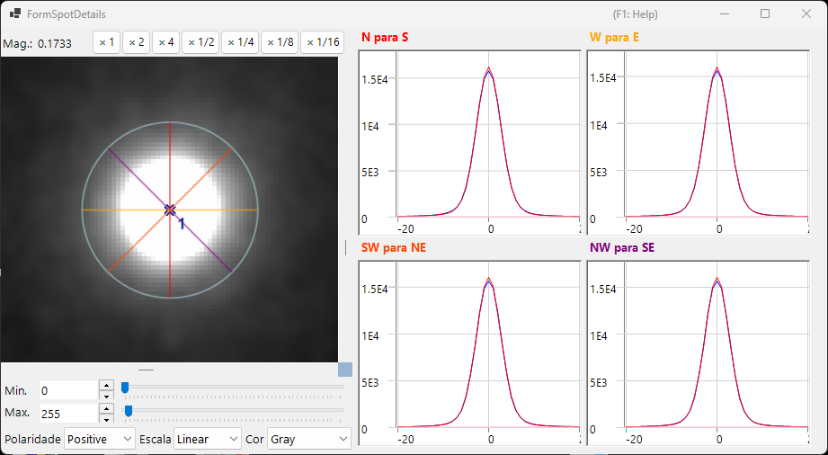
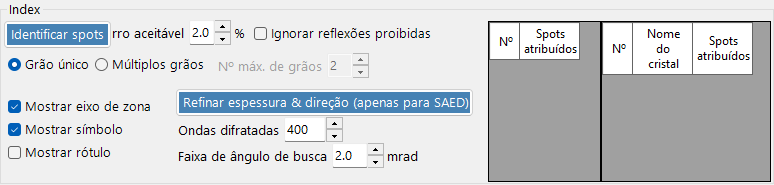

# Spot ID v2

**Spot ID v2** detecta, ajusta e indexa os spots de difração numa imagem de difração experimental. O [Spot ID v1](10-spot-id.md) (o antigo TEM ID), por sua vez, recebe a geometria dos spots como entrada numérica.

---

## Atalhos de teclado e mouse

Você constrói a lista de spots diretamente sobre a imagem carregada. O painel de imagem usa a [navegação de visualização de imagem](21-shortcuts.md) padrão do ReciPro para deslocamento/zoom; a edição de spots acrescenta as combinações abaixo.

| Atalho | Ação |
|----------|--------|
| <kbd>F1</kbd> | Abrir esta página do manual on-line |
| Clique duplo esquerdo na imagem | Adicionar um spot nesse ponto (ajustado ao pico) |
| <kbd>CTRL</kbd> + clique duplo esquerdo | Adicionar um spot e marcá-lo como o feixe direto (000) |
| Clique esquerdo em um spot | Selecionar o spot mais próximo |
| <kbd>CTRL</kbd> + clique direito em um spot | Excluir o spot mais próximo |
| <kbd>CTRL</kbd> + teclas de seta | Deslocar o spot selecionado em um pixel |
| Arrastar com botão esquerdo / meio (área vazia) | Deslocar a imagem |
| Roda do mouse | Aproximar / afastar o zoom no cursor |
| Arrastar uma caixa com o botão direito | Aproximar o zoom na região selecionada |
| Clique duplo direito | Afastar o zoom |
| Clique duplo no cabeçalho da linha de um spot (tabela) | Aplicar zoom nesse spot (×2) |

→ Consulte **[21. Atalhos de teclado e mouse](21-shortcuts.md)** para ver cada janela de relance.

---

## Menu Arquivo

Abrir uma imagem de difração; **Salvar** / **Copiar** gravam a imagem exibida como metarquivo (EMF) ou como imagem (PNG). As imagens também podem ser carregadas por arrastar e soltar. Para um arquivo Gatan DM3/DM4 calibrado em nm⁻¹, a radiação é definida como elétrons, e a tensão de aceleração e o tamanho do pixel (nm⁻¹) são lidos do arquivo (nesse caso o comprimento de câmera não é necessário).

**Salvar ▸ Candidate list (CSV)...** exporta os candidatos de orientação encontrados pela indexação e **Copiar ▸ Candidate list (TSV)** coloca a mesma tabela na área de transferência: uma linha por candidato × grão, com o posto, o índice do grão, o nome do cristal, os ângulos de Euler ZXZ (°), os nove elementos da matriz de rotação, o resíduo quadrático médio (nm⁻²), o número de pontos atribuídos e as atribuições ponto → (hkl). O CSV usa sempre o ponto como separador decimal; o TSV pode ser colado diretamente numa planilha.

---

## Óptica

### Fonte incidente

Selecione o tipo de radiação (raios X / elétron / nêutron) e defina a energia ou o comprimento de onda.

### Comprimento da câmera / Tamanho do pixel

O comprimento de câmera (mm) e o tamanho do pixel do detector (mm ou nm⁻¹). Quando um arquivo Gatan DM calibrado em nm⁻¹ é carregado, o tamanho do pixel (nm⁻¹) é lido do cabeçalho do arquivo e o comprimento de câmera não é usado (a caixa **Comprimento da câmera** fica desativada enquanto a unidade for nm⁻¹). Alterar o comprimento de onda, o comprimento de câmera ou a unidade do tamanho do pixel mantém as posições dos spots (em pixels) e recalcula os seus espaçamentos *d* com a nova calibração.

A posição da janela e a calibração (fonte, energia, comprimento de câmera e a unidade e o valor do tamanho do pixel) são mantidas para a próxima inicialização; abrir um arquivo de imagem que contenha uma calibração as substitui. <!-- 261105Cl 監査: NumericBoxPixelSize_ValueChanged (8860d40)、FormMain.cs の保存・復元 (dc42de3) -->

**Mostrar anéis de Debye** (desativado por padrão) desenha os anéis de Debye de todos os cristais selecionados na janela principal — cada cristal com a sua própria cor quando vários estão selecionados —, centrados no spot direto e com a calibração atual (comprimento de onda, comprimento de câmera, tamanho do pixel); os anéis das reflexões proibidas pelas regras de extinção não são desenhados. **Mostrar círculos guia** (ativado por padrão) desenha círculos guia sobre o padrão. <!-- 261106Cl 作者の決定 I10 -->

---

## Informação do spot

- **Detectar & ajustar spots**: Detecção automática de spots usando máximos locais e subtração de fundo.
- **Número**: O número máximo de spots a detectar.
- **Vizinho mais próximo**: A separação mínima (px) permitida entre spots detectados. Picos mais próximos do que isso são mesclados, evitando a detecção dupla do mesmo spot.
- **Intervalo de ajuste (raio)**: O raio (px) da região circular usada para ajustar o pico de cada spot. Os pixels dentro deste círculo são ajustados com uma função pseudo-Voigt.
- **Aplicar a todos**: Define o raio de ajuste de cada spot como o valor atual de **Intervalo de ajuste (raio)**.
- **Excluir / Limpar tudo**: Remover o spot selecionado ou todos os spots detectados.
- **Salvar** / **Copiar**: Salvar a tabela de spots num arquivo CSV ou copiá-la para a área de transferência como texto separado por tabulações. Ambos funcionam mesmo com um único spot. O CSV usa sempre o ponto como separador decimal e pode ser lido de volta com **Arquivo ▸ Carregar** (é preciso carregar uma imagem antes; os spots são adicionados aos já listados). <!-- 261105Cl 監査: GetSpotListText / readCSV (7f65908) -->
- **Reajustar tudo**: Reajustar as posições e intensidades de todos os spots detectados.
- **Símbolos** / **Números**: Mostrar símbolos marcadores / números sobre os spots observados (ambos ativados por padrão).
- **Ajuste global**: Realizar um ajuste global de todas as posições dos spots de uma só vez (experimental).
- **Donut**: Aplicar uma subtração de fundo em forma de rosca (experimental); a caixa ao lado define a largura (px) do anel em torno de cada spot cuja média é subtraída como fundo local.
- **Detalhes spot**: Quando marcado, abre uma janela mostrando informações detalhadas sobre o spot atualmente selecionado.
- **Detalhes função** (desmarcado quando a janela é aberta): Mostra uma figura da função pseudo-Voigt bidimensional e seus parâmetros (x_0, y_0, H1, H2, θ, η, A, B_0, B_x, B_y) usados na tabela de spots.

---

## Index

- **Identificar spots**: Executa o algoritmo de indexação para encontrar o cristal e o eixo de zona que melhor correspondem. Durante a execução, um botão **Parar** ocupa o seu lugar e interrompe a busca. São necessários uma imagem carregada, pelo menos dois spots e pelo menos um cristal selecionado na lista de cristais da janela principal; caso contrário, uma mensagem informa o que falta. Enquanto o Spot ID v2 está aberto, a lista de cristais da janela principal permite seleção múltipla. <!-- 261105Cl 監査: buttonIdentifySpots_Click (494ef52)、FormMain.cs の複数選択 (4020433) -->
- **Erro aceitável**: Tolerância relativa do espaçamento d em % (0.1–10, padrão 2). A tolerância angular entre spots é derivada dela como asin(tolerância)/2.
- **Ignorar reflexões proibidas** (desativado por padrão; apenas difração de elétrons): Quando marcado, todas as reflexões sistematicamente ausentes, incluindo as proibidas por eixos helicoidais e planos de deslizamento, são excluídas das reflexões candidatas. Quando desmarcado, apenas as ausências devidas à centragem da rede (I, F, A, B, C, R) são excluídas, de modo que as reflexões proibidas por eixos helicoidais/planos de deslizamento, que podem aparecer por difração múltipla, continuam candidatas. Para raios X e nêutrons, todas as reflexões ausentes são sempre excluídas (tratamento cinemático); a caixa aparece então marcada e esmaecida, e volta ao estado anterior quando a fonte volta a ser elétrons. <!-- 261106Cl 作者の決定 I4 -->
- **Grão único / Múltiplos grãos**: Buscar uma única orientação (monocristal) ou várias orientações (uma região policristalina / de múltiplos grãos). Para múltiplos grãos, **Nº máx. de grãos** define o limite superior do número de grãos a buscar.
- **Mostrar eixo de zona** / **Mostrar símbolo** / **Mostrar rótulo**: Sobrepõem o eixo de zona e os símbolos / rótulos de índice dos spots calculados.
- **Refinar espessura & direção (apenas para SAED)**: Funciona apenas com **Elétrons** como fonte (caso contrário, a barra de status informa isso e nada é calculado). <!-- 261105Cl 監査: ButtonRefineThicknessAndDirection_Click / Bethe_CbedCompleted (ed018ca) --> Refina a espessura da amostra (nm) e a direção do feixe do grão selecionado, comparando as intensidades observadas dos spots com cálculos dinâmicos (ondas de Bloch). **Ondas difratadas** (1–2048, padrão 400) é o número de feixes e **Faixa de ângulo de busca** (mrad, 1–10, padrão 2) é o semi-intervalo angular das direções incidentes pesquisadas. O refinamento não pode ser interrompido (o botão **Parar** pertence apenas a **Identificar spots**); a janela fica desativada até que ele termine. São testadas espessuras de 50–549 nm (passo de 1 nm) e direções incidentes numa grade quadrada em torno da orientação atual do grão (passo = 1/15 da faixa de busca), e é adotado o par que minimiza Σ (Iobs − a·Icalc)² sobre os spots indexados (a: melhor fator de escala). A melhor espessura é passada ao Simulador de difração, e a orientação do grão (aplicada também à janela principal, a menos que o cristal ali tenha sido trocado durante o cálculo) é inclinada de modo que a melhor direção se torne a direção do feixe; a rotação no plano é mantida. O resultado (espessura, inclinação em mrad, eixo de zona, resíduo) é exibido na barra de status. Se a melhor direção ficar na borda da faixa de busca, a barra de status o indica, pois o ótimo pode estar fora dela: pressione o botão novamente (a busca é então centrada na orientação refinada) ou amplie a faixa. <!-- 261105Cl 方位の精密化の実装に合わせて追記 (根拠: FormSpotIDV2.cs: ButtonRefineThicknessAndDirection_Click / Bethe_CbedCompleted) -->
- **Resultados**: As melhores correspondências são exibidas com o nome do cristal, o eixo de zona [uvw] e os índices individuais dos spots (hkl). Selecionar uma única linha de grão também seleciona o seu cristal na janela principal e define essa orientação. <!-- 261105Cl 監査: bindingSourceGrains_CurrentChanged (I11) -->

---

## Veja também

- [Spot ID v1](10-spot-id.md)
- [Simulador de difração](7-diffraction-simulator/index.md)
- [Janela principal](0-main-window.md)
- [Atalhos de teclado e mouse](21-shortcuts.md)
