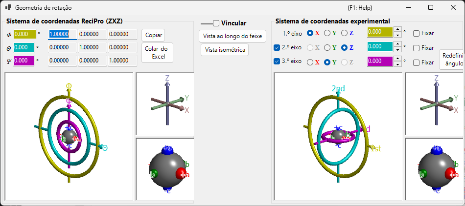

# Geometria de rotação

Esta janela representa o estado de rotação de um cristal como uma matriz 3×3 e converte entre diferentes sistemas de coordenadas eulerianos.

O ReciPro usa três ângulos de Euler — **Ψ**, **Θ** e **Φ** — aplicados na ordem **Z–X–Z**. No entanto, essa convenção não corresponde necessariamente aos eixos do goniômetro do seu instrumento real. A janela **Geometria de rotação** permite converter os ângulos de Euler do ReciPro para um sistema de coordenadas definido arbitrariamente, apoiando o ajuste do goniômetro no laboratório. <!-- 261105Cl 監査: 画面の欄の見出し・ツールチップ (Φ, Θ, Ψ) に合わせ θ → Θ に統一 -->

---

## Atalhos de teclado e mouse

Todas as seis visualizações 3D (os painéis do ReciPro e do goniômetro experimental / eixos / objetos) estão **vinculadas** — girar qualquer uma gira todas as seis em conjunto. Elas compartilham a [navegação de visualização OpenGL](21-shortcuts.md) padrão do ReciPro.

| Atalho | Ação |
|----------|--------|
| <kbd>F1</kbd> | Abrir esta página do manual on-line |
| Arrastar com o botão esquerdo em uma visualização | Girar o modelo (todas as seis visualizações giram juntas) |
| Roda do mouse, ou arrastar com o botão direito para cima/baixo | Zoom (as visualizações grandes do goniômetro) |
| <kbd>CTRL</kbd> + arrastar com o botão direito para cima/baixo | Alterar a distância da câmera (apenas no modo de perspectiva) |
| <kbd>CTRL</kbd> + clique duplo com o botão direito | Alternar entre projeção ortográfica e em perspectiva |

As pequenas visualizações *Axes* e *Objects* têm zoom e deslocamento desativados. Não há atalhos de teclado além de <kbd>F1</kbd>.

---

## Sistema de coordenadas do ReciPro (ZXZ)

A metade superior da janela mostra o estado de rotação no "sistema de coordenadas do ReciPro".

- **Φ, Θ, Ψ** são caixas somente leitura que mostram a orientação atual (os ângulos de Euler da Janela principal). As rotações feitas enquanto esta janela está fechada são exibidas quando ela é reaberta. <!-- 261105Cl 監査: 読み取り専用の表示・開き直したときの反映 (FormRotation.cs) -->
- **Rotation matrix** exibe a matriz 3×3 correspondente ao estado de rotação atual.

### Φ, Θ, Ψ (ângulos de Euler Z–X–Z)

A orientação do cristal é parametrizada por três rotações. Descritas no referencial **solidário ao corpo (intrínseco)**, elas são aplicadas nesta ordem:

1. **Φ** — primeira rotação em torno do eixo **Z**.
2. **Θ** — rotação em torno do eixo **X** do referencial girado uma vez.
3. **Ψ** — segunda rotação em torno do eixo **Z** do referencial girado duas vezes.

A mesma rotação vista no referencial **fixo do laboratório** é a sequência inversa — Ψ em torno de $Z$, depois Θ em torno de $X$, depois Φ em torno de $Z$ — que é a descrição usada no [Apêndice A1.1](appendix/a1-coordinate-system/1-orientation.md). Ambas fornecem a mesma matriz $R$ abaixo; Φ é simplesmente o eixo mais externo (como em um goniômetro) e Ψ o mais interno.

As caixas Φ, Θ, Ψ e as nove caixas da matriz são exibições **somente leitura**. Para alterar a orientação, gire o cristal na Janela principal, use **Colar do Excel** ou (com **Vincular** marcado) edite os ângulos dos eixos experimentais abaixo; cada alteração é propagada para a Janela principal e para todos os simuladores vinculados.

### Rotation matrix

A matriz 3 × 3 produzida a partir dos valores atuais (Φ, Θ, Ψ). Use **Copiar** / **Colar do Excel** para transferir a matriz de ida e volta por meio de uma planilha.

A matriz segue uma única convenção em todos os lugares em que aparece no ReciPro:

$$
\mathbf{v}_{\mathrm{rot}} = R\,\mathbf{v}_{0}
$$

- \(R\) é a rotação **ativa** do cristal, expressa no referencial de laboratório fixo ao monitor (\(X\) para a direita, \(Y\) para cima, \(Z\) na direção do observador — ver o [Apêndice A1.1](appendix/a1-coordinate-system/1-orientation.md)).
- \(\mathbf{v}_{0}\) : coordenadas cartesianas (vetor coluna) de uma direção fixa ao cristal na **orientação inicial** (\(c \parallel Z\), \(b\) no plano \(YZ\)).
- \(\mathbf{v}_{\mathrm{rot}}\) : coordenadas da mesma direção após a rotação, ainda no referencial de laboratório.
- Em \(\Phi=\Theta=\Psi=0\), \(R\) é a matriz identidade. \(R\) é ortonormal com determinante +1, portanto a transformação inversa é simplesmente a transposta: \(R^{-1}=R^{\mathsf T}\).

Em termos dos ângulos de Euler, \(R = R_Z(\Phi)\,R_X(\Theta)\,R_Z(\Psi)\) (rotações destras em torno dos eixos fixos; \(\Psi\) age primeiro sobre o vetor):

$$
R=\begin{pmatrix}
\cos\Phi\cos\Psi-\cos\Theta\,\sin\Phi\sin\Psi & -\cos\Phi\sin\Psi-\cos\Theta\,\sin\Phi\cos\Psi & \sin\Theta\,\sin\Phi\\
\sin\Phi\cos\Psi+\cos\Theta\,\cos\Phi\sin\Psi & -\sin\Phi\sin\Psi+\cos\Theta\,\cos\Phi\cos\Psi & -\sin\Theta\,\cos\Phi\\
\sin\Theta\,\sin\Psi & \sin\Theta\,\cos\Psi & \cos\Theta
\end{pmatrix}
$$

Para aplicá-la a índices cristalográficos, converta-os primeiro em coordenadas cartesianas da orientação inicial: uma direção \([uvw]\) torna-se \(\mathbf{v}_0 = u\mathbf{a}+v\mathbf{b}+w\mathbf{c}\), e uma normal de plano \((hkl)\) torna-se \(\mathbf{v}_0 = h\mathbf{a}^{*}+k\mathbf{b}^{*}+l\mathbf{c}^{*}\) (eixos recíprocos).

A mesma matriz (\(R_{ij}\) = linha \(i\), coluna \(j\)) aparece em:

- **Copiar** / **Colar do Excel** nesta janela (3 × 3, separada por tabulações, linhas de cima para baixo);
- `Dir.GetRotationMatrix()` / `Dir.SetRotationMatrix()` e `Dir.GetEuler()` na [API de macros](20-macro/1-built-in-functions.md) (nove elementos na ordem das linhas \(R_{11}, R_{12}, R_{13}, R_{21}, \ldots, R_{33}\));
- as colunas **R11**–**R33** da lista de candidatos salva pelo [Spot ID v2](11-spot-id-v2.md).

### Janelas OpenGL

A visualização 3D mostra a rotação atual usando três toros coloridos (rosquinhas):

| Cor | Ângulo de Euler | Nível do goniômetro |
|--------|------------|-----------------|
| **Amarelo** | Φ | 1º eixo (superior) |
| **Azul claro** | Θ | 2º eixo (intermediário) |
| **Rosa** | Ψ | 3º eixo (inferior) |

As setas **vermelha**, **verde** e **azul** representam os eixos X, Y, Z em coordenadas cartesianas do espaço real. Estes *não* são os mesmos que os eixos cristalinos mostrados na Janela principal.

A esfera cinza no centro representa a amostra. As pequenas esferas vermelha / verde / azul (rotuladas **+a/−a**, **+b/−b**, **+c/−c**) marcam as direções dos eixos *a*, *b*, *c* normalizados do cristal após a rotação (esfera maior = extremidade +). Em Φ = Θ = Ψ = 0 elas mostram a orientação inicial do cristal (*c* ∥ +Z, *b* no plano YZ), de modo que *a* e *b* coincidem com +X e +Y apenas para células ortogonais.

> **Nota**: Arrastar na janela OpenGL altera apenas a *direção de projeção* desta visualização, não a orientação do cristal em si. Para girar o cristal, use a Janela principal.

### Botões

| Botão | Ação |
|--------|--------|
| Copiar | Copiar a matriz de rotação 3×3 como texto separado por tabulações, uma linha da matriz por linha de texto; ela pode ser colada de volta com **Colar do Excel** |
| Colar do Excel | Definir a matriz de rotação a partir da área de transferência (3×3, separada por tabulações). Valores que não formam uma matriz de rotação (linhas e colunas ortonormais, determinante +1) são rejeitados com uma mensagem; pequenos desvios, como os arredondamentos de uma planilha (até 10⁻³), são corrigidos para a matriz de rotação mais próxima <!-- 261105Cl 監査: FormRotation.cs の Paste の検査 (RᵀR − I ≤ 1e-3, det > 0) と Copy の改行 (\r\n) --> |
| Vista ao longo do feixe | Igualar à projeção da Janela principal (eixo Z perpendicular à tela) |
| Vista isométrica | Mudar para projeção isométrica |

---

## Sistema de coordenadas experimental

A metade inferior define os ângulos de Euler em um conjunto arbitrário de eixos de rotação e lê/define o estado do goniômetro. Isso é chamado de **Sistema de coordenadas experimental**.

### 1º, 2º, 3º eixos

Selecione o eixo de rotação de cada nível do goniômetro (1º = superior, 2º = intermediário, 3º = inferior) entre **X**, **Y** ou **Z** (apenas os sentidos positivos do referencial de laboratório). O 2º eixo não pode ser igual ao 1º, nem o 3º igual ao 2º (o botão de opção conflitante é desabilitado). O padrão é **X – Z – Y**. Os gráficos são atualizados de acordo.

O ângulo de cada eixo é exibido na caixa colorida correspondente (amarela, azul claro, rosa) e pode ser inserido diretamente (em graus; valores fora de −180…180° são reduzidos a esse intervalo). A rotação experimental é composta da mesma forma que a matriz do próprio ReciPro, com o 1º eixo como o mais externo:

$$
R_{\mathrm{exp}} = R_{\mathbf{e}_1}(\omega_1)\,R_{\mathbf{e}_2}(\omega_2)\,R_{\mathbf{e}_3}(\omega_3)
$$

(rotações destras em torno dos eixos fixos do laboratório $\mathbf{e}_i$).

| Controle | Ação |
|---------|--------|
| **2.º eixo** / **3.º eixo** | Ativar ou desativar esse nível (um goniômetro com apenas um ou dois eixos). Desativar define o ângulo correspondente como 0. Desativar o 2º eixo também desativa o 3º. |
| **Fixar** | Manter esse ângulo no valor atual enquanto **Vincular** decompõe uma nova orientação em ângulos do goniômetro (veja abaixo). |
| **Redef. ângulos** | Definir os três ângulos experimentais como 0. |

---

## Vincular {#link}

Quando **Vincular** está marcado, o sistema de coordenadas do ReciPro e o sistema de coordenadas experimental ficam acoplados: seus ângulos de Euler são ajustados de modo que a orientação do objeto permaneça consistente entre os dois sistemas.

No momento em que **Vincular** é marcado, o desvio $R_{\mathrm{base}} = R_{\mathrm{exp}}^{-1} R$ entre os dois sistemas é armazenado e, a partir daí, $R = R_{\mathrm{exp}}\,R_{\mathrm{base}}$. Enquanto estiverem vinculados:

- editar um ângulo experimental gira o cristal em todas as janelas;
- uma rotação incremental (botões de seta, CTRL+SHIFT+setas ou arrasto na Janela principal ou em outras janelas) é decomposta numericamente nos ângulos do goniômetro ativados e não marcados com **Fixar**, e o cristal é colocado na **orientação mais próxima que o goniômetro consegue alcançar** — assim, com eixos fixados ou desativados, o cristal segue as restrições do goniômetro, e não exatamente o mouse;
- as caixas **Fixar** da Janela principal continuam valendo: com uma delas marcada, a rotação incremental é feita em torno desse eixo de zona ou dessa normal de plano antes de ser decomposta; <!-- 261105Cl 監査: Link 中も主窓の Fix が効く (FormMain.cs, bc75fdc4) -->
- definir uma orientação absoluta — digitar nas caixas **Ângulos de Euler** da Janela principal (as caixas Φ, Θ, Ψ desta janela são somente leitura), **Redefinir rotação**, **Ver ao longo** ▸ **Eixo** / **Plano**, **Colar do Excel** nesta janela, selecionar na lista de cristais um cristal com outra orientação, ou definir a orientação a partir de outra janela (por exemplo, aplicando um resultado de indexação) ou de uma macro — aplica-a exatamente e **desmarca Vincular**; a barra de status da Janela principal o informa. Os ângulos do goniômetro, as configurações de **Fixar** e os eixos ativados são mantidos. Marque **Vincular** novamente para vincular na nova orientação. As operações que não alteram a orientação (por exemplo, editar o cristal) mantêm **Vincular** marcado. <!-- 261106Cl 作者の決定 G-13: FormRotation.cs SetRotation(bool) -->

Se o cristal for girado enquanto esta janela estiver fechada com **Vincular** marcado, reabrir a janela refaz a base do vínculo na orientação atual (como se **Vincular** fosse marcado de novo), de modo que nem a orientação do cristal nem os ângulos do goniômetro saltam. <!-- 261105Cl 監査: 開き直したときの Link の扱い (FormRotation.cs, ecdcec9a) -->

### Exemplo de fluxo de trabalho

1. No laboratório, ajuste um goniômetro de modo que o eixo *a* de um cristal fique alinhado com a direção de incidência dos raios X e o eixo *b* fique horizontal.
2. Insira os ângulos de Euler do goniômetro de laboratório no sistema de coordenadas experimental.
3. Na Janela principal, gire o cristal de modo que o eixo *a* aponte para a normal da tela e o eixo *b* fique horizontal.
4. Marque **Vincular** — agora, sempre que você apontar o cristal para uma orientação diferente na Janela principal, os ângulos de goniômetro necessários são exibidos automaticamente.

---

## Veja também

- [Janela principal](0-main-window.md)
- [Estereonete](6-stereonet.md)
- [Sistema de coordenadas básico e orientação do cristal](appendix/a1-coordinate-system/1-orientation.md)
- [Atalhos de teclado e mouse](21-shortcuts.md)
