# Visualizador de estrutura

O **Visualizador de estrutura** desenha a estrutura do cristal selecionado como uma imagem tridimensional usando OpenGL.

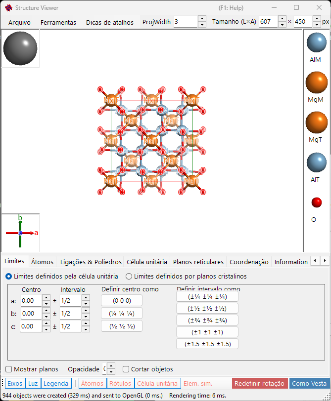

---

## Atalhos de teclado e mouse

A janela possui uma grande visualização 3D, além de dois pequenos gizmos — a caixa de **eixos do cristal** (canto inferior esquerdo) e a caixa de **direção da luz** (canto superior esquerdo) — e cada uma responde de forma diferente a um arraste com o botão esquerdo. A visualização principal usa a [navegação de visualização OpenGL](21-shortcuts.md) padrão do ReciPro.

| Atalho | Ação |
|----------|--------|
| <kbd>F1</kbd> | Abrir esta página do manual on-line |
| <kbd>CTRL</kbd>+<kbd>SHIFT</kbd>+<kbd>C</kbd> | Copiar a imagem renderizada para a área de transferência |
| Arraste com o botão esquerdo na visualização principal | Girar o modelo |
| Clique duplo com o botão esquerdo em um átomo | Mostrar as coordenadas do átomo clicado e as distâncias e os ângulos de ligação dos vizinhos ao seu redor (só os átomos exibidos podem ser selecionados) <!-- 261105Cl 監査: 近接原子はクリックした位置の周り (ca87b772, 8cc95680) --> |
| Arraste com o botão direito para cima/baixo ou roda do mouse | Zoom |
| Arraste com o botão do meio | Deslocar |
| <kbd>CTRL</kbd> + arraste com o botão direito para cima/baixo | Alterar a distância da câmera (somente no modo de perspectiva) |
| <kbd>CTRL</kbd> + clique duplo com o botão direito | Alternar entre projeção ortográfica e perspectiva |
| Arraste com o botão esquerdo no gizmo de **eixos do cristal** | Girar o modelo (sem giro no plano) |
| Arraste com o botão esquerdo no gizmo de **luz** | Alterar a direção da iluminação |

Os atalhos <kbd>CTRL</kbd>+<kbd>SHIFT</kbd> de toda a aplicação, descritos na [janela principal](0-main-window.md#keyboard-mouse-shortcuts), também funcionam enquanto esta janela está em foco.

→ Consulte **[21. Atalhos de teclado e mouse](21-shortcuts.md)** para uma visão geral de todas as janelas.

---

## Área principal

Estrutura cristalina 3D com fonte de luz, eixos do cristal e legenda de átomos. A posição e o tamanho da janela são mantidos para a próxima inicialização. <!-- 261106Cl 作者の決定 H6 -->
> A caixa **Tamanho (L×A)** no canto superior direito da janela define o tamanho em pixels da visualização 3-D (a janela é redimensionada de acordo); as imagens salvas e copiadas têm esse tamanho.
> A caixa **ProjWidth** ao lado dela mostra a largura da visualização projetada em nm. Edite o valor para aplicar zoom numericamente — ele permanece sincronizado com o zoom por arraste com o botão direito / roda do mouse na visualização.

---

## Barra de menu

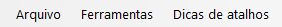

### Menu Arquivo

| Item de menu | Descrição |
|--------------|-----------|
| Salvar imagem ▸ Imagem principal / Legenda / Eixos cristalinos / Direção da luz | Salvar a visualização principal, a legenda de átomos ou um dos gizmos como PNG |
| Copiar imagem para a área de transferência ▸ Imagem principal / Legenda / Eixos cristalinos / Direção da luz <!-- 261105Cl 監査: copyToClipboardToolStripMenuItem.Text --> | Copiar a imagem (Ctrl+Shift+C copia a visualização principal) |
| Salvar vídeo ▸ Imagem principal / Eixos cristalinos | Salvar em MP4 um vídeo de rotação/translação da visualização principal ou do gizmo dos eixos cristalinos (velocidade, duração, fps, qualidade e assim por diante) |
| Export 3D model (3MF/STL) | Exportar a estrutura exibida como modelo sólido para impressão 3D |

Menu **Ferramentas**: **Eu gosto do VESTA** (o mesmo que o botão *Como Vesta* da barra de ferramentas) e **Enable DDP** (mostra/oculta a opção *Dual Depth Peeling* em [Modo de transparência](#modo-de-transparência)).

**Dicas de atalhos** (um menu separado de nível superior) lista os atalhos de teclado.

**Salvar vídeo** abre o diálogo de configuração de filme mostrado abaixo. Um filme pode girar a visualização, transladar o centro de projeção ou fazer ambos ao mesmo tempo — marque **Rotação** e/ou **Translação**:

- **Rotação**: gira a visualização a **Velocidade** (°/s; valores negativos invertem o sentido) em torno do eixo escolhido abaixo — **Projeção atual** (direção de inclinação escolhida com os botões de seta), um **Índice de direção** [uvw] ou a normal de um **Plano reticular** (hkl). O eixo é tomado da orientação do cristal no momento em que **OK** é pressionado. Com os índices de Miller–Bravais ativados, quatro índices são mostrados apenas para **Plano reticular**; um **Índice de direção** é sempre o [uvw] de três índices. <!-- 261105Cl 監査: FormMovie.cs (OK の時点で回転軸を求め直す、4 指数は格子面だけ, 35fa72fc) -->
- **Translação**: move o centro de projeção ao longo do índice de direção [uvw] a **Velocidade** (períodos de rede por segundo). Esta opção aparece somente quando o diálogo é aberto a partir do Visualizador de estrutura e, enquanto estiver ativada, **Índice de direção** é o único modo de direção.

Defina a duração do filme (**Duração**), a taxa de quadros (**FPS**, 1–120) e a qualidade do codificador (**Qualidade**, 1–100; valores maiores usam uma taxa de bits mais alta e geram um arquivo maior), escolha o codec (**H264** / **H265**) e pressione **OK** para gerar um arquivo MP4. **Incluir quadro final** acrescenta um quadro extra em t = Duração para que o filme termine exatamente na orientação/posição final. (A lista de velocidade de codificação apenas rotula a exibição de progresso e não afeta mais a codificação em si.)

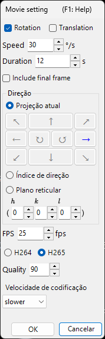

#### Export 3D model (3MF/STL)

**Export 3D model (3MF/STL)** exporta o modelo de estrutura desenhado na tela como um modelo sólido para impressão 3D. Só é possível exportar sólidos fechados: átomos (esferas e elipsoides), ligações (cilindros) e poliedros de coordenação. Os rótulos dos átomos, os planos de limite, os planos reticulares e os símbolos dos elementos de simetria não são exportados. <!-- 261105Cl 監査: 配位多面体を出力し、対称要素は出さない (6c31fc0d) --> A moldura da célula unitária é feita de segmentos de reta, por isso só é substituída por cilindros (com esferas nos vértices) quando você marca a opção correspondente. **Cortar objetos nos planos delimitadores** não é aplicado à saída: os objetos que atravessam os planos limitantes são exportados inteiros (o diálogo o indica). <!-- 261106Cl 作者の決定 H10 -->

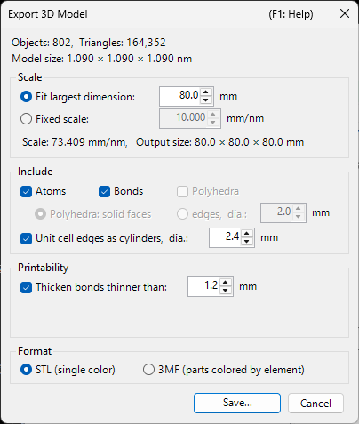

A parte superior do diálogo informa o número de objetos e triângulos envolvidos e o tamanho real do modelo (**Tamanho do modelo**, nm).

**Escala** : como o tamanho de saída é decidido

- **Dimensão máxima** : escala o modelo automaticamente para que sua aresta mais longa alcance o comprimento indicado (5–500 mm, 80 mm por padrão). A espessura dos cilindros que substituem a moldura da célula unitária e as armações de arestas dos poliedros é incluída. <!-- 261105Cl 監査: 円柱の太さを含めて合わせる (82e50b62) -->
- **Escala fixa** : informe a escala (mm/nm) diretamente. Use para construir vários cristais na mesma escala e colocá-los lado a lado. Ao mudar para esta opção, parte-se da escala que estava em vigor momentos antes.
- A linha abaixo mostra a escala resultante e as dimensões impressas (**Tam. saída**, mm), incluindo também essa espessura dos cilindros.

**Incluir** : quais elementos entram na impressão

- **Átomos** / **Ligações** / **Poliedros** : só é possível selecionar os tipos exibidos no momento; ao desmarcar um deles, ele permanece na tela mas fica de fora da impressão.
- **Poliedros: faces** / **arestas, Ø** : exporta os poliedros de coordenação como corpos maciços com faces ou como uma armação de arestas (cilindros mais esferas nos vértices, 2.0 mm por padrão). A armação deixa visíveis os átomos internos.
- **grade vazada: Ø barra / passo** : a armação de arestas mais uma grade de barras finas em cada face (diâmetro da barra 0.8–5.0 mm, 1.2 mm por padrão; passo 1.5–20 mm, 5.0 mm por padrão). De longe, as faces parecem preenchidas, mas o interior continua visível.
- **Arestas da célula (cil.), Ø** : inclui a moldura da célula unitária, substituída por cilindros do diâmetro indicado (2.4 mm por padrão). Esta caixa vem marcada por padrão sempre que a moldura da célula é exibida.

**Imprimibilidade** : adequação à impressão

- **Engrossar ligações sob** : ligações cujo diâmetro impresso ficaria abaixo do valor indicado (1.2 mm por padrão) são refeitas com esse diâmetro a partir da primitiva original, evitando que ligações finas quebrem. Se você deixar a opção desligada enquanto uma ligação estiver fina demais, aparece um aviso em vermelho.

**Formato** : formato de arquivo

- **STL (cor única)** : um STL binário de cor única.
- **3MF (colorido por elemento)** : 3MF com as peças coloridas por elemento; os nomes das cores trazem os nomes dos elementos.

**Salvar...** pede o nome do arquivo. Concluída a exportação, a contagem de triângulos, as dimensões impressas e a escala são registradas na caixa de informações no canto inferior esquerdo.

---

## Menu de abas

### Limites definidos pela célula

Especifica o intervalo de desenho do cristal. Há dois modos, alternados com os botões de opção na parte superior.

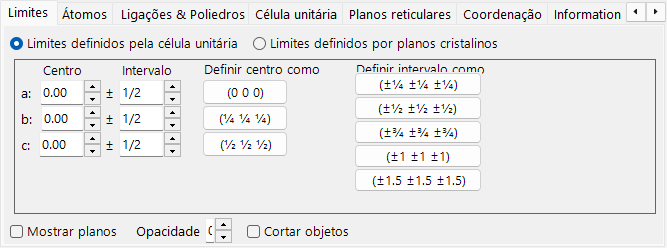

Neste modo, os eixos *a*, *b*, *c* da célula unitária são a unidade do intervalo de desenho.

- **Centro**: deslocamento do centro do intervalo de desenho a partir do [centro de projeção](#centro-de-projeção), em coordenadas fracionárias (valores positivos o movem em direção a +*a*, +*b*, +*c*). O intervalo desenhado é (centro de projeção + **Centro**) ± **Intervalo**. <!-- 261106Cl 作者の決定 H3/H18, C4 -->
- **Intervalo**: limite superior/inferior para cada um dos eixos *a*, *b*, *c*.
- **Botões de predefinição** à direita fornecem valores usados com frequência (por exemplo, célula 1×1×1, célula 2×2×2).

### Limites definidos por planos cristalinos

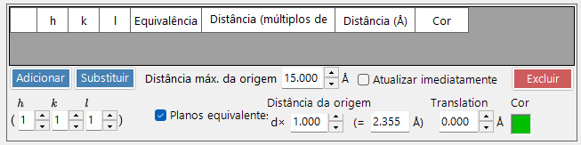

Neste modo, a área de desenho é delimitada por um conjunto de planos cristalinos. Se os planos não definirem uma região espacialmente fechada, o ReciPro acrescenta um poliedro quase esférico de raio **Dist. máx. (centro proj.)** (Å, medida a partir do [centro de projeção](#centro-de-projeção)) para fechá-la. <!-- 261106Cl 作者の決定 C4 -->

#### Lista de limites

Todos os planos limitantes registrados para o cristal atual. Use **Adicionar / Substituir / Excluir** para manipular a lista; a caixa de seleção mais à esquerda desativa temporariamente um plano sem excluí-lo.

> Para salvar as alterações permanentemente, você também deve pressionar **Adicionar** ou **Substituir** na **Janela principal**. Caso contrário, as alterações serão perdidas na próxima vez que você alterar a seleção na lista principal de cristais.

#### Índices H k l

Define o plano limitante por seu índice de Miller. A caixa de seleção inclui planos cristalograficamente equivalentes gerados a partir do (*hkl*) selecionado.

#### Distância ao centro de proj.

A distância do [centro de projeção](#centro-de-projeção) (e não da origem da célula) ao plano limitante, inserida <!-- 261106Cl 作者の決定 C4 --> como múltiplo da distância interplanar (*d*-spacing) do (*hkl*) selecionado (caixa **d×**) ou em Å (a caixa entre parênteses). As duas caixas estão vinculadas: alterar uma atualiza a outra. Cada plano fica no lado +**g** do centro de projeção (no sentido da sua normal (*hkl*)), e é desenhado o lado que contém o centro; com um único plano, a região é o semiespaço do lado do centro. <!-- 261106Cl 仕上げ R3 D5: Boundary.cs Bound.Reset (面は nᵢ·r ≤ D) -->

- **Translação** (Å): move toda a região delimitada pelos planos nesse valor ao longo da normal do (*hkl*) especificado; valores positivos a movem em direção a +**g**, isto é, no sentido da normal de (*hkl*). Funciona com qualquer número de planos, inclusive um único plano sem **Planos equivalentes**. <!-- 261106Cl 作者の決定 B11, C5 -->
- **Dist. máx. (centro proj.)** (Å): raio do poliedro de fechamento usado quando os planos não delimitam uma região (veja acima).
- **Atualizar imediatamente**: aplica as edições do plano selecionado sem pressionar **Substituir**.

#### Mostrar planos / Opacidade

Mostra ou oculta os próprios planos limitantes. Quando exibidos, **Opacidade** define a transparência (0 = transparente, 1 = opaco).

#### Cortar objetos nos planos delimitadores

Se marcado, somente a região interna definida pelos limites é renderizada; átomos, ligações e poliedros que cruzam os limites são recortados.

#### Ocultar átomos

Não há caixa de seleção para isso na aba Limites. Em vez disso, desative o botão **Átomos** da barra de ferramentas: nenhum átomo é gerado, de modo que as ligações e os poliedros também desaparecem — útil quando apenas a célula ou os planos reticulares precisam ser visualizados.

### Átomos

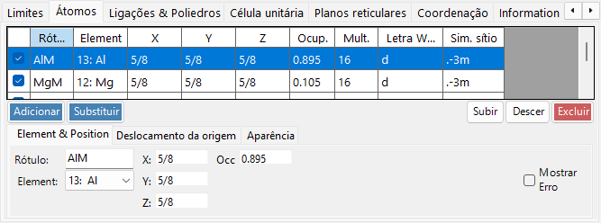

Coordenadas, elemento, ocupação, raio, cor, material. **Aplicar ao mesmo elemento**.

#### Lista de átomos

A lista de átomos no cristal. Use **Adicionar / Substituir / Excluir** para manipular a lista; a caixa de seleção mais à esquerda oculta temporariamente um átomo.

> Para salvar as alterações permanentemente, clique também em **Adicionar** ou **Substituir** na **Janela principal**.

#### Elemento e posição

- **Rótulo**: rótulo de texto livre para o átomo (usado em legendas e tooltips).
- **Element**: elemento químico / estado de ionização.
- **X, Y, Z**: coordenadas fracionárias. Números reais entre 0 e 1, ou frações como `1/2` ou `2/3`.
- **Occ**: ocupação, um número real entre 0 e 1.

#### Deslocamento da origem

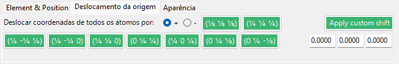

Desloca cada átomo pelo mesmo deslocamento fracionário. Pressione um botão de predefinição (por exemplo, para alternar entre as escolhas de origem 1 / 2 do mesmo grupo espacial) ou insira um (Δx, Δy, Δz) personalizado e pressione **Apply custom shift**.

#### Aparência

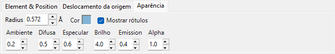

Raio, cor e material por átomo.

- **Radius**: raio atômico desenhado.
- **Cor**: cor da superfície.
- **Material**: propriedades de textura / material usadas pelo shader OpenGL.
- **Aplicar ao mesmo elemento**: aplica o raio e a cor atuais a todos os átomos da mesma espécie de elemento.

### Ligações e poliedros

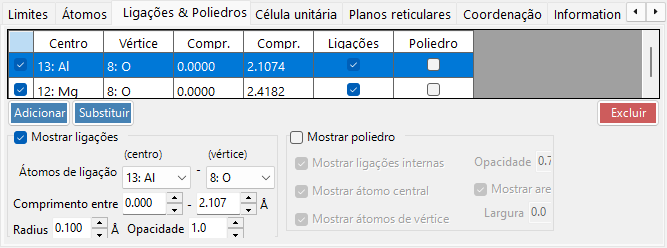

Limiares de comprimento de ligação, exibição de poliedros, arestas.

#### Lista de ligações

Todas as regras de ligação/poliedro registradas para o cristal. Use **Adicionar / Substituir / Excluir**; a caixa de seleção mais à esquerda desativa temporariamente uma entrada. Assim como em átomos e limites, é necessário usar **Adicionar** / **Substituir** na **Janela principal** para tornar a alteração permanente.

#### Propriedade da ligação

- **Mostrar ligações**: desenha as ligações desta regra (a caixa de seleção acima das configurações da ligação).
- **Átomos de ligação** **(centro)** - **(vértice)**: espécies de elemento usadas como átomo central da ligação / do poliedro e como vértice (a outra extremidade).
- **Comprimento entre** … **-** … (Å): limiares de distância inferior e superior. Pares de átomos fora desse intervalo não são desenhados.
- **Radius** (Å): espessura desenhada da ligação (raio do cilindro).
- **Opacidade**: opacidade da ligação (0 = transparente, 1 = opaco).

#### Propriedade do poliedro

- **Mostrar poliedro**: quando marcado, o poliedro definido pela ligação atual é desenhado (somente se o conjunto centro/vértice for geometricamente válido).
- **Mostrar ligações internas**: com **Mostrar poliedro** ativado, desenha as ligações do centro aos vértices (elas também exigem **Mostrar ligações**).
- **Mostrar átomo central**: mostra/oculta o átomo central.
- **Mostrar átomos de vértice**: mostra/oculta os átomos dos vértices. Um átomo central ou de vértice oculto ainda é desenhado quando outro poliedro exibido o mostra, ou quando ele termina uma ligação de uma definição sem poliedro. <!-- 261105Cl 監査: 3 つのチェックが描画に効くようになった (7e198f9d) -->
- **Opacidade**: opacidade das faces (0 = transparente, 1 = opaco).
- **Mostrar arestas**: desenha as arestas que conectam os vértices.
- **Largura**: largura de linha das arestas em pixels (1–5). Valores abaixo de 1 salvos por versões antigas são desenhados com 1 px. <!-- 261106Cl 作者の決定 H4 -->
- Não há caixas de cor nesta aba: as ligações assumem as cores dos átomos das suas duas extremidades e os poliedros a cor do seu átomo central (as cores dos átomos são definidas na aba [Átomos](#átomos)). <!-- 261105Cl 監査: BondControl の colorControlPolyhedron/Bond/Edges は Visible=False。色は原子の材質から (FormStructureViewer.cs) -->

### Célula unitária

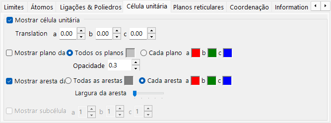

Translação, planos da célula, arestas.

#### Translação

Todo grupo espacial tem uma origem padrão. Para mover o centro da célula unitária desenhada para longe dessa origem, defina a translação ao longo de *a*, *b*, *c*.

A translação está ligada ao [Centro de projeção](#centro-de-projeção): definir o centro de projeção como $(x, y, z)$ define a translação como $(x-0.5,\ y-0.5,\ z-0.5)$. Uma translação positiva move a célula desenhada em direção a +*a*, +*b*, +*c*. <!-- 261106Cl 作者の決定 H3/H18 -->

#### Mostrar plano da célula

Define se as seis faces que delimitam a célula unitária são desenhadas. Quando ativado, você pode definir a cor da face e a transparência.

#### Mostrar aresta da célula

Define se as arestas da célula unitária são desenhadas. A cor das arestas é configurável.

A caixa de seleção principal **Mostrar célula unitária** (= o botão *Célula unitária* da barra de ferramentas) liga/desliga a célula inteira. As cores das faces e das arestas podem ser definidas de uma vez para **Todos os planos** / **Todas as arestas** ou para **Cada plano** / **Cada aresta** (*a*, *b*, *c* separadamente); **Largura da aresta** define a espessura da linha e **Opacidade** a transparência das faces.

#### Mostrar subcélula

**Mostrar subcélula** desenha linhas de grade que dividem a célula no número de partes indicado nas caixas **a**, **b**, **c** (1–10 cada; as caixas só podem ser usadas enquanto a opção estiver marcada), nas faces e no interior da célula. As linhas que coincidem com as arestas da célula não são desenhadas. As linhas usam a cor das arestas (**Todas as arestas** / **Cada aresta**), metade da largura da aresta (no mínimo 1 px) e opacidade 0,5, e são exibidas independentemente de **Mostrar aresta da célula**. Não são incluídas na exportação do modelo 3D. <!-- 261106Cl 作者の決定 H5 -->

### Planos reticulares

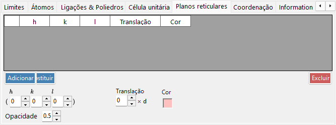

Especificação do índice de Miller com equivalentes cristalográficos.

#### Índices H k l

Especifica o plano reticular por seu índice de Miller. A caixa de seleção inclui opcionalmente planos cristalograficamente equivalentes gerados a partir de (*hkl*).

#### Translação

Desloca os planos reticulares desenhados ao longo da sua normal por uma fração da distância interplanar *d* (**× d**, −0,5 a 0,5); valores positivos os movem em direção a +**g** (os planos ficam em **g**·**r** = (*m* + T)*d*). Por isso, os valores salvos em listas de cristais por versões anteriores são desenhados do lado oposto (0 e ±0,5 têm a mesma aparência). <!-- 261106Cl 作者の決定 C5 --> É desenhado cada plano da família que atravessa o intervalo de desenho, um por *d*. Os planos estão fixos à rede cristalina: em 0 passam pelos pontos da rede e se movem com a estrutura quando o [centro de projeção](#centro-de-projeção) muda. <!-- 261105Cl 監査: LatticePlaneControl numericBoxDistance (−0.5〜0.5, × d)、FormStructureViewer.cs:SetLatticePlanes (4fd9e8c3)。「d の整数倍」は誤り -->

### Coordenação

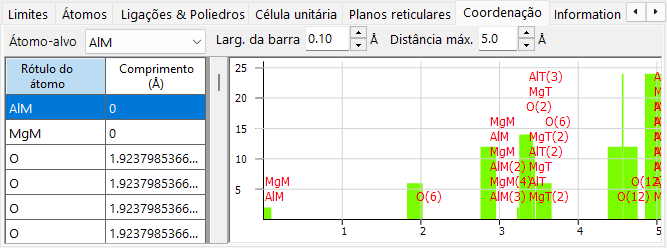

Tabela e gráfico de coordenação em torno do átomo-alvo.

#### Tabela (lado esquerdo)

Lista quais átomos cercam o átomo-alvo selecionado e a que distância. O átomo-alvo é selecionado no menu suspenso acima da tabela.

#### Gráfico (lado direito)

Histograma da contagem de vizinhos em função da distância, derivado dos mesmos dados da tabela. Ajuste **Meia-largura** (a meia largura *w* de cada barra, que cobre *d* ± *w*) até que as barras separem nitidamente as camadas de coordenação <!-- 261106Cl 作者の決定 B18 --> — isso fornece uma estimativa visual do número de coordenação.

### Informação

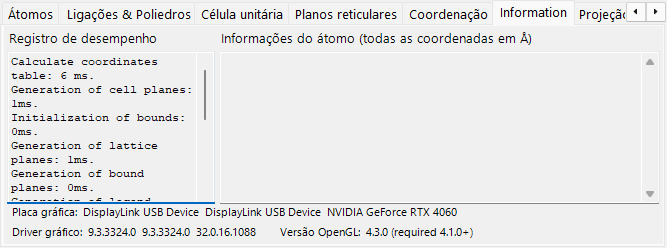

Registro de renderização (tempo de quadro, informações da GPU) e informações básicas sobre o átomo selecionado. Em construção — os campos podem crescer com o tempo.

### Projeção

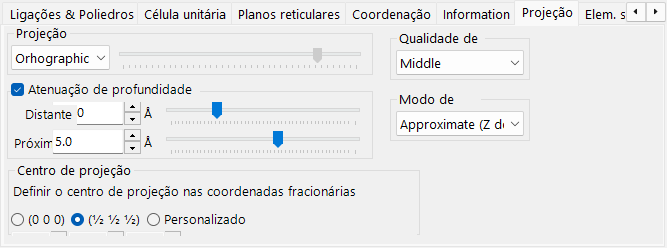

Modo de projeção (ortográfica/perspectiva), atenuação por profundidade, qualidade de renderização, modo de transparência.

#### Projeção

- **Orthographic**: projeção paralela perfeita (ponto de vista no infinito).
- **Perspective**: projeção em perspectiva a partir da distância do ponto de vista definida pelo controle deslizante.

#### Atenuação por profundidade

Esmaece objetos distantes na direção da profundidade (**Atenuação de profundidade**). A cor é misturada linearmente com a **cor de fundo**: objetos mais próximos que **Próximo** mantêm sua própria cor, objetos mais distantes que **Distante** assumem a cor de fundo, e os intermediários são interpolados. (A opacidade em si não muda.) **Próximo** e **Distante** são dados em Å.

#### Centro de projeção

Define o centro da projeção nas coordenadas especificadas. Ative **Personalizado** para inserir coordenadas arbitrárias. Os valores digitados (−1 a 1) são usados como estão. Um filme de **Translação** (veja o [Menu Arquivo](#menu-arquivo)) controla esses valores automaticamente e reduz cada coordenada ao intervalo de −0.5 a +0.5 (um período de rede) à medida que se move. <!-- 261105Cl 監査: 折り畳むのは SetProjectionCenter (動画の経路) だけ。マクロに投影中心の関数は無い -->

#### Qualidade de renderização

Qualidade de desenho (subdivisão da malha, antisserrilhamento). Maior qualidade é mais lenta — escolha a configuração que corresponda à sua GPU.

#### Modo de transparência

Algoritmo usado para átomos e poliedros translúcidos.

- **Approximate (Z depth sorting, OpenGL 4.1+)**: rápido, mas pode ser impreciso quando muitos objetos translúcidos se sobrepõem.
- **High quality (dual depth peeling, OpenGL 4.1+)**: transparência independente da ordem por *depth peeling*. Exibido apenas quando **Ferramentas ▸ Enable DDP** está ativado (ativado por padrão quando o PPLL não está disponível). O número de passes de *peeling* segue a configuração de [Qualidade de renderização](#qualidade-de-renderização).
- **High quality (per-pixel linked list, OpenGL 4.3+)**: transparência exata independente da ordem; exibido apenas quando a GPU suporta OpenGL 4.3. Precisa, mas lenta; na prática exige uma GPU dedicada.

### Elementos de simetria

A aba **Elem. sim.** desenha os operadores de simetria do grupo espacial diretamente sobre o modelo 3D (alternar com o botão **Elem. sim.** da barra de ferramentas). Cada classe de elemento pode ser mostrada/ocultada de forma independente:

- **Eixos de simetria**: **Rotações**, **Helicoidais**, **Rotoinversões**
- **Planos**: **Espelhos**, **Deslizamentos**
- **Centros de inversão**

A chave geral é **Mostrar elementos de simetria**. Para cada grupo você pode ajustar o tamanho do símbolo (%) e a cor e, para os eixos e os planos, também a largura da linha.

### Diversos

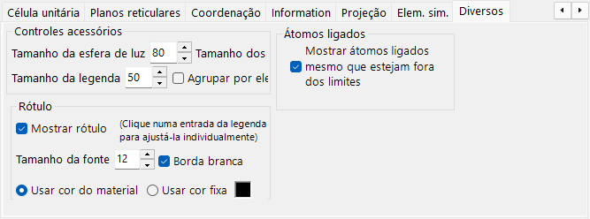

- **Controles acessórios**: define os tamanhos de exibição (esfera de luz, eixos, legenda). **Agrupar por elemento** alterna a exibição da legenda.
- **Átomos ligados**: **Mostrar átomos ligados mesmo que estejam fora dos limites** continua desenhando átomos que estão ligados a átomos dentro do intervalo de desenho, mesmo quando ficam fora dele.
- **Rótulo**: configurações dos rótulos dos átomos na vista 3-D (não da legenda) — **Mostrar rótulo**, **Tamanho da fonte**, **Borda branca** e a cor dos rótulos (**Usar cor do material** ou **Usar cor fixa**). Clicar numa entrada da legenda de átomos alterna individualmente os rótulos desse átomo (ou elemento, com **Agrupar por elemento**).

---

## Barra de ferramentas

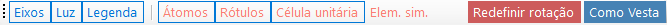

| Botão | Descrição |
|--------|-------------|
| Eixos | Mostrar orientação dos eixos (tamanho = constante de rede) |
| Luz | Definir direção da luz |
| Legenda | Legenda de átomos |
| Átomos | Mostrar/ocultar os átomos; as ligações, os poliedros e os rótulos são construídos sobre os átomos, por isso também são ocultados <!-- 261105Cl 監査: toolStripButtonAtomObjects.ToolTipText (2028c4a1) --> |
| Rótulos | Alternar rótulos de átomos |
| Célula unitária | Alternar arestas da célula unitária |
| Elem. sim. | Alternar a sobreposição de elementos de simetria (veja acima) |
| Redefinir rotação | Retornar à orientação inicial |
| Como Vesta | Mudar para uma aparência no estilo VESTA: as cores e os raios dos átomos são redefinidos e a lista de ligações é **substituída** pelas ligações padrão |

---

## Veja também

- [Janela principal](0-main-window.md)
- [Banco de dados de cristais](1-crystal-database.md)
- [Informação de simetria](2-symmetry-information.md)
- [Simulador de difração](7-diffraction-simulator/index.md)
- [Atalhos de teclado e mouse](21-shortcuts.md)
