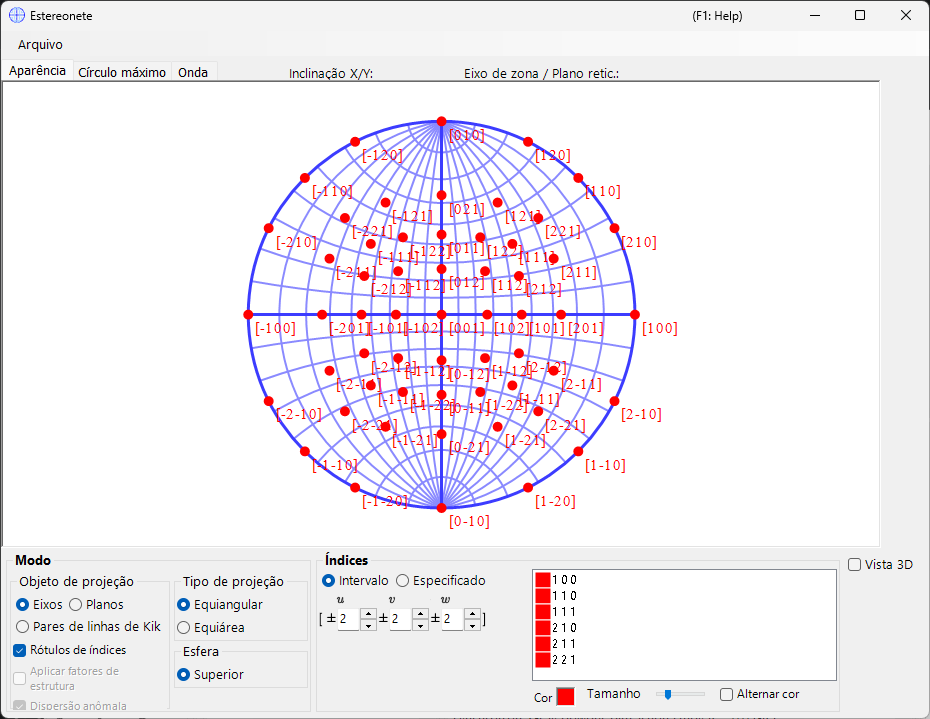
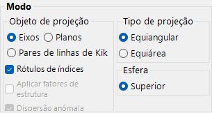
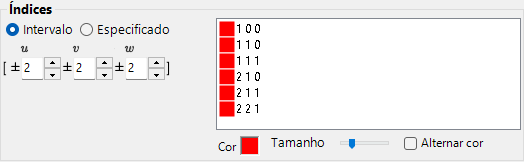
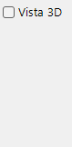
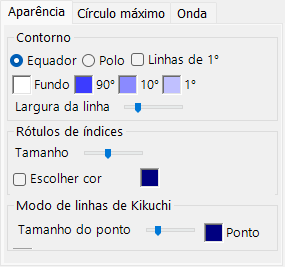
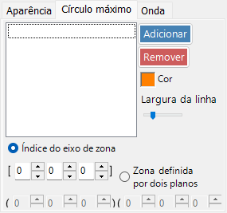
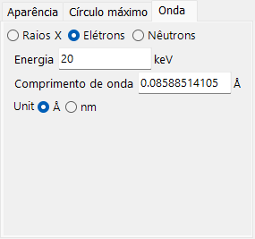

# Estereonete

A **Estereonete** exibe direções de planos e eixos cristalinos usando a projeção estereográfica.

---

## Atalhos de teclado e mouse

A estereonete em si é uma projeção 2-D; uma esfera 3-D opcional pode ser exibida com **Vista 3D**.

| Atalho | Ação |
|----------|--------|
| <kbd>F1</kbd> | Abrir esta página do manual on-line |
| Arrastar com o botão esquerdo perto do centro | Inclinar o cristal |
| Arrastar com o botão esquerdo na área externa | Girar o cristal em torno do eixo de visualização |
| Clique duplo esquerdo | Alternar entre a projeção **Planos** e **Eixos** |
| Clique direito | Diminuir o zoom |
| Arrastar com o botão direito uma caixa | Aumentar o zoom na região selecionada |
| Arrastar com o botão do meio | Deslocar |
| Mover o mouse (sem botão) | Ler o (hkl)/[uvw] sob o cursor — útil para indexar um reflexo medido |

Arrastar na rede gira o **cristal**; o estado de rotação é compartilhado entre todas as janelas.

A renderização 3-D usa a [navegação de visualização OpenGL](21-shortcuts.md) padrão do ReciPro (arrastar com o botão esquerdo para girar, arrastar com o botão direito / roda para zoom, <kbd>CTRL</kbd> + clique duplo direito alterna a projeção) e gira apenas a visualização 3-D, não o cristal em si.

Os atalhos <kbd>CTRL</kbd>+<kbd>SHIFT</kbd> de toda a aplicação, da [janela principal](0-main-window.md#keyboard-mouse-shortcuts), também funcionam enquanto esta janela está em foco.

→ Consulte **[21. Atalhos de teclado e mouse](21-shortcuts.md)** para uma visão geral de cada janela.

---

## Área principal

A projeção em estereonete dos planos cristalinos, índices de direção e linhas de Kikuchi do cristal selecionado é exibida.

---

## Menu Arquivo

Salvar como imagem raster (PNG), ou copiar como imagem raster ou como metarquivo vetorial (EMF). Um metarquivo colado permite editar fontes e espessuras de linha no PowerPoint ou em outros editores vetoriais.

| Item de menu | Descrição |
|-----------|-------------|
| Salvar Imagem ▸ como Imagem (formato PNG) / como metarquivo (EMF) | Salvar a estereonete como arquivo PNG (o item *como metarquivo (EMF)* está desativado no momento; para saída vetorial use **Copiar para a área de transferência ▸ como metarquivo (EMF)**) |
| Copiar para a área de transferência ▸ Como Imagem / como metarquivo (EMF) | Copiar a estereonete |
| Salvar Vídeo ▸ Estereonete / 3D | Salvar um vídeo de rotação (MP4) da estereonete ou da vista 3-D, com o mesmo diálogo de configuração de filme do [Visualizador de estrutura](5-structure-viewer.md#menu-arquivo) (apenas rotação) |
| Configurar Página / Visualizar Impressão / Imprimir | Imprimir a estereonete |

---

## Modo {#mode}

### Alvo da projeção

Selecione o que projetar na rede.

- **Eixos** — projeta os índices de direção \([uvw]\).
- **Planos** — projeta as normais dos planos cristalinos \((hkl)\).
- **Pares de Kikuchi** — projeta pares de linhas de Kikuchi.

### Método de projeção

| Método | Descrição |
|--------|-------------|
| **Wulff** (ângulo igual / estereográfica) | Preserva a relação angular entre os elementos projetados, mas não o ângulo sólido. Usado pelos cristalógrafos clássicos ao ler ângulos entre eixos ou entre planos. |
| **Schmidt** (área igual / Lambert) | Preserva o ângulo sólido (a área) de cada região, mas distorce os ângulos. Preferido para figuras de polo estatísticas, em que a densidade relativa importa. |

### Hemisfério

Escolha o hemisfério **Superior** ou **Inferior** como fonte da projeção — alterna se a face visível da esfera é a mais próxima ou a mais distante do observador.
Superior = o lado $+Z$ (voltado para o observador, veja o [Apêndice A1.1](appendix/a1-coordinate-system/1-orientation.md)); com **Inferior**, a componente $Z$ de cada direção é invertida antes da projeção, e os pontos são desenhados como **círculos vazados** em vez de preenchidos.

### Opções de exibição

- **Rótulos de índices**: mostrar os rótulos de índice.
- **Fatores de estrutura na intensidade**: quando **Planos** ou **Pares de Kikuchi** está selecionado, pondera cada item pelo seu fator de estrutura (defina a fonte de onda e o comprimento de onda na [aba Onda](#wave)). O peso é $I_{\mathrm{rel}} = |F_{hkl}|^2 / \max|F|^2$ sobre o conjunto exibido: no modo **Planos**, o raio do ponto é multiplicado por $\sqrt{I_{\mathrm{rel}}}$ (ou seja, $\propto |F_{hkl}|$); no modo **Pares de Kikuchi**, a opacidade da linha é $I_{\mathrm{rel}}$.
- **Dispersão anômala**: inclui os termos de dispersão anômala de raios X $f'$, $f''$ nos fatores de estrutura. Habilitado apenas para raios X e nos modos **Planos** / **Pares de Kikuchi**.

> Para cristais trigonais/hexagonais, a notação de Miller–Bravais (4 índices) pode ser ativada em **Opções ▸ Usar índice de Miller-Bravais (hkil)** na janela principal.

---

## Índices {#indices}

Define quais planos cristalinos / eixos são desenhados.

### Modo de intervalo

Especifique um intervalo de índices \([uvw]\) ou \((hkl)\). O ReciPro enumera cada índice dentro dos limites e projeta cada um deles.

No modo **Intervalo**, os limites são $\pm$ os valores inseridos; apenas os índices irredutíveis são considerados, agrupados em conjuntos de índices cristalograficamente equivalentes (cada conjunto recebe uma cor).

### Modo de fator de estrutura

Disponível apenas para **Planos** e **Pares de Kikuchi**. Projeta os planos com os maiores $|F_{hkl}|^2$ para a fonte de onda atual. **Máx.** define o número de planos a desenhar (os planos equivalentes são contados individualmente; no modo **Planos**, uma reflexão paralela a outra mais forte — uma ordem superior ou inferior dela, p. ex. 222 quando 111 é mais forte — é omitida).

### Modo especificado

Especifica eixos ou planos individuais. Digite um índice, pressione **Adicionar** para registrá-lo ou **Remover** para excluí-lo. Quando **Incluir índices equivalentes** está marcado, todos os índices cristalograficamente equivalentes também são desenhados.

### Cor / Tamanho {#colour-size}

Defina a **Cor** e o **Tamanho** dos pontos plotados. Marque **Alternar cor** para codificar por cor cada conjunto de eixos/planos equivalentes de forma diferente — útil para distinguir famílias em um gráfico de múltiplos índices.

---

## 3D Options

Exibido quando **Vista 3D** está marcado; a esfera 3-D aparece num painel à direita da rede.

- **Redefinir**: retorna a vista 3-D à direção e ao zoom padrão.
- **Rótulo**: desenha os rótulos de índice em 3-D.
- **Hemisfério**: desenha apenas os polos do hemisfério superior ($Z>0$).
- **Estereonete**: desenha o plano de projeção (a rede) em 3-D, com os pontos projetados dos polos do hemisfério superior.
- **Contorno da esfera**: desenha a grade de latitude/longitude da esfera.
- **Linhas de projeção** (com **Estereonete** ativado): desenha as linhas auxiliares de projeção de cada polo do hemisfério superior — uma reta do polo sul $(0,0,-1)$ até o polo para Wulff, um arco para Schmidt.
- **Atenuação de profundidade**: intensidade do esmaecimento por profundidade da vista 3-D.

---

## Menu de abas

### Aparência {#appearance}

#### Contorno {#outline}

Como o contorno da estereonete é desenhado — o círculo delimitador e a grade opcional de círculos máximos de latitude/longitude. Escolha **Equador** ou **Polo**, alterne **Linhas de 1°** e o preenchimento de **Fundo**, defina as cores da grade **90° / 10° / 1°** e ajuste a **Largura da linha** com a barra de controle.

#### Rótulos de índices {#index-labels}

- **Tamanho** — tamanho dos rótulos de índice.
- **Cor** — usa uma única cor fixa para todos os rótulos de índice em vez da cor por ponto, útil quando os pontos são codificados por cor, mas você deseja todos os rótulos em uma única cor para facilitar a leitura.
- **Separ.** — caractere colocado entre os índices em cada rótulo: **Nada** (por exemplo, 100), **Espaço** (1 0 0) ou **Vírgula** (1,0,0).

#### Modo de linhas de Kikuchi {#kikuchi-line-mode}

- **Tamanho do ponto** — tamanho dos pontos plotados.
- **Ponto** / **Rótulo** — cores dos pontos e de seus rótulos.

### Círculo máximo {#great-circle}

Desenhe círculos máximos (círculos menores não são suportados). Especifique-os pelo **Índice do eixo de zona** \([uvw]\) (o círculo máximo formado pela zona desse eixo) ou por **Zona definida por dois planos** (o eixo de zona é o produto vetorial deles). Use **Adicionar** / **Remover** para editar a lista; desmarcar uma entrada oculta esse círculo. A cor e a espessura de linha dos círculos também são configuráveis.

### Onda {#wave}

Usado apenas quando **Planos** ou **Pares de Kikuchi** está selecionado como alvo da projeção (no modo **Pares de Kikuchi**, o comprimento de onda também define o ângulo de Bragg, ou seja, a separação de cada par de linhas). Define a fonte de onda (X-ray / electron / neutron) e o comprimento de onda ou a energia necessários para calcular os fatores de estrutura do cristal usados por **Fatores de estrutura na intensidade** em [Modo](#mode).

---

## Veja também

- [Janela principal](0-main-window.md)
- [Geometria de rotação](4-rotation-geometry.md)
- [Visualizador de estrutura](5-structure-viewer.md)
- [Simulador de difração](7-diffraction-simulator/index.md)
- [Sistema de coordenadas básico e orientação do cristal](appendix/a1-coordinate-system/1-orientation.md)
