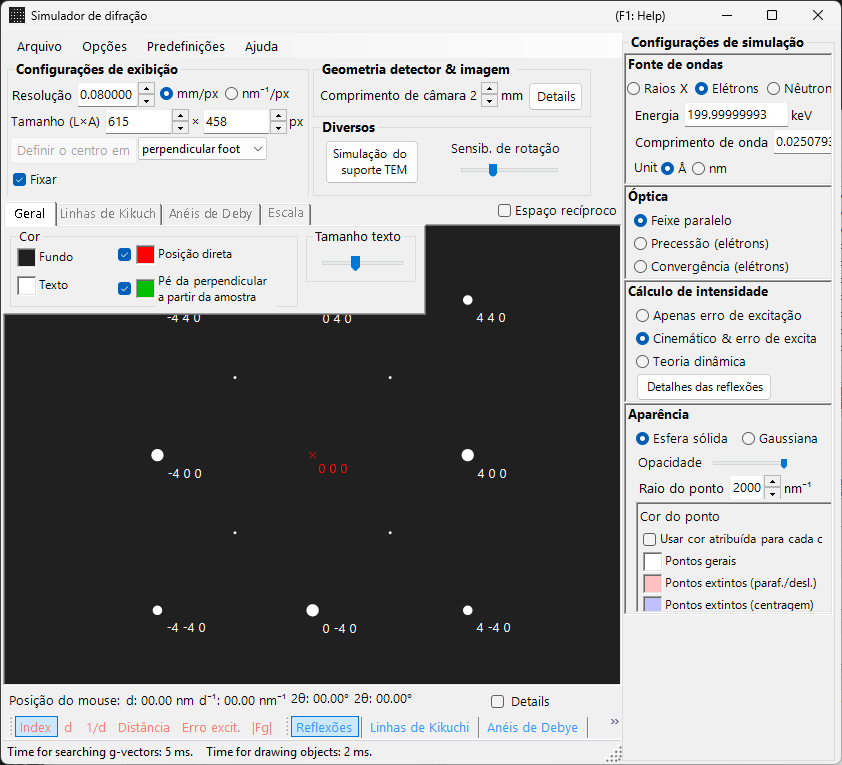
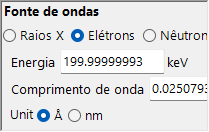
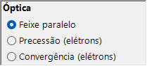
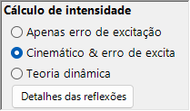
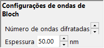
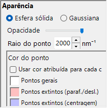

# Simulação SAED (Selected Area Electron Diffraction)

A simulação **SAED (Selected Area Electron Diffraction)** calcula padrões de difração eletrônica de monocristal produzidos por um feixe de elétrons paralelo. Este é o modo padrão do [simulador de difração](index.md).

> Esta página lista todas as configurações que aparecem no painel **Configurações de simulação**, à direita, quando você escolhe **Fonte de ondas = Elétrons** e **Óptica = Feixe paralelo**. Para operações de toda a janela, como desenhar e salvar, consulte a [página de visão geral](index.md).

Condições de GUI: Fonte de ondas = Elétrons, Óptica = Feixe paralelo, Cálculo de intensidade = Apenas erro de exc. / Cinemático & erro exc. / Teoria dinâmica.

---

## Visão geral

Simula o padrão de difração produzido quando um feixe de elétrons paralelo atravessa uma amostra fina. As posições dos spots são fixadas pela relação geométrica entre a esfera de Ewald e os pontos da rede recíproca, e o brilho de cada spot é calculado de acordo com o modo de cálculo de intensidade selecionado.

---

## Fonte de ondas {#wave-length}

Defina a fonte de radiação como **Elétrons**. Insira a energia (keV) ou o comprimento de onda (Å ou nm, alternável; padrão Å) e o comprimento de onda corrigido relativisticamente é calculado. O valor inicial é 200 keV; o menu **Predefinições** define 300 / 200 / 120 kV com um clique. Para fontes de raios X e nêutrons, consulte [Simulação de difração de raios X](5-x-ray-neutron-diffraction.md).

---

## Óptica {#incident-beam-mode}

Defina a **Óptica** (a geometria do feixe incidente) como **Feixe paralelo**. Esta é a geometria de onda plana padrão usada para SAED e difração de raios X.

> **Nota**: Para elétrons você pode escolher **Feixe paralelo / Precessão (elétrons) / Convergência (elétrons)**. A escolha de **Precessão (elétrons)** resulta em uma [simulação PED](2-ped-simulation.md), e a escolha de **Convergência (elétrons)** resulta em uma [simulação CBED](3-cbed-simulation.md); em ambos os casos o cálculo de intensidade muda automaticamente para **Teoria dinâmica**.

---

## Intensity calculation

Seleciona como as intensidades dos spots são calculadas.

### Somente erro de excitação

A intensidade é determinada exclusivamente pela distância geométrica entre a esfera de Ewald e o ponto da rede recíproca (o erro de excitação $S_g$). Ela é máxima em $S_g = 0$ — exatamente sobre a esfera — e decai à medida que $\lvert S_g\rvert$ aumenta, chegando a zero assim que $\lvert S_g\rvert$ excede o **Raio do ponto** indicado para o ponto da rede recíproca. Como o fator de estrutura do cristal é ignorado, este é o modo mais rápido e adequado para verificar as posições dos spots de difração.

Somente neste modo aparecem as seguintes opções:

| Opção | Descrição |
|--------|-------------|
| **Excluir todas as reflexões proibidas** | Oculta todos os reflexos proibidos pelo grupo espacial (centragem de rede, eixos helicoidais e planos de deslizamento). Marcá-la também marca e bloqueia a opção seguinte. |
| **Excluir reflexões proibidas por centragem de rede** | Oculta apenas os reflexos proibidos pela centragem de rede (ativada por padrão). |
| **Desenhar todos os pontos com o mesmo raio** | Desenha todos os spots excitados com o raio completo *R*, independentemente de $S_g$. |

Os reflexos proibidos que permanecem visíveis são desenhados nas cores de **Pontos extintos** (consulte [Spot appearance](#spot-appearance)).

### Cinemática

Além do erro de excitação, o fator de estrutura cinemático $\lvert F_{hkl} \rvert^2$ é incorporado à intensidade. As regras de extinção são corretamente refletidas, tornando este modo adequado para amostras finas ou difração fraca.

### Dinâmica (método de ondas de Bloch, somente elétron)

Um cálculo dinâmico rigoroso pelo método de ondas de Bloch (método de Bethe). Ele reproduz o espalhamento múltiplo e a variação da intensidade dependente da espessura, e é necessário para amostras espessas ou difração forte. Disponível apenas quando **Elétrons** está selecionado. Para a teoria, consulte [Apêndice A3. Método de ondas de Bloch](../appendix/a3-bloch-wave/calculation.md).

> **Nota**: Quando **Teoria dinâmica** está selecionada, um painel **Configurações de ondas de Bloch** aparece abaixo.

---

## Bloch wave settings (teoria dinâmica)

Ativo apenas quando **Cálculo de intensidade = Teoria dinâmica**.

| Parâmetro | Descrição |
|-----------|-------------|
| **Número de ondas difratadas** | Número de ondas de Bloch incluídas no problema de autovalores (8–1000, padrão 240). Valores maiores fornecem intensidades mais precisas, mas aumentam o tempo de cálculo com $O(N^3)$ |
| **Espessura** | Espessura da amostra (nm) usada no cálculo dinâmico (0.01–10000 nm, padrão 50 nm) |

---

## Spot appearance

Controla como cada spot de difração é renderizado.

- **Esfera sólida / Gaussiana** : o modelo geométrico do ponto da rede recíproca (padrão **Esfera sólida**). **Esfera sólida** desenha a seção transversal (um círculo) entre uma esfera e a esfera de Ewald: o raio da esfera é $R\,I^{1/3}$ para **Cinemático & erro exc.** (volume da esfera ∝ intensidade) e $R$ para **Apenas erro de exc.**; para **Teoria dinâmica**, desenha-se um disco de raio $R\,I_\text{dyn}^{1/2}$ (área ∝ intensidade) sem o corte pela esfera de Ewald. **Gaussiana** desenha a seção transversal (uma gaussiana 2-D) de uma gaussiana 3-D com $\sigma = R$, cuja integral corresponde à intensidade de difração.
- **Opacidade** : transparência do spot (0 = transparente, 1 = opaco).
- **Raio do ponto (R)** : raio virtual do ponto da rede recíproca (nm⁻¹; 0.01–1, padrão 0.2). O tamanho do spot é fixado pela combinação do modo de **Aparência** e do **Cálculo de intensidade** (veja acima).
- **Brilho**, **Escala de cores**, **Escala log** : exibidos apenas no modo **Gaussiana**. **Brilho** ajusta a intensidade integrada da gaussiana renderizada; a **Escala de cores** é **Gray** (spots nas cores de ponto abaixo), **Cold-warm**, **Spectrum** ou **Fire**; **Escala log** exibe as intensidades em escala logarítmica (útil para padrões com grande contraste de intensidade).
- **Cor do ponto** : exibida enquanto a **Escala de cores** for **Gray** (a configuração inicial). **Pontos gerais**, **Pontos extintos (paraf./desl.)** e **Pontos extintos (centragem)** definem as cores dos reflexos permitidos e proibidos.
- **Cor por cristal** : quando marcado, os spots são desenhados na cor atribuída a cada cristal (também para um único cristal).

---

## Spot labels

Os rótulos sobrepostos aos spots são selecionados na [barra de ferramentas](index.md#toolbar).

| Rótulo | Conteúdo |
|-------|---------|
| **Index** | índices de Miller $(hkl)$; quatro índices $(hkil)$ quando **Opções ▸ Usar índice de Miller-Bravais (hkil)** da janela principal está ativado e o cristal usa eixos hexagonais (os rótulos das linhas de Kikuchi, dos anéis de Debye e da vista 3-D seguem a mesma configuração) <!-- 261105Cl 監査: C23 --> |
| **d** | distância interplanar $d$, em Å ou nm conforme a unidade de comprimento da janela principal <!-- 261106Cl 作者の決定 C20 --> |
| **1/d** | inverso da distância interplanar $1/d$, em nm⁻¹ ou Å⁻¹ conforme a unidade de comprimento da janela principal <!-- 261106Cl 作者の決定 C2 --> |
| **Distância** | distância no detector entre o spot e o spot transmitido (direto) (mm), medida entre as posições desenhadas; por isso vale também para um detector inclinado, para a câmera de precessão de raios X e para o Retro-Laue (medida a partir do orifício do feixe); não é exibida quando o feixe transmitido não atinge o detector <!-- 261105Cl 監査: DrawDiffractionSpotsLabel (C15)。L2 tan2θ は傾けない平板の検出器だけ --> |
| **2θ** | ângulo de espalhamento $2\theta$ (mesma definição dos círculos concêntricos da escala 2θ) |
| **χ** | ângulo azimutal $\chi$, medido a partir da direção para cima (12 horas), positivo no sentido horário (mesma definição das linhas radiais da escala azimutal) |
| **Erro excit.** | erro de excitação $S_g$, em nm⁻¹ ou Å⁻¹ conforme a unidade de comprimento da janela principal |
| **Intensidade** | intensidade relativa (%) no modo **Cinemático & erro exc.**; no modo **Teoria dinâmica**, a intensidade relativa (% do feixe difratado mais intenso, excluindo 000) e a amplitude complexa na superfície de saída. Nada é exibido no modo **Apenas erro de exc.** |

---

## Operações compartilhadas

Informações do detector, espelhamento, exibição do espaço recíproco, linhas de Kikuchi, anéis de Debye, linhas de escala, configurações de cor, salvamento e similares são comuns a todos os modos. Consulte a [página de visão geral](index.md). Os detalhes por reflexão obtidos do cálculo dinâmico podem ser examinados em [informação dos spots de difração](index.md#diffraction-spot-information).

---

## Veja também

- [Simulador de difração (visão geral)](index.md)
- [Cálculo SAED com feixe paralelo](../appendix/a3-bloch-wave/calculation.md#parallel-beam-saed)
- [Simulação de difração de raios X](5-x-ray-neutron-diffraction.md)
- [Simulação de difração eletrônica por precessão (PED)](2-ped-simulation.md)
- [Definição do sistema de coordenadas](../appendix/a1-coordinate-system/1-orientation.md)
