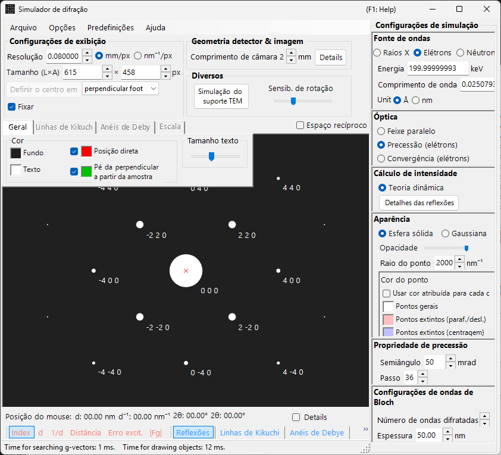
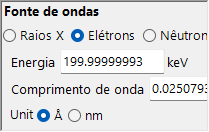
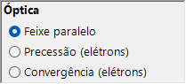
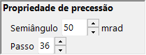
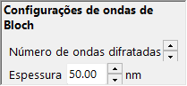
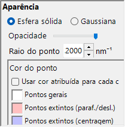

# Simulação de Difração Eletrônica por Precessão (PED)

A simulação de **PED (Precession Electron Diffraction)** calcula padrões de difração de elétrons obtidos pela precessão do feixe incidente em um cone ao redor do eixo óptico.

> Esta página lista todas as configurações que aparecem no lado direito quando você seleciona **Fonte de ondas = Elétrons, Óptica = Precessão (elétrons), Cálculo de intensidade = Teoria dinâmica (automático)**. Observe que **selecionar Precessão (elétrons) em Óptica alterna automaticamente o cálculo de intensidade para Teoria dinâmica**. Para operações que abrangem toda a janela, como desenho e salvamento, consulte a [página de visão geral](index.md).

Condições da GUI: **Fonte de ondas = Elétrons, Óptica = Precessão (elétrons), Cálculo de intensidade = Teoria dinâmica (automático)**

---

## Visão geral

Na PED, o feixe de elétrons é colocado em precessão em um cone ao redor do eixo óptico, e os padrões de difração obtidos para cada direção do feixe sobre o cone de precessão são integrados. Em comparação com a SAED convencional, isso oferece as seguintes vantagens:

- Os efeitos dinâmicos são eliminados por média, produzindo dados de intensidade próximos às razões de intensidade cinemática
- As reflexões de zonas de Laue de ordem superior (HOLZ) são observadas com mais clareza
- Podem ser obtidos dados de intensidade adequados para análise de estrutura

---

## Fonte de ondas {#wavelength-setup}

Como a PED é difração de elétrons, selecione **Elétrons** como **Fonte de ondas**. Inserir a energia do elétron (keV) ou o comprimento de onda (Å ou nm, alternável; padrão Å) calcula o comprimento de onda corrigido relativisticamente.

---

## Óptica {#incident-beam}

Em **Óptica** (a geometria do feixe incidente), selecione **Precessão (elétrons)** (disponível apenas quando **Elétrons** está selecionado).

> **Nota** : Selecionar **Precessão (elétrons)** **alterna automaticamente o cálculo de intensidade para Teoria dinâmica**, e o painel de configurações do método de ondas de Bloch e o painel de configurações da precessão aparecem. **Apenas erro de exc.** / **Cinemático & erro exc.** não podem mais ser selecionados.

---

## Configurações de precessão

Defina a forma e a amostragem do cone de precessão.

| Parâmetro | Descrição | Recomendado |
|-----------|-------------|-------------|
| **Âng. prec.** | Ângulo de precessão, isto é, o semiângulo de abertura do cone de precessão (mrad; 0.1–500, padrão 50) <!-- 261106Cl 仕上げ R3 D1: 欄名 Semiângulo → Âng. prec. --> | 10–40 mrad |
| **Passo** | Número de direções de feixe paralelo amostradas sobre o cone de precessão (2–1080, padrão 36). Valores maiores produzem uma integração mais suave, mas aumentam o tempo de cálculo linearmente | 36–72 |

---

## Cálculo de intensidade e configurações de ondas de Bloch

No momento em que **Precessão (elétrons)** é selecionada, o **Cálculo de intensidade** fica fixado em **Teoria dinâmica** (automático). Para o feixe paralelo em cada direção de precessão, a intensidade de difração é calculada pelo método de ondas de Bloch (cálculo dinâmico), e a integração sobre todas as direções produz o padrão PED.

| Parâmetro | Descrição | Recomendado |
|-----------|-------------|-------------|
| **Número de ondas difratadas** | Número de ondas de Bloch incluídas no problema de autovalores (8–1000, padrão 240). Valores maiores produzem intensidades mais precisas, mas o tempo de cálculo cresce como $O(N^3)$ | 50–200 |
| **Espessura** | Espessura da amostra usada no cálculo dinâmico (nm; 0.01–10000, padrão 50) | — |

O custo computacional é aproximadamente "número de passos × cálculo de ondas de Bloch por direção". Para detalhes do cálculo dinâmico, consulte [Cálculo dinâmico (método de ondas de Bloch)](../appendix/a3-bloch-wave/calculation.md).

---

## Aparência dos pontos

Controla como cada ponto de difração é desenhado.

- **Esfera sólida / Gaussiana** : Modelo geométrico dos pontos da rede recíproca. **Esfera sólida** desenha a seção transversal de uma esfera de raio $R$ com a esfera de Ewald, e **Gaussiana** desenha a seção transversal (uma gaussiana 2D) de uma gaussiana 3D com $\sigma = R$ com a esfera de Ewald.
- **Opacidade** : Transparência do ponto (0 = transparente, 1 = opaco).
- **Raio do ponto (R)** : Raio dos pontos da rede recíproca. Para intensidades dinâmicas, a integral gaussiana $=$ Brilho $\times I_\text{dyn}$, e a Esfera sólida usa o raio $R \times I_\text{dyn}^{1/2}$ (de modo que a área é proporcional à intensidade dinâmica).
- **Brilho**, **Escala de cores**, **Escala log** : exibidos apenas no modo **Gaussiana**. **Brilho** ajusta a intensidade integrada da gaussiana desenhada; a **Escala de cores** é **Gray** (pontos nas cores de ponto abaixo), **Cold-warm**, **Spectrum** ou **Fire**; **Escala log** exibe a intensidade em escala logarítmica.
- **Cor do ponto** : exibida enquanto a **Escala de cores** for **Gray** (a configuração inicial): **Pontos gerais** / **Pontos extintos (paraf./desl.)** / **Pontos extintos (centragem)**.
- **Cor por cristal** : Desenha os pontos na cor atribuída a cada cristal.

---

## Comparação com SAED

| Característica | SAED | PED |
|---------|------|-----|
| Feixe | Paralelo, fixo | Em precessão (varredura cônica) |
| Efeitos dinâmicos | Grandes | Eliminados por média, menores |
| Reflexões HOLZ | Fracas | Aparecem fortemente |
| Confiabilidade da intensidade | Pode ser insuficiente para análise de estrutura | Adequada para análise de estrutura |
| Tempo de cálculo | Curto | Longo |

---

## Veja também

- [Simulador de difração (visão geral)](index.md)
- [Simulação de difração de raios X](5-x-ray-neutron-diffraction.md)
- [Simulação SAED](1-saed-simulation.md)
- [Cálculo dinâmico (método de ondas de Bloch)](../appendix/a3-bloch-wave/calculation.md)
