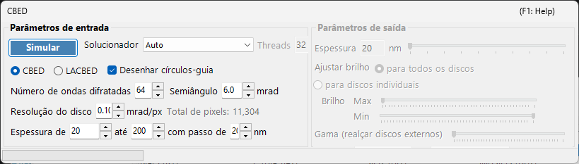
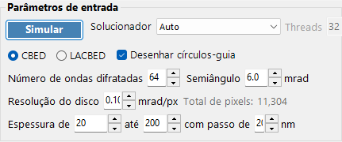
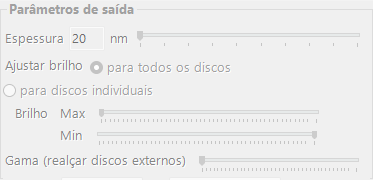

# Simulação CBED

A **simulação CBED (Convergent-Beam Electron Diffraction)** calcula e exibe padrões de difração com feixe convergente usando o método de ondas de Bloch (Bethe). Os padrões CBED mostram discos de difração em vez de pontos e contêm informações ricas sobre a simetria, a espessura e a estrutura do cristal.

> Esta página lista todas as configurações da janela dedicada que se abre quando você seleciona **Fonte de ondas = Elétrons** e **Óptica = Convergência (elétrons)** no [Simulador de difração](index.md). Selecionar **Convergência (elétrons)** define automaticamente o **Cálculo de intensidade** como **Teoria dinâmica**, e esta janela de configurações CBED se abre. Fechar esta janela com o botão × volta a **Óptica** para **Feixe paralelo**. <!-- 261105Cl 監査: FormDiffractionSimulatorMultislice_FormClosing (UserClosing) --> Os discos calculados podem ser salvos com **Arquivo > Salvar discos CBED** / **Copiar discos CBED** da janela principal. Para desenhar e salvar padrões de difração, bem como para outras operações comuns ao simulador de difração, consulte a [página de visão geral](index.md).

Condições de GUI: Fonte de ondas = Elétrons · Óptica = Convergência (elétrons) · Cálculo de intensidade = Teoria dinâmica (automático)

---

## Parâmetros de entrada

Enquanto esta janela estiver aberta, os painéis **Configurações de ondas de Bloch** e **Aparência** da janela principal ficam desativados; o número de ondas e as espessuras são obtidos daqui.

| Parâmetro | Descrição | Padrão / Típico |
|-----------|-------------|-------------------|
| **CBED** / **LACBED** | **CBED**: padrão padrão de feixe convergente em que cada disco corresponde a uma reflexão, com o disco transmitido (000) no centro. **LACBED** (Large-Angle CBED): apenas o disco transmitido (000) é calculado e desenhado, sem somar os discos vizinhos que se sobrepõem, de modo que se pode usar um semiângulo maior que os ângulos de Bragg (LACBED de campo claro; o modo em si não alarga o semiângulo). <!-- 261105Cl 監査: BetheMethod.cs cbed_DoWork (LACBED は 000 だけ)、radioButtonLACBED.ToolTip。「ディスクが重なる」は誤り --> Útil para observar as linhas de zona de Laue de ordem superior (HOLZ) e a simetria | CBED |
| **Semiâng. conv. α (mrad)** | Semiângulo do cone do feixe convergente (0–2000 mrad). Determina o tamanho de cada disco de difração (o diâmetro do disco no espaço recíproco corresponde a $2\alpha$) | padrão 6 mrad; tipicamente 5–30 mrad |
| **Resolução do disco (mrad/px)** | Resolução angular dentro de cada disco. O disco é amostrado em uma grade $N\times N$ com $N = \lceil 2\alpha / \text{resolution} \rceil$, e apenas os pontos dentro do círculo são calculados. Valores menores fornecem maior resolução, mas o número de direções do feixe cresce com o quadrado, de modo que o tempo de cálculo também aumenta quadraticamente. A contagem resultante — o número de pixels em cada disco, isto é, as direções do feixe incidente dentro do círculo de convergência, cada uma exigindo um cálculo de ondas de Bloch — é mostrada como **Total de pixels** <!-- 261105Cl 監査: label2/labelDivisionNumber.ToolTip --> | padrão 0.1 mrad/px |
| **Ondas difratadas** | Número máximo de feixes incluídos no cálculo de ondas de Bloch em cada direção do feixe incidente (1–2048). Mais feixes fornecem maior precisão, mas o custo do problema de autovalores cresce com $O(N^3)$ | padrão 64; tipicamente 100–500 |
| **Espessura de / até / com passo de** | Valores inicial, final e de passo da espessura da amostra (nm, cada um 1–1000). Várias espessuras são calculadas em conjunto e alternadas com o controle deslizante de espessura no lado de saída | padrão de 20 a 200 nm, passo 20 nm |
| **Solucionador** | Mecanismo de cálculo. **Auto**; **Eigenproblem with Eigen lib.** / **Eigenproblem with MKL lib.** (diagonalização); **Matrix exp. with Eigen lib.** / **Matrix exp. with MKL lib.** (método da exponencial de matriz, v4.794). **Auto** usa o método da exponencial de matriz com Eigen e todos os processadores lógicos quando o Eigen está disponível; caso contrário, usa o problema de autovalores com MKL. O caminho da exponencial de matriz exige espessuras igualmente espaçadas e, caso contrário, recorre ao problema de autovalores. As entradas MKL não são oferecidas em ARM64, e as entradas Eigen ficam ocultas quando a biblioteca nativa Eigen não está disponível | Auto |
| **Threads** | Número de threads paralelas (1–128). Desativado para **Auto**; selecionar um solucionador define-o como o número de processadores lógicos (¼ dele para MKL) | — |
| **Desenhar círculos-guia** | Quando marcado, desenha círculos amarelos indicando o limite de cada disco de difração no padrão principal (no LACBED, um círculo para 000 e cruzes para os demais reflexos) | ativado |

---

## Run / Stop

- **Simular** : inicia a simulação CBED com os parâmetros de entrada atuais.
- **Parar** : cancela o cálculo em execução. O resultado do último cálculo concluído continua exibido (também quando um cálculo falha). <!-- 261105Cl 監査: Bethe_CbedCompleted (completedDisks ほか) -->

---

## Parâmetros de saída

Assim que o cálculo é concluído, os parâmetros de saída ficam disponíveis. Todos eles alteram apenas a exibição, sem recalcular.

| Parâmetro | Descrição |
|-----------|-------------|
| **Espessura** | Seleciona a espessura da amostra a ser exibida, entre as espessuras do último cálculo concluído (alterar depois as caixas de espessura de entrada não a altera), usando um controle deslizante (a tabela de [informações dos reflexos de difração](index.md#diffraction-spot-information) acompanha essa seleção) <!-- 261105Cl 監査: CompletedThicknesses (最後に完了した計算の厚み) --> |
| **Ajustar brilho** | **para todos os discos**: uma única escala de brilho, normalizada pelo máximo sobre todos os discos. **para discos individuais**: cada disco é normalizado pelo seu próprio máximo (γ é redefinido para 0 e desativado) |
| **Brilho (Max / Min)** | Limites superior e inferior da intensidade exibida, como frações do máximo (a posição do controle deslizante é aplicada à 4ª potência). Ajuste quando você quiser enfatizar características fracas |
| **Gama (realçar discos externos)** | Multiplica cada pixel por $\exp(\gamma\,r)$, em que $r$ é sua distância ao centro do padrão, para tornar os discos externos escuros de grande ângulo mais fáceis de ver em relação ao disco transmitido central. Ativo apenas com **para todos os discos** |
| **Gradiente** | Seleciona a gradação de intensidade entre **Positive** / **Negative** (preto-branco invertido) |
| **Cor** | Mapa de cores usado para a exibição: **Gray**, **Cold-warm**, **Spectrum** ou **Fire** |

---

## Fundamento físico

No CBED, o feixe incidente é considerado um cone de ondas planas com direções diferentes. Para cada direção (cada ponto dentro da abertura de convergência = uma onda plana incidente parcial), o método de ondas de Bloch resolve a equação de Schrödinger dos elétrons no interior do cristal, e os resultados são reorganizados como discos de difração. As linhas HOLZ (zona de Laue de ordem superior) aparecem como linhas finas escuras/claras dentro dos discos, originadas de reflexões em zonas de Laue superiores. Elas são sensíveis ao parâmetro de rede ao longo do eixo $c$ e são úteis para a análise estrutural tridimensional.

Para os detalhes teóricos, consulte [Cálculo CBED](../appendix/a3-bloch-wave/cbed.md).

---

## Veja também

- [Simulador de difração (visão geral)](index.md)
- [Simulação SAED](1-saed-simulation.md)
- [Simulação PED](2-ped-simulation.md)
- [Cálculo CBED](../appendix/a3-bloch-wave/cbed.md)
