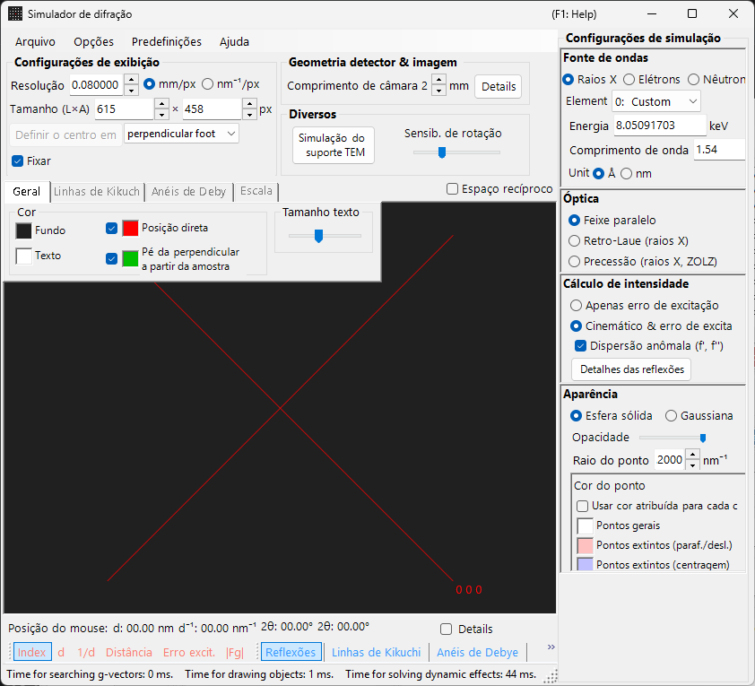
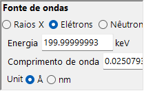
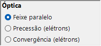
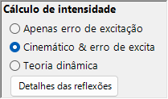
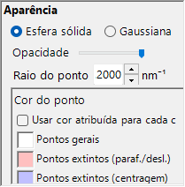
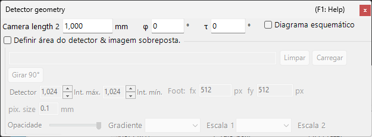

# Simulação de difração de raios X / nêutrons

A **simulação de difração de raios X / nêutrons** calcula padrões de difração de monocristal para raios X e nêutrons. É um dos principais modos do [simulador de difração](index.md).

> Esta página lista todas as configurações que aparecem no lado direito quando você seleciona **Raios X** (ou **Nêutron**) como fonte de ondas. Para operações que afetam toda a janela, como desenhar e salvar, consulte a [página de visão geral](index.md).

Condições da GUI: Fonte de ondas = Raios X / Nêutron · Óptica = Feixe paralelo / Precessão (raios X, ZOLZ) / Retro-Laue (raios X) · Cálculo de intensidade = Apenas erro de exc. / Cinemático & erro exc.

---

## Visão geral

Os raios X têm um comprimento de onda maior que os elétrons (Cu Kα: 0.15406 nm = 1.5406 Å), de modo que a esfera de Ewald é mais fortemente curvada. Como resultado, menos pontos da rede recíproca satisfazem a condição de difração simultaneamente do que no caso dos elétrons. Como o poder de espalhamento atômico é pequeno e o espalhamento múltiplo é fraco, a teoria cinemática da difração fornece precisão suficiente para as intensidades (o cálculo dinâmico é suportado apenas para elétrons).

---

## Wave Length

Selecione **Raios X** como fonte de radiação. Os raios X podem ser especificados de duas maneiras: raios X característicos e radiação síncrotron.

### Raios X característicos

A escolha de um **elemento** e de uma **transição** fixa o comprimento de onda dos raios X característicos. A transição é especificada na notação de Siegbahn (Kα₁ / Kα₂ / Kβ, etc.). Comprimentos de onda Kα₁ de elementos representativos:

| Elemento | Linha | Comprimento de onda (Å) | Energia (keV) |
|---------|------|-----------------|--------------|
| Cu | Kα₁ | 1.5406 | 8.048 |
| Mo | Kα₁ | 0.7093 | 17.479 |
| Co | Kα₁ | 1.7890 | 6.930 |
| Cr | Kα₁ | 2.2897 | 5.415 |

### Radiação síncrotron

Defina **Element** como **0: Custom** e insira diretamente a energia (keV) ou o comprimento de onda (Å). Qualquer comprimento de onda pode ser usado.

---

## Modo do feixe incidente

Seleciona a geometria do feixe incidente. Três modos estão disponíveis para raios X.

### Parallel

A onda plana padrão. Um feixe incidente paralelo, usado para SAED e difração de raios X de monocristal.

### Precession (X-ray) — câmera de precessão

Simula uma câmera de precessão de raios X. Trata-se de uma fotografia de precessão que captura uma única camada da rede recíproca.

### Back-Laue (Laue de retrorreflexão)

Simula um padrão de Laue de retrorreflexão com raios X brancos (policromáticos). Nessa geometria de retrorreflexão, o detector é colocado do lado da fonte e **Monochrome** é desativado. Os spots são projetados sobre um detector plano **perpendicular ao feixe**, posicionado à distância do comprimento de câmera no lado da fonte; a inclinação do detector **Tau / Phi** da [Geometria do detector](index.md#detector-geometry) não é usada nessa projeção.

- O espectro branco é cortado em **50 keV**: os reflexos são coletados até $d = \lambda(50\ \text{keV})/2$, e nenhuma ponderação espectral é aplicada.
- Os harmônicos $n\mathbf{g}$ situados na mesma reta que passa pela origem caem no mesmo spot; seus $\lvert F\rvert^2$ são somados no reflexo de menor ordem, e as intensidades dos spots são normalizadas pelo spot mais intenso.
- **Dispersão anômala (f', f'')** é desativada (a energia não tem um valor único), e o **Raio do ponto** não tem unidade neste modo.

> **Nota**: As opções do feixe incidente acompanham o comprimento de onda. **Precessão (elétrons)** e **Convergência (elétrons)** aparecem somente quando a radiação de elétrons está selecionada, enquanto as opções **Precessão (raios X, ZOLZ)** e **Retro-Laue (raios X)** acima aparecem somente quando a radiação de raios X está selecionada. Para nêutrons, apenas **Feixe paralelo** está disponível. Dependendo do estado no momento da captura, a captura de tela pode não mostrar as opções específicas de raios X.

---

## Cálculo da intensidade

Seleciona o método usado para calcular as intensidades dos spots. Dois modos estão disponíveis para raios X.

### Only excitation error

A intensidade é determinada exclusivamente pela distância geométrica entre a esfera de Ewald e o ponto da rede recíproca (o erro de excitação $S_g$). Ela é máxima em $S_g = 0$ — exatamente sobre a esfera — e decai à medida que $\lvert S_g\rvert$ aumenta, chegando a zero assim que $\lvert S_g\rvert$ excede o **Raio do ponto** indicado para o ponto da rede recíproca. O fator de estrutura é ignorado.

Somente neste modo aparecem as seguintes opções:

- **Excluir todas as reflexões proibidas** / **Excluir reflexões proibidas por centragem de rede** (padrão: apenas centragem de rede) : ocultam os reflexos proibidos pelo grupo espacial. Os reflexos não ocultados são desenhados nas cores separadas definidas em **Cor do ponto** (proibidos por eixo helicoidal/plano de deslizamento e proibidos pela centragem de rede).
- **Desenhar todos os pontos com o mesmo raio** : desenha todos os spots com o tamanho correspondente a $S_g = 0$, independentemente do erro de excitação.

### Kinematical & excitation error

Além do erro de excitação, o fator de estrutura cinemático $\lvert F_{hkl} \rvert^2$ é incorporado à intensidade. As regras de extinção são estritamente obedecidas. Os fatores de Lorentz e de polarização não são incluídos (esta é uma simulação do padrão geométrico).

- **Dispersão anômala (f', f'')** (apenas raios X, ativada por padrão) : adiciona ao fator de estrutura os termos de dispersão anômala f′, f″ na energia atual dos raios X (também aos anéis de Debye). Em uma estrutura não centrossimétrica que contém espalhadores anômalos quimicamente distintos, a lei de Friedel deixa então de valer e as intensidades de $hkl$ / $\bar h\bar k\bar l$ diferem (pares de Bijvoet); o efeito é mais forte perto de uma borda de absorção. Desativada para Back-Laue. Consulte [Fator de estrutura](../appendix/a2-beam-interaction/structure-factor.md).

> **Nota**: A **teoria dinâmica** está desabilitada para raios X (disponível somente quando a radiação de elétrons está selecionada).

---

## Aparência dos spots

Controla como cada spot de difração é renderizado.

- **Esfera sólida / Gaussiana** : modelo geométrico do ponto da rede recíproca. **Esfera sólida** desenha a seção transversal entre uma esfera e a esfera de Ewald; com **Cinemático & erro exc.**, o raio da esfera é $R \times I_\text{rel}^{1/3}$ (de modo que o *volume* da esfera é proporcional à intensidade relativa), e com **Apenas erro de exc.** é o próprio *R*. **Gaussiana** usa a seção transversal entre uma gaussiana 3D com σ = *R* e a esfera de Ewald (a integral da gaussiana 2D corresponde à intensidade de difração); spots com $\lvert S_g\rvert \ge 3R$ não são desenhados.
- **Opacidade** : transparência do spot (0 = transparente, 1 = opaco).
- **Raio do ponto (R)** : raio do ponto da rede recíproca. O tamanho do spot renderizado é determinado pela combinação de **Aparência** e **Cálculo de intensidade**.
- **Brilho** : ativo apenas no modo **Gaussiana**. Define a intensidade integrada da gaussiana renderizada.
- **Escala de cores** (apenas Gaussiana) : **Gray**, **Cold-Warm**, **Spectrum** ou **Fire**.
- **Escala log** (apenas Gaussiana) : exibe as intensidades em escala logarítmica.
- **Cor do ponto** : cores dos spots usadas com a escala de cores **Gray** (este grupo fica oculto para as outras escalas de cores).
- **Cor por cristal** : quando marcado, desenha os spots na cor atribuída a cada cristal.

---

## Anéis de Debye (policristalino)

Os anéis de Debye de uma amostra policristalina podem ser exibidos. Ative **Anéis de Debye** na barra de ferramentas (consulte [Barra de ferramentas](index.md#toolbar)).

- **Ignorar intensidade de difração** : desenha todos os anéis com a mesma cor e intensidade (usado para uma comparação puramente geométrica que ignora o fator de estrutura).
- **Mostrar rótulos de índices** : exibe o índice (*hkl*) próximo a cada anel.

As configurações detalhadas estão na aba **Anéis de Debye** do [menu de abas](index.md#drawing-overlay-tabs).

---

## Difração de nêutrons

Selecionar **Nêutron** no controle de comprimento de onda calcula um padrão de difração de nêutrons.
Insira a energia (meV) ou o comprimento de onda (Å ou nm, alternável; padrão Å). O feixe incidente só pode ser **Feixe paralelo**. O cálculo da intensidade pode ser **Apenas erro de exc.** ou **Cinemático & erro exc.** (a **Teoria dinâmica** não está disponível). A intensidade cinemática usa o comprimento de espalhamento de nêutrons em vez do fator de espalhamento atômico.

---

## Diferenças entre difração de raios X e de elétrons

| Característica | Difração de raios X | Difração de elétrons |
|---------|-------------------|----------------------|
| Comprimento de onda | Longo (0.5–2.5 Å) | Curto (0.02–0.04 Å) |
| Curvatura da esfera de Ewald | Grande | Pequena (quase plana) |
| Reflexões simultâneas | Poucas | Muitas |
| Fator de espalhamento | Fator de espalhamento atômico $f(s)$ | Fator de espalhamento eletrônico $f_e(s)$ |
| Efeitos dinâmicos | Geralmente pequenos | Grandes |
| Regras de extinção | Estritamente obedecidas | Podem ser violadas pelo espalhamento múltiplo |

---

## Operações comuns

Para operações que afetam toda a janela, como comprimento de câmera, geometria do detector, salvamento de padrões e configurações de cor, consulte a [página de visão geral](index.md). A geometria detalhada do detector é configurada na janela de geometria mostrada abaixo.

---

## Veja também

- [Simulador de difração (visão geral)](index.md)
- [Simulação SAED](1-saed-simulation.md)
- [Simulação de difração de elétrons por precessão (PED)](2-ped-simulation.md)
- [Simulação de difração de elétrons por feixe convergente (CBED)](3-cbed-simulation.md)
- [Sistema de coordenadas — orientação do cristal](../appendix/a1-coordinate-system/1-orientation.md)
