# Crystal Diffraction (Simulador de difração)

**Crystal Diffraction (Simulador de difração)** simula padrões de difração de raios X, de nêutrons e de elétrons de monocristal.

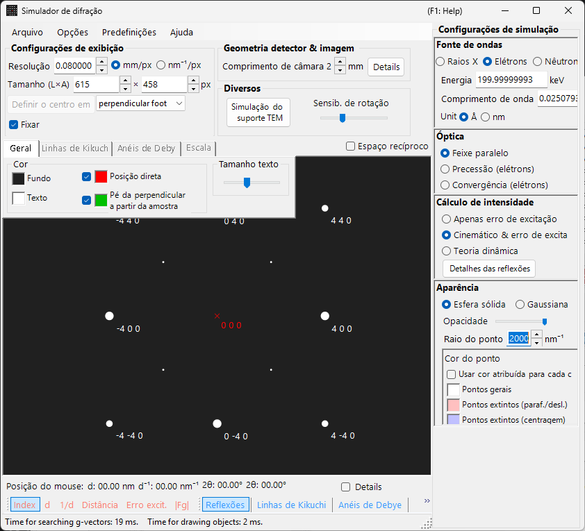

A janela tem uma área de desenho do padrão de difração à **esquerda** e, à **direita**, o painel **Configurações de simulação** (fonte de ondas, óptica, cálculo de intensidade, aparência, etc.). A combinação de fonte de ondas e óptica determina o modo de aquisição (difração de raios X, SAED, PED, CBED), e os painéis à direita são reconfigurados de acordo.

---

## Como esta página e as páginas de modo dividem o trabalho

- **Esta página (hub)**: reúne as operações comuns a todos os modos (atalhos, menus, barra de ferramentas, informações de tela/detector, abas de overlay, informações dos reflexos, geometria do detector, compressão dinâmica).
- **Cada página de modo**: cobre **todas as configurações que aparecem à direita** quando esse modo é selecionado (comprimento de onda, feixe incidente, cálculo de intensidade, aparência, configurações de ondas de Bloch, configurações de precessão, etc.), de modo que cada página seja autossuficiente (há alguma sobreposição entre os modos).

| Modo | Conteúdo | Página |
|------|----------|------|
| **Difração de raios X (e de nêutrons)** | Padrão de difração de raios X / nêutrons de monocristal (paralelo, raios X em precessão, Back Laue) | [Simulação de difração de raios X](5-x-ray-neutron-diffraction.md) |
| **SAED** | Difração de elétrons com feixe paralelo (selected-area electron diffraction) | [Simulação SAED](1-saed-simulation.md) |
| **PED** | Difração de elétrons em precessão | [Simulação PED](2-ped-simulation.md) |
| **CBED** | Difração de elétrons com feixe convergente | [Simulação CBED](3-cbed-simulation.md) |

> **ALCHEMI não é um modo.** Ao contrário de raios X / SAED / PED / CBED, determinados pela combinação de comprimento de onda e feixe incidente, o simulador ALCHEMI é uma **janela filha** aberta pelo menu **Opções**, por isso é listado aqui separadamente.

| Janela filha | Conteúdo | Página |
|------|------|------|
| **Simulador ALCHEMI** | Curvas de rocking de ionização resolvidas por sítio (microanálise realçada por canalização) | [Simulação ALCHEMI](4-alchemi-simulation.md) |

Ocultar o Simulador de difração também oculta todas as suas janelas filhas (informações dos reflexos, geometria do detector, CBED, compressão dinâmica, simulação do suporte TEM e o simulador ALCHEMI). Quando o simulador é exibido novamente, apenas a janela CBED (no modo de convergência) reabre sozinha. <!-- 261105Cl 監査: FormElectronDiffraction_VisibleChanged (f98bc0d) -->

---

## Referência rápida de modos

Localize a página de que precisa a partir da combinação de **Fonte de ondas** e **Óptica** (feixe incidente).

| Fonte de ondas | Óptica | Modo | Página |
|------------|--------------------|------|------|
| Elétrons | Feixe paralelo | SAED | [Simulação SAED](1-saed-simulation.md) |
| Elétrons | Precessão (elétrons) | PED | [Simulação PED](2-ped-simulation.md) |
| Elétrons | Convergência (elétrons) | CBED | [Simulação CBED](3-cbed-simulation.md) |
| Raios X | Feixe paralelo | Difração de raios X | [Simulação de difração de raios X](5-x-ray-neutron-diffraction.md) |
| Raios X | Precessão (raios X, ZOLZ) | Raios X em precessão (câmera de precessão) | [Simulação de difração de raios X](5-x-ray-neutron-diffraction.md) |
| Raios X | Retro-Laue (raios X) | Laue de retroreflexão | [Simulação de difração de raios X](5-x-ray-neutron-diffraction.md) |
| Nêutron | Feixe paralelo | Difração de nêutrons | [seção de nêutrons da Simulação de difração de raios X](5-x-ray-neutron-diffraction.md) |

> **Nota**: As opções de feixe incidente (**Óptica**) mudam com o comprimento de onda. Para elétrons: **Feixe paralelo, Precessão (elétrons), Convergência (elétrons)**; para raios X: **Feixe paralelo, Precessão (raios X, ZOLZ), Retro-Laue (raios X)**; para nêutrons: apenas **Feixe paralelo**. Mudar a fonte de ondas sempre redefine a óptica para **Feixe paralelo**. Selecionar **Precessão (elétrons)** ou **Convergência (elétrons)** alterna automaticamente o cálculo de intensidade para **Teoria dinâmica**; a **Teoria dinâmica** só é oferecida para elétrons (ao selecionar raios X ou nêutrons, o cálculo volta para **Cinemático & erro exc.**). O Retro-Laue (Back Laue) usa um feixe branco (policromático).

---

## Atalhos de teclado e mouse

Estes se aplicam à janela do padrão de difração compartilhada pelas simulações de raios X, SAED e PED. Arrastar sobre o padrão gira o **cristal**. Use o zoom com a roda do mouse ou com clique direito / arrastar com o botão direito.

| Atalho | Ação |
|----------|--------|
| <kbd>F1</kbd> | Abrir esta página do manual online |
| Arrastar com o botão esquerdo perto do centro | Inclinar o cristal |
| Arrastar com o botão esquerdo na área externa | Girar o cristal em torno do eixo do feixe |
| Clique duplo esquerdo em um reflexo | Mostrar detalhes do reflexo (índice, *d*, fator de estrutura, erro de excitação) |
| Arrastar com o botão do meio | Deslocar o padrão |
| <kbd>CTRL</kbd> + Arrastar com o botão do meio | Mover o centro do detector (quando a área do detector está sendo exibida) |
| Roda do mouse | Ampliar / reduzir o zoom por ×2 a cada passo da roda; o ponto sob o cursor é levado ao centro da vista (com **Fixar** marcado, o centro fixado é mantido) |
| Clique direito | Reduzir o zoom (×1/1.2) |
| Arrastar com o botão direito um retângulo | Ampliar o zoom na região selecionada |
| Clique duplo direito na barra de status | Copiar um resumo em texto das configurações atuais: cristal e ângulos de Euler, fonte, energia, comprimento de onda, óptica, forma dos pontos, cálculo de intensidade (para **Teoria dinâmica**, também a espessura, o número de ondas difratadas e, para PED, o semiângulo de precessão) e a geometria do detector <!-- 261105Cl 監査: statusStrip1_MouseDown (C24) --> |
| Clique duplo direito em um botão de camada ativo (Spots / Kikuchi / Debye / Scale) | Piscar essa camada ligando e desligando |

As janelas auxiliares abertas a partir daqui adicionam mais alguns:

| Atalho | Ação |
|----------|--------|
| Clique duplo esquerdo na estereonete — **Simulação de Suporte TEM** | Ajustar a inclinação do suporte para esse ponto |
| Teclas de seta — **Simulação de Suporte TEM** | Avançar a inclinação do suporte passo a passo (marque **Ativar teclas de seta** primeiro; funciona somente enquanto a janela do suporte estiver ativa) <!-- 261106Cl 作者の決定 D25 --> |
| Soltar um arquivo `.prm` ou uma imagem — **Geometria do detector** | Carregar geometria do detector / imagem de overlay |
| Soltar um perfil `.txt` — **Compressão dinâmica** | Carregar perfis de posição/tempo/pressão (escolha o tempo com o controle deslizante **Tempo**; arraste as linhas verticais no gráfico para definir a frente / a traseira) |

Os atalhos <kbd>CTRL</kbd>+<kbd>SHIFT</kbd> de toda a aplicação, da janela principal, também funcionam enquanto esta janela está em foco (consulte [janela principal](../0-main-window.md)).

→ Consulte **[21. Atalhos de teclado e mouse](../21-shortcuts.md)** para todas as janelas de uma só vez.

---

## Rotas rápidas por objetivo

| Objetivo | Começar por | Referência |
|------|------------|-----------|
| Produzir difração de elétrons com feixe paralelo (SAED) | Definir **Óptica** como **Feixe paralelo** e a **Fonte de ondas** como **Elétrons** | [Simulação SAED](1-saed-simulation.md), [cálculo de SAED com feixe paralelo](../appendix/a3-bloch-wave/calculation.md) |
| Produzir difração de raios X de monocristal | Alternar a **Fonte de ondas** para **Raios X** (para radiação síncrotron, defina **Element** como **0: Custom**) | [Simulação de difração de raios X](5-x-ray-neutron-diffraction.md) |
| Produzir difração de elétrons em precessão (PED) | Definir **Óptica** como **Precessão (elétrons)** e, em seguida, definir o semiângulo e o passo | [Simulação PED](2-ped-simulation.md) |
| Produzir difração de elétrons com feixe convergente (CBED) | Definir **Óptica** como **Convergência (elétrons)** e definir as condições na janela CBED | [Simulação CBED](3-cbed-simulation.md), [cálculo CBED](../appendix/a3-bloch-wave/cbed.md) |
| Inspecionar a lista de reflexos do cálculo dinâmico | Selecionar **Teoria dinâmica** e clicar em **Detalhes dos pontos** | [Cálculo dinâmico (núcleo compartilhado)](../appendix/a3-bloch-wave/calculation.md) |
| Comparar a geometria do detector com uma imagem experimental | Abrir as configurações de geometria do detector em **Detalhes**, no grupo **Geometria detector & imagem sobreposta**, e usar a imagem de overlay | [Sistema de coordenadas do detector](../appendix/a1-coordinate-system/2-diffraction.md) |

---

## Área principal

O padrão de difração é simulado no centro da tela.

### Operação do mouse

Consulte "Atalhos de teclado e mouse" no topo desta página.

### Posição do mouse

A linha **Posição do mouse:** acima do padrão mostra, para a posição do cursor, *d* e *d*⁻¹ (em nm e nm⁻¹ ou em Å e Å⁻¹, conforme a unidade de comprimento da janela principal) e 2θ <!-- 261106Cl 作者の決定 C2 --> (em graus e em rad, ou em mrad abaixo de 0.1 rad). Marcar **Details** adiciona três leituras de coordenadas: as coordenadas do detector (mm, origem = pé da perpendicular a partir da amostra), as coordenadas no espaço real (mm, origem = cristal) e as coordenadas no espaço recíproco (nm⁻¹). No modo Retro-Laue, os valores de *d* e do espaço recíproco são exibidos como "-", e 2θ é o ângulo de espalhamento, isto é, 180° menos o ângulo a partir do eixo do feixe (180° no orifício do feixe, no centro). <!-- 261105Cl 監査: Back Laue の 2θ (C13) -->

---

## Menu File

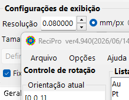

| Item de menu | Descrição |
|-----------|-------------|
| **Salvar imagem** | Salvar o padrão de difração exibido, **como Imagem (formato PNG)** ou **como metarquivo (EMF)**. |
| **Salvar área do detector** | Salvar apenas o recorte da área do detector (PNG / EMF) na grade de pixels do detector. Exibido apenas enquanto a área do detector estiver sendo mostrada. Pergunta-se se a imagem sobreposta deve ser incluída somente quando há uma carregada. <!-- 261105Cl 監査: SaveOrCopyDetector (C18) --> |
| **Salvar discos CBED** | Apenas no modo CBED: salvar os discos calculados **como Imagens individuais (formato PNG / TIFF)** ou **como imagem coletiva (formato PNG / TIFF)**. Sempre os discos CBED, mesmo enquanto a área do detector está sendo exibida. |
| **Copiar** | Copiar a imagem exibida para a área de transferência (**como Imagem** / **como metarquivo (EMF)**). |
| **Copiar área do detector** | Copiar apenas o recorte da área do detector na grade de pixels do detector. Exibido apenas enquanto a área do detector estiver sendo mostrada. Pergunta-se se a imagem sobreposta deve ser incluída somente quando há uma carregada. |
| **Copiar discos CBED** | Apenas no modo CBED: copiar os discos **como imagem coletiva** (sempre os discos CBED, mesmo enquanto a área do detector está sendo exibida). |
| **Salvar vídeo** | Gravar um vídeo do **Padrão de difração** ou da vista do **Espaço recíproco**. |
| **Configurar página / Visualizar impressão / Imprimir** | Imprimir o padrão exibido. |

### Preset

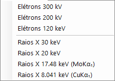

Predefinições fixas de fonte de ondas que definem apenas a radiação e sua energia: **Elétrons 300 kV**, **Elétrons 200 kV**, **Elétrons 120 kV**, **Raios X 30 keV**, **Raios X 20 keV**, **Raios X 17.48 keV (MoKα₁)** e **Raios X 8.041 keV (CuKα₁)** (as duas últimas selecionam a linha característica Kα₁ do Mo / Cu). As demais configurações (geometria do detector, abas, propriedades dos reflexos) não são armazenadas nem alteradas.

### Menus Opções e Ajuda

| Item de menu | Descrição |
|-----------|-------------|
| **Opções > Compressão dinâmica** | Abre a janela de [Compressão dinâmica](#dynamic-compression) (junto com a janela de geometria do detector). |
| **Opções > Simulador ALCHEMI...** | Abre o [Simulador ALCHEMI](4-alchemi-simulation.md). |
| **Ajuda > Conceito básico do método de Bethe** | Abre no navegador o [apêndice sobre ondas de Bloch](../appendix/a3-bloch-wave/index.md) do manual online. |

---

## Barra de ferramentas {#toolbar}

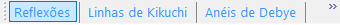

| Botão | Descrição |
|--------|-------------|
| Pontos | Mostrar / ocultar a camada de reflexos de difração |
| Linhas de Kikuchi | Mostrar / ocultar a camada de linhas de Kikuchi |
| Anéis de Debye | Mostrar / ocultar a camada de anéis de Debye |
| Escala | Mostrar / ocultar a camada de linhas de escala |
| Index / d / 1/d / Distância / 2θ / χ / Erro excit. / Intensidade <!-- 261106Cl 作者の決定 C11, C1 --> | Escolha do rótulo anexado a cada reflexo |

---

## Informações de tela e detector

### Tela

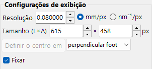

| Item | Descrição |
|------|-------------|
| **Resolução** | O tamanho de um pixel da tela, em **mm/px** (no plano do detector) ou **nm⁻¹/px** (selecionável; padrão 0.08 mm/px). Não precisa corresponder ao tamanho real do pixel do detector; é tratado como uma escala de exibição e atualizado automaticamente quando você aplica zoom com o mouse. |
| **Tamanho (L×A)** | Largura e altura em pixels da área de desenho. Dependendo da resolução do seu monitor, valores muito grandes podem não ser ajustáveis. |
| **Definir o centro em / Fixar** | Coloca o centro da área de desenho no **perpendicular foot** (pé da perpendicular), no **direct spot** (reflexo direto) ou no centro do **detector** (este último apenas quando uma área de detector está definida). Com **Fixar** marcado (padrão), o centro permanece ali: o deslocamento com o mouse é desativado e o zoom mantém esse centro. |
| **Espelhar horizontal / Espelhar vertical / Imagem negativa** | Espelhamentos geométricos (horizontal / vertical) e inversão de cores do padrão: **Imagem negativa** inverte o fundo, os pontos, os rótulos, as linhas de Kikuchi, as reflexões proibidas, o ponto direto, o pé da perpendicular, os anéis de Debye e as linhas de escala (as cores dos cristais, as escalas de cores da exibição gaussiana, a vista 3-D e uma imagem sobreposta não são invertidas). <!-- 261105Cl 監査: checkBoxNegativeImage_CheckedChanged (C21) --> Use-os para corresponder à orientação ou ao contraste de uma imagem experimental. |
| **Espaço recíproco** | Abre, ao lado do padrão, uma vista 3D da esfera de Ewald e dos pontos da rede recíproca, visualizando quais reflexos estão excitados. Seu painel **Opções** define as cores (pontos perto / longe da esfera de Ewald, esfera de Ewald, origem, guia de direção), o raio 3D dos pontos (nm⁻¹), o limiar de intensidade relativa (%), a transparência dos pontos longe da esfera de Ewald, os rótulos e a direção de visualização (botões de seta com um **Passo** angular, **Redefinir vista**). |

### Detector (comprimento de câmera)

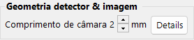

- **Comp. câmara 2** : Distância (mm) da amostra ao pé da perpendicular baixada sobre o plano do detector (padrão 1000 mm). Coincide com o comprimento de câmera usual quando o detector não está inclinado (τ = 0).
- **Detalhes** : Abre a janela de configurações de geometria do detector (consulte [Geometria do detector](#detector-geometry) abaixo).

### Diversos {#misc}

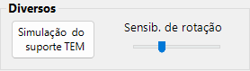

- **Sensib. de rotação** : Quantidade de rotação do cristal por pixel de arrasto do mouse.
- **Simulação do suporte TEM** : Abre a janela de simulação vinculada ao suporte (veja abaixo).

---

## Simulação do suporte TEM

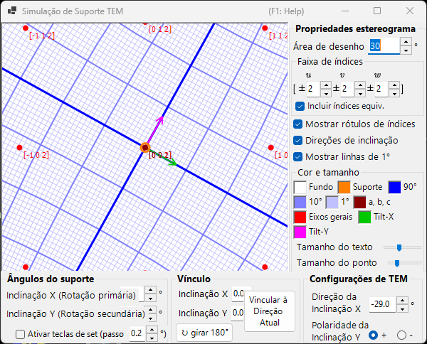

Abre uma janela que vincula o padrão de difração a um **suporte TEM** de dupla inclinação (**Inclinação X** = rotação primária, **Inclinação Y** = rotação secundária). Definir os ângulos de inclinação do suporte atualiza o padrão e a orientação do cristal, e as orientações alcançáveis podem ser exibidas em uma estereonete (adicionado na v4.914). **Vincular à Direção Atual** toma a orientação atual do cristal como referência do suporte (nos valores dados de Inclinação X / Inclinação Y); **Configurações de TEM** definem a direção do eixo de Inclinação X na tela (padrão −29°) e a polaridade da Inclinação Y, e **↻ girar 180°** gira o cristal 180° em torno do feixe (sempre em torno do eixo do feixe, mesmo quando um eixo ou plano está fixado na janela principal). Um clique duplo esquerdo na estereonete ajusta a inclinação do suporte para esse ponto, e marcar **Ativar teclas de seta** permite que ←/→ avancem a Inclinação X e ↑/↓ a Inclinação Y passo a passo (passo 0.1–2°, padrão 0.2°). As teclas de seta inclinam o suporte somente enquanto esta janela estiver ativa. <!-- 261106Cl 作者の決定 D25 --> Quando a janela é exibida novamente depois de ter sido ocultada (junto com o simulador), ou quando Inclinação X / Inclinação Y é alterada, uma rotação ou uma troca de cristal feita nesse meio-tempo é tomada como a nova referência: a orientação atual é tratada como a orientação na inclinação presente, e a lista de eixos de zona é refeita para o cristal atual. <!-- 261105Cl 監査: FormDiffractionSimulatorHolder.cs OnVisibleChanged / numericBoxTilt_ValueChanged (54e23f0) -->

---

## Abas de overlay de desenho {#drawing-overlay-tabs}

### General

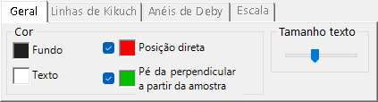

Define o **Tam. texto** dos rótulos e as cores do **Texto** dos rótulos, do marcador **Pé da perpendicular a partir da amostra**, do marcador **Posição direta** e do **Fundo** (os dois marcadores podem ser desligados individualmente). As cores dos pontos são definidas em **Aparência** (consulte as páginas de modo); as cores das linhas de Kikuchi, dos anéis de Debye e das linhas de escala, nas respectivas abas. As configurações feitas aqui se aplicam a todos os modos de renderização.

### Linhas de Kikuchi

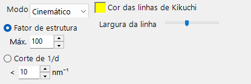

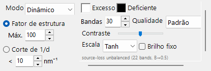

Ativa quando as linhas de Kikuchi estão habilitadas na barra de ferramentas.

- **Reflection selection** : Escolhe quais reflexos geram as linhas de Kikuchi. Ou **Fator de estrutura** (os *N* reflexos principais por $\lvert F_{hkl}\rvert$, com *N* definido em **Máx.**; 1–1000, padrão 100) ou **Corte de 1/d** (todos os reflexos cujo 1/d está abaixo do limiar; 0–100 nm⁻¹, padrão 10).
- **Modo** : Como as linhas de Kikuchi são desenhadas (padrão **Cinemático**). Os ajustes abaixo da caixa de combinação mudam com o modo.
    - **Geométrico** : todas as linhas selecionadas em uma cor fixa.
    - **Cinemático** : a escuridão da linha segue a intensidade relativa cinemática de cada reflexão.
    - **Dinâmico** : perfis de banda excesso/deficiente dinâmicos de dois feixes alimentados por espalhamento térmico difuso, calculados em segundo plano. As bandas de excesso aparecem no lado de ângulos altos e os traços deficientes na direção do feixe direto; a espessura da amostra é compartilhada com os ajustes de intensidade. As linhas geométricas são desenhadas enquanto o cálculo decorre.
- **Ajustes Geométrico / Cinemático** : **Cor das linhas de Kikuchi** e **Largura da linha**.
- **Ajustes Dinâmico** :
    - **Excesso** / **Deficiente** : cores do lado claro (contraste positivo) e escuro (contraste negativo) das bandas.
    - **Bandas** : Número de bandas desenhadas com perfis dinâmicos (as *N* melhores por contraste dinâmico; 1–50, padrão 30).
    - **Qualidade** : Pontos de amostragem através de cada banda (Rápido 65 / Padrão 129 / Alta 257; padrão **Padrão**).
    - **Contraste** : Ganho de exibição aplicado ao contraste da banda antes da compressão.
    - **Escala** : Curva de compressão de brilho (Linear / Log / Tanh; padrão Tanh). São transformações de visualização, não respostas físicas de câmera.
    - **Brilho fixo** : Congela a normalização de brilho, p. ex. para comparar orientações ou espessuras diferentes.
    - A linha de aviso cinza indica a marca de desequilíbrio fonte/perda, o número de bandas desenhadas e diagnósticos (p. ex. fator *B* padrão substituído em átomos com *B* = 0).
- (O antigo parâmetro separado **Threshold** não existe mais; os reflexos são limitados apenas pela seleção acima.)

### Anéis de Debye

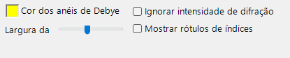

Ativa quando os anéis de Debye estão habilitados na barra de ferramentas.

- **Ignorar intensidade de difração** : Se marcado, todos os anéis de Debye são desenhados com a mesma cor e intensidade (ignorando o fator de estrutura do cristal). Use-o para uma comparação puramente geométrica.
- **Mostrar rótulos de índices** : Se marcado, os índices {*hkl*} aparecem próximo de cada anel (quatro índices {*hkil*} quando **Opções ▸ Usar índice de Miller-Bravais (hkil)** da janela principal está ativado e o cristal usa eixos hexagonais). <!-- 261105Cl 監査: DrawDebyeRing (C23)。ラベルは波かっこ -->

### Scale

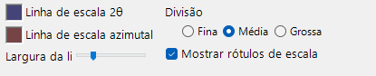

Ativa quando as linhas de escala estão habilitadas na barra de ferramentas.

- **Linha de escala 2θ / Linha de escala azimutal** : a linha **2θ** representa ângulo de espalhamento constante (círculos concêntricos), a linha **azimutal** representa ângulo de azimute constante (linhas radiais a partir do centro). As cores são configuráveis de forma independente. No modo Retro-Laue, os rótulos de 2θ são ângulos de espalhamento, de modo que o centro é 180°.
- **Largura da linha** : Espessura das linhas de escala.
- **Divisão** : Densidade das linhas de escala, **Fina** / **Média** (padrão) / **Grossa**.
- **Mostrar rótulos de escala** : Se rótulos numéricos devem ser desenhados nas linhas de escala.

(Não há uma aba *Misc* separada; a **Sensib. de rotação** do mouse fica no grupo **Diversos** do painel à direita, veja [Diversos](#misc) acima.)

---

## Informações dos reflexos de difração {#diffraction-spot-information}

Lista os detalhes por reflexo calculados pelo método de ondas de Bloch (cálculo Dynamical). Abra-o com o botão **Detalhes dos pontos** no painel de cálculo de intensidade. Nos modos **Apenas erro de exc.** / **Cinemático & erro exc.**, o botão lista os reflexos desenhados no momento com seus potenciais eletrônicos e $P_g$, $Q_g$ (sem amplitudes dinâmicas); no modo CBED, a tabela segue a espessura selecionada na janela CBED. Para raios X e nêutrons, $S_g$, $P_g$ e $Q_g$ são calculados com o comprimento de onda real (sem correção de refração), as colunas de potencial e o seletor da unidade de potencial ficam ocultos, e a tensão de aceleração, $m/m_0$ e $v/c$ são exibidos como "-". <!-- 261105Cl 監査: FormDiffractionSpotInfo.cs SetTable (C 組) -->

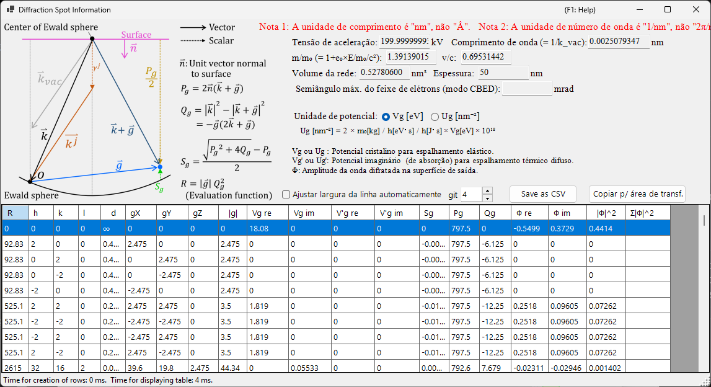

### Esquema e definições

O esquema (canto superior esquerdo) mostra os vetores na esfera de Ewald e define as grandezas usadas na tabela ($\hat{\mathbf{n}}$ é o vetor unitário normal à superfície da amostra, $\mathbf{k}$ é o vetor de onda incidente, $\mathbf{g}$ é o vetor da rede recíproca).

- $P_g = 2\,\hat{\mathbf{n}} \cdot (\mathbf{k} + \mathbf{g})$
- $Q_g = |\mathbf{k}|^2 - |\mathbf{k} + \mathbf{g}|^2 = -\mathbf{g} \cdot (2\mathbf{k} + \mathbf{g})$
- **Erro de excitação:** $S_g = \dfrac{\sqrt{P_g^2 + 4 Q_g} - P_g}{2}$
- **Função de avaliação:** $R = |\mathbf{g}|\, Q_g^2$ — ordena os reflexos de acordo com a intensidade com que são excitados (menor = mais próximo da esfera de Ewald = excitado mais fortemente; o feixe transmitido $g=0$ tem $R=0$ e vem primeiro). A tabela é ordenada por $R$ crescente.

### Colunas da tabela

| Coluna | Significado |
|--------|---------|
| **R** | função de avaliação $R = \lvert\mathbf{g}\rvert\, Q_g^2$ (acima; usada para selecionar / ordenar reflexos) |
| **h, k, (i,) l** | índices de Miller (*i* é o índice hexagonal redundante, mostrado apenas para cristais hexagonais) |
| **d** | distância interplanar (nm) |
| **gX, gY, gZ** | componentes do vetor da rede recíproca *g* (1/nm) |
| **\|g\|** | magnitude de *g* (1/nm) |
| **Vg re / Vg im** | coeficiente de Fourier do potencial do cristal para espalhamento elástico, $V_g$ (real / imaginário) |
| **V'g re / V'g im** | potencial imaginário (de absorção) para espalhamento térmico difuso (TDS), $V'_g$ (real / imaginário) |
| **Sg** | erro de excitação $S_g$ (acima; 1/nm) |
| **Pg** | grandeza auxiliar $P_g = 2\,\hat{\mathbf{n}}\cdot(\mathbf{k}+\mathbf{g})$ (acima) |
| **Qg** | grandeza auxiliar $Q_g = -\mathbf{g}\cdot(2\mathbf{k}+\mathbf{g})$ (acima) |
| **Φ re / Φ im** | amplitude complexa $\Phi$ da onda difratada dinâmica na superfície de saída (real / imaginário) |
| **\|Φ\|^2** | intensidade difratada $\lvert\Phi\rvert^2$ desse reflexo |
| **Σ\|Φ\|^2** | soma cumulativa de $\lvert\Phi\rvert^2$ (total sobre os reflexos; útil como verificação de conservação de intensidade) |

### Unidades de potencial e outros controles

- **Unidade de potencial** : Alterna o potencial exibido entre **Vg [eV]** (potencial eletrostático, eV) e **Ug [nm⁻²]** (a grandeza escalonada $U_g = (2 m_0/h^2)\, V_g$ que entra nas equações de ondas de Bloch). Os cabeçalhos das colunas mudam de acordo entre *Vg / V'g* e *Ug / U'g*. Exibido apenas para elétrons. <!-- 261106Cl 作者の決定 C5 -->
- Acima da tabela são exibidos a tensão de aceleração, o comprimento de onda ($\lambda = 1/k_\text{vac}$), a razão de massa relativística $m/m_0$, a razão de velocidade $v/c$, o volume da rede, a espessura da amostra e (no modo CBED) o semiângulo de convergência α. A espessura só aparece num cálculo de **Teoria dinâmica** (no modo CBED, a espessura da janela CBED) e o semiângulo só no modo CBED; caso contrário, aparecem como "-".
- **Nota 1:** a unidade de comprimento é **nm**, não Å. **Nota 2:** a unidade de número de onda é **1/nm**, não 2π/nm.
- **Dígito efetivo** : número de algarismos significativos mostrados na tabela (1–16, padrão 4). **Ajustar largura da linha automaticamente** : ajustar automaticamente as larguras das colunas. **Copiar p/ área de transf.** : exporta a tabela como texto que pode ser colado em uma planilha. **Salvar como CSV** : grava a mesma tabela (as colunas visíveis) em um arquivo CSV; o separador decimal é sempre o ponto, de modo que o arquivo continua válido em locales com vírgula decimal. **Copiar p/ área de transf.** e **Salvar como CSV** funcionam mesmo quando a tabela tem uma única linha. Ambos começam com linhas `# chave: valor` que dão as condições (fonte, tensão de aceleração ou energia, comprimento de onda, espessura, semiângulo de convergência em CBED, cristal, ângulos de Euler, modo de cálculo), e os cabeçalhos das colunas trazem as unidades, p. ex. `d (nm)`, `Sg (nm⁻¹)`, `Qg (nm⁻²)`. <!-- 261106Cl 作者の決定 C22 -->

---

## Geometria do detector {#detector-geometry}

Uma janela para a configuração detalhada da geometria do detector (comprimento de câmera, inclinação, rotação) e a sobreposição de uma imagem experimental. Abra-a a partir de **Detalhes** no painel **Geometria detector & imagem sobreposta**.

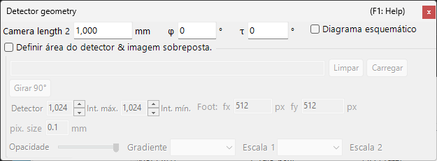

### Configurações de geometria do detector

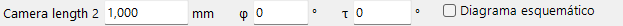

Especifique a geometria de reflexão: **Comprimento da câmera 2** (mm, 1–10000, padrão 1000) e a inclinação do detector **τ** (−200 a 200°) em torno de um eixo no plano com azimute **φ**. Para Back Laue (Laue de retroreflexão), apenas o **Comprimento da câmera 2** é usado: o padrão é sempre projetado sobre um detector perpendicular ao feixe, no lado da fonte, e τ / φ não são aplicados a essa projeção. Soltar um arquivo `.prm` carrega os itens nele armazenados — a fonte (elemento e linha de raios X, elétrons ou nêutrons) com o seu comprimento de onda, o comprimento de câmera 2, τ, φ, a posição do pé, o tamanho do pixel e o tamanho do detector — e ativa a área do detector; os itens que não estão no arquivo ficam inalterados. <!-- 261105Cl 監査: FormDiffractionSimulatorGeometry_DragDrop (952b457)。以前の「常に X 線・任意波長」は誤り -->

### Área do detector e imagem sobreposta

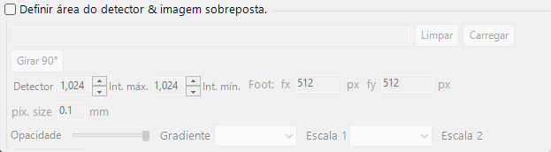

Marque **Definir área do detector & imagem sobreposta.** para especificar o detector: tamanho em pixels (padrão 1024 × 1024), **tam. pix.** (mm, padrão 0.1) e a posição do pé **Pé: fx, fy** (px, padrão 512, 512) — o pé da perpendicular baixada da amostra ao plano do detector, que coincide com a posição do feixe direto somente quando o detector não está inclinado (τ = 0). <!-- 261105Cl 監査: numericBoxFootX/Y.ToolTip, convertDetectorToReal --> Uma imagem experimental pode ser carregada (**Carregar** ou soltando o arquivo) e sobreposta com **Opacidade**, **Gradiente** (filme positivo/negativo), **Escala 1** (log/linear), **Escala 2** (Gray / Cold-warm / Spectrum / Fire), **Int. máx./Int. mín.**, **Girar 90°** e **Limpar**. Carregar uma imagem `.ipa` define τ = 0 (o arquivo não contém inclinação), coloca o pé no centro da imagem e define o comprimento de câmera 2 como a distância do filme. Um arquivo que não pode ser lido como arquivo `.prm` nem como imagem é informado com uma mensagem. <!-- 261105Cl 監査: ReadImage / showCannotRead (4dc847a) --> **Diagrama esquemático** mostra um esboço da geometria. Use isto para sobrepor o padrão simulado e uma imagem experimental e ajustar finamente a geometria do detector.

Consulte também [Sistema de coordenadas do detector](../appendix/a1-coordinate-system/2-diffraction.md) para as definições do sistema de coordenadas.

---

## Compressão dinâmica {#dynamic-compression}

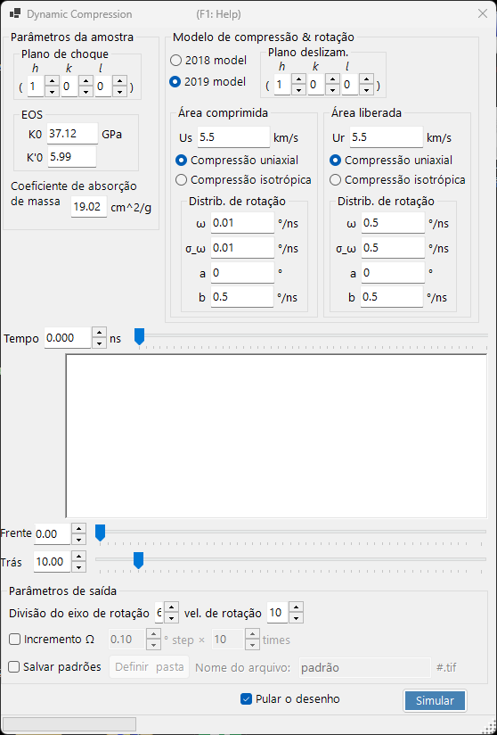

Uma janela para simular a difração de uma amostra comprimida por choque (compressão dinâmica). Solte um arquivo `.txt` separado por tabulações com três colunas (profundidade em µm, tempo em ns, pressão em MBar) para carregar perfis de pressão para cada tempo; o eixo horizontal do gráfico é a profundidade (µm); o controle deslizante **Tempo** (ns) seleciona o perfil mostrado no gráfico. As duas linhas verticais no gráfico (**Frente** / **Trás**) podem ser arrastadas para definir a frente e a traseira da compressão. A janela também reúne o modelo de compressão (**2018 / 2019 model**), as velocidades de choque (**Us**, **Ur**, km/s), a **EOS** (K0, K'0), o **Plano de choque** / **Plano deslizam.**, as distribuições de rotação das áreas comprimida e liberada, o coeficiente de absorção de massa, o passo em Ω e **Salvar padrões** (`#.tif`), e é executada com **Simular**. Uma largura de rotação σ igual a 0 (ou um número de divisões 0 para o ângulo de rotação) é tratada como uma única orientação. Quer a execução tenha êxito ou falhe, o cristal e a sua orientação são restaurados em seguida. <!-- 261105Cl 監査: FormDiffractionSimulatorDynamicCompression.cs execute / buttonSimulate_Click (fb26838, 4a21154, 8461e90) -->

---

## Simulador ALCHEMI

Abre uma janela filha que calcula **curvas de rocking de ionização resolvidas por sítio**: o rendimento de um canal de ionização escolhido enquanto o cristal é inclinado através das condições de Bragg de uma fila sistemática, separado por sítio atômico. Abre-se pelo menu **Opções**. Ao contrário da janela CBED, ela tem sua própria área de saída e não desenha na tela da janela principal.

→ Veja **[Simulação ALCHEMI](4-alchemi-simulation.md)** para todas as definições e para o âmbito e as limitações conhecidas.

---

## Tópicos relacionados

- [Simulação de difração de raios X](5-x-ray-neutron-diffraction.md)
- [Simulação SAED](1-saed-simulation.md)
- [Simulação PED](2-ped-simulation.md)
- [Simulação CBED](3-cbed-simulation.md)
- [Simulação ALCHEMI](4-alchemi-simulation.md)
- [Cálculo dinâmico (núcleo compartilhado)](../appendix/a3-bloch-wave/calculation.md)
- [Sistema de coordenadas do detector](../appendix/a1-coordinate-system/2-diffraction.md)
