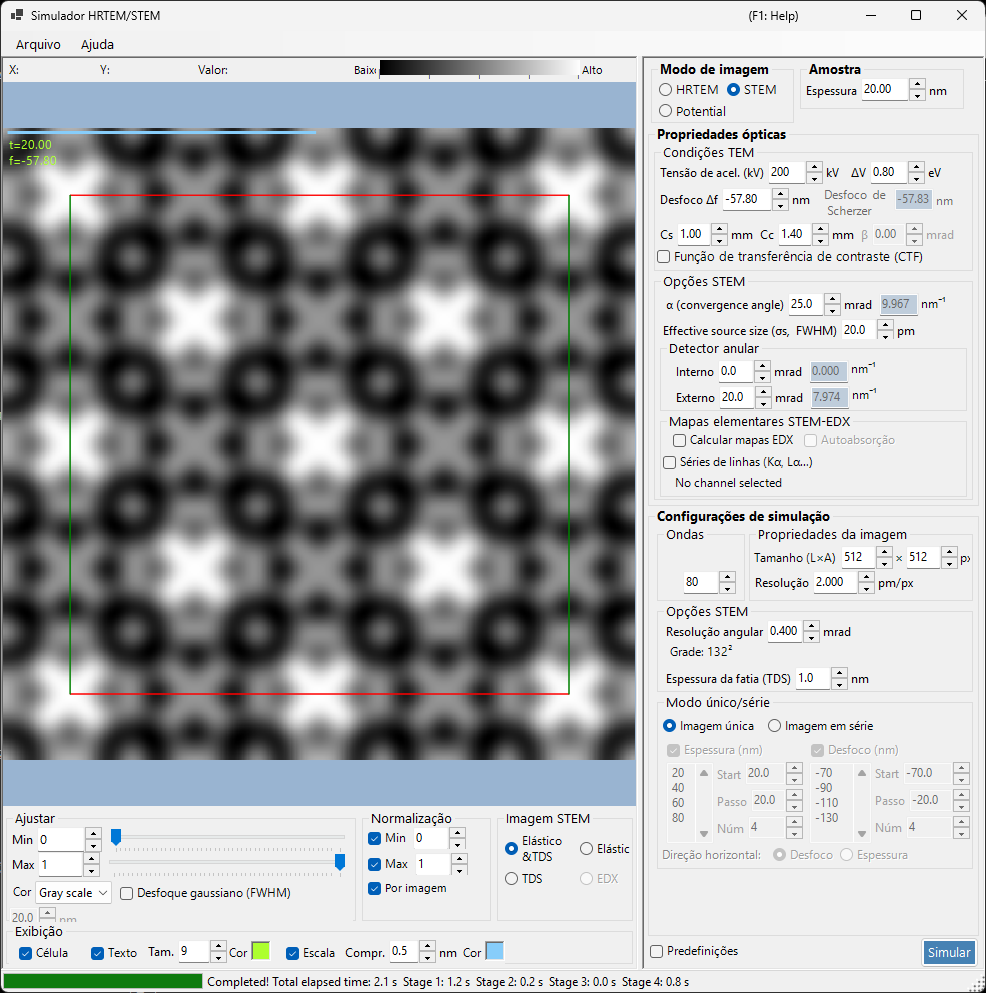
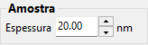
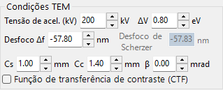
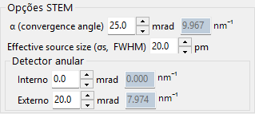
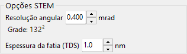
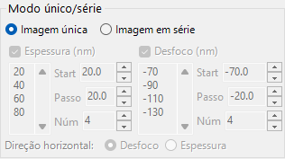
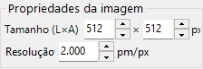
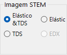
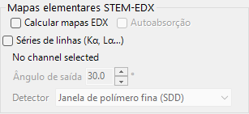

# Simulação STEM

A **simulação STEM (Scanning Transmission Electron Microscopy)** calcula imagens de microscopia eletrônica de transmissão por varredura usando o método de ondas de Bloch.

> Esta página lista todas as configurações que aparecem à direita quando **Modo de imagem = STEM**. Para os controles de exibição do resultado, brilho e normalização à esquerda, consulte a [página de visão geral](index.md). Apenas o **alvo de exibição** específico do STEM é repetido abaixo.

---

## Visão geral

Um feixe eletrônico convergente é varrido sobre a amostra, e os elétrons transmitidos e espalhados em cada posição de varredura são coletados por detectores anulares. O ReciPro calcula a imagem STEM com o método de ondas de Bloch (cálculo dinâmico).

### Fluxo de cálculo

1. Em cada posição de varredura, calcule as intensidades difratadas com o método de ondas de Bloch para cada direção de incidência da sonda convergente.
2. Integre a intensidade espalhada sobre a faixa angular do detector.
3. Tanto as contribuições de espalhamento elástico quanto de espalhamento térmico difuso (TDS) podem ser calculadas.

Consulte o [Apêndice A3.4 — Cálculo STEM](../appendix/a3-bloch-wave/stem.md) para a teoria.

---

## Tipos de detector

| Detector | Faixa angular | Contribuição principal | Contraste |
|----------|-------------|-------------------|----------|
| **BF** (campo claro) | 0 – ângulo de convergência | Elástico | Contraste de fase |
| **ABF** (campo claro anular) | Parte interna do ângulo de convergência | Elástico | Sensível a elementos leves |
| **LAADF** (campo escuro anular de baixo ângulo) | Logo fora do ângulo de convergência | Elástico + TDS | Sensível a deformações |
| **HAADF** (campo escuro anular de alto ângulo) | Bem fora do ângulo de convergência | TDS (inelástico) | Contraste-Z ($\propto Z^2$) |

> **Configurações típicas de detector** (cada uma disponível com um clique no menu de clique direito das opções STEM, todas com ângulo de convergência α = 25 mrad):
> BF (0–5 mrad) / ABF (12–24 mrad) / LAADF (26–60 mrad) / HAADF (80–250 mrad)

---

## Parâmetros da amostra

- **Espessura** : espessura da amostra (nm). Este valor é ignorado no modo **Imagem em série**.

---

## Condições TEM

| Parâmetro | Descrição | Padrão / típico |
|-----------|-------------|-------------------|
| **Tensão de acel.** <!-- 261105Cl 監査: 見出しから (kV) を外した (numericBoxAccVol.HeaderText)。単位は欄の右に出る --> | Tensão de aceleração (kV). O comprimento de onda do elétron corrigido relativisticamente é exibido ao lado | 200 kV |
| **Desfoco Δf** | Desfocagem da lente objetiva (formadora da sonda) (nm) | −57.8 nm |
| **Cs** | Coeficiente de aberração esférica (mm). Afeta o tamanho da sonda | 0.5–1.0 mm |
| **Cc** | Coeficiente de aberração cromática (mm) | 1.0–2.0 mm |
| **ΔV** | Largura a meia altura da dispersão de energia dos elétrons (eV) | 0.5–2.0 eV |

> **β (semiângulo de iluminação) está desativado no modo STEM**, porque o ângulo de convergência α assume o seu papel. A desfocagem e Cs entram na sonda pela mesma função de aberração $\chi$ do HRTEM (Δf negativo = subfoco; veja [Simulação HRTEM](1-hrtem-simulation.md#tem-conditions)). O menu de clique direito de **Condições TEM** (zerar aberrações, desfoco de Scherzer, predefinições de microscópio) também funciona aqui.

---

## Opções STEM (óptica)

Defina a geometria da sonda convergente e do detector anular. Cada ângulo também é exibido convertido em um raio no espaço recíproco $\sin\theta/\lambda$ (nm⁻¹) à direita.

| Parâmetro | Descrição | Padrão / típico |
|-----------|-------------|-------------------|
| **Semiâng. conv. α** | Semiângulo da sonda convergente (mrad). Valores maiores geram uma sonda mais fina e alteram o contraste de difração | 25 mrad (padrão); 15–25 mrad |
| **Detector anular — Interno** | Semiângulo interno de coleta do detector anular (mrad). O sinal dentro desse ângulo é excluído | 0 (padrão); BF: 0, HAADF: 80 |
| **Detector anular — Externo** | Semiângulo externo de coleta do detector anular (mrad). O sinal fora desse ângulo é excluído | 20 (padrão); BF: 5, HAADF: 250 |
| **Tamanho efetivo da fonte (FWHM)** <!-- 261105Cl 監査: 見出しを numericBoxSTEM_EffectiveSourceSize.HeaderText に合わせた --> | Tamanho efetivo da fonte de elétrons (pm). Aplicado após o cálculo como uma convolução gaussiana de cada imagem Elástico / TDS / EDX. Valores maiores borram a imagem e reduzem o contraste de detalhes finos | 20 pm (padrão) |

Os ângulos do detector se aplicam apenas à imagem STEM de referência (Elástico / TDS / Elástico & TDS); os mapas STEM-EDX não os usam. Os padrões valem apenas na primeira execução; depois disso, os últimos valores usados são restaurados.

---

## Opções STEM (simulação)

- **Espessura da fatia (TDS)** : espessura de fatia da amostra (nm, padrão 1, intervalo 0.1–10) usada ao calcular a intensidade TDS (térmico-difuso, inelástico). Valores menores são mais precisos, mas mais lentos.
- **Resolução angular** : resolução de amostragem angular das direções de incidência da sonda (mrad, padrão 0.4). Valores menores amostram a sonda mais finamente, mas são mais lentos. As direções da sonda formam uma grade $N\times N$ com $N=\lceil 2\times1.05\,\alpha/\Delta\alpha\rceil$, das quais são calculadas as que ficam dentro de um disco cerca de 5 % maior que o ângulo de convergência (uma margem para a interpolação); o número cresce, portanto, com o quadrado de $\alpha/\Delta\alpha$, sendo a principal alavanca sobre o tempo de cálculo. A linha abaixo da caixa mostra a grade (por exemplo `Grade: 132²`); veja [Amostragem angular da sonda](../appendix/a3-bloch-wave/stem.md#angular-sampling) para as medidas de convergência.

---

## Modo único/série

<!-- 261105Cl 監査: 見出しを画面 (groupBoxSerialImage.Text) と HRTEM のページに合わせた -->

- **Imagem única** : calcula uma imagem STEM na espessura atual.
- **Imagem em série** : gera uma série de imagens com a espessura / desfocagem variada em etapas (definidas por **Início / Passo / Núm**; a lista abaixo também pode ser editada diretamente).

---

## Propriedades da imagem

- **Tamanho (L×A)** : número de pixels na imagem varrida (padrão 512×512). A autossolução e o cálculo de $I(Q)$ (Estágios 1–4 na barra de status) não dependem dele; ele entra apenas na síntese final da imagem no espaço real a partir dos coeficientes $I(Q)$, cujo custo é proporcional a pixels × número de vetores $Q$.
- **Resolução** : resolução de amostragem (pm/px).

---

## Ondas

- Número máximo de ondas de Bloch usadas no método de Bethe (padrão 80). O custo do problema de autovalores escala com o cubo do número de ondas. Como referência para imagens STEM ADF/HAADF: para Si [001] a 200 kV (40–120 mrad), o desvio é de cerca de 1,5 % com 80 e 0,5 % com 200; com átomos pesados e ângulos de detector altos (SrTiO₃, 64–200 mrad), é de cerca de 7 % com 200 e 1 % com 500. <!-- 261111Cl 追加・変更: STEM の HAADF (TDS) の収束の実測 (|g| の順のビーム、Si [001] は和集合 1054 本・SrTiO₃ は 700 本を基準) -->

---

## Função de transferência de contraste (STEM) {#ctf-stem}

A caixa de seleção **Função de transferência de contraste (CTF)** em **Condições TEM** abre a mesma janela de CTF do modo HRTEM. No modo STEM ela oferece duas opções:

- **Imagem coerente** : traça $\sin\chi$, $\cos\chi$, $E_\text{s}$, $E_\text{c}$, PCTF e ACTF como no HRTEM, mas $E_\text{s}(u)=\exp(-2\pi^2\sigma_s^2u^2)$ é obtido do tamanho efetivo da fonte ($\sigma_s$ = FWHM / $2\sqrt{2\ln2}$), e PCTF / ACTF são cortadas no ângulo de convergência.
- **Imagem incoerente** : traça a função de transferência incoerente, calculada integrando a função da lente sobre a sobreposição de duas aberturas formadoras de sonda (amostragem 192 × 192 da abertura) e multiplicando por $\exp(-2\pi^2\sigma_s^2u^2)$.

---

## Alvo de exibição STEM (lado do resultado) {#stem-display-target}

A chave de exibição no canto inferior esquerdo da janela seleciona qual componente de espalhamento da imagem STEM já calculada deve ser mostrado (alternável sem recalcular).

| Alvo de exibição | Descrição |
|----------------|-------------|
| **Elástico** | Imagem somente de espalhamento elástico |
| **TDS** | Imagem somente de espalhamento térmico difuso |
| **Elastic & TDS** | Soma de elástico + TDS |
| **EDX** | Mapa de raios X característicos. A linha a exibir (por exemplo `O-K`) é escolhida na caixa de combinação abaixo, e **EDX comum** em *Normalização* coloca os canais da mesma grandeza (canais de camada: vacâncias; séries de linhas: fótons de raios X) em uma única faixa de exibição compartilhada, de modo que trocar entre eles não reescala a imagem |

!!! note
    As três imagens são reconstruídas a partir da parte real da soma de Fourier, de modo que **Elastic & TDS** é exatamente a soma das outras duas. Até a versão 4.944 tomava-se o módulo, o que quebrava essa identidade e clareava levemente os pixels escuros. Veja [Reconstrução de uma imagem real](../appendix/a3-bloch-wave/stem.md#real-image-reconstruction).

---

## Mapas elementares STEM-EDX {#stem-edx}

Marque **Calcular mapas EDX** para calcular mapas de raios X característicos junto com a imagem do tipo ADF. Não se trata de um modo separado: os sinais elástico, TDS e EDX saem todos da mesma execução STEM, e depois é possível alternar entre eles em [Imagem STEM](#stem-display-target) sem recalcular.

Não há seletor de elementos. Quando a caixa está marcada, **todos os canais elemento/camada que podem ser calculados para este cristal nesta tensão de aceleração** são computados, e a linha abaixo da caixa de seleção os lista (por exemplo `3 mapa(s): O-K, Mg-K, Al-K`). Um canal está disponível quando a tensão de aceleração está na faixa de 30–400 kV (a faixa da tabela fornecida), a borda de ionização fica abaixo dela e a camada é coberta pelos dados fornecidos com o programa — K: C–Sn (Z = 6–50), L1–L3: Ca–Rn (Z = 20–86), M1–M3: Zn–Rn (Z = 30–86), M4–M5: As–Rn (Z = 33–86); os canais L e M somam as subcamadas presentes. A tabela fornecida armazena fatores de forma de ionização totalmente relativísticos para todos os canais até um vetor de espalhamento de 16 Å⁻¹, ou menos em tensões de aceleração baixas. Nada é extrapolado: onde o cálculo precisa de um vetor de espalhamento maior do que o coberto por uma linha da tabela, o fator de forma é zerado e o canal é marcado com ⚠ na caixa de combinação de EDX. Se nada estiver disponível, a execução é recusada com uma mensagem explicativa, em vez de produzir um mapa vazio.

A grade de direções de incidência da sonda é informada abaixo de **Resolução angular** em *Opções STEM (simulação)*; enquanto **Calcular mapas EDX** estiver marcado, ela acrescenta a divisão recomendada, por exemplo `Grade: 132² (recomendado: ≥48²)`. Essa grade é definida pela **Resolução angular** e pelo ângulo de convergência; veja [Amostragem angular da sonda](../appendix/a3-bloch-wave/stem.md#angular-sampling). Abaixo da divisão recomendada, o resíduo hermitiano ±q pode exceder a tolerância e abortar a execução; por isso o valor fica laranja e um diálogo de confirmação aparece antes do início do cálculo.

!!! warning "O que os valores representam"
    Para um canal de camada (K, L, M), o mapa é o **número de vacâncias de camada interna geradas por elétron incidente**; não se aplica o rendimento de fluorescência. Para uma série de linhas (Kα, Kβ, Lα, Lβ, Mα), calculada quando **Séries de linhas (Kα, Lα…)** está marcada, é o **número de fótons de raios X gerados por elétron incidente**, em todas as direções e antes da detecção: aplicam-se o rendimento de fluorescência, as cascatas Coster–Kronig e radiativas e a ramificação das linhas (xraylib 4.2.1), mas não a cascata Auger. Ambos são grandezas do modelo, não contagens previstas de raios X: autoabsorção na amostra, ângulo sólido do detector e eficiência do detector **não** são aplicados. Use os mapas para a distribuição espacial e para comparar espessura ou orientação, não para quantificação absoluta.

### Parâmetros do detector (reservados)

**Autoabsorção**, **Ângulo de saída** e **Detector** estão presentes no painel, mas desativados: pertencem ao modelo de detector que ainda não está implementado. São exibidos para que o painel não mude de posição quando o modelo for incorporado. O efeito que terão difere em natureza:

| Fator | Contraste pixel a pixel em um mapa | Razão entre mapas de elementos |
|---|---|---|
| Autoabsorção (ângulo de saída) | **altera** | **altera** |
| Janela / camada morta / eficiência do detector | sem efeito | **altera fortemente** |
| Ângulo sólido do detector, corrente do feixe, tempo de permanência | sem efeito | sem efeito |

A última linha é o motivo pelo qual o ReciPro não expõe corrente do feixe nem tempo de permanência: eles multiplicam todos os pixels de todos os mapas pelo mesmo número, cancelam-se em qualquer razão e ficam invisíveis após a normalização de exibição.

### Precisão e custo

O STEM-EDX não impõe nenhum limite extra ao número de ondas nem à espessura da fatia: ele percorre os mesmos caminhos de cálculo da imagem do tipo ADF, de modo que as configurações que funcionam para STEM também funcionam para EDX.

A precisão fica a cargo do usuário, exatamente como no caso do número de ondas ou da resolução angular. Como referência, o erro de integração em profundidade cresce aproximadamente em proporção a **Espessura da fatia (TDS)** — cerca de 2–3 % a 1 nm, 4–8 % a 2 nm e 12–23 % a 4 nm (relativo ao pico, SrTiO₃ a 39 nm). Reduzir a espessura da fatia à metade reduz o erro aproximadamente à metade e praticamente dobra o trabalho de integração em profundidade.

Com aberrações definidas (por exemplo Cs = 1 mm com desfocagem de Scherzer a α = 25 mrad), a fase de aberração oscila rapidamente sobre a grelha de direções da sonda, e o STEM-EDX pode recusar o cálculo com um erro *non-Hermitian residual* mesmo com uma grelha fina — esta recusa protege o mapa de artefactos de grelha de alguns por cento. Reduza o Cs e a desfocagem (a média de varrimento de um mapa EDX não depende de todo das aberrações), ou torne a **Resolução angular** bastante mais fina aceitando um cálculo mais longo.

---

## Custo computacional

A simulação STEM é computacionalmente cara, portanto defina os parâmetros a seguir adequadamente.

| Fator | Impacto |
|--------|--------|
| **Ângulo de convergência** | Maior → mais sobreposição dos discos CBED → custo maior |
| **Ondas de Bloch** | O custo do problema de autovalores escala com N³ |
| **Resolução angular** | Mais fina → mais precisa, mas o custo escala com N² |
| **Pixels da imagem (Tamanho)** | Apenas a síntese final no espaço real (pixels × número de vetores $Q$); os Estágios 1–4 não dependem dele |

---

## Importância do fator de temperatura

Para a simulação HAADF-STEM, os átomos devem ter um fator de temperatura isotrópico (fator de Debye-Waller) diferente de zero. Se o valor for desconhecido, defina $B \approx 0.5\ \text{Å}^2$. Com um fator de temperatura nulo, a intensidade TDS é zero e a imagem HAADF não é calculada corretamente.

| Detector | Faixa | Contribuição principal |
|----------|-------|-------------------|
| BF, ABF | Dentro do ângulo de convergência | Elástico |
| LAADF, HAADF | Fora do ângulo de convergência | Inelástico (TDS) |

---

## Comparação com o Dr. Probe

Confirmou-se que as simulações STEM do ReciPro concordam estreitamente com a amplamente utilizada GUI Dr. Probe (v1.10). A figura abaixo compara as duas para os detectores BF, ABF, LAADF e HAADF ao longo de uma série de espessuras (2.96–60.05 nm), tanto sem aberração (esquerda) quanto com Cs = 0.2 mm, desfocagem = −25.9 nm (direita). Os dois códigos concordam em todos os tipos de detector e espessuras.

Um relatório mais detalhado está disponível em PDF: [Comparação de simulações STEM pela GUI Dr. Probe (v1.10) e ReciPro (v4.854)](https://github.com/seto77/ReciPro/files/10976084/ComparisonSTEMsimulations.pdf).

---

## Comparação com o py_multislice

Os mapas STEM-EDX do ReciPro também foram verificados contra o [py_multislice](https://github.com/HamishGBrown/py_multislice), um código multislice / fonão congelado independente. A figura compara os mapas O-K, Ti-K e Sr-L de SrTiO₃ [001] a 200 kV numa série de espessuras (3,91–62,48 nm), sem aberrações (à esquerda) e com Cs = 0,2 mm, desfocagem = −25,9 nm (à direita).

As formas normalizadas dos mapas concordam em 1–2 % para Ti-K e Sr-L no limite fino. Os **totais** diferem em ±10–17 % porque os dois códigos obtêm as secções eficazes de ionização de fontes diferentes (Bote–Salvat no ReciPro, tabelas do grupo Allen no py_multislice). A razão ReciPro / py_multislice também cai com a espessura, porque o modelo absortivo do ReciPro remove os eletrões dispersos termicamente enquanto o fonão congelado os mantém a ionizar — o que quantifica o erro prático da aproximação absortiva para EDX.

O relatório completo, com as curvas quantitativas e a análise em frequência espacial, está disponível em PDF: [Comparação de simulações STEM-EDX por py_multislice e ReciPro (v4.945, conjunto de dados de ionização v3.0.0)](../../assets/references/STEM_EDX_pyms_comparison.pdf).

---

## Veja também

- [Simulador HRTEM/STEM (visão geral)](index.md)
- [Simulação HRTEM](1-hrtem-simulation.md)
- [Simulação de potencial](3-potential-simulation.md)
- [Apêndice A3.4 — Cálculo STEM](../appendix/a3-bloch-wave/stem.md)
