# Главное окно

При запуске ReciPro появляется главное окно. Из этого окна вы выбираете кристалл, управляете его вращением и вызываете различные функции.

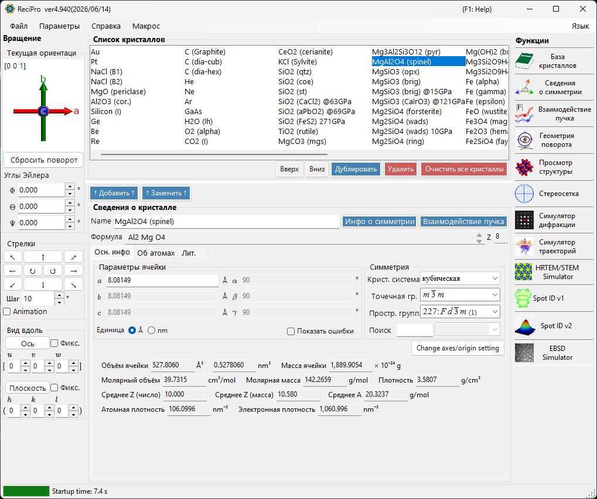

| Область | Расположение | Описание |
|------|----------|-------------|
| **Меню Файл** | Сверху | Операции с файлами, параметры, справка |
| **Управление вращением** | Слева | Просмотр/задание ориентации кристалла |
| **Список кристаллов** | Верхний центр | Выбор кристаллов и управление ими |
| **Сведения о кристалле** | Нижний центр | Редактирование параметров решётки, симметрии, атомов |
| **Функции** | Справа | Запуск окон моделирования/анализа |

---

## Сочетания клавиш и действия мышью {#keyboard-mouse-shortcuts}

Главное окно устанавливает несколько **общеприложенческих** сочетаний клавиш. Они продолжают работать, пока в фокусе находятся окна Просмотр структуры, Стереосеть, Симулятор дифракции и Spot ID v1.

| Сочетание | Действие |
|----------|--------|
| <kbd>F1</kbd> | Открыть эту страницу онлайн-руководства |
| <kbd>CTRL</kbd>+<kbd>SHIFT</kbd> + клавиши со стрелками | Повернуть кристалл на один шаг в этом направлении (удерживайте две стрелки для диагонали) |
| Удерживать <kbd>CTRL</kbd> при запуске ReciPro | Запуск с отключённым OpenGL (восстановление при проблемах с графикой; только для этого запуска, не сохраняется) |
| Перетаскивание виджета ориентации левой кнопкой (внизу слева, под *Ориентация*) | Повернуть кристалл |
| Двойной щелчок правой кнопкой по виджету ориентации | Скопировать изображение виджета в буфер обмена |
| Одиночный щелчок по кнопке функции | Открыть / закрыть это окно (свёрнутое окно вместо закрытия восстанавливается) |
| Двойной щелчок по кнопке функции | Принудительно сделать окно видимым и вывести его на передний план |
| Щелчок правой кнопкой по кристаллу в списке | Контекстное меню (Переименовать / Экспортировать как CIF / Дублировать / Удалить) |
| Двойной щелчок по подписи индекса оси зоны (`[u v w]`, под *Ориентация*) | Показать / скрыть поле max-UVW |
| Перетащить файл на окно | Загрузить список кристаллов (`.xml`, `.out`; запрашивается, заменить список или добавить к нему) или кристалл (`.cif`, `.amc`) <!-- 261105Cl 監査: .cdb2 はドロップで読めないので外した (FormMain.cs:FormMain_DragDrop) --> |
| <kbd>CTRL</kbd>+<kbd>SHIFT</kbd>+<kbd>ALT</kbd>+<kbd>C</kbd> | Открыть (экспериментальный) инструмент захвата GUI для активного окна |

→ См. **[21. Сочетания клавиш и действия мышью](21-shortcuts.md)** для обзора по каждому окну.

---

## Базовый рабочий процесс

Если вы впервые работаете с ReciPro, выполните следующие шаги:

1. Выберите нужный кристалл в **Списке кристаллов**. Чтобы использовать файл CIF/AMC, перетащите его в **Сведения о кристалле**.
2. Если вы редактируете параметры решётки или положения атомов, нажмите **Добавить** или **Заменить**, чтобы изменения были записаны обратно в список кристаллов.
3. Задайте ориентацию кристалла в **Управлении вращением**, используя ось зоны, кристаллическую плоскость, углы Эйлера или перетаскивание мышью.
4. Откройте нужный инструмент из **Функций**. Окна расчётов для дифракции, HRTEM/STEM, EBSD и других используют текущий выбранный кристалл и его ориентацию.

---

## Меню «Файл»

### Файл

| Пункт меню | Описание |
|-----------|-------------|
| Загрузить список кристаллов (заменить текущий список) | Загрузить файл списка кристаллов (`*.xml`, `*.out`), заменив текущий список; в диалоге можно выбрать, какие кристаллы загрузить |
| Загрузить список кристаллов (добавить к текущему списку) | Загрузить файл списка кристаллов и добавить его к текущему списку (с тем же диалогом выбора) |
| Сбросить к исходному списку кристаллов | Перезагрузить список кристаллов, поставляемый с ReciPro |
| Импортировать кристалл из файла CIF или AMC | Загрузить один кристалл из файла CIF / AMC |
| Сохранить список кристаллов | Сохранить текущий список кристаллов (в диалоге можно выбрать, какие кристаллы записать) |
| Экспортировать выбранный кристалл в файл CIF | Сохранить выбранный кристалл в формате CIF |
| Очистить все кристаллы | Удалить все кристаллы из списка |
| Выход | Закрыть приложение |

### Параметры

| Пункт меню | Описание |
|-----------|-------------|
| Показывать всплывающие подсказки | Показать или скрыть всплывающие подсказки во всех окнах — у элементов управления, кнопок панели инструментов и пунктов меню, ячеек таблиц и вкладок; настройка сохраняется до следующего запуска <!-- 261106Cl 作者の決定 C9 --> <!-- 261106Cl 作者の決定 A20 --> |
| Тёмная тема | Переключение между светлой и тёмной цветовыми темами |
| Использовать индексы Миллера–Браве (hkil) | Использовать 4-индексную нотацию для тригональных/гексагональных систем во всём приложении |
| Использовать ионные факторы рассеяния | Использовать ионные электронные факторы рассеяния (Peng) для назначенных атомам ионов в динамических (метод блоховских волн) электронных расчётах, включая профили Кикучи; монопольный член при $g \neq 0$ добавляется только к упругим коэффициентам $U_g$ (поглощение TDS и TDS-источник Кикучи используют конечную ионную часть). Если флажок снят, используются факторы нейтральных атомов. Если элементарная ячейка не электронейтральна ($\Sigma q \neq 0$), монопольный член отбрасывается и используется только конечная (экранированная ионная) часть; при включении параметра выводится уведомление |
| Скачать библиотеку MKL | Скачать нативную библиотеку Intel MKL (~55 МБ); после установки она автоматически используется для больших вычислений |
| Принимать внешние команды макросов (именованный канал) | Слушать именованный канал `ReciPro.Macro.v1` и выполнять макросы, присланные внешними программами — см. [Внешнее управление](20-macro/3-external-control.md) |
| Сбросить настройки реестра при выходе (вступает в силу после перезапуска) | Сбросить настройки при следующем перезапуске |
| Отключить библиотеку Crystallography.Native (требуется перезапуск) | Перейти на управляемый код, если нативная (C++) библиотека не загружается |
| Отключить весь рендеринг OpenGL (требуется перезапуск) | Для старых GPU / удалённого рабочего стола |
| Отключить рендеринг текста OpenGL (требуется перезапуск) | Обходное решение для проблем отрисовки текста на некоторых GPU |
| (экспериментально) Захватить компоненты GUI... | Инструмент разработчика для сохранения скриншотов GUI |
| Функция порошковой дифракции (в разработке) | Включить окно поликристаллической (порошковой) дифракции |

### Справка

| Пункт меню | Описание |
|-----------|-------------|
| Проверить обновления | Проверить, доступна ли новая версия ReciPro, и установить её |
| Подсказки | Показать подсказки по использованию (устарело) |
| История версий | Открыть диалог истории версий |
| Лицензия | Показать лицензию MIT |
| Репозиторий GitHub | Открыть репозиторий ReciPro в браузере |
| Сообщить об ошибках, пожеланиях или комментариях | Открыть страницу GitHub Issues |
| Справка (веб) | Открыть онлайн-руководство на GitHub Pages на странице, соответствующей языку интерфейса |

Язык интерфейса переключается через отдельное меню **Язык** (требуется перезапуск).

### Язык

Переключение языка интерфейса. Доступны одиннадцать языков — English, 日本語, Deutsch, Français, Español, Português, Italiano, Русский, 简体中文, 繁體中文 и 한국어 — и в меню каждый из них показан в собственной письменности. Изменение вступает в силу после перезапуска ReciPro. Онлайн-руководство следует той же настройке, поэтому <kbd>F1</kbd> и **Справка ▸ Справка (веб)** открывают страницу на выбранном языке.

### Макрос

**Editor** открывает окно [Макрос](20-macro/index.md) для автоматизации операций ReciPro с помощью скриптов в стиле Python. Макросы, зарегистрированные в этом окне, также перечислены под **Editor**; выбор макроса сразу запускает его. Для повторяющихся рабочих процессов см. [встроенные функции](20-macro/1-built-in-functions.md) и [примеры макросов](20-macro/2-examples.md).

---

## Управление ориентацией кристалла

Состояние вращения кристалла совместно используется симулятором дифракции, Просмотром структуры, Стереосетью, симулятором HRTEM/STEM, симулятором EBSD и другими окнами. Это не просто настройка отображения — оно определяет направление падающего пучка и связь координат кристалла, используемую в моделировании. Краткий видеоурок доступен на странице [Использование](appendix/a0-how-to-use.md).

### Текущая ориентация

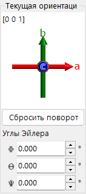

Показывает ориентацию кристалла. Перетаскивайте для вращения. Оси: красная = *a*, зелёная = *b*, синяя = *c*.

### Сбросить поворот
Сбрасывает к исходному состоянию: ось *c* перпендикулярна экрану, ось *b* направлена вверх.

### Ось зоны
Показывает ось зоны [*uvw*], ближайшую к нормали экрана. Кандидатами служат несократимые индексы (НОД = 1) с $|u|+|v|+|w| \le$ предела в поле max-UVW (1–100, по умолчанию 30); двойной щелчок по подписи индекса показывает или скрывает это поле.

### Углы Эйлера (Z-X-Z)
Задайте ориентацию кристалла с помощью углов Эйлера **Z–X–Z**:

- \(\Phi\): поворот вокруг оси Z
- \(\Theta\): поворот вокруг оси X
- \(\Psi\): поворот вокруг оси Z

Повороты применяются в порядке \(\Psi \to \Theta \to \Phi\). Подробнее см. [Геометрия вращения](4-rotation-geometry.md) и [Приложение A1. Система координат](appendix/a1-coordinate-system/1-orientation.md).

### Стрелки

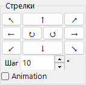

Поворачивает на угол **Шаг** (по умолчанию 10°). ↺ / ↻ поворачивают вокруг нормали экрана. Установите **Animation** для непрерывного вращения; тогда **Шаг** задаёт скорость в °/с.

### Вид вдоль

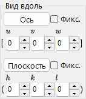

Выравнивает ось зоны [*uvw*] или кристаллическую плоскость (*hkl*) перпендикулярно экрану.

- **Фикс.**: если отмечено, все последующие повороты (стрелки, перетаскивание мышью) выполняются вокруг заданной оси зоны или нормали плоскости, так что это направление остаётся неподвижным. Включён может быть только один из двух флажков **Фикс.**, и его нельзя отметить, пока индекс равен 0 0 0.
- **Ось**: устанавливает введённую ось зоны \([uvw]\) перпендикулярно экрану. Если также задано **Плоскость** и ось лежит в этой плоскости ($uh+vk+wl=0$), нормаль плоскости направляется вверх на экране; в противном случае направление вверх выбирается автоматически.
- **Плоскость**: устанавливает нормаль введённой кристаллической плоскости \((hkl)\) перпендикулярно экрану. Если также задано **Ось** и она лежит в этой плоскости ($uh+vk+wl=0$), эта ось направляется вверх на экране; в противном случае направление вверх выбирается автоматически.

### Основные способы задания ориентации

| Метод | Использовать, когда | Где |
|--------|----------|-------|
| Перетаскивание мышью | Вы хотите свободно вращать, наблюдая за осями кристалла. | Панель **Текущая ориентация** |
| Кнопки со стрелками | Вам нужны небольшие повторяемые повороты. | Панель **Стрелки** |
| Ось зоны | Вы знаете направление обзора, например \([001]\) или \([110]\). | **Вид вдоль** / ввод оси зоны |
| Нормаль плоскости | Вам нужна кристаллическая плоскость \((hkl)\) перпендикулярно экрану. | **Вид вдоль** / ввод плоскости |
| Углы Эйлера | Вам нужна воспроизводимая числовая ориентация. | **Углы Эйлера (Z-X-Z)** |

См. [Геометрия вращения](4-rotation-geometry.md) и [Приложение A1. Системы координат](appendix/a1-coordinate-system/1-orientation.md) для матриц вращения и соглашений о координатах.

---

## Список кристаллов

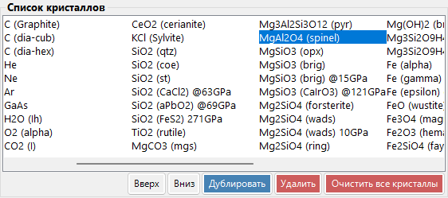

66 кристаллов в стандартной установке. Выберите, чтобы просмотреть сведения и задать для расчётов. **Щёлкните правой кнопкой по кристаллу** в Списке кристаллов для контекстного меню: *Переименовать*, *Экспортировать как CIF*, *Дублировать*, *Удалить*.

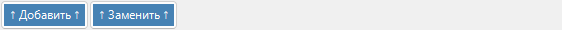

| Кнопка | Действие |
|--------|--------|
| Вверх / Вниз | Изменить порядок |
| Дублировать | Скопировать выбранный кристалл |
| Удалить / Очистить все кристаллы | Удалить выбранный кристалл / все кристаллы |
| Добавить / Заменить | Добавить в список или заменить выбранную запись |

---

## Сведения о кристалле

Редактируйте параметры решётки, симметрию и атомы; перетаскивайте файлы CIF/AMC, чтобы загрузить структуру. Этот элемент управления совместно используется ReciPro, PDIndexer и CSManager, но отображаемые вкладки и функции различаются в зависимости от приложения. ReciPro показывает вкладки **Осн. инфо**, **Об атомах** и **Лит.** (вкладки EOS, Elasticity и другие предназначены для других приложений и в ReciPro не отображаются).

> **Важно**: нажмите **Добавить** или **Заменить**, чтобы сохранить изменения.

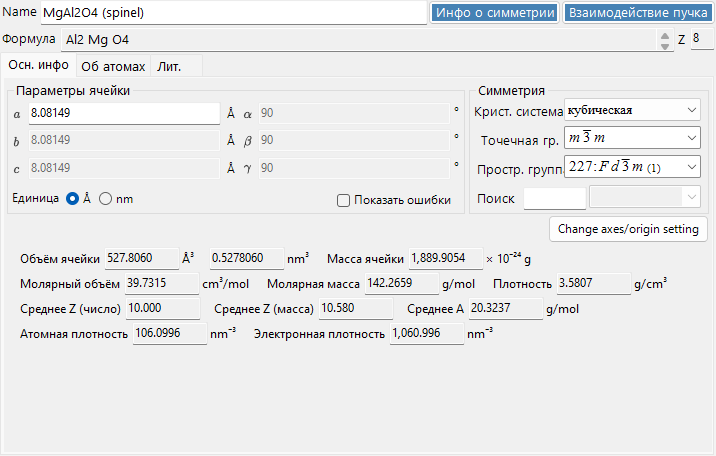

Верхняя часть панели всегда показывает **Name** (название кристалла), **Формула** (химическая формула, вычисленная из списка атомов), **Z** (число формульных единиц на элементарную ячейку) и **Цвет** (цвет отображения кристалла, используемый в трёхмерном виде структуры и на кривых дифракционных профилей). Кнопки **Инфо о симметрии** и **Взаимодействие пучка** открывают окна [Сведения о симметрии](2-symmetry-information.md) и [Взаимодействие пучка](3-beam-interaction.md). Массовые и атомные доли и пересчёт на оксиды показывает пункт контекстного меню [Подробный химический состав](#chemical-composition).

### Вкладка Осн. инфо {#basic-info-tab}

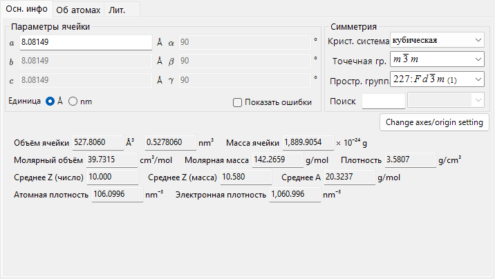

Параметры решётки, симметрия и выводимые из них величины.

| Элемент | Описание |
|------|------|
| Параметры ячейки | Параметры решётки a, b, c (**Ед.**: Å = 10⁻¹⁰ м или nm; единица сохраняется до следующего запуска) и α, β, γ. Выбор симметрии автоматически ограничивает их (например, a=b=c, α=β=γ=90° для кубической). |
| Симметрия | Выберите **Крист. система**, **Точечная гр.** и **Простр. группа**. Введите текст в поле **Поиск**, чтобы перечислить подходящие кандидаты (с учётом регистра). |
| Объём ячейки / Масса ячейки | Объём и масса элементарной ячейки. Объём отображается в ų / nm³ в соответствии с выбором **Ед.**; масса — в 10⁻²⁴ г. |
| Молярный объём / Молярная масса / Плотность | Молярный объём (см³/моль, на формульную единицу), молярная масса (г/моль) и плотность (г/см³). Показываются **только при введённых атомах**. |
| Среднее Z (число) / Среднее Z (масса) / Среднее A | Средний атомный номер, взвешенный по числу и по массе, и средний атомный вес на атом (г/моль). Заселённости учитываются. |
| Показать ошибки | Показать поля погрешностей (±) параметров ячейки. |
| Change axes/origin setting | То же, что пункт контекстного меню **Изменить установку осей/начала**: преобразование в другую установку осей/начала той же пространственной группы. |
| Атомная плотность / Электронная плотность | Число атомов и электронов на объём ячейки; отображается в Å⁻³ / nm⁻³ в соответствии с выбором **Ед.** |

### Вкладка Об атомах {#atom-tab}

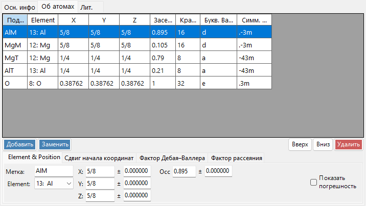

Задайте сорт, положение, температурный фактор и фактор рассеяния каждого атома. Редактируйте список атомов с помощью **Добавить**, **Заменить** (заменить выбранную строку), **Вверх/Вниз** (изменить порядок) и **Удалить**. Список атомов также показывает для каждой позиции её кратность (**Кратн.**), букву Уайкоффа (**Букв. Уайк.**) и симметрию позиции (**Симм. поз.**). Каждый атом имеет:

| Элемент | Описание |
|------|------|
| Метка | Метка атома (любой идентификатор). |
| Element | Элемент (включая ионную валентность). |
| X, Y, Z | Дробные координаты (0–1). Можно вводить дроби, такие как 1/2 или 2/3. |
| Occ | Заселённость (0–1). |

Щёлкните правой кнопкой мыши по строке атома и выберите **Показать эквивалентные позиции атома**, чтобы открыть небольшое окно со списком всех позиций, порождённых операциями симметрии пространственной группы; кнопка **Copy** копирует список как текст, разделённый табуляциями (например, для вставки в электронную таблицу).

**Сдвиг начала координат**: сдвигает начало отсчёта всех атомных координат. Выберите знак с помощью **+** / **−**, затем нажмите один из предустановленных векторов — (⅛ ⅛ ⅛), (¼ ¼ ¼), (0 ¼ ⅛), (¼ 0 ¼), (0 ¼ ¼), (¼ ¼ 0), (¼ −¼ 0), (¼ −¼ ¼), (0 ¼ −⅛) — или используйте **Apply custom shift** для произвольной величины.

**Смещение (B)** (фактор Дебая–Валлера / температурный фактор):

| Элемент | Описание |
|------|------|
| Notation | Использовать нотацию U или B. При переключении отображаемые значения пересчитываются ($B = 8\pi^2 U$). |
| Модель | Изотропный или анизотропный. |
| U##, β## | Для анизотропного случая введите каждую компоненту: $U_{ij}$ в Ų или в нотации B безразмерные $\beta_{ij} = 2\pi^2 a^*_i a^*_j U_{ij}$ (как B(i,j) в файлах AMCSD). |

**Фактор рассеяния**: выберите фактор рассеяния, используемый для каждого атома.

| Излучение | Источник / настройка |
|-----------|------|
| X-ray | Факторы рассеяния, включая ионную валентность (International Tables for Crystallography, Vol. C). |
| Electron | Факторы рассеяния электронов — для нейтральных атомов из Peng, Ren, Dudarev & Whelan (1996), *Acta Cryst.* **A52**, 257–276; для ионов из Peng (1998), *Acta Cryst.* **A54**, 481–485. |
| Neutron | Длины рассеяния нейтронов. Выберите **Natural isotope abundance** или **Custom isotope abundance** (произвольный изотопный состав). |

### Вкладка Лит. {#reference-tab}

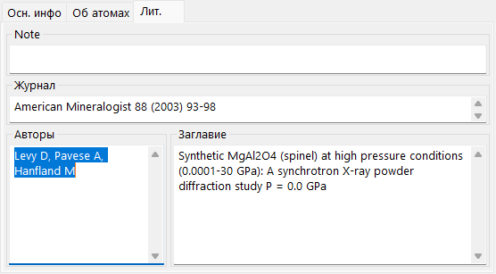

Запишите источник структуры: **Note**, **Авторы**, **Журнал** и **Заглавие**.

### Контекстное меню (щелчок правой кнопкой)

Щёлкните правой кнопкой по пустой области элемента управления для этих основных действий:

| Пункт меню | Действие |
|-----------|------|
| Подробный химический состав | Открывает окно [Подробный химический состав](#chemical-composition) (мас. %, ат. %, нормированное число атомов, пересчёт на оксиды). |
| Взаимодействие пучка | Открывает окно [Взаимодействие пучка](3-beam-interaction.md). |
| Сведения о симметрии | Открывает окно [Сведения о симметрии](2-symmetry-information.md). |
| Импорт из CIF или AMC... | Загружает кристалл из файла CIF / AMC. |
| Экспорт в CIF | Экспортирует текущий кристалл как CIF. |
| Вернуть параметры ячейки | Восстанавливает константы ячейки до значений, загруженных первоначально. |
| Преобразовать в пр. группу P1 | Разворачивает структуру до пространственной группы P1. |
| Преобразовать в сверхструктуру | Преобразует в сверхструктуру с целочисленными кратными a, b, c (диалог размера). |
| Изменить установку осей/начала | Преобразует в эквивалентную пространственную группу (другая установка осей). |

#### Подробный химический состав {#chemical-composition}

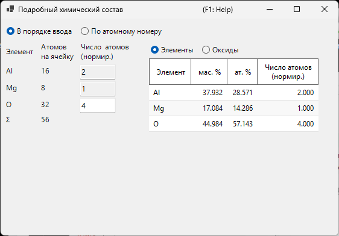

Показывает состав текущего кристалла, рассчитанный по списку атомов (число атомов каждого элемента — сумма кратность × заселённость по его позициям). Окно следует за кристаллом, выбранным в главном окне.

- Правая таблица показывает для каждого элемента **мас. %**, **ат. %** и **Число атомов (нормир.)**; левая таблица — число атомов на ячейку. Щёлкните поле нормированного столбца в левой таблице, чтобы сделать этот элемент опорным, и введите его число атомов (например, O = 24). По умолчанию опорный элемент — O (иначе первый элемент), и нормированный столбец показывает химическую формулу.
- **Оксиды**, **Галогениды** и **Сульфиды** (показываются только применимые к кристаллу) формально пересчитывают состав в компоненты, используя валентность каждого элемента (столбец **Валентность**). Валентности можно редактировать (допускаются дроби вроде 8/3). Если значение не введено, для Fe берётся 2, для остальных элементов — валентность иона, выбранного для фактора рентгеновского рассеяния, иначе — обычная степень окисления. **Σ=0** задаёт валентность, при которой суммарный заряд равен нулю, а **По умолчанию** удаляет введённые валентности. Введённые валентности хранятся в кристалле и сохраняются в XML-списках кристаллов.
- **В порядке ввода** / **По атомному номеру** переключают порядок элементов.

---

## Панель функций {#functions}

Вертикальная полоса кнопок справа запускает перечисленные ниже окна анализа и моделирования.

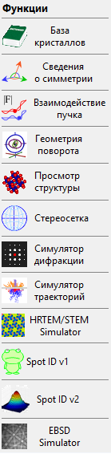

| Кнопка | Описание | Подробнее |
|--------|-------------|---------|
| База кристаллов | Поиск и импорт кристаллов из встроенных / онлайн-баз данных | [1. База данных кристаллов](1-crystal-database.md) |
| Сведения о симметрии | Сведения о пространственной группе и диаграммы симметрии *International Tables* Vol. A | [2. Сведения о симметрии](2-symmetry-information.md) |
| Взаимодействие пучка | Взаимодействие пучка с кристаллом: рефлексы, ослабление, факторы рассеяния, флуоресценция | [3. Взаимодействие пучка](3-beam-interaction.md) |
| Геометрия вращения | 3D-матрица вращения / углы гониометра | [4. Геометрия вращения](4-rotation-geometry.md) |
| Просмотр структуры | 3D-структура кристалла | [5. Просмотр структуры](5-structure-viewer.md) |
| Стереосеть | Стереографическая проекция | [6. Стереосеть](6-stereonet.md) |
| Симулятор дифракции | Монокристаллическая рентгеновская / электронная дифракция | [7. Симулятор дифракции](7-diffraction-simulator/index.md) |
| Симулятор траекторий | Монте-Карло-моделирование траекторий электронов | [8. Траектории электронов](8-electron-trajectory.md) |
| Симулятор HRTEM/STEM | Моделирование изображений HRTEM / STEM | [9. Симулятор HRTEM/STEM](9-hrtem-stem-simulator/index.md) |
| Spot ID v1 | Индицирование картин SAED (ранее «TEM ID») | [10. Spot ID v1](10-spot-id.md) |
| Spot ID v2 | Обнаружение и индицирование рефлексов | [11. Spot ID v2](11-spot-id-v2.md) |
| Симулятор EBSD | Моделирование картин EBSD | [12. Моделирование EBSD](12-ebsd-simulation.md) |
| Порошковая дифракция | Поликристаллическая (порошковая) дифракция — включить через **Параметры ▸ Функция порошковой дифракции (в разработке)** | - |

---

## См. также

- [База данных кристаллов](1-crystal-database.md)
- [Геометрия вращения](4-rotation-geometry.md)
- [Просмотр структуры](5-structure-viewer.md)
- [Симулятор дифракции](7-diffraction-simulator/index.md)
- [Сочетания клавиш и действия мышью](21-shortcuts.md)
- [Базовая система координат и ориентация кристалла](appendix/a1-coordinate-system/1-orientation.md)
