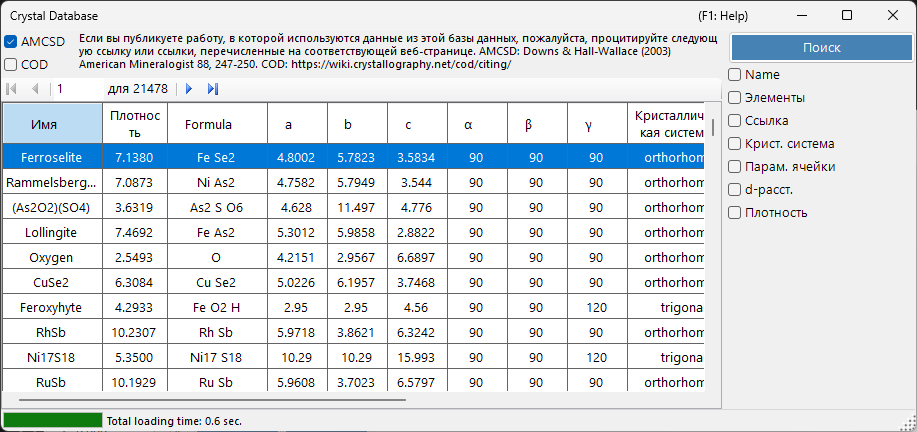
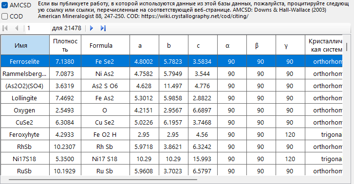
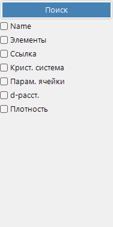
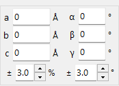

# База данных кристаллов

**База данных кристаллов** предоставляет функции для поиска и импорта кристаллических структур из двух источников, выбираемых с помощью флажков **AMCSD** и **COD**:

- **AMCSD** : встроенная [American Mineralogist Crystal Structure Database](https://www.rruff.net/) (более 20 000 структур).
- **COD** : [Crystallography Open Database](https://www.crystallography.net/cod/). Поскольку файл большой, он не входит в комплект установщика; файл базы данных автоматически загружается при первом использовании. Когда файл обновляется на сервере, вам предлагается загрузить его снова.

При использовании этих баз данных, пожалуйста, цитируйте следующие источники.

При использовании **AMCSD**:

> Downs, R.T. and Hall-Wallace, M. (2003) The American Mineralogist Crystal Structure Database. *American Mineralogist* **88**, 247-250.

При использовании **COD**:

> Gražulis, S. et al. (2009) Crystallography Open Database – an open-access collection of crystal structures. *Journal of Applied Crystallography* **42**, 726-729.
>
> Gražulis, S. et al. (2012) Crystallography Open Database (COD): an open-access collection of crystal structures and platform for world-wide collaboration. *Nucleic Acids Research* **40**, D420-D427.

---

## Сочетания клавиш и мыши

В этом окне нет комбинаций с клавишами-модификаторами; оно управляется обычными щелчками. Единственные неочевидные действия:

| Сочетание | Действие |
|----------|--------|
| <kbd>F1</kbd> | Открыть эту страницу онлайн-руководства |
| <kbd>ENTER</kbd> в любом поле поиска | Выполнить поиск по базе данных (то же, что кнопка **Поиск**) |
| Щелчок по строке в таблице результатов | Загрузить этот кристалл в главное окно |
| Щелчок по элементу во всплывающем окне **Таблица Менделеева** | Переключить его фильтр: *может включать или нет* → *должно включать* → *должно исключать* |

→ См. **[21. Сочетания клавиш и мыши](21-shortcuts.md)** для обзора каждого окна.

---

## Таблица

Отображает кристаллы, соответствующие критериям поиска. Выберите кристалл, чтобы передать его в Сведения о кристалле главного окна. Нажмите **Добавить** или **Заменить**, чтобы добавить его в Список кристаллов.

---

## Параметры поиска

Введите критерии поиска ниже и нажмите кнопку **Поиск** или клавишу **Enter**.

| Критерий | Описание |
|-----------|-------------|
| **Name** | Название кристалла |
| **Элементы** | Выбор по периодической таблице (может/должен/не должен содержать) |
| **Ссылка** | Заголовок, журнал, автор |
| **Крист. система** | Выбор кристаллической системы |
| **Парам. ячейки** | Постоянные решётки и погрешность |
| **d-расст.** | Значения d сильных рефлексов и погрешность |
| **Плотность** | Плотность и погрешность |

### Name

Поиск свободного текста по названию кристалла. Допускаются частичные совпадения; регистр не учитывается. Применяются только критерии, флажки которых отмечены, и они объединяются по И (AND).

### Элементы {#element}

Нажмите кнопку **Таблица Менделеева**, чтобы открыть выбор элементов. Каждая кнопка элемента переключается между тремя состояниями:

- **может включать или нет** (по умолчанию — жёлтый)
- **должно включать** (синий)
- **должно исключать** (красный)

Кристалл должен содержать каждый элемент из *должно включать* и не содержать ни одного из *должно исключать*; записи без данных об атомах исключаются, пока включён критерий **Элементы**.

Три кнопки вверху окна сбрасывают каждый элемент в одно из трёх состояний одним щелчком.

### Ссылка

Поиск свободного текста (частичное совпадение без учёта регистра) по метаданным публикации: заголовок статьи, название журнала и список авторов.

### Крист. система

Ограничивает поиск конкретной кристаллической системой (cubic, tetragonal, orthorhombic, hexagonal, trigonal, monoclinic, triclinic). Первый пункт, *Unknown*, не накладывает ограничений.

### Поиск по параметрам ячейки

Введите целевые постоянные решётки *a*, *b*, *c* (Å) и *α*, *β*, *γ* (°) и допустимые погрешности: одну относительную погрешность (±%), общую для *a*, *b*, *c*, и одну абсолютную погрешность (±°), общую для углов. Значение 0 означает, что параметр не учитывается.

### d-расст.

Введите до трёх *d*-расстояний (Å; отметьте каждое, которое нужно использовать), каждое с относительной погрешностью (±%). Кристалл подходит, если каждое введённое значение совпадает с одним из его сильнейших рефлексов, хранящихся в базе данных (до 16, упорядоченных по интенсивности порошковой рентгеновской дифракции при λ = 1,54 Å). Если отмечено **Игнорировать фактор рассеяния**, значения вместо этого сравниваются со всеми геометрически возможными *d*-расстояниями, вычисленными по элементарной ячейке (включая систематически погашенные рефлексы). Полезно, когда из эксперимента известны только положения дифракционных пиков.

### Плотность

Фильтрация по массовой плотности (g/cm³) в пределах относительной погрешности (±%).

---

## См. также

- [Главное окно](0-main-window.md)
- [Сведения о симметрии](2-symmetry-information.md)
- [Взаимодействие пучка](3-beam-interaction.md)
- [Просмотр структуры](5-structure-viewer.md)
