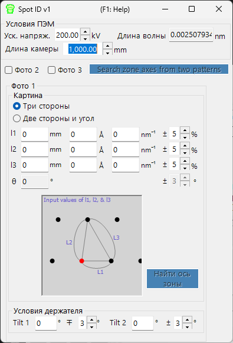

# Spot ID v1

**Spot ID v1** (прежний **TEM ID**) ищет кандидатные оси зоны по численно введённой геометрии рефлексов одной–трёх дифракционных картин. Обнаружение, аппроксимация и индицирование рефлексов на изображении выполняются в [Spot ID v2](11-spot-id-v2.md).

---

## Сочетания клавиш и мыши

Spot ID v1 принимает геометрию рефлексов как **числовой ввод** (прежний рабочий процесс *TEM ID*); области просмотра изображения в нём нет (загрузка изображений, масштабирование мышью, обнаружение рефлексов и их ручной выбор относятся к [Spot ID v2](11-spot-id-v2.md)). Единственное сочетание находится в окне результатов:

| Сочетание | Действие |
|----------|--------|
| <kbd>F1</kbd> | Открыть эту страницу онлайн-руководства |
| Двойной щелчок по строке в списке результатов | Выбрать этот кристалл и повернуть его к соответствующей оси зоны |

→ См. **[21. Сочетания клавиш и мыши](21-shortcuts.md)** для обзора всех окон.

---

## Поиск оси зоны по геометрии рефлексов (прежний TEM ID)

Если у вас нет изображения для загрузки, вы всё равно можете искать кандидатные оси зоны, вручную вводя геометрию картины электронной дифракции с выделенной области (SAED). Введите условия наблюдения ПЭМ и геометрию рефлексов, затем нажмите **Найти ось зоны** для одного фото (или **Найти оси зон по двум картинам** / **по трём картинам**, чтобы использовать несколько фото вместе), чтобы найти кандидатные ориентации кристалла.

### Условия ПЭМ

Введите **Уск. напряж.** (kV, по умолчанию 200) и **Длина камеры** (mm, по умолчанию 1000). **Длина волны** (nm) вычисляется по напряжению и показывается только для чтения.

### Фото 1, 2, 3

Введите геометрию дифракционных рефлексов.

- Чтобы ввести расстояние между двумя рефлексами на детекторе, используйте поле **mm**.
- Если вам известно значение *d*, введите его в единицах **Å** или **nm⁻¹**.

**Три стороны** : Введите длины трёх сторон треугольника, одной из вершин которого является direct spot.

**Две стороны и угол** : Введите длины двух сторон (включая direct spot) и угол между ними.

- Допуски (поля **±**) : у каждой длины есть допуск в % (0–50, по умолчанию 5), у θ — в градусах (0–30, по умолчанию 3). Не введённое значение (θ в режиме трёх сторон, l3 в режиме двух сторон) вычисляется и показывается, а рядом с полями ввода рисуется эскиз получающейся картины.
- **Условия держателя** : **Tilt 1** / **Tilt 2** (°) гониометрического держателя, при которых было снято фото, каждый с допуском (0–10°, по умолчанию 3°). Углы между настройками держателя для разных фото вычисляются и показываются.
- **Фото 2** / **Фото 3** : включают второе и третье фото. Флажки между фото считают l1 (или l2) двух фото одним и тем же рефлексом и копируют его длину.
- **Найти ось зоны** выполняет поиск по одному фото; **Найти оси зон по двум картинам** / **по трём картинам** ищет сочетания, согласованные с фото и углами наклона держателя между ними; фото 3 используется, только если отмечен флажок **Фото 3** и введены все его значения, иначе используются два фото. В таблице результатов для одного фото (**Найти ось зоны**) всегда показываются g1, d1, g2 и d2, а также g3 и d3 в режиме трёх сторон или θ в режиме двух сторон и угла. <!-- 261105Cl 監査: buttonSearchAll_Click (afd65e0)、FormSpotIDv1Results.SetDataSet (46d91db) --> Поиск выполняется по всем кристаллам, выбранным в списке главного окна (пока открыт Spot ID v1, разрешён множественный выбор). Если найдено более 1000 кандидатов, ничего не выводится и предлагается сузить условия; иначе открывается окно результатов. Двойной щелчок по строке выбирает кристалл и поворачивает его в эту ориентацию. Знак каждой кандидатной оси зоны следует учебному соглашению **g**₁ × **g**₂, поэтому он противоположен по сравнению с версиями до 2026-11 (ориентация при этом та же). <!-- 261106Cl 作者の決定 B16 -->

---

## См. также

- [Spot ID v2](11-spot-id-v2.md)
- [Симулятор дифракции](7-diffraction-simulator/index.md)
- [Главное окно](0-main-window.md)
- [База данных кристаллов](1-crystal-database.md)
- [Моделирование EBSD](12-ebsd-simulation.md)
