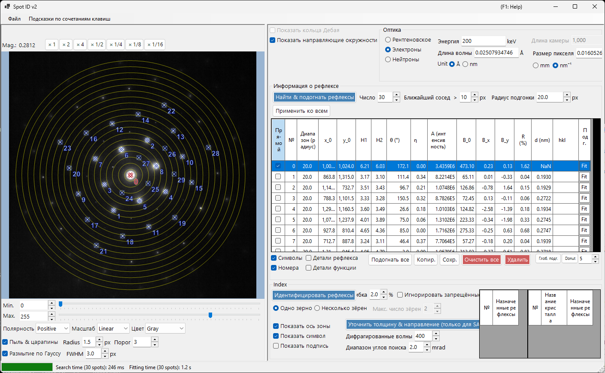
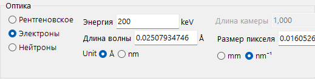
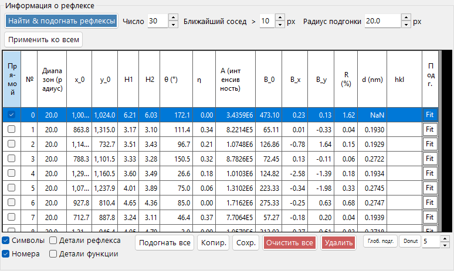
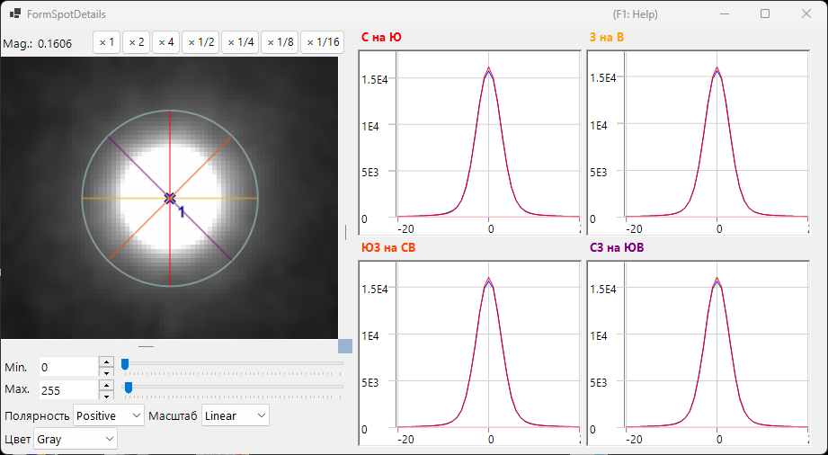
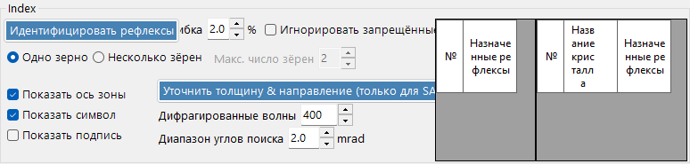

# Spot ID v2

**Spot ID v2** обнаруживает, аппроксимирует и индицирует дифракционные рефлексы на экспериментальном дифракционном изображении. [Spot ID v1](10-spot-id.md) (прежний TEM ID), напротив, принимает геометрию рефлексов как числовой ввод.

---

## Сочетания клавиш и мыши

Список рефлексов вы создаёте непосредственно на загруженном изображении. Область изображения использует стандартную [навигацию по изображению](21-shortcuts.md) ReciPro для панорамирования/масштабирования; для редактирования рефлексов добавляются приведённые ниже комбинации.

| Сочетание | Действие |
|----------|--------|
| <kbd>F1</kbd> | Открыть эту страницу онлайн-руководства |
| Двойной щелчок левой кнопкой по изображению | Добавить рефлекс в этой точке (с подгонкой пика) |
| <kbd>CTRL</kbd> + двойной щелчок левой кнопкой | Добавить рефлекс и отметить его как прямой (000) пучок |
| Щелчок левой кнопкой по рефлексу | Выбрать ближайший рефлекс |
| <kbd>CTRL</kbd> + щелчок правой кнопкой по рефлексу | Удалить ближайший рефлекс |
| <kbd>CTRL</kbd> + клавиши со стрелками | Сместить выбранный рефлекс на один пиксель |
| Перетаскивание левой / средней кнопкой (пустая область) | Панорамировать изображение |
| Колесо мыши | Приблизить / отдалить у курсора |
| Перетаскивание правой кнопкой рамки | Приблизить выбранную область |
| Двойной щелчок правой кнопкой | Отдалить |
| Двойной щелчок по заголовку строки рефлекса (таблица) | Приблизить к этому рефлексу (×2) |

→ См. **[21. Сочетания клавиш и мыши](21-shortcuts.md)** для обзора всех окон.

---

## Меню «Файл»

Открытие дифракционного изображения; **Сохранить** / **Копировать** записывают отображаемое изображение как метафайл (EMF) или изображение (PNG). Изображения можно также загружать перетаскиванием. Для файла Gatan DM3/DM4, откалиброванного в нм⁻¹, излучение устанавливается на электроны, а ускоряющее напряжение и размер пикселя (нм⁻¹) считываются из файла (длина камеры в этом случае не нужна).

**Сохранить ▸ Candidate list (CSV)...** экспортирует найденные при индицировании кандидаты ориентации, а **Копировать ▸ Candidate list (TSV)** помещает ту же таблицу в буфер обмена: по одной строке на кандидат × зерно, с рангом, номером зерна, названием кристалла, углами Эйлера ZXZ (°), девятью элементами матрицы поворота, среднеквадратичной невязкой (nm⁻²), числом сопоставленных рефлексов и сопоставлениями рефлекс → (hkl). В CSV десятичный разделитель всегда точка; TSV можно сразу вставить в электронную таблицу.

---

## Оптика

### Источник излучения

Выберите тип излучения (рентгеновское / электронное / нейтронное) и задайте энергию или длину волны.

### Длина камеры / Размер пикселя

Длина камеры (мм) и размер пикселя детектора (мм или нм⁻¹). При загрузке файла Gatan DM, откалиброванного в нм⁻¹, размер пикселя (нм⁻¹) берётся из заголовка файла, а длина камеры не используется.

**Показать кольца Дебая** (по умолчанию выкл.) и **Показать направляющие окружности** (по умолчанию вкл.) рисуют на картине кольца Дебая кристалла и направляющие окружности.

---

## Информация о рефлексе

- **Detect & Fit Spots**: Автоматическое обнаружение рефлексов с использованием локальных максимумов и вычитания фона.
- **Number**: Максимальное число обнаруживаемых рефлексов.
- **Nearest neighbour**: Минимальное расстояние (px), допустимое между обнаруженными рефлексами. Пики, расположенные ближе этого расстояния, объединяются, что предотвращает двойное обнаружение одного и того же рефлекса.
- **Fitting range (radius)**: Радиус (px) круговой области, используемой для подгонки пика каждого рефлекса. Пиксели внутри этого круга подгоняются псевдо-фойгтовской функцией.
- **Apply to All**: Устанавливает радиус подгонки каждого рефлекса равным текущему значению **Fitting range (radius)**.
- **Удалить / Очистить все**: Удалить выбранный рефлекс или все обнаруженные рефлексы.
- **Сохр.** / **Копир.**: Сохранить таблицу рефлексов в файл или скопировать её в буфер обмена.
- **Подогнать все**: Заново подогнать положения и интенсивности всех обнаруженных рефлексов.
- **Символы** / **Номера**: Показывать на наблюдаемых рефлексах символы-маркеры / номера (по умолчанию оба включены).
- **Глоб. подг.**: Выполнить глобальную подгонку положений всех рефлексов одновременно (экспериментальная функция).
- **Donut**: Применить вычитание фона в форме кольца (экспериментальная функция); соседнее поле задаёт ширину (px) кольца вокруг каждого рефлекса, среднее значение в котором вычитается как локальный фон.
- **Details of the spot**: Если флажок установлен, открывается окно с подробными сведениями о текущем выбранном рефлексе.
- **Детали функции** (при открытии окна выключено): Показать рисунок двумерной псевдо-фойгтовской функции и её параметров (x_0, y_0, H1, H2, θ, η, A, B_0, B_x, B_y), используемых в таблице рефлексов.

---

## Index

- **Identify Spots**: Запускает алгоритм индицирования для поиска наиболее подходящего кристалла и оси зоны.
- **Допустимая ошибка**: Относительный допуск по межплоскостному расстоянию в % (0,1–10, по умолчанию 2). Допуск по углу между рефлексами выводится из него как asin(допуск)/2.
- **Игнорировать запрещённые рефлексы** (по умолчанию выкл.; только для электронной дифракции): Если флажок установлен, все систематически погашенные рефлексы, включая запрещённые винтовыми осями и плоскостями скользящего отражения, исключаются из кандидатных рефлексов. Если флажок снят, исключаются только погасания, обусловленные центрировкой решётки (I, F, A, B, C, R), поэтому запрещённые винтовыми осями / плоскостями скольжения рефлексы, которые могут появиться из-за многократной дифракции, остаются кандидатами. Для рентгеновских лучей все погашенные рефлексы исключаются всегда.
- **Single Grain / Multiple Grains**: Поиск одной ориентации (монокристалл) или нескольких ориентаций (поликристаллическая / многозёренная область). Для нескольких зёрен параметр **Max. num. of grains** задаёт верхний предел числа искомых зёрен.
- **Показать ось зоны** / **Показать символ** / **Показать подпись**: Наложить ось зоны и символы / подписи индексов рассчитанных рефлексов.
- **Уточнить толщину & направление (только для SAED)**: Уточнить толщину образца (nm) и направление пучка для выбранного зерна, сопоставляя наблюдаемые интенсивности рефлексов с динамическими расчётами (метод блоховских волн). **Дифрагированные волны** (1–2048, по умолчанию 400) — число пучков, а **Диапазон углов поиска** (mrad, 1–10, по умолчанию 2) — угловой полудиапазон перебираемых направлений падения. **Стоп** прерывает вычисление.
- **Results**: Наилучшие совпадения отображаются с именем кристалла, осью зоны [uvw] и индексами отдельных рефлексов (hkl).

---

## См. также

- [Spot ID v1](10-spot-id.md)
- [Симулятор дифракции](7-diffraction-simulator/index.md)
- [Главное окно](0-main-window.md)
- [Сочетания клавиш и мыши](21-shortcuts.md)
